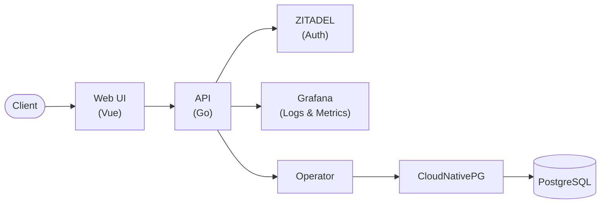

# DBaaS Platform

A self-service **Database-as-a-Service** platform for provisioning and managing PostgreSQL instances on Kubernetes — built end-to-end, from raw IaaS on OpenStack up to a production-style PaaS product with an API, a web UI, GitOps delivery, and full observability.

Built as part of a cloud-native platform engineering track (Infrastructure → Platform → Product), where the goal was to own the whole stack rather than a single layer of it.

## Architecture



## Features

- **Custom Kubernetes Operator**: A `PostgreSQL` CRD (built with Kubebuilder) that reconciles into a [CloudNativePG](https://cloudnative-pg.io/) `Cluster`, exposing a simplified spec (`version`, `instances`, `storage`, `database`, `username`) and a status (`phase`, `readyInstances`, conditions) so the API never has to speak CNPG directly.
- **REST API**: Go/Gin service for create / list / get / update / delete of instances, plus credentials and log retrieval, fully documented with OpenAPI. Idempotent creation via `Idempotency-Key`, per-user isolation via Kubernetes labels.
- **AuthN/AuthZ**: OIDC via [ZITADEL](https://zitadel.com/), role-based access control (`dbaas.user`, `dbaas.admin`), admin-only audit log endpoint.
- **Web UI**: Vue 3 + TypeScript SPA for the full instance lifecycle — create, monitor status, view logs/credentials, update, delete.
- **GitOps delivery**: ArgoCD-driven deployment of the operator, API, UI, CNPG, and the observability stack via Kustomize overlays.
- **Observability**: Prometheus + Grafana for metrics, Loki + Grafana Alloy for logs, structured JSON application logs, and a per-instance/per-user audit trail queryable through the API.
- **Go SDK**: A typed client library (`sdk/`) with OAuth2 client-credentials auth, wrapping the full instance API for programmatic use.
- **Infrastructure as Code**: Terraform + Ansible provisioning of the underlying Kubernetes cluster — from a single/multi-node cluster on self-hosted OpenStack (DevStack) up to a managed [STACKIT SKE](https://www.stackit.de/en/product/stackit-kubernetes-engine/) cluster.

## Repository layout

| Path | What lives there |
|---|---|
| [`operator/`](operator) | Kubebuilder-generated `PostgreSQL` operator that wraps CloudNativePG |
| [`platform/`](platform) | The REST API (Go/Gin), auth, observability, OpenAPI spec |
| [`client/`](client) | Vue 3 + TypeScript web UI, unit tests (Vitest) and e2e tests (Playwright) |
| [`sdk/`](sdk) | Go client SDK for the REST API |
| [`infra/`](infra) | Terraform + Ansible for OpenStack (DevStack) and STACKIT SKE clusters |
| [`gitops/`](gitops) | Kustomize manifests + ArgoCD Application definitions for every component |

Each folder has (or will have) its own README with implementation details.

## Quick look: Go SDK

```go
import "github.com/foyez/dbaas-platform/sdk"

c := dbaas.New("https://api.example.com",
    dbaas.WithClientCredentials(tokenURL, clientID, clientSecret, []string{"dbaas"}),
)

inst, _ := c.Instances.Create(ctx, dbaas.CreateInstanceInput{
    Name:           "orders-db",
    Version:        16,
    Storage:        "10Gi",
    IdempotencyKey: "orders-db-create-1",
})

creds, _ := c.Instances.Credentials(ctx, inst.ID)
```

## Documentation

| Doc | Covers |
|---|---|
| [`operator/README.md`](operator/README.md) | CRD design, reconciliation logic, running/testing the operator locally |
| [`platform/docs/openapi.yaml`](platform/docs/openapi.yaml) | Full REST API contract |
| [`client/README.md`](client/README.md) | UI structure, running dev server, unit/e2e tests |
| [`sdk/README.md`](sdk/README.md) | SDK usage and examples |
| [`infra/README.md`](infra/README.md) | OpenStack + SKE provisioning steps |

## Tech stack

- **Operator**: Go, Kubebuilder, controller-runtime, CloudNativePG APIs
- **API**: Go, Gin, ZITADEL (OIDC/RBAC), Prometheus client, OpenAPI
- **Frontend**: Vue 3, TypeScript, Vite, Pinia, Tailwind CSS, shadcn/ui
- **Testing**: Go testing + testify, Vitest, Playwright
- **Infra**: Terraform, Ansible, OpenStack (DevStack), STACKIT SKE, Kustomize, ArgoCD
- **Observability**: Prometheus, Grafana, Loki, Grafana Alloy