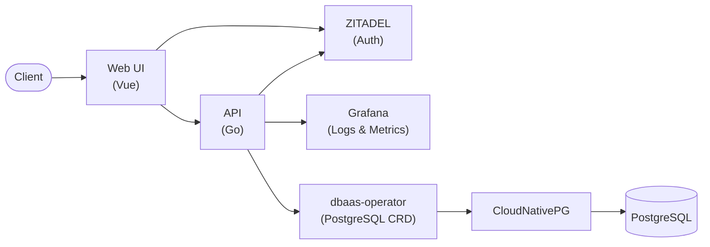

# DBaaS Platform

A self-service **Database-as-a-Service** platform: developers create, scale and query their own PostgreSQL databases through a web UI, REST API or Go SDK. Built end to end, from raw IaaS on OpenStack (Terraform + Ansible) to a product deployed on STACKIT Kubernetes Engine (SKE).

📖 **Documentation: [foyez.github.io/dbaas-platform](https://foyez.github.io/dbaas-platform/)**

> **Status:** the production cluster has been shut down to save costs. The whole platform runs locally with one command (see [Quick start](#quick-start)), and production can be recreated from this repo with Terraform and the bootstrap pipeline.



## Highlights

- **Custom Kubernetes operator.** A five-field `PostgreSQL` CRD, built with Kubebuilder, that reconciles into a [CloudNativePG](https://cloudnative-pg.io/) cluster, so the API never deals with CNPG directly.
- **REST API in Go.** Create, list, update and delete instances, plus credentials, logs and an in-browser SQL console. Creation is idempotent and every user only sees their own instances. Documented with OpenAPI.
- **Real database endpoints.** Every instance gets its own port on one shared load balancer through ingress-nginx's TCP passthrough, instead of a load balancer per tenant.
- **Auth with ZITADEL.** OIDC login with PKCE, `dbaas.user` and `dbaas.admin` roles, token introspection in the API.
- **Web UI and Go SDK.** A Vue 3 app for the full instance lifecycle, and a typed Go client using OAuth2 client credentials.
- **GitOps delivery.** Forgejo CI builds images and commits their tags to Git; Argo CD deploys them.
- **Observability.** Prometheus and Grafana for metrics, Loki and Alloy for logs, and an audit trail queryable through the API.
- **Infrastructure as code.** OpenStack VMs and Kubernetes clusters (Terraform + Ansible), the SKE cluster and ZITADEL, all in Terraform.

## Quick start

Requires only Docker (with about 6 GB of memory), `make`, `curl`, `unzip` and `openssl`. kind, kubectl, Helm and Terraform are downloaded at pinned versions into `./bin`.

```sh
make dev
```

About 10 minutes later the whole platform is running on a local [kind](https://kind.sigs.k8s.io/) cluster, including its own ZITADEL:

| What | URL |
|---|---|
| App | http://app.dbaas.localhost |
| API | http://api.dbaas.localhost/api/v1 |
| ZITADEL console | http://auth.dbaas.localhost/ui/console |

Log in with `admin@dbaas.auth.dbaas.localhost` / `Password1!`. `make dev-down` deletes everything and `make help` lists all targets. See [Getting started](https://foyez.github.io/dbaas-platform/getting-started/) for details.

## Design decisions

Each one is written up with its trade-offs in the [docs](https://foyez.github.io/dbaas-platform/design-decisions/).

| # | Decision |
|---|---|
| 1 | [The Kubernetes API is the only state store](https://foyez.github.io/dbaas-platform/design-decisions/kubernetes-as-state-store/), no separate platform database |
| 2 | [A narrow CRD of my own wraps CloudNativePG](https://foyez.github.io/dbaas-platform/design-decisions/own-crd-over-cnpg/) |
| 3 | [One shared load balancer exposes databases through allocated TCP ports](https://foyez.github.io/dbaas-platform/design-decisions/shared-loadbalancer/) |
| 4 | [Creation is idempotent through a deterministic resource name](https://foyez.github.io/dbaas-platform/design-decisions/idempotent-creation/) |
| 5 | [The SQL console goes through the API](https://foyez.github.io/dbaas-platform/design-decisions/sql-console-through-api/) |
| 6 | [Authentication is delegated to ZITADEL](https://foyez.github.io/dbaas-platform/design-decisions/auth-with-zitadel/) |
| 7 | [Audit events are structured logs in Loki](https://foyez.github.io/dbaas-platform/design-decisions/audit-in-loki/) |
| 8 | [Delivery is GitOps, and CI writes image tags back to Git](https://foyez.github.io/dbaas-platform/design-decisions/gitops-delivery/) |

## Documentation

| Section | Covers |
|---|---|
| [Architecture](https://foyez.github.io/dbaas-platform/architecture/) | C4 diagrams and request flow |
| [Components](https://foyez.github.io/dbaas-platform/components/) | Operator, API, UI, auth, SDK, delivery, observability, infrastructure |
| [Learning notes](https://foyez.github.io/dbaas-platform/notes/) | What I learned building it, by topic, with review questions |
| [`platform/docs/openapi.yaml`](platform/docs/openapi.yaml) | Full REST API contract |

The site is built from [`docs/`](docs). Preview it with `make docs`.

## Repository layout

| Path | Contents |
|---|---|
| [`operator/`](operator) | Kubebuilder operator for the `PostgreSQL` CRD |
| [`platform/`](platform) | REST API: Go/Gin, auth, observability, OpenAPI spec |
| [`client/`](client) | Vue 3 + TypeScript web UI |
| [`sdk/`](sdk) | Go client SDK |
| [`gitops/`](gitops) | Kustomize bases and overlays, Argo CD applications |
| [`infra/`](infra) | Terraform and Ansible for OpenStack, SKE and ZITADEL |
| [`hack/dev/`](hack/dev) | Local kind setup behind `make dev` |
| [`docs/`](docs) | Documentation site (MkDocs) |
| [`.forgejo/`](.forgejo), [`.github/`](.github) | CI: image builds on Forgejo, docs deployment on GitHub |

## Tech stack

- **Operator**: Go, Kubebuilder, controller-runtime, CloudNativePG
- **API**: Go, Gin, ZITADEL (OIDC, RBAC), pgx, Prometheus client, OpenAPI
- **Frontend**: Vue 3, TypeScript, Vite, Pinia, Tailwind CSS, shadcn-vue
- **Testing**: Go testing + testify, envtest, Vitest, Playwright, k6
- **Infrastructure**: Terraform, Ansible, OpenStack (DevStack), STACKIT SKE, kind
- **Delivery**: Forgejo Actions, Kustomize, Argo CD, GitHub Pages
- **Observability**: Prometheus, Grafana, Loki, Grafana Alloy
