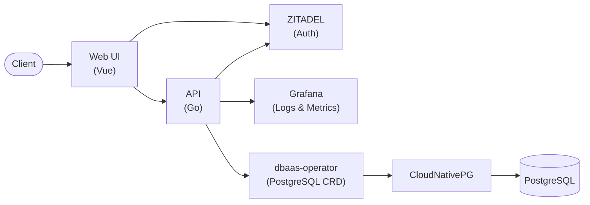
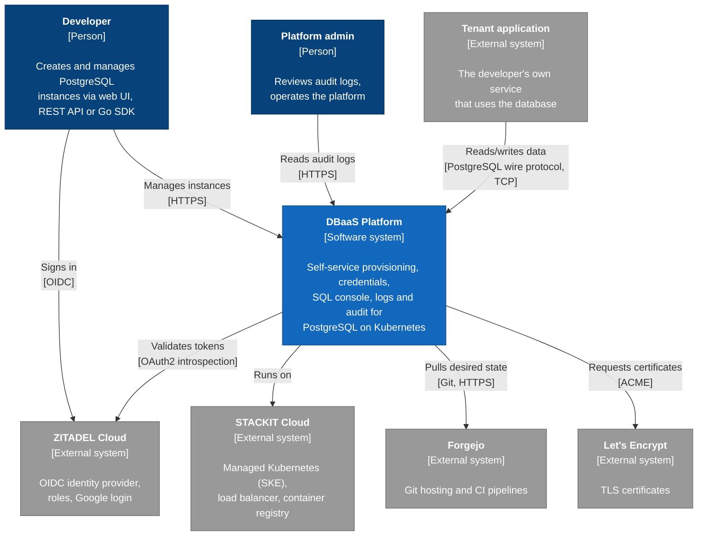
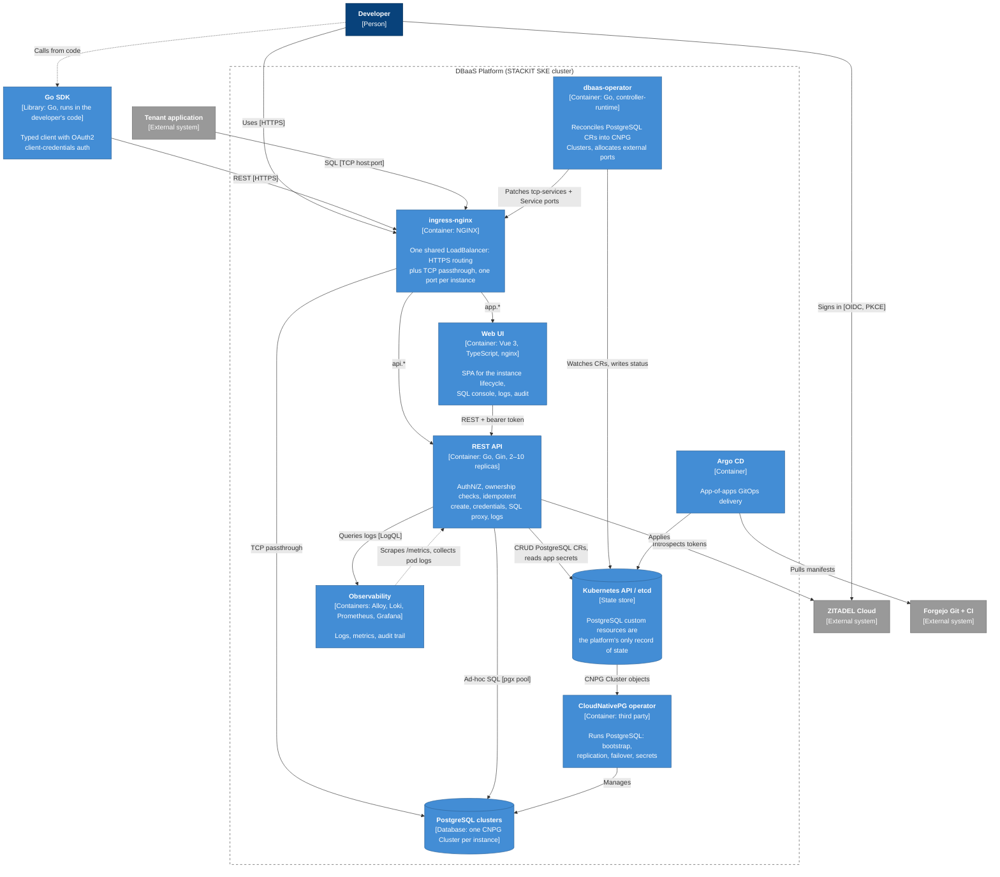

# DBaaS Platform

A self-service **Database-as-a-Service** platform for provisioning and managing PostgreSQL instances on Kubernetes — built end-to-end, from raw IaaS on OpenStack up to a production-style PaaS product with an API, a web UI, GitOps delivery, and full observability.

Built as part of a cloud-native platform engineering track (Infrastructure → Platform → Product), where the goal was to own the whole stack rather than a single layer of it.

## Architecture

Simple architecture:



The diagrams follow the [C4 model](https://c4model.com/): Level 1 shows the system in its environment, Level 2 zooms into the deployable parts.

### Level 1: System context



### Level 2: Containers



Delivery path (not drawn): a push to `main` triggers Forgejo CI, which builds an image, pushes it to the STACKIT registry and commits the new tag into `gitops/*/overlays/prod`. Argo CD then syncs it into the cluster. cert-manager issues the Let's Encrypt certificates for both hostnames.

## Features

- **Custom Kubernetes Operator**: A `PostgreSQL` CRD (built with Kubebuilder) that reconciles into a [CloudNativePG](https://cloudnative-pg.io/) `Cluster`, exposing a simplified spec (`version`, `instances`, `storage`, `database`, `username`) and a status (`phase`, `readyInstances`, `externalPort`, conditions) so the API never has to speak CNPG directly.
- **REST API**: Go/Gin service for create / list / get / update / delete of instances, plus credentials, log retrieval, and ad-hoc SQL execution — fully documented with OpenAPI. Idempotent creation via `Idempotency-Key`, per-user isolation via Kubernetes labels, cursor-based pagination on list endpoints (matches the underlying Kubernetes/Loki APIs, which have no offset/skip concept).
- **External database connectivity**: each instance's CNPG cluster is `ClusterIP`-only by default (unreachable outside the cluster) — the operator allocates a port from a shared pool and wires it into ingress-nginx's TCP passthrough, so instances get a real externally-reachable connection string through one shared LoadBalancer instead of one per tenant.
- **In-browser SQL console**: run queries directly against an instance from the UI — proxied through the API with a pooled connection, a per-query timeout, and a row cap, so one query can't take down the API pod.
- **AuthN/AuthZ**: OIDC via [ZITADEL](https://zitadel.com/), role-based access control (`dbaas.user`, `dbaas.admin`), admin-only audit log endpoint.
- **Web UI**: Vue 3 + TypeScript SPA for the full instance lifecycle — create, monitor status (live, via polling — no manual refresh), view logs/credentials, run queries, update, delete. Public landing page and documentation site in front of the authenticated app.
- **GitOps delivery**: ArgoCD-driven deployment of the operator, API, UI, CNPG, and the observability stack via Kustomize overlays.
- **Observability**: Prometheus + Grafana for metrics, Loki + Grafana Alloy for logs, structured JSON application logs, and a per-instance/per-user audit trail queryable through the API.
- **Go SDK**: A typed client library (`sdk/`) with OAuth2 client-credentials auth, wrapping the full instance API for programmatic use.
- **Infrastructure as Code**: Terraform + Ansible provisioning of the underlying Kubernetes cluster — from a single/multi-node cluster on self-hosted OpenStack (DevStack) up to a managed [STACKIT SKE](https://www.stackit.de/en/product/stackit-kubernetes-engine/) cluster.

## Design decisions and trade-offs

**1. The Kubernetes API is the only state store.** No separate platform database exists. Each instance is a `PostgreSQL` custom resource, and ownership is a label on it (`app.example.com/user-id`).
*Why:* etcd already provides persistence, watches and optimistic concurrency. A second store would be a second source of truth that can drift from the cluster.
*Trade-off:* queries are limited to label selectors. Pagination is cursor-only, because the List API has no offset. Anything relational, such as per-user quotas or billing, would need a real database later.

**2. A narrow CRD of my own wraps CloudNativePG.** The API and UI never touch CNPG objects directly.
*Why:* a five-field spec and a normalised `phase` give a stable contract. CNPG upgrades, or a different engine, stay contained inside the operator.
*Trade-off:* it's one more component to build, test and run, with two reconciliation layers. The operator's CNPG API version must also be kept in sync with the CNPG version installed in the cluster.

**3. One shared LoadBalancer exposes databases through allocated TCP ports.** The alternatives were a LoadBalancer per instance, or hostname-based routing.
*Why:* a cloud LoadBalancer per tenant costs money and public IPs. Hostname (SNI) routing doesn't work with generic TCP proxies. A PostgreSQL client first sends a plaintext `SSLRequest` and only starts TLS after the server replies. So the proxy (e.g. `ssl_preread`) never sees a TLS ClientHello it could route on. PostgreSQL 17's `sslnegotiation=direct` fixes this, but the platform supports versions 14–16.
*Trade-off:* the port range is finite (30100–30999). The allocator is a ConfigMap guarded by optimistic locking. The operator also has to patch objects owned by ingress-nginx, which GitOps or Helm can overwrite.

**4. Creation is idempotent through a deterministic resource name:** `sha256(userID + Idempotency-Key)`.
*Why:* the API server's `AlreadyExists` check becomes the atomic deduplication step. No idempotency table is needed, and it works across API replicas.
*Trade-off:* clients must send a key on every create. Reusing a key with a different body isn't detected yet.

**5. The SQL console goes through the API.** The browser never connects to PostgreSQL directly.
*Why:* browsers can't speak the PostgreSQL wire protocol. Going through the API reuses the same authentication and ownership checks. Each query is limited to 10 seconds and 500 rows, with at most 3 pooled connections per instance and idle eviction.
*Trade-off:* the API becomes part of the data path and holds per-pod connection state. Queries run as the database owner.

**6. Authentication is delegated to ZITADEL.** Access tokens are checked through introspection.
*Why:* OIDC, roles, social login and service accounts (used by the SDK) come for free and are maintained by a dedicated product.
*Trade-off:* every request makes a network call to an external dependency. Local JWT validation would be faster, but token revocation would then take effect later.

**7. Audit events are structured logs in Loki.** They don't live in a database table.
*Why:* it reuses the observability stack that already exists. Audit becomes one more `component=audit` log stream, queryable by the admin endpoint.
*Trade-off:* audit retention equals log retention (7 days), and the logs are not tamper-evident. A compliance-grade audit trail would need its own append-only storage.

**8. Delivery is GitOps, and CI writes image tags back to Git.**
*Why:* Git holds the full desired state, so a rollback is a `git revert`, and the cluster never needs inbound CI credentials.
*Trade-off:* CI needs write access to the repository. Child Argo apps are still synced manually, which slows down how quickly a change reaches the cluster.

### Known limitations and next steps

- **Backups:** no scheduled backups or point-in-time recovery yet. CNPG supports both through object storage, and they're the first thing to add.
- **Tenant isolation:** all instances share one namespace, with no per-tenant `ResourceQuota` or `NetworkPolicy`. A namespace per tenant is the planned direction.
- **Abuse limits:** there are no per-user limits on instance count or storage, and storage size isn't validated.
- **Error reporting:** failed reconciles, such as an unsupported major-version change, aren't reported as a `Failed` phase yet.

## Repository layout

| Path | What lives there |
|---|---|
| [`operator/`](operator) | Kubebuilder-generated `PostgreSQL` operator that wraps CloudNativePG |
| [`platform/`](platform) | The REST API (Go/Gin), auth, observability, OpenAPI spec |
| [`client/`](client) | Vue 3 + TypeScript web UI, unit tests (Vitest) and e2e tests (Playwright) |
| [`sdk/`](sdk) | Go client SDK for the REST API |
| [`infra/`](infra) | Terraform + Ansible for OpenStack (DevStack) and STACKIT SKE clusters |
| [`gitops/`](gitops) | Kustomize manifests + ArgoCD Application definitions for every component |

Each folder has (or will have) its own README with implementation details.

## Quick look: Go SDK

```go
import "github.com/foyez/dbaas-platform/sdk"

c := dbaas.New("https://api.example.com",
    dbaas.WithClientCredentials(tokenURL, clientID, clientSecret, []string{"dbaas"}),
)

inst, _ := c.Instances.Create(ctx, dbaas.CreateInstanceInput{
    Name:           "orders-db",
    Version:        16,
    Storage:        "10Gi",
    IdempotencyKey: "orders-db-create-1",
})

creds, _ := c.Instances.Credentials(ctx, inst.ID)
```

## Documentation

| Doc | Covers |
|---|---|
| [`operator/README.md`](operator/README.md) | CRD design, reconciliation logic, running/testing the operator locally |
| [`platform/docs/openapi.yaml`](platform/docs/openapi.yaml) | Full REST API contract |
| [`client/README.md`](client/README.md) | UI structure, running dev server, unit/e2e tests |
| [`sdk/README.md`](sdk/README.md) | SDK usage and examples |
| [`infra/README.md`](infra/README.md) | OpenStack + SKE provisioning steps |

## Tech stack

- **Operator**: Go, Kubebuilder, controller-runtime, CloudNativePG APIs
- **API**: Go, Gin, ZITADEL (OIDC/RBAC), pgx (query execution), Prometheus client, OpenAPI
- **Frontend**: Vue 3, TypeScript, Vite, Pinia, Tailwind CSS, shadcn/ui
- **Testing**: Go testing + testify, Vitest, Playwright
- **Infra**: Terraform, Ansible, OpenStack (DevStack), STACKIT SKE, Kustomize, ArgoCD
- **Observability**: Prometheus, Grafana, Loki, Grafana Alloy
