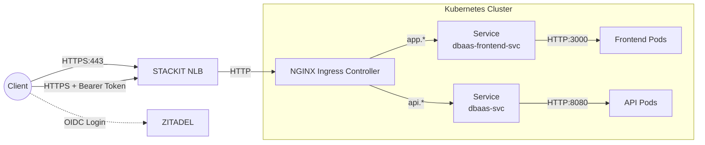

# Architecture

The platform turns a request like "give me a PostgreSQL 16 database" into a running, reachable database. A Go API records the request as a Kubernetes custom resource, a custom operator turns that into a CloudNativePG cluster, and ingress-nginx exposes it on its own TCP port.

The diagrams follow the [C4 model](https://c4model.com/): Level 1 shows the system in its environment, Level 2 zooms into the deployable parts.

## Level 1: System context

```
┌──────────────────┐   ┌──────────────────┐   ┌──────────────────┐
│ Developer        │   │ Platform Admin   │   │ Tenant App       │
│ [Person]         │   │ [Person]         │   │ [External system]│
│ Creates & manages│   │ Reviews audit    │   │ Developer's own  │
│ Postgres DBs     │   │ logs             │   │ service          │
└────────┬─────────┘   └────────┬─────────┘   └────────┬─────────┘
         │ UI / API / SDK       │ Web UI               │ SQL over TCP
         │ HTTPS                │ HTTPS                │
         └──────────────────┐   │   ┌──────────────────┘
                            ▼   ▼   ▼
                 ┌──────────────────────────────┐
                 │        DBaaS Platform        │
                 │      [Software system]       │
                 │  Self-service PostgreSQL on  │
                 │  Kubernetes: provision, SQL, │
                 │  credentials, logs, audit    │
                 └──────────────┬───────────────┘
                                │
        ┌──────────────────┬────┴─────────────┬──────────────────┐
        │ Validates tokens │ Runs on          │ Pulls config     │ Gets TLS certs
        ▼                  ▼                  ▼                  ▼
┌──────────────┐   ┌──────────────┐   ┌──────────────┐   ┌──────────────┐
│ ZITADEL      │   │ STACKIT      │   │ Forgejo      │   │ Let's        │
│ [External]   │   │ [External]   │   │ [External]   │   │ Encrypt      │
│ OIDC login,  │   │ SKE cluster, │   │ Git + CI,    │   │ [External]   │
│ roles        │   │ LB, registry │   │ GitOps repo  │   │ ACME certs   │
└──────────────┘   └──────────────┘   └──────────────┘   └──────────────┘
```

## Level 2: Containers

```
   Developer                    Developer's code                Tenant App
       │ Browser                      │ Calls API                   │
       ▼                              ▼                             │
┌──────────────────┐        ┌──────────────────┐                    │
│ Web UI           │        │ Go SDK           │                    │
│ [Vue 3 / TS]     │        │ [Go library]     │                    │
│ Manage instances,│        │ OAuth2 client-   │                    │
│ SQL console, logs│        │ credentials auth │                    │
└────────┬─────────┘        └────────┬─────────┘                    │
         │ HTTPS / JSON              │ HTTPS / JSON                 │ SQL over TCP
         └─────────────┬─────────────┘                              │ (host:port)
                       │                                            │
┌──────────────────────┼────────────────────────────────────────────┼─────────┐
│ KUBERNETES CLUSTER (STACKIT SKE)                                  │         │
│                      ▼                                            │         │
│  ┌────────────────────────┐  CRUD CRs   ┌────────────────────┐    │         │
│  │ REST API               ├────────────►│ Kubernetes API     │    │         │
│  │ [Go / Gin]             │             │ [etcd]             │    │         │
│  │ Auth, ownership,       │             │ PostgreSQL CRs =   │    │         │
│  │ credentials, SQL proxy │             │ all platform state │    │         │
│  └──┬──────────────────┬──┘             └─────────┬──────────┘    │         │
│     │ LogQL            │ SQL (pgx)                │ watches       │         │
│     ▼                  │                          ▼               │         │
│  ┌──────────────┐      │                ┌────────────────────┐    │         │
│  │ Loki/Grafana │      │                │ dbaas-operator     │    │         │
│  │ [Observ.]    │      │                │ [Go / Kubebuilder] │    │         │
│  │ Logs, audit, │      │                │ CR → CNPG Cluster, │    │         │
│  │ metrics      │      │                │ opens TCP port     │    │         │
│  └──────────────┘      │                └─────────┬──────────┘    │         │
│                        │                          │ creates       │         │
│                        │                          ▼               │         │
│                        │                ┌────────────────────┐    │         │
│                        │                │ CloudNativePG      │    │         │
│                        │                │ [3rd-party]        │    │         │
│                        │                │ HA, failover,      │    │         │
│                        │                │ secrets            │    │         │
│                        │                └─────────┬──────────┘    │         │
│                        │                          │ runs          │         │
│                        ▼                          ▼               ▼         │
│  ┌──────────────────────────────────────────────────────────────────────┐   │
│  │ PostgreSQL clusters  [one CNPG Cluster per instance]                 │   │
│  └──────────────────────────────────────────────────────────────────────┘   │
└──────────────────────────────────────┬──────────────────────────────────────┘
                                       │ REST API validates tokens
                                       ▼
                     ┌──────────────────────────────────┐
                     │ ZITADEL Cloud   [OIDC, roles]    │
                     └──────────────────────────────────┘
```

Delivery path (not drawn): a push to `main` triggers Forgejo CI, which builds an image, pushes it to the STACKIT registry and commits the new tag into `gitops/*/overlays/prod`. Argo CD then syncs it into the cluster. cert-manager issues the Let's Encrypt certificates for both hostnames.

## Request flow in production



A STACKIT Network Load Balancer is the public entry point and forwards traffic to the NGINX Ingress Controller inside the cluster. Users log in directly with ZITADEL over OIDC, and the frontend sends the resulting access token as a `Bearer` token with every API request.

The same LoadBalancer also carries raw PostgreSQL traffic: each instance gets a port from a shared pool, and ingress-nginx passes TCP on that port straight to the instance. [Design decision 3](../design-decisions/shared-loadbalancer.md) explains why.
