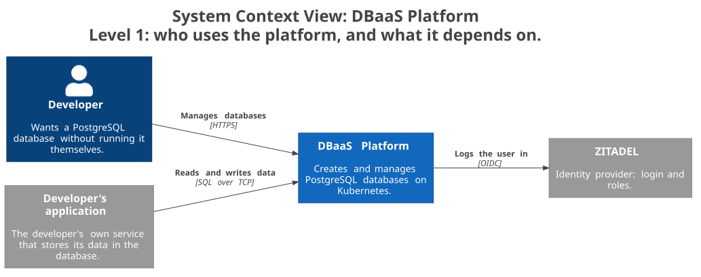
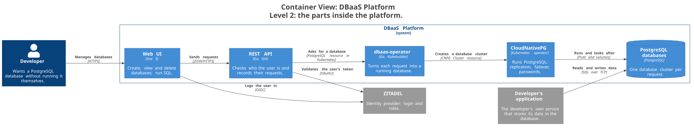
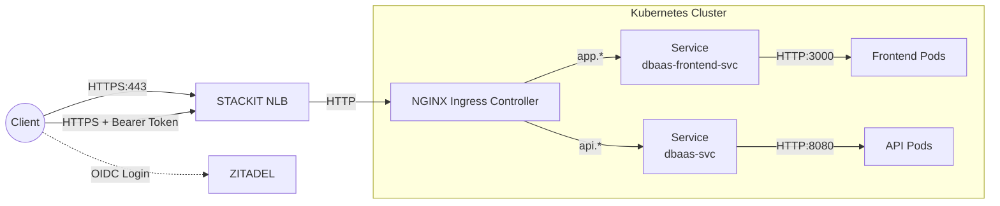

# Architecture

The platform turns a request like "give me a PostgreSQL 16 database" into a running, reachable database. A Go API records the request as a Kubernetes custom resource, a custom operator turns that into a CloudNativePG cluster, and ingress-nginx exposes it on its own TCP port.

The diagrams follow the [C4 model](https://c4model.com/), which describes software at different zoom levels, like a map. Level 1 shows the system as one box in its environment. Level 2 zooms into that box and shows the parts that run separately.

## Level 1: System context



A developer manages their databases through the platform, and their own application connects to those databases to store data. The platform doesn't handle passwords itself: [ZITADEL](../components/auth.md) logs users in.

## Level 2: Containers



Read it from left to right. It's the path a "create database" request takes:

1. The developer fills in a form in the **Web UI**.
2. The **REST API** checks the user's token with ZITADEL, then saves the request in Kubernetes as a `PostgreSQL` custom resource.
3. The **dbaas-operator** notices the new resource and creates a CloudNativePG cluster for it. It also gives the database its own public port.
4. **CloudNativePG** starts PostgreSQL and keeps it running.
5. The developer's application connects to the **PostgreSQL database** directly, without going through the API.

Each box name matches a directory in the repository: [`client/`](https://github.com/foyez/dbaas-platform/tree/main/client), [`platform/`](https://github.com/foyez/dbaas-platform/tree/main/platform) and [`operator/`](https://github.com/foyez/dbaas-platform/tree/main/operator). Monitoring and delivery are left out to keep the diagram readable. They're covered in [Observability](../components/observability.md) and [Delivery](../components/delivery.md).

## Request flow in production



A STACKIT Network Load Balancer is the public entry point and forwards traffic to the NGINX Ingress Controller inside the cluster. Users log in directly with ZITADEL over OIDC, and the frontend sends the resulting access token as a `Bearer` token with every API request.

The same LoadBalancer also carries raw PostgreSQL traffic: each instance gets a port from a shared pool, and ingress-nginx passes TCP on that port straight to the instance. [Design decision 3](../design-decisions/shared-loadbalancer.md) explains why.

## Changing the diagrams

The two C4 diagrams are generated from one model, [`workspace.dsl`](https://github.com/foyez/dbaas-platform/blob/main/docs/architecture/workspace.dsl), written in [Structurizr DSL](https://docs.structurizr.com/dsl). Each arrow is declared once and shows up on both levels, so the levels can't contradict each other. Edit the model, then:

```sh
make diagrams          # render docs/architecture/diagrams/*.svg
make diagrams-preview  # optional: live preview at http://localhost:8080
```

Commit the model and the SVGs together. The docs workflow runs `make diagrams-check` and fails if they don't match.
