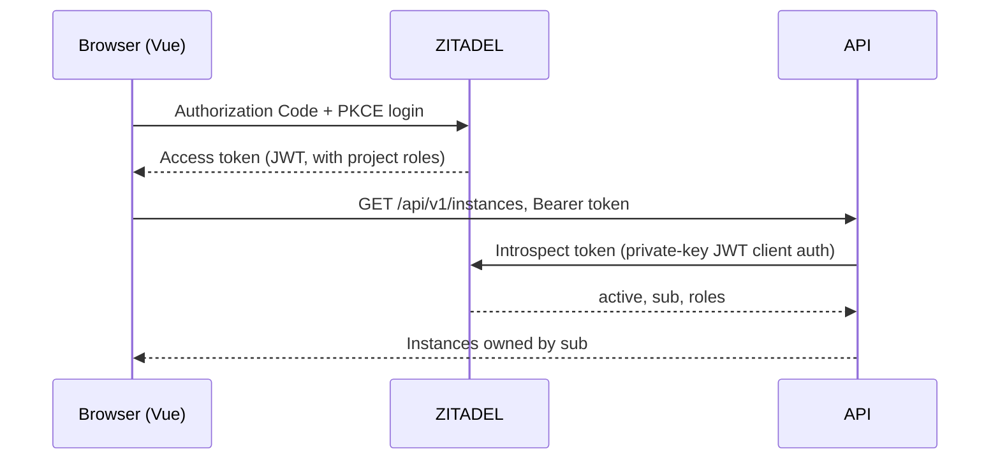

# Authentication

Identity is delegated to [ZITADEL](https://zitadel.com/). The platform never stores passwords: users log in with ZITADEL, and the API asks ZITADEL whether each access token is valid. [Design decision 6](../design-decisions/auth-with-zitadel.md) covers the trade-offs.

## How a request is authenticated

The API authenticates to ZITADEL's introspection endpoint as its own API application, with a private key. The token's subject (`sub`) becomes the owner label on every resource the user creates.

## Roles

| Role | Grants |
|---|---|
| `dbaas.user` | Manage your own instances. Every new user gets it automatically through a ZITADEL action on registration. |
| `dbaas.admin` | Everything a user can do, plus the audit log. |

## Configured with Terraform

Everything in ZITADEL is created by [`infra/zitadel/tf`](https://github.com/foyez/dbaas-platform/tree/main/infra/zitadel/tf):

- the `DBAAS Platform` project, with role assertion turned on so roles appear in tokens
- the `dbaas-web` OIDC app (browser, PKCE, no client secret)
- the `dbaas-api` API app, which uses private-key JWT for introspection
- the two roles and the registration action that grants `dbaas.user`
- an optional Google identity provider
- a machine user for testing the SDK's client-credentials flow

Production applies it against ZITADEL Cloud. The local setup applies the same module against a self-hosted ZITADEL in the kind cluster (see [Getting started](../getting-started.md)).
