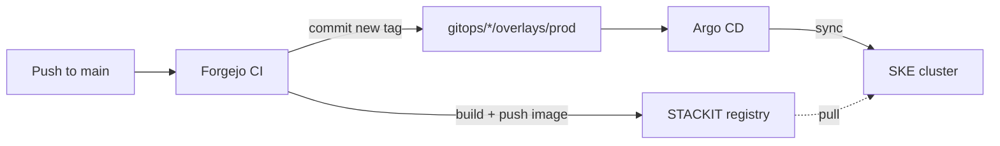

# Delivery

Delivery is GitOps: Git holds the desired state of the cluster, and [Argo CD](https://argo-cd.readthedocs.io/) makes the cluster match it. CI never talks to the cluster directly. [Design decision 8](../design-decisions/gitops-delivery.md) covers the trade-offs.



## CI workflows

| Workflow | Runs on | Does |
|---|---|---|
| `api-ci.yaml` | push to `main` touching `platform/` | Build and push the API image, bump its tag in `gitops/api/overlays/prod` |
| `client-ci.yaml` | push to `main` touching `client/` | Same for the frontend |
| `operator-ci.yaml` | push to `main` touching `operator/` | Same for the operator |
| `api-test.yaml` | pull requests to `main` | Run the API's Go tests |
| `k8s-bootstrap.yaml` | push to `main` touching the cluster config | Provision the SKE cluster with Terraform and install Argo CD |

Image tags are the short commit SHA, which is why the history contains commits like `chore: bump dbaas-platform-api image to 12e64f9`.

## GitOps layout

Each component in [`gitops/`](https://github.com/foyez/dbaas-platform/tree/main/gitops) is a Kustomize base with environment overlays:

```text
gitops/<component>/
├── base/              # shared manifests
└── overlays/
    ├── dev/           # local kind cluster (make dev)
    └── prod/          # SKE, image tags written by CI
```

Argo CD uses an app-of-apps: [`gitops/argocd/root-app.yaml`](https://github.com/foyez/dbaas-platform/blob/main/gitops/argocd/root-app.yaml) points at `gitops/argocd/apps/`, which holds one Application per component: CNPG, the operator, the API, the frontend, cert-manager, External Secrets, the ingress-nginx TCP access rules and the sample database.

Secrets don't live in Git. The External Secrets Operator is installed so they can be synced from STACKIT Secrets Manager, but the `SecretStore` and `ExternalSecret` resources aren't defined in this repository yet. Secrets such as the API's ZITADEL key and the registry pull secret are created outside Git.
