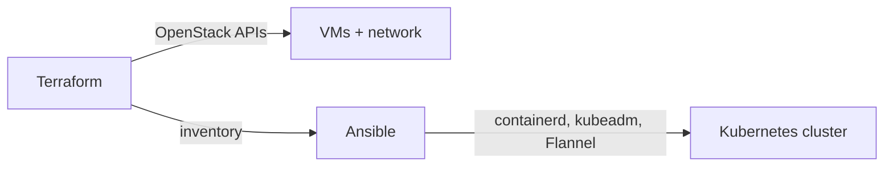

# Infrastructure

The project climbed the stack on purpose: first running its own cloud, then a self-built Kubernetes cluster on it, then a managed cluster for the product. Each step is in [`infra/`](https://github.com/foyez/dbaas-platform/tree/main/infra).

| Directory | What it provisions |
|---|---|
| `openstack/devstack` | A single-node OpenStack (DevStack) install: the IaaS layer |
| `openstack/vm` | One VM on that OpenStack, with Terraform |
| `openstack/single-node` | A VM plus a single-node Kubernetes cluster |
| `openstack/two-nodes` | A control-plane and a worker node, joined into one cluster |
| `ske-cluster/terraform` | The managed STACKIT Kubernetes Engine (SKE) cluster the product ran on |
| `zitadel/tf` | ZITADEL project, roles and apps (see [Authentication](auth.md)) |
| `observability` | Local Podman Compose setup used while building the observability stack |

## Kubernetes on OpenStack

Each OpenStack setup has a `bootstrap.sh` that runs the whole thing with one command:

1. **Terraform** creates the network, security groups and VMs through the OpenStack APIs and writes an Ansible inventory.
2. **Ansible** installs containerd and the Kubernetes components, initialises the control plane with `kubeadm`, installs the Flannel network plugin and joins the workers.

## STACKIT SKE

For the product itself, the cluster is a managed SKE cluster with a single autoscaling node pool, created with the STACKIT Terraform provider. The `k8s-bootstrap.yaml` workflow applies it and then installs Argo CD, after which everything else comes from Git (see [Delivery](delivery.md)).

The production cluster has been shut down to save costs. Running `k8s-bootstrap.yaml` again recreates it.
