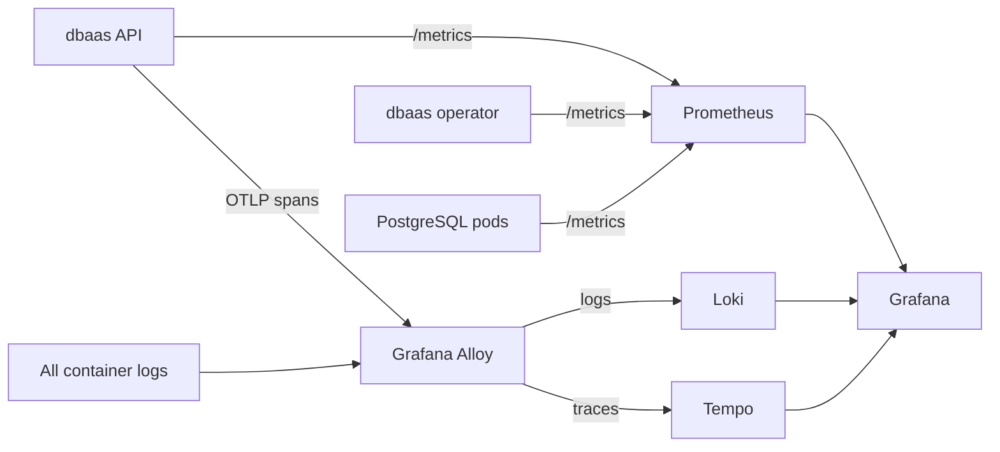

# Observability

Metrics, logs and traces all end up in Grafana. The stack runs in its own `observability` namespace and is defined in [`gitops/observability`](https://github.com/foyez/dbaas-platform/tree/main/gitops/observability) as pinned Helm charts rendered by Kustomize. `make dev` installs the same stack locally.

| Piece | Chart | Role |
|---|---|---|
| Prometheus | `kube-prometheus-stack` | Metrics from the API, the operator, every PostgreSQL instance and the cluster itself; 7 days of retention |
| Loki | `loki` | Logs, 7 days of retention |
| Tempo | `tempo` | Traces, 3 days of retention |
| Grafana Alloy | `alloy` | Runs on every node: ships container logs to Loki, and receives traces over OTLP and forwards them to Tempo |
| Grafana | `grafana` | Dashboards and Explore, with Prometheus, Loki and Tempo datasources |

## What gets measured

**Metrics** (Prometheus):

| Source | Scraped by | Examples |
|---|---|---|
| API | `ServiceMonitor` on `/metrics` | `dbaas_http_requests_total`, `dbaas_http_request_duration_seconds` by route and status; `dbaas_sql_console_queries_total` by outcome; Go runtime and process |
| Operator | `ServiceMonitor` on the HTTPS metrics port, with Prometheus's token | `controller_runtime_reconcile_total`, reconcile errors and durations, work queue depth |
| PostgreSQL | `PodMonitor` on every CloudNativePG instance pod | `cnpg_collector_up`, connections, transactions, database size, replication lag |
| Cluster | kube-prometheus-stack defaults | Node, pod and container resource usage |

**Logs** (Loki): every container's output, labelled with `namespace`, `pod`, `container` and `app`. PostgreSQL pods also get `instance_id` and `owner_id`, which is how the API finds an instance's logs. The API logs one JSON line per request, plus:

- **Audit events**: a `component=audit` stream recording who did what to which instance, read back by the admin-only `GET /api/v1/audit-logs`. [Design decision 7](../design-decisions/audit-in-loki.md) explains why audit lives in logs.
- **`trace_id` and `span_id`** on every line logged during a request, linking it to its trace.

**Traces** (Tempo): the API is instrumented with OpenTelemetry. Each request gets a server span, with child spans for its Kubernetes API calls, ZITADEL token introspection, Loki queries and SQL console statements. SQL console spans record the instance, row count and SQLSTATE, but never the SQL text, which can contain user data.

## Moving between signals

- **Log → trace:** in Explore, a Loki log line with a `trace_id` shows a **TraceID** link that opens the trace in Tempo.
- **Trace → logs:** a span in Tempo has a **Logs for this span** link that queries the API's log lines with the same `trace_id`.

## Configuration

The API follows the standard OpenTelemetry environment variables:

| Variable | Value in the cluster |
|---|---|
| `OTEL_EXPORTER_OTLP_ENDPOINT` | `http://dbaas-alloy.observability.svc.cluster.local:4317`; without it, tracing is off |
| `OTEL_SERVICE_NAME` | `dbaas-api` |
| `OTEL_TRACES_SAMPLER` | unset: every request is traced |

`APP_LOG_FORMAT` is `json` in every deployment, which the Loki queries depend on; set it to `text` when running the binary directly.

## Locally

`make dev` installs the whole stack, and Grafana is at <http://grafana.dbaas.localhost> (`admin` / `admin`). `OBSERVABILITY=false make dev` skips it to save memory; the instance Logs tab and the audit log then have no data source.

In production, `scripts/observability-forward-start.sh` port-forwards Grafana and Prometheus to your machine.
