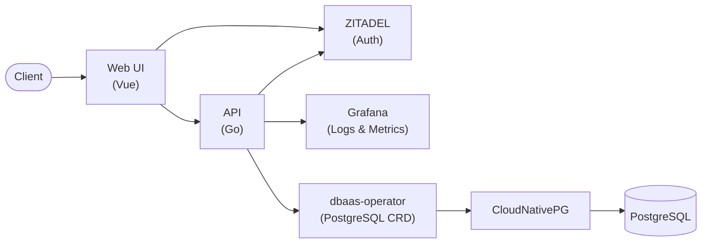

# DBaaS Platform

A self-service **Database-as-a-Service** platform: developers create, scale and query their own PostgreSQL databases through a web UI, REST API or Go SDK. It was built end to end, from raw IaaS on OpenStack (Terraform + Ansible) to a product deployed on STACKIT Kubernetes Engine (SKE).

The production cluster has been shut down to save costs. Everything can be recreated from the [repository](https://github.com/foyez/dbaas-platform), and the whole platform runs locally with one command.
