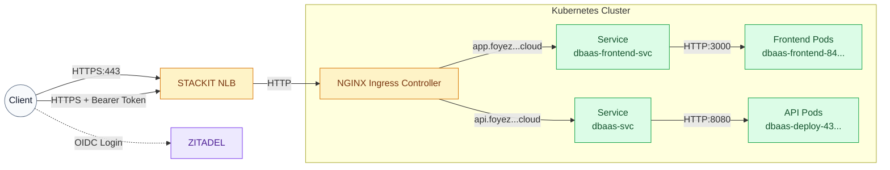
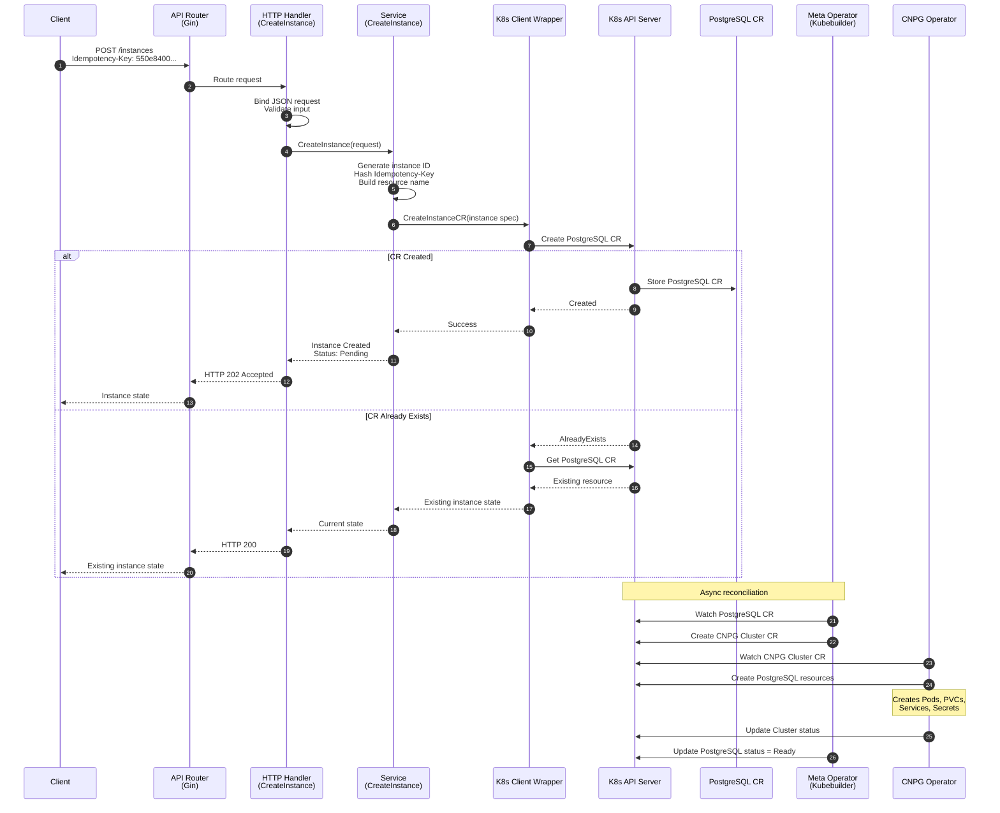
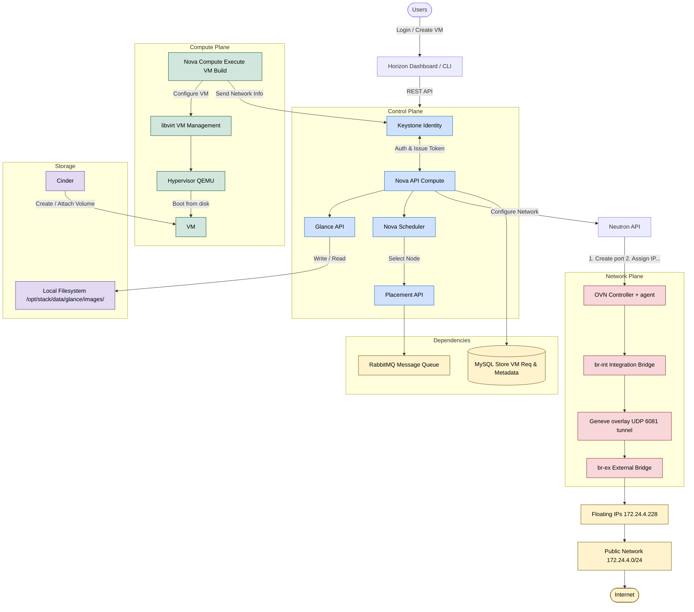
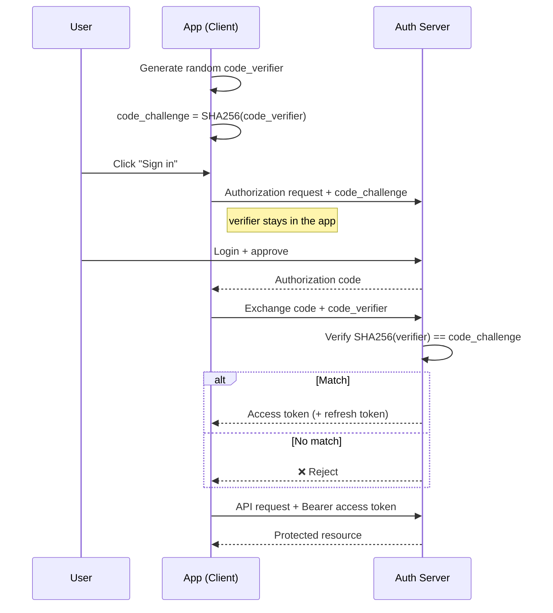
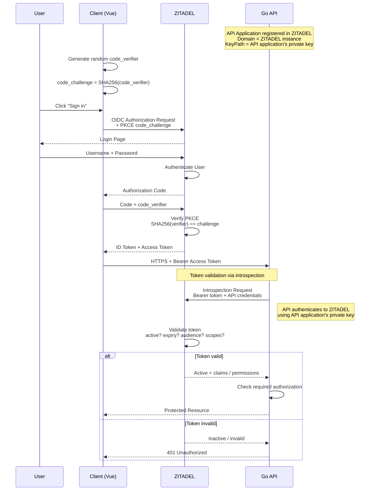
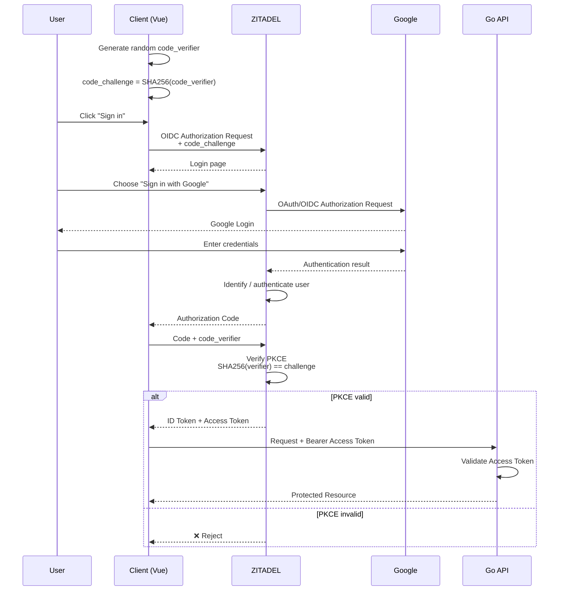

## Architecture

### Traffic Flow



The platform uses a **STACKIT Network Load Balancer** as the public entry point, forwarding traffic to the **NGINX Ingress Controller** inside the Kubernetes cluster.

* **Frontend:** `app.foyez.runs.onstackit.cloud` → Frontend Service → Frontend Pods
* **Backend API:** `api.foyez.runs.onstackit.cloud` → API Service → API Pods
* **Authentication:** Users authenticate directly with **ZITADEL** using OIDC.
* **Authorization:** The frontend sends the ZITADEL access token as a `Bearer` token with API requests.
* **Services:** Kubernetes `ClusterIP` Services provide internal communication between the Ingress and Pods.
* **Scalability:** Both frontend and backend run with multiple replicas for availability.

### Instance Creation Sequential Flow 



The API follows a **declarative, asynchronous provisioning model**:

1. Client sends `POST /instances` with an **Idempotency-Key**.
2. Gin router validates and forwards the request to the service layer.
3. The service creates a **PostgreSQL Custom Resource (CR)** through the Kubernetes API.
4. API immediately returns **`202 Accepted`** with the instance in `Pending` state.
5. The Meta Operator watches the PostgreSQL CR and creates the corresponding **CNPG Cluster CR**.
6. The **CloudNativePG (CNPG) Operator** provisions the PostgreSQL resources such as Pods, PVCs, Services, and Secrets.
7. Operators update the resource status until the instance reaches **`Ready`**.
8. If the same idempotency key is submitted again, the existing instance is returned instead of creating a duplicate.

**Key concept:**

> The API handles the request synchronously, while Kubernetes operators handle PostgreSQL provisioning asynchronously through the desired state defined in the Custom Resource.

### OpenStack Arch. Diagram



---

### PKCE Auth Flow



The key idea:

```text
Before login:

App
├── code_verifier      🔒 stays here
└── SHA256(verifier)
        │
        └──→ code_challenge → Auth Server


After login:

Auth Server
    │
    └──→ authorization_code → App

App
    │
    ├── authorization_code
    └── code_verifier 🔒
             │
             ▼
        Auth Server
             │
       SHA256(verifier)
             │
             ▼
     matches challenge?
        │          │
       YES         NO
        │           │
      Token       Reject
```

---

### Username & Password Login Flow



**What is happening:**

* **OIDC** → authenticates the user and provides identity information.
* **OAuth 2.0** → provides authorization to access your Go API.
* **PKCE** → protects the authorization-code exchange.
* **ID Token** → tells the Vue app who the user is.
* **Access Token** → is sent to the Go API to access protected resources.

---

### Google Login Flow



### The simple picture to remember

```text
                    OIDC + OAuth 2.0
                 +       PKCE
                 ↓
Vue Client ────────────> ZITADEL
                            │
                ┌───────────┴───────────┐
                │                       │
         Username/Password           Google
                │                       │
                └───────────┬───────────┘
                            ↓
                    Authorization Code
                            ↓
                    PKCE Code Exchange
                            ↓
                   ID Token + Access Token
                            │
                            ↓
                       Vue Client
                            │
                  Bearer Access Token
                            ↓
                         Go API
```

**One sentence for the interview:**

> "My Vue application uses OIDC on top of OAuth 2.0 with Authorization Code Flow and PKCE. ZITADEL handles authentication, either with username/password or through Google as an external identity provider. After authentication, ZITADEL returns an authorization code, which Vue exchanges using the PKCE verifier for tokens. The access token is then sent as a Bearer token to my Go API, where it is validated and used for authorization."
