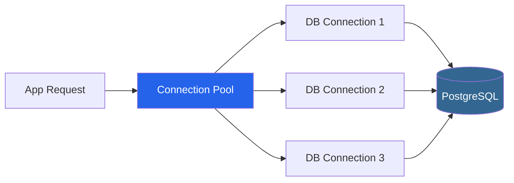
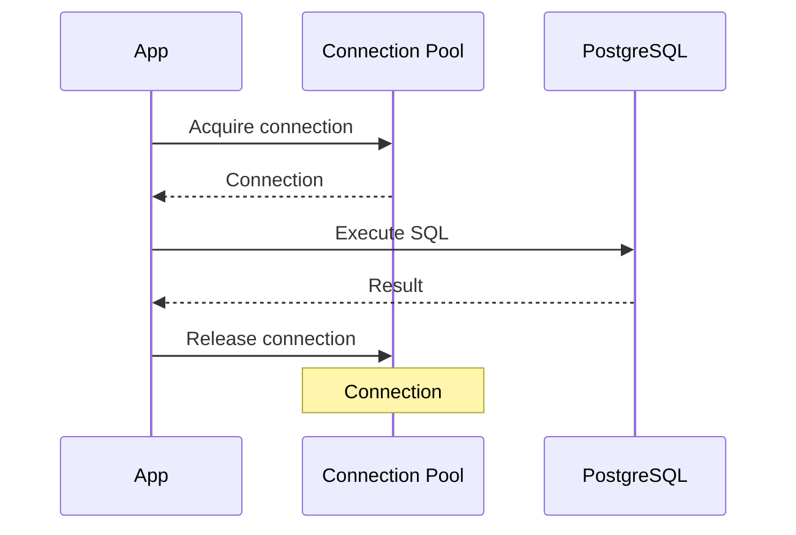
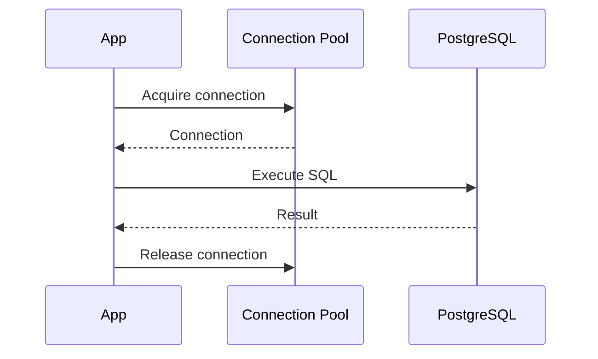
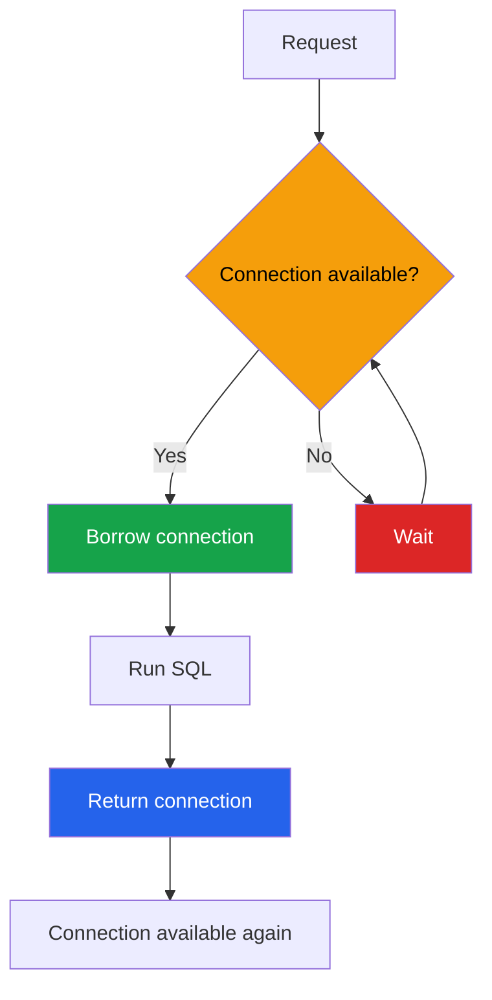
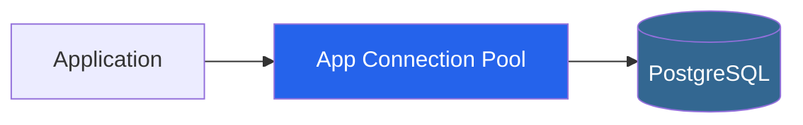
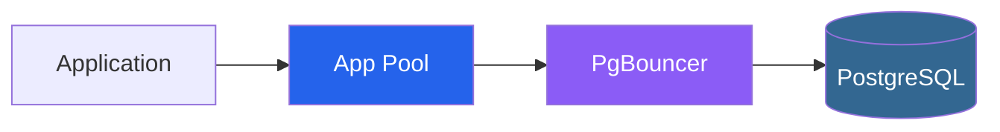
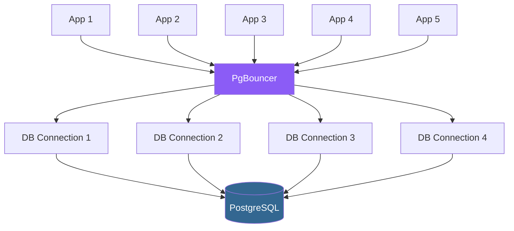
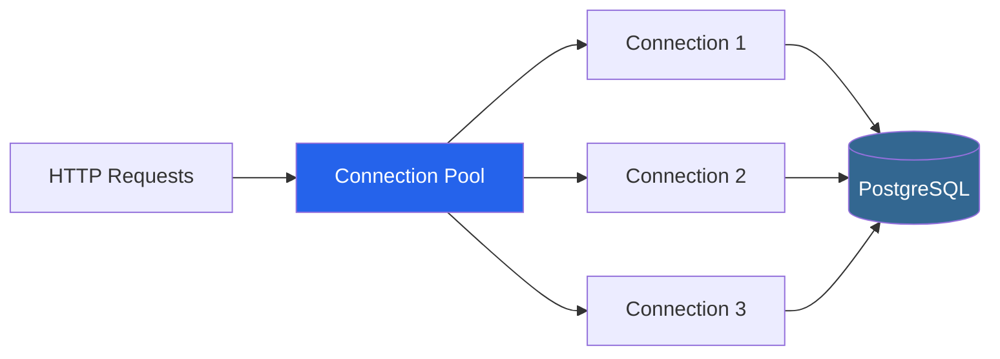
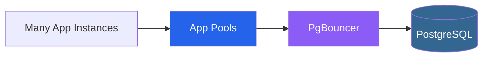

# Database Connection Pooling

## 1. The basic idea

A **database connection** is a communication channel between the application and PostgreSQL.

Instead of creating a new connection for every request, we create a small number of connections and **reuse them**.

Think of a connection pool as a **waiting room of reusable database connections**.



---

# 2. Why do we need connection pooling?

Without a connection pool, every request could do:

```text
Request
   ↓
Create connection
   ↓
Run SQL
   ↓
Close connection
```

For many requests:

```text
Request 1 → Create → Query → Close
Request 2 → Create → Query → Close
Request 3 → Create → Query → Close
Request 4 → Create → Query → Close
```

This is inefficient.

With a pool:

```text
              Connection Pool
           ┌───────────────────┐
           │ Connection 1      │
           │ Connection 2      │
           │ Connection 3      │
           └───────────────────┘
                    │
                    ▼
                PostgreSQL
```

The connections are created once and **reused by many requests**.

---

# 3. Why is creating a database connection expensive?

Creating a connection is not just:

```text
connect()
```

Conceptually, it involves several steps:

```text
Application
    ↓
Network connection
    ↓
PostgreSQL connection setup
    ↓
Authentication
    ↓
Create PostgreSQL session
    ↓
Connection ready
```

There is network work, authentication, server-side resources, and session setup.

Therefore, we don't want:

```text
Create connection
      ↓
Use for 5 ms
      ↓
Destroy connection
```

for every request.

Instead:

```text
Create connection
      ↓
Keep it open
      ↓
Reuse it
      ↓
Reuse it again
      ↓
Reuse it again
```

That's the main reason connection pooling exists.

---

# 4. How does the pool work?

The application **borrows** a connection.



The next request can reuse the same connection:



The important idea:

> **The request borrows the connection; it doesn't own or destroy the connection.**

---

# 5. `MinConns` and `MaxConns`

For example:

```go
cfg.MinConns = 2
cfg.MaxConns = 10
```

Think of the pool like this:

```text
           CONNECTION POOL

    ┌────────────────────────┐
    │                        │
    │  Connection 1 🔵       │
    │  Connection 2 🔵       │ ← MinConns = 2
    │  Connection 3 ⚪       │
    │  Connection 4 ⚪       │
    │  Connection 5 ⚪       │
    │  ...                   │
    │  Connection 10 ⚪      │ ← MaxConns = 10
    │                        │
    └────────────────────────┘
```

### `MinConns`

```go
MinConns = 2
```

Keep a small number of connections ready.

### `MaxConns`

```go
MaxConns = 10
```

Don't allow the pool to have more than 10 connections.

The exact behavior of when connections are created can depend on the pool implementation, but conceptually:

```text
MinConns → baseline ready connections
MaxConns → upper limit
```

---

# 6. What happens when all connections are busy?

Suppose:

```go
MaxConns = 3
```

Three requests are already using the connections:

```text
Connection 1 → Request A
Connection 2 → Request B
Connection 3 → Request C

Request D → WAITING
```

Conceptually:



When Request A finishes:

```text
Request A/B/C
    ↓
Release Connection 1/2/3
    ↓
Request D gets Connection 1/2/3
```

This is important because the pool doesn't only **reuse connections**.

It also **limits database concurrency**.

---

# 7. Why not just allow unlimited connections?

Because PostgreSQL has limited resources.

Imagine:

```text
100 application instances
×
10 connections per instance
=
1,000 possible PostgreSQL connections
```

That's potentially a lot of database connections.

More connections do **not** automatically mean better performance.

Too many connections can cause:

* More memory usage
* More CPU overhead
* More contention
* More database resource pressure
* Worse performance

So we want a **reasonable connection limit**.

---

# 8. What determines the right `MaxConns`?

There is no universal answer like:

```text
MaxConns = 10 is always correct
```

The right value depends on things like:

```text
Application concurrency
        +
Query latency
        +
Database CPU/memory
        +
PostgreSQL connection capacity
        +
Number of application instances
        +
Other database clients
```

For example:

```text
10 connections × 5 application instances
=
50 possible connections
```

So connection-pool sizing must consider the **whole system**, not just one application instance.

For an interview project, a conservative value such as:

```go
MaxConns = 10
```

is reasonable as a starting point if you document that it should be tuned using real measurements/load testing.

---

# 9. Where does PgBouncer fit?

Your application already has a connection pool:



**PgBouncer is another connection-pooling layer that runs outside your application.**



So:

```text
Application
     ↓
Application Connection Pool
     ↓
PgBouncer
     ↓
PostgreSQL
```

---

# 10. Why would we use PgBouncer?

Imagine many application instances:

```text
App 1 ──┐
App 2 ──┤
App 3 ──┤
App 4 ──┼──→ PostgreSQL
App 5 ──┤
App 6 ──┘
```

Each application might have its own connection pool.

For example:

```text
App 1 → 10 connections
App 2 → 10 connections
App 3 → 10 connections
App 4 → 10 connections
App 5 → 10 connections

Total = 50 possible PostgreSQL connections
```

As the application scales, the number of database connections can become a problem.

PgBouncer provides another layer:



PgBouncer can **reuse/multiplex backend PostgreSQL connections among clients**, depending on its pooling mode.

### Multiplex means:

> **Many clients share a smaller number of backend resources.**

For example:

```text
10 application clients
        ↓
    PgBouncer
        ↓
3 PostgreSQL connections
```

The clients don't all need their own dedicated PostgreSQL connection at all times.

---

# 11. Application Pool vs PgBouncer

|              | Application Pool                 | PgBouncer                                  |
| ------------ | -------------------------------- | ------------------------------------------ |
| Where?       | Inside application               | Separate service                           |
| Main purpose | Reuse DB connections             | Manage/reuse DB connections across clients |
| Scope        | Usually one application instance | Can serve many application instances       |
| Common?      | Very common                      | More useful as systems grow                |
| Required?    | Usually yes                      | Not always                                 |

You can have both:

```text
Application
     ↓
App Connection Pool
     ↓
PgBouncer
     ↓
PostgreSQL
```

But you **don't automatically need both**.

For a small interview project:

```text
Go Application
      ↓
Connection Pool
      ↓
PostgreSQL
```

is perfectly reasonable.

---

# 12. The whole picture

### Small application



Requests:

```text
Request
   ↓
Borrow connection
   ↓
Execute SQL
   ↓
Return connection
   ↓
Connection stays available for reuse
```

### Larger system



---

# 13. Example configuration

```go
cfg.MaxConns = 10
cfg.MinConns = 2
cfg.MaxConnLifetime = 30 * time.Minute
cfg.MaxConnIdleTime = 5 * time.Minute
```

Think about them like this:

```text
MinConns
   ↓
Keep a small baseline of connections available

MaxConns
   ↓
Maximum connections this pool can use

MaxConnLifetime
   ↓
Don't let connections live forever

MaxConnIdleTime
   ↓
Close connections that have been idle too long
```

The exact tuning should be based on **load testing and production metrics**, not arbitrary numbers.

---

# 14. Interview answer to memorize

> **“Creating a database connection is relatively expensive because it involves network connection setup, authentication, and creating server-side session resources. A connection pool creates a limited number of connections and reuses them across requests. Requests borrow a connection, execute their query, and return it to the pool. This avoids the overhead of creating a new connection for every request and also limits database concurrency.**
>
> **For a small service, an application-level connection pool is usually enough. At larger scale, when many application instances create many database connections, we can introduce something like PgBouncer as an external connection pooler to manage and reuse PostgreSQL connections across clients.”**

### The one mental model to remember

```text
                    REUSE
                      ↑
Request → App Pool → DB Connection → PostgreSQL
              ↑
              │
         borrow / return


At larger scale:

Many Apps
    ↓
App Pools
    ↓
PgBouncer
    ↓
Fewer PostgreSQL connections
    ↓
PostgreSQL
```

**In one sentence:**

> **Connection pooling means creating a limited number of expensive database connections once, then borrowing and reusing them across many application requests.**
