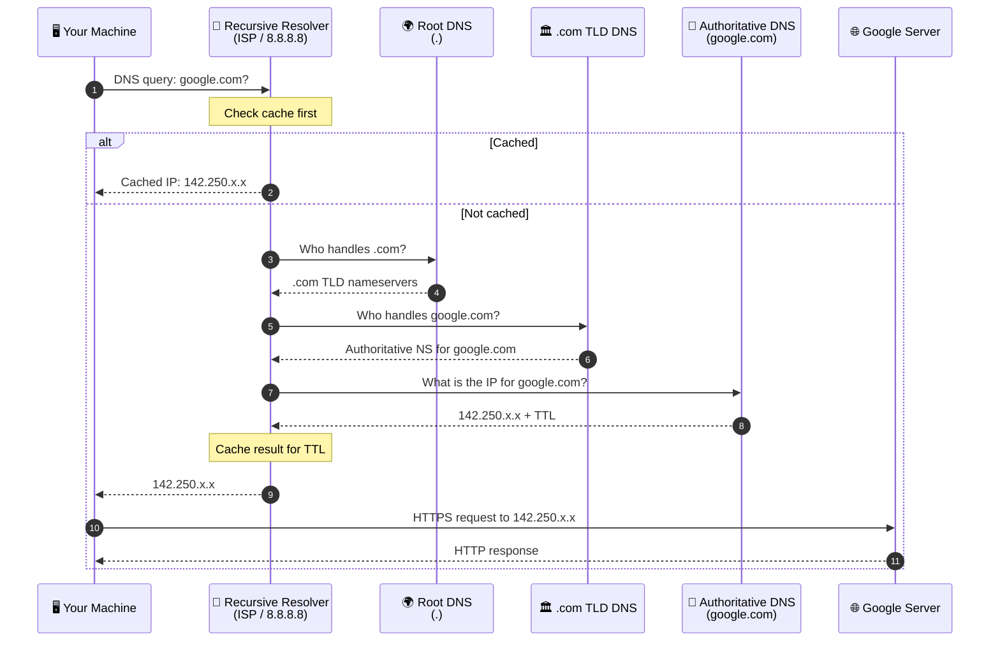
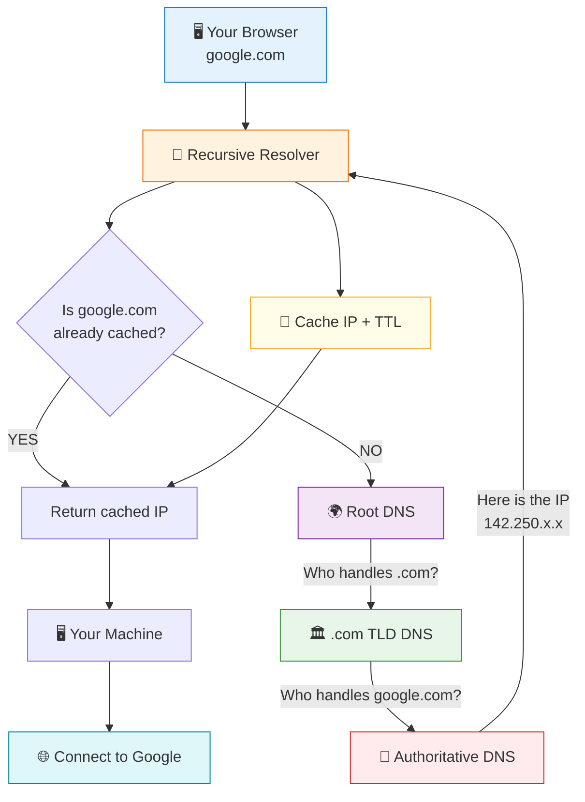
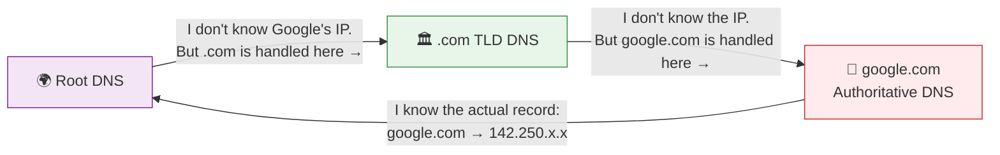
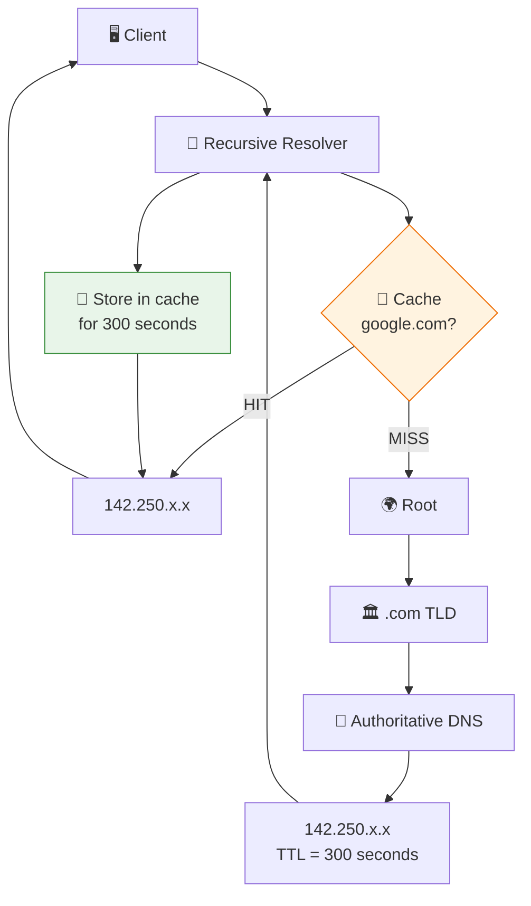
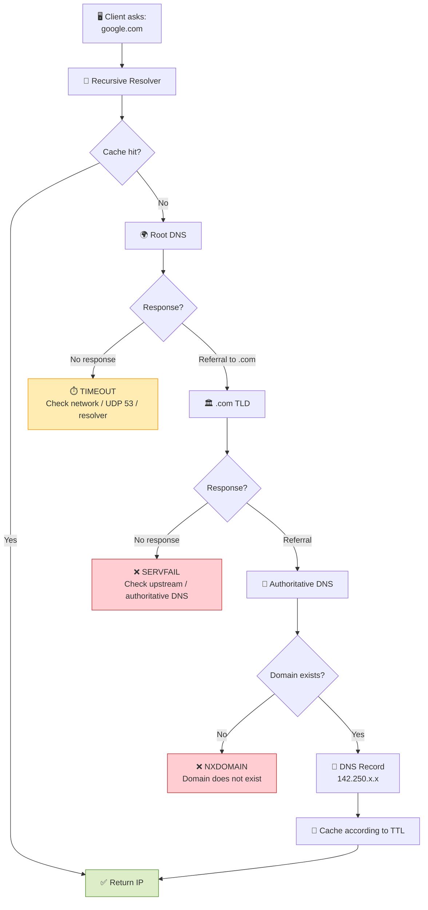
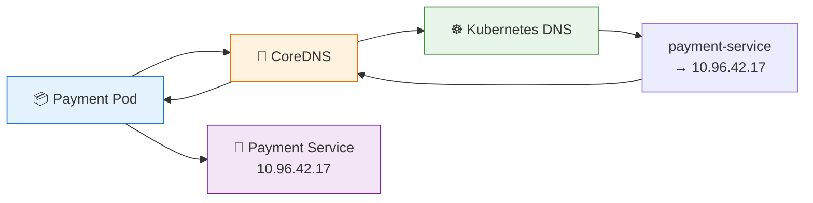

# DNS (Domain Name Server)

### 1. Normal DNS resolution



### 2. The key idea

Think of DNS as **asking a chain of directories for increasingly specific information**:



### 3. What each server actually knows

This is the part that is **really important for interviews**:



In other words:

**Root:**

> "I don't know `google.com`, but I know who manages `.com`."

**`.com` TLD:**

> "I don't know Google's IP, but I know which authoritative nameservers manage `google.com`."

**Authoritative server:**

> "I am responsible for `google.com`. Here is its DNS record."

---

## 4. Where caching fits in

The recursive resolver is usually the most important component to understand:



Suppose the authoritative server says:

```text
google.com → 142.250.x.x
TTL → 300 seconds
```

The recursive resolver can answer subsequent clients from its cache for those **300 seconds**.

So:

```text
                 First request
                     │
                     ▼
Client ──────► Recursive Resolver
                     │
                  Cache MISS
                     │
                     ▼
              Root → TLD → Auth
                     │
                     ▼
                142.250.x.x
                     │
                     ▼
                   Cache
                     │
                     ▼
                   Client


                 Next request
                     │
                     ▼
Client ──────► Recursive Resolver
                     │
                  Cache HIT
                     │
                     ▼
                142.250.x.x
```

That is why the recursive resolver can make DNS look extremely fast.

---

## 5. What happens when DNS fails?

Now you can place your failure modes directly onto the resolution path:



### Remember the three common errors

| Error        | Meaning                                        | Think                                  |
| ------------ | ---------------------------------------------- | -------------------------------------- |
| **NXDOMAIN** | Domain definitively doesn't exist              | 🚫 **"No such domain"**                |
| **SERVFAIL** | Resolver couldn't successfully complete lookup | 💥 **"Something went wrong upstream"** |
| **Timeout**  | Didn't get a response in time                  | ⏱️ **"Nobody answered"**               |

---

## 6. And in Kubernetes / microservices

The exact same concept happens internally:



If CoreDNS is broken:

```text
Payment Pod
    │
    │ lookup payment-service
    ▼
 CoreDNS
    │
    X  💥 CoreDNS unavailable
    │
    ▼
"lookup payment-service: no such host"
```

Notice something subtle:

> **The Payment Service itself can be perfectly healthy while DNS makes it unreachable by name.**

That's why DNS is such an important production troubleshooting skill.

### The mental model I'd memorize

```text
                 DNS LOOKUP

Client
  │
  ▼
Recursive Resolver
  │
  ├── Cache HIT ──────────────► IP
  │
  └── Cache MISS
        │
        ▼
      Root
   "Who handles .com?"
        │
        ▼
      TLD
   "Who handles google.com?"
        │
        ▼
  Authoritative
   "Here is the IP"
        │
        ▼
 Recursive Resolver
   "Cache it + TTL"
        │
        ▼
      Client
        │
        ▼
     Connect
```

**One sentence for an interview:**

> “The client asks a recursive resolver, which first checks its cache; on a miss, it walks the DNS hierarchy from root to TLD to authoritative nameserver, gets the record, caches it according to its TTL, and returns the IP to the client.”
