## Kubernetes Pod Lifecycle & Reconciliation

```mermaid
flowchart TD
    A["User / kubectl"] -->|Create / Update| B["API Server"]
    B -->|Persist state| C["etcd"]

    B -->|Watch / Read resources| D["Controller"]

    D --> E{"Desired State == Observed State?"}

    E -->|Yes| F["Nothing to do"]
    E -->|No| G["Reconcile / Take Action"]

    G -->|Create / Update resources| B

    B --> H["Scheduler"]
    H -->|Assign Pod to Node| B

    B --> I["Kubelet"]
    I -->|Run / Maintain Pod| J["Containers"]

    I -->|Report status| B
    B -->|Persist updated state| C
```



## When a Pod Disappears

```
Pod disappears
      ↓
Controller sees:
Desired = 3 Pods
Actual  = 2 Pods
      ↓
Controller creates a new Pod
      ↓
API Server
      ↓
Scheduler assigns it to a node
      ↓
Kubelet starts the Pod's containers
```

## When a Container Crashes

```
Container crashes
      ↓
Kubelet detects it
      ↓
Kubelet restarts container (Based on Pod's restart policy)

Example:
restartPolicy: Always
```

## Component Responsibilities

```
Kubelet    → manages containers/Pods on its node
Controller → manages desired number/state of Kubernetes resources
Scheduler  → decides which node gets a Pod
API Server → communication + state interface
etcd       → persistent storage of cluster state
```