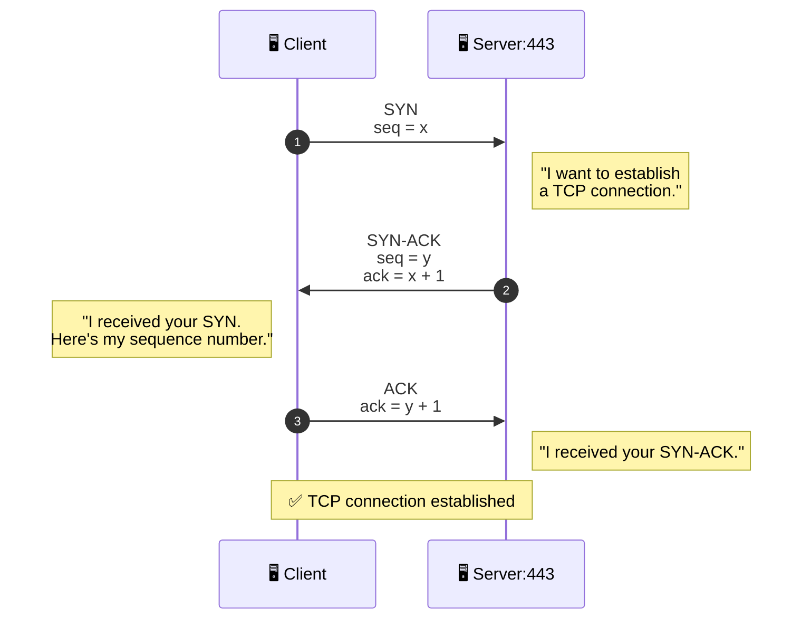
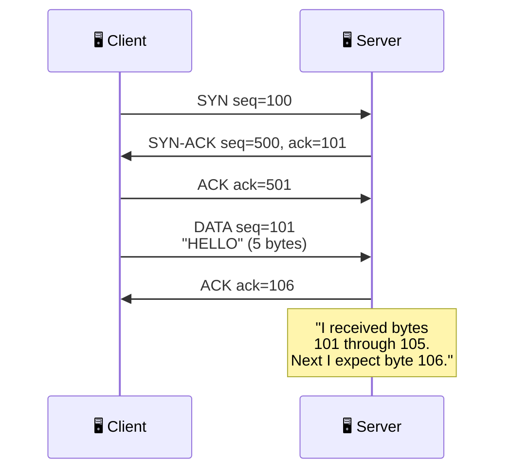
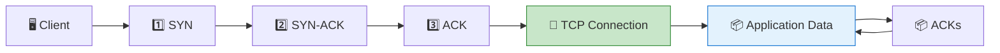
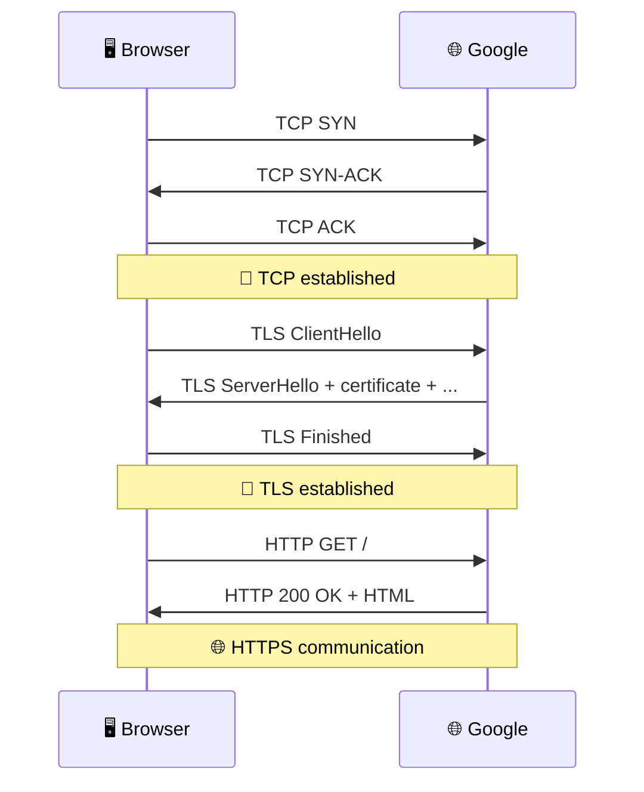
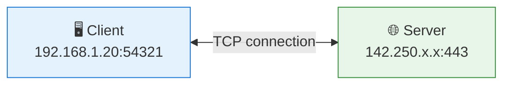
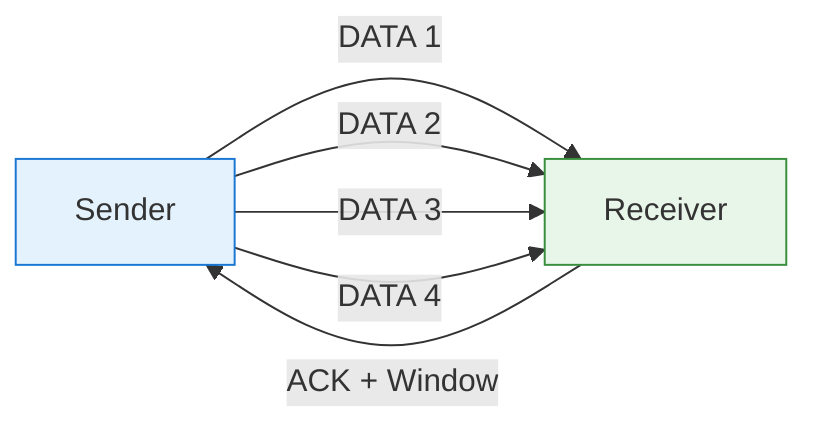
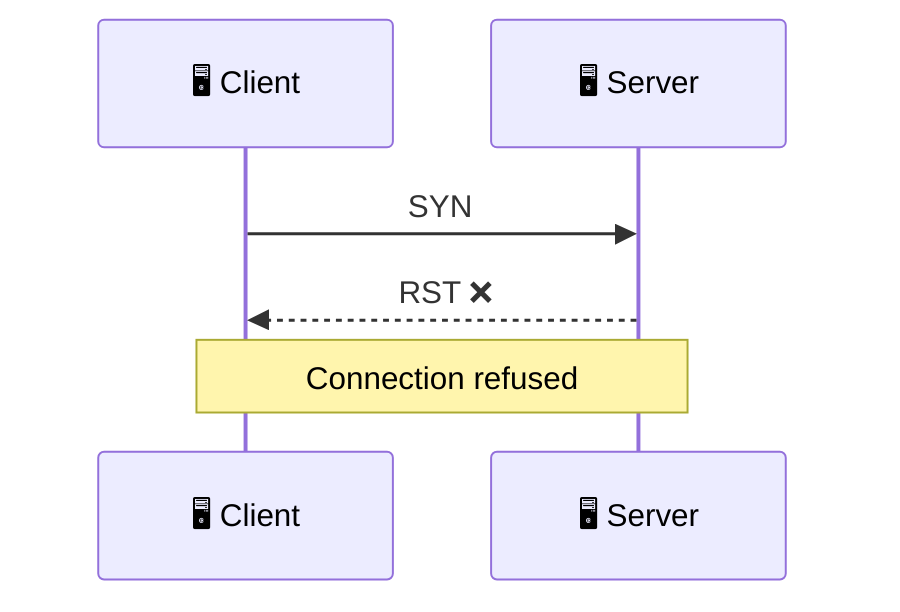
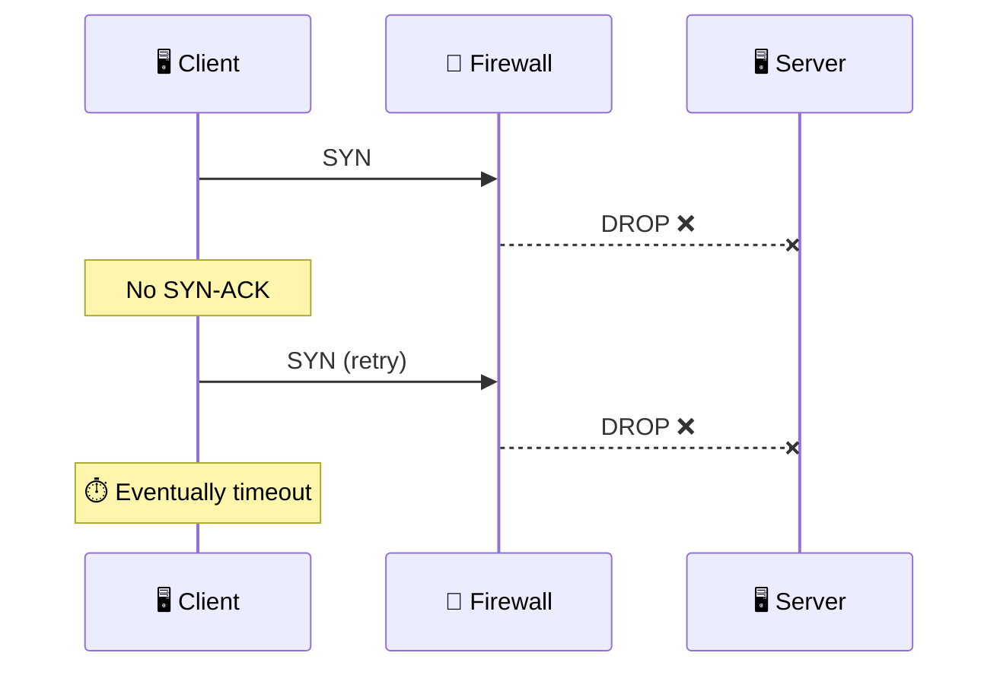
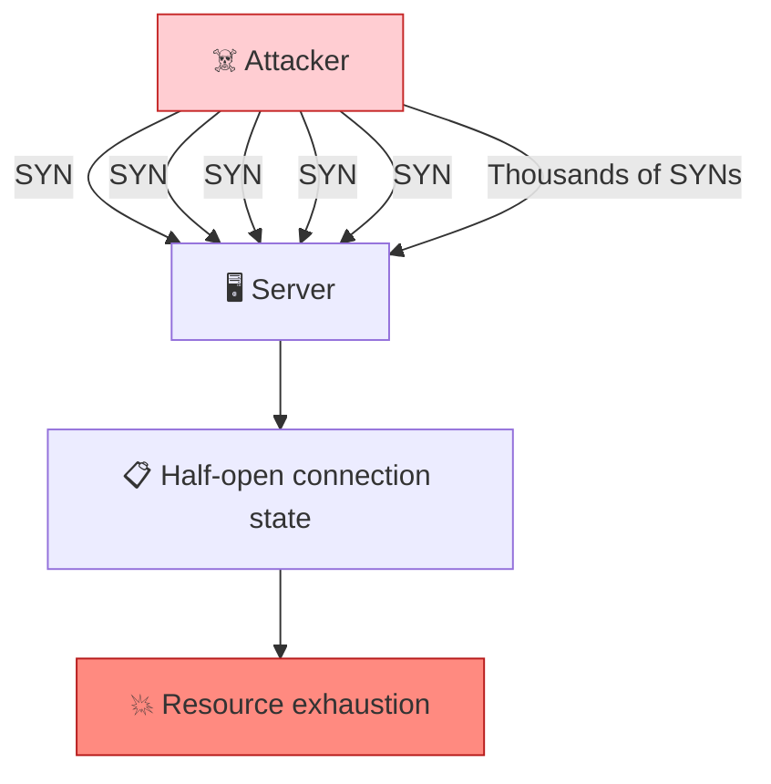
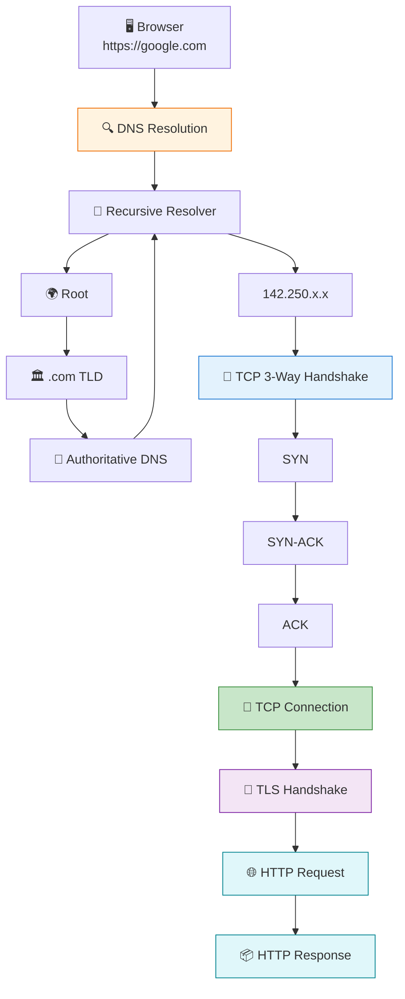

# TCP (Transport Control Protocol)

## 1. TCP 3-Way Handshake



### Think of it as:

```text
CLIENT                                      SERVER
  │                                            │
  │──────────── SYN (seq=x) ─────────────────►│
  │          "Can we talk?"                    │
  │                                            │
  │◄────── SYN-ACK (seq=y, ack=x+1) ─────────│
  │          "Yes. I heard you."               │
  │                                            │
  │──────────── ACK (ack=y+1) ───────────────►│
  │          "Great, I heard you too."         │
  │                                            │
  │           CONNECTION ESTABLISHED           │
  │                                            │
  │════════════ DATA TRANSFER ════════════════►│
```

---

# 2. What are `seq` and `ack` actually doing?

This is one of the most important TCP concepts.

Imagine the client wants to send:

```text
HELLO
```

TCP numbers bytes so it can detect missing or out-of-order data.



So:

```text
Client sends:
    seq = 101
    "HELLO" = 5 bytes

Server replies:
    ack = 106

Meaning:

"I successfully received bytes
101, 102, 103, 104, 105.

The next byte I want is 106."
```

That's how TCP provides **ordered and reliable delivery**.

---

# 3. What happens after the handshake?

The handshake isn't the actual application data.

It establishes the connection first:



For HTTPS, the overall flow is roughly:

```text
DNS
 │
 ▼
IP address
 │
 ▼
TCP 3-way handshake
 │
 ▼
TLS handshake
 │
 ▼
HTTP request
 │
 ▼
HTTP response
```

So when you type:

```text
https://google.com
```

you can mentally visualize:



---

# 4. TCP ports

The connection isn't simply:

```text
Client → Server
```

It's actually identified by a **4-tuple**:

```text
Source IP
Source Port
Destination IP
Destination Port
```

For example:

```text
Client
192.168.1.20:54321
       │
       │ TCP
       ▼
Google
142.250.x.x:443
```

So the connection is:

```text
192.168.1.20 : 54321
        ↓
142.250.x.x : 443
```

Where:

```text
54321 = ephemeral client port
443   = HTTPS server port
```

A useful mental model:



The server can therefore have thousands of TCP connections to port `443` simultaneously because each connection has a different client-side tuple.

---

# 5. MSS and Window Size

There are two different concepts worth separating.

### MSS — "How big can each TCP payload be?"

For a typical Ethernet MTU:

```text
Ethernet MTU
    1500 bytes
       │
       ├── IP header      ~20 bytes
       ├── TCP header     ~20 bytes
       │
       └── TCP payload   ~1460 bytes
```

Therefore:

```text
1500 - 20 - 20 = 1460 bytes
```

So TCP might split:

```text
Large application data
        │
        ▼
┌──────────────┐
│ TCP segment  │ 1460 bytes
├──────────────┤
│ TCP segment  │ 1460 bytes
├──────────────┤
│ TCP segment  │ 1460 bytes
├──────────────┤
│ TCP segment  │ ...
└──────────────┘
```

### Window — "How much can I send before waiting?"

Imagine the receiver says:

```text
Receive Window = 10,000 bytes
```

The sender can have roughly that much unacknowledged data in flight.



This is part of **TCP flow control**.

A larger effective window generally allows more data to be in flight, which matters especially on high-latency connections.

---

# 6. TCP failures — visualize the difference

This is particularly useful in interviews.

## Connection refused



The important distinction:

> **Something answered you and explicitly rejected the connection.**

Typical symptom:

```text
connect() → ECONNREFUSED
```

Usually happens when nothing is listening on that port, or something actively sends a reset.

---

## Connection timeout



The key difference:

```text
REFUSED:

Client ── SYN ──► Server
Client ◄─ RST ─── Server
              ↑
          "NO"


TIMEOUT:

Client ── SYN ──► 🧱
                  X
              silently dropped

              ...waiting...

              ⏱️ TIMEOUT
```

**Interview shortcut:**

> `RST` → somebody actively rejected you.
> No response → something is probably dropping or preventing the traffic.

---

# 7. SYN flood

Normally:

```text
SYN
 │
 ▼
Server allocates state
 │
 ▼
SYN-ACK
 │
 ▼
ACK
 │
 ▼
Connection
```

An attacker can instead do:



The attacker doesn't complete the handshake.

The server has lots of:

```text
SYN received
    ↓
SYN-ACK sent
    ↓
Waiting for ACK...
    ↓
Waiting...
    ↓
Waiting...
```

**SYN cookies** help by avoiding allocation of full connection state until the final ACK arrives.

---

# 8. The complete mental model

Put DNS and TCP together:



### The interview mental model

```text
1. DNS
   "What IP is google.com?"

          ↓

2. TCP
   "Can we establish a reliable connection?"

   SYN
   SYN-ACK
   ACK

          ↓

3. TLS
   "Can we establish encrypted communication?"

          ↓

4. HTTP
   "GET /"

          ↓

5. Server
   "200 OK + response"
```

The **most important distinction** is:

> **DNS finds the destination. TCP establishes the reliable connection. TLS encrypts it. HTTP carries the application request/response.**
