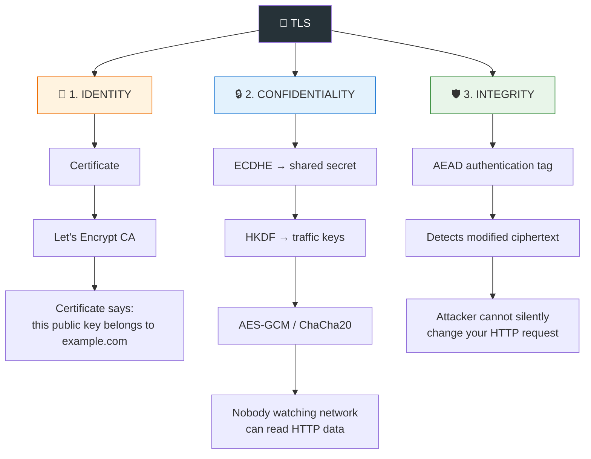
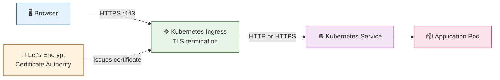
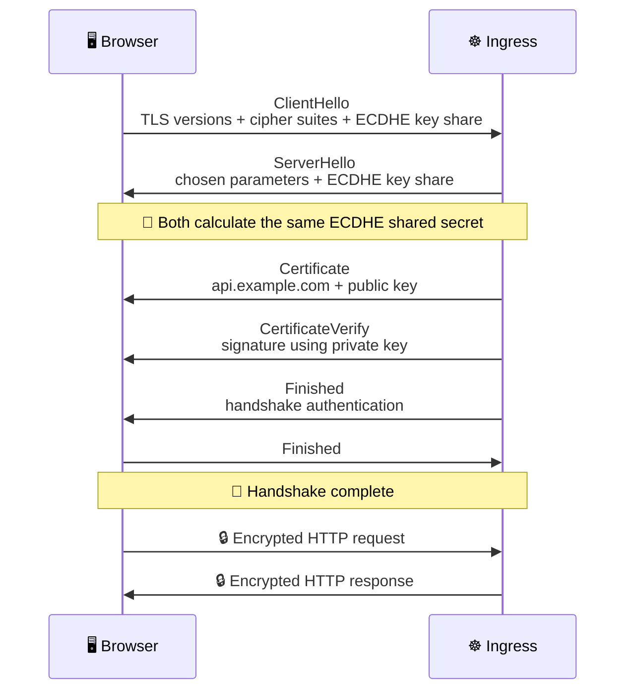
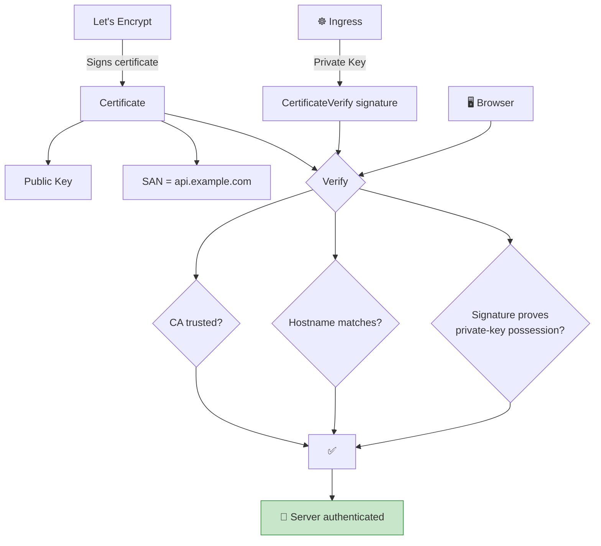
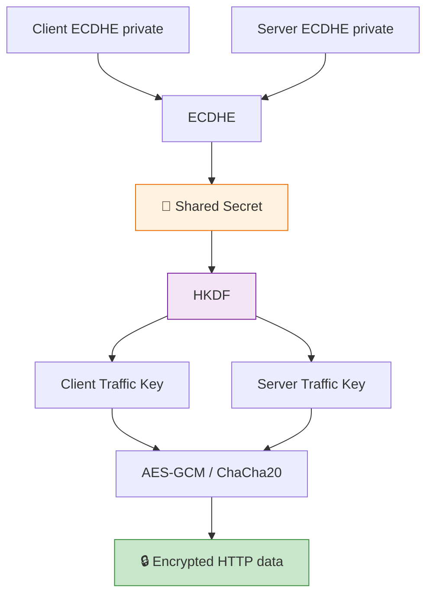
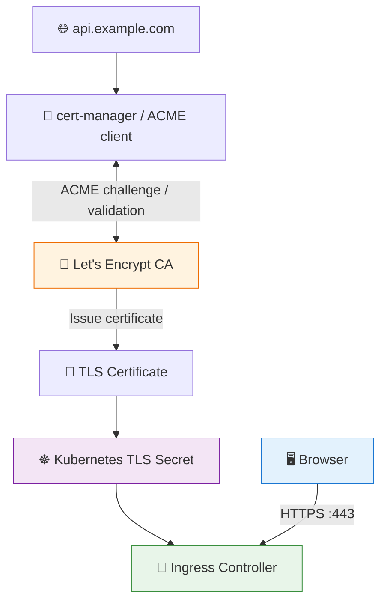
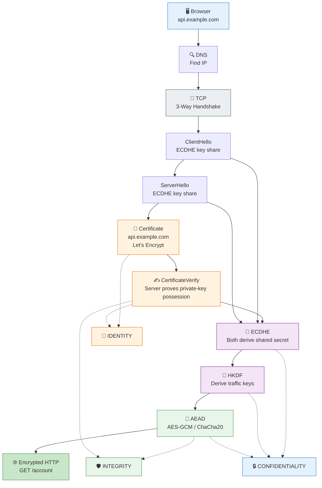

# TLS (Transport Layer Security) / SSL (Secure Sockets Layer)

> In TLS 1.3, **ECDHE is not “asymmetric encryption used to encrypt the handshake/data.”** It is a **key-agreement mechanism**. The certificate's asymmetric key is primarily used for **authentication/signatures**. Once the handshake derives symmetric traffic keys, **AEAD encryption + authentication** protects the actual data. ([RFC Editor][1])

That distinction is worth getting right if you want to understand TLS “by heart.”

Also, since you're using **Ingress + Let's Encrypt**, I'll map the theory directly to that setup.

---

# 1. The big picture: TLS has 3 security jobs

When you say:

> **TLS = identity + encryption + integrity**

that's an excellent mental model.

Think of it like this:



Memorize this:

```text
             TLS
              │
     ┌────────┼────────┐
     ↓        ↓        ↓
  IDENTITY  SECRET   INTEGRITY
     │        │        │
 Certificate ECDHE    AEAD
     │        │        │
Let's Encrypt  ↓      ↓
     │      AES-GCM  Tag
     │      ChaCha20
     ↓        ↓        ↓
 "Who?"   "Can't read" "Can't modify"
```

---

# 2. Now let's put your Let's Encrypt Ingress into the picture

Suppose you have:

```text
https://api.example.com
```

and Kubernetes:

```text
Internet
   │
   ▼
Ingress Controller
   │
   ▼
Kubernetes Service
   │
   ▼
Application Pod
```

Your TLS architecture probably looks roughly like this:



This is **very important**:

### Let's Encrypt does NOT encrypt your traffic.

Let's Encrypt's job is essentially:

> **"I certify that this public key is associated with `api.example.com`."**

The **Ingress** possesses the corresponding private key and uses it during TLS authentication.

Let's Encrypt is a **Certificate Authority**, and its certificates are obtained through the ACME protocol after demonstrating control of the domain. ([Let's Encrypt][2])

---

# 3. What exactly is inside the certificate?

Imagine Let's Encrypt gives your Ingress a certificate containing something conceptually like:

```text
Certificate
┌───────────────────────────────────────┐
│ Subject / SAN: api.example.com        │
│                                       │
│ Public Key:                            │
│   ABCDEF123456...                     │
│                                       │
│ Issuer: Let's Encrypt                 │
│                                       │
│ Valid From: ...                        │
│ Valid Until: ...                       │
│                                       │
│ Let's Encrypt's Signature:             │
│   XXXXXXXX...                         │
└───────────────────────────────────────┘
```

The corresponding private key lives on the server/Ingress:

```text
Certificate:
    public key
        │
        │ mathematically related
        │
        ▼
Ingress private key
    🔑 SECRET
```

The browser knows and trusts the CA chain.

So the browser can essentially ask:

> "Did a CA I trust sign this certificate, and does this certificate say it belongs to `api.example.com`?"

If yes, the browser has **server identity**.

---

# 4. Now visualize the TLS 1.3 handshake

Here's the more accurate TLS 1.3 picture:



The actual TLS 1.3 protocol has some details around encryption of handshake messages and key derivation, but this is the right conceptual model. TLS 1.3 uses `(EC)DHE` key exchange, certificates/signatures for authentication, HKDF for deriving traffic secrets, and AEAD for record protection. ([RFC Editor][1])

---

# 5. The most important part: where does each security property come from?

Let's trace each one.

## 🪪 IDENTITY → Certificate + Digital Signature

Suppose you're connecting to:

```text
https://api.example.com
```

The attacker says:

```text
"I'm api.example.com!"
```

How does the browser know?

The server presents:

```text
Certificate
    │
    ├── SAN = api.example.com
    │
    ├── Public Key
    │
    └── Signed by trusted CA
```

Then the server proves:

> "I actually possess the private key corresponding to that public key."

That's what **CertificateVerify** is doing in TLS 1.3. The server signs the handshake transcript with its private key. ([RFC Editor][1])

Conceptually:



### Therefore:

```text
CERTIFICATE
     +
CA TRUST
     +
CERTIFICATEVERIFY
     ↓
🪪 IDENTITY
```

This is **not** what encrypts your HTTP data.

---

# 6. 🔒 CONFIDENTIALITY → ECDHE + symmetric encryption

Now we need to solve another problem:

> "How can the browser and server get the same secret without sending that secret over the network?"

That's where ECDHE comes in.

Very simplified:

```text
                 Public Internet
                       │
       ┌───────────────┴───────────────┐
       │                               │
    Browser                          Server
       │                               │
 private key A                    private key B
       │                               │
 public key A                     public key B
       │                               │
       └─────────── ECDHE ─────────────┘
                       │
                       ▼
              SAME SHARED SECRET
```

The attacker sees:

```text
public key A
public key B
```

but doesn't have:

```text
private key A
private key B
```

Therefore the attacker can't practically derive the shared secret.

TLS 1.3 then feeds the shared secret into **HKDF** to derive the actual traffic secrets/keys. ([RFC Editor][1])

Conceptually:



So:

```text
ECDHE
  ↓
Shared secret
  ↓
HKDF
  ↓
Traffic keys
  ↓
AES-GCM / ChaCha20
  ↓
🔒 CONFIDENTIALITY
```

---

# 7. 🛡️ INTEGRITY → AEAD authentication tag

This part is often misunderstood.

Encryption alone doesn't necessarily tell you whether someone modified the ciphertext.

TLS 1.3 uses **AEAD** algorithms such as AES-GCM or ChaCha20-Poly1305. AEAD provides both encryption and authentication of the protected record. ([RFC Editor][1])

Imagine:

```text
Browser wants to send:

GET /account
```

TLS turns it conceptually into:

```text
Plaintext
    │
    ▼
┌──────────────────────────────┐
│ AEAD encryption              │
│                              │
│ key + nonce + plaintext      │
└──────────────────────────────┘
    │
    ├── ciphertext
    │
    └── authentication tag
             │
             ▼
      🔒 TLS record
```

An attacker sees:

```text
8F A2 91 C4 77 ...
```

They cannot simply change:

```text
/account
```

into:

```text
/admin
```

without causing authentication to fail.

The receiver effectively does:

```text
Received ciphertext
        │
        ▼
     AEAD verify
        │
   ┌────┴────┐
   │         │
 VALID     INVALID
   │         │
   ▼         ▼
decrypt    ❌ reject
```

Therefore:

```text
AEAD
 ├── Encryption
 │      ↓
 │   🔒 Confidentiality
 │
 └── Authentication tag
        ↓
     🛡️ Integrity
```

This is one of the most important things to remember.

---

# 8. So what does the private key actually do?

This is where people often get confused.

Your Let's Encrypt certificate has:

```text
PUBLIC KEY
```

Your Ingress has:

```text
PRIVATE KEY
```

The private key is **not used to encrypt all your HTTP traffic**.

Instead, in certificate-based TLS 1.3 authentication, the server uses the private key to **sign handshake information**.

```text
                 Let's Encrypt
                      │
                      │ signs
                      ▼
              ┌───────────────┐
              │ Certificate   │
              │               │
              │ Public Key    │
              └───────┬───────┘
                      │
                      │ browser verifies
                      ▼
                 "This key is
                  for my domain"

Ingress:
    Private Key
         │
         │ signs
         ▼
    CertificateVerify
         │
         ▼
Browser verifies signature
         │
         ▼
    🪪 AUTHENTICATED
```

So don't memorize:

> "TLS uses the certificate to encrypt data."

Instead memorize:

> **"The certificate authenticates the server; ECDHE establishes shared secrets; symmetric AEAD encryption protects the data."**

That's a much better mental model.

---

# 9. Where does Let's Encrypt fit?

Your real Kubernetes setup might look like this:



The important separation is:

### Certificate issuance

```text
cert-manager
     │
     ▼
Let's Encrypt
     │
     │ "Prove you control api.example.com"
     ▼
Certificate
     │
     ▼
Kubernetes Secret
     │
     ▼
Ingress
```

Let's Encrypt validates control of the domain through ACME challenges and then issues the certificate. ([Let's Encrypt][3])

### Actual HTTPS request

Later:

```text
Browser
   │
   │ HTTPS
   ▼
Ingress
   │
   │ TLS handshake
   ▼
Certificate + private key
   │
   ▼
ECDHE
   │
   ▼
Traffic keys
   │
   ▼
Encrypted HTTP
```

**Let's Encrypt isn't sitting in the middle of this request.**

That's a crucial distinction.

---

# 10. Your Ingress is probably the TLS termination point

Suppose:

```text
Browser
   │
   │ HTTPS
   ▼
Ingress
   │
   │ HTTP
   ▼
Service
   │
   ▼
Pod
```

Then TLS encryption exists **from the browser to the Ingress**:

```text
        ENCRYPTED
🖥️ ─────────────────► 🚪 Ingress
                         │
                         │ HTTP
                         ▼
                      Service
                         │
                         ▼
                        Pod
```

So the browser has:

```text
🔒 HTTPS
```

but the traffic between Ingress and Pod may be:

```text
⚠️ plain HTTP
```

unless you've configured **TLS/mTLS upstream** as well.

This is extremely important in Kubernetes.

If you have:

```text
Internet
   │
 HTTPS
   │
   ▼
Ingress
   │
 HTTP
   │
   ▼
Pod
```

then TLS gives you confidentiality **on the client → Ingress leg**, not automatically across the entire cluster.

---

# 11. If you use mTLS, the picture changes

Normal HTTPS:

```text
Browser ──────► Server
       Server proves identity
```

mTLS:

```text
Client ──────► Server
  │              │
  │ proves       │ proves
  │ identity     │ identity
  │              │
  └──────────────┘
```

So:

```text
Normal TLS:

Client
   │
   │ "Prove you are the server"
   ▼
Server
```

Whereas mTLS:

```text
Client                    Server
  │                          │
  │──── "Prove yourself" ───►│
  │◄──── "You too!" ─────────│
  │                          │
  └──── encrypted traffic ───┘
```

That's why service meshes use mTLS: **both services authenticate each other**.

---

# 12. The complete picture you should memorize

Here's the diagram I'd actually recommend committing to memory:



## The 3 things to say in an interview

### 🪪 Identity

**Certificate + CA trust + CertificateVerify**

> "The certificate binds the domain to a public key, and the server proves possession of the corresponding private key."

### 🔒 Encryption

**ECDHE → shared secret → HKDF → traffic keys → AES-GCM/ChaCha20**

> "ECDHE establishes shared secret material without transmitting the secret; TLS derives symmetric traffic keys from it, which protect application data."

### 🛡️ Integrity

**AEAD authentication tag**

> "TLS 1.3's AEAD record protection detects modification of encrypted records."

---

## And one correction to your notes

I'd change this:

> **Handshake | Asymmetric (ECDHE) | Securely exchange a secret**

to:

> **Key exchange | (EC)DHE | Establish shared secret material without transmitting the secret**

And change:

> **Symmetric encryption is ~1000x faster than asymmetric**

to simply:

> **Symmetric cryptography is much more efficient for bulk data; TLS therefore uses symmetric AEAD traffic keys after key establishment.**

The exact “1000x” figure isn't a useful invariant and depends heavily on the algorithms, hardware, implementation, and operation being compared.

Also, don't think of TLS as having a simple **"asymmetric encryption phase → symmetric encryption phase."** In TLS 1.3, the asymmetric operations primarily provide **authentication/signatures**, while ECDHE provides **key agreement**; then symmetric AEAD protects application traffic. ([RFC Editor][1])

If you can mentally reconstruct **`Certificate → private-key proof → ECDHE → HKDF → AEAD`**, you basically understand the core of TLS 1.3.

[1]: https://www.rfc-editor.org/info/rfc8446/?utm_source=chatgpt.com "RFC 8446: The Transport Layer Security (TLS) Protocol Version 1.3 | RFC Editor"
[2]: https://letsencrypt.org/docs/?utm_source=chatgpt.com "Documentation - Let's Encrypt"
[3]: https://letsencrypt.org/docs/challenge-types/?utm_source=chatgpt.com "Challenge Types - Let's Encrypt"
