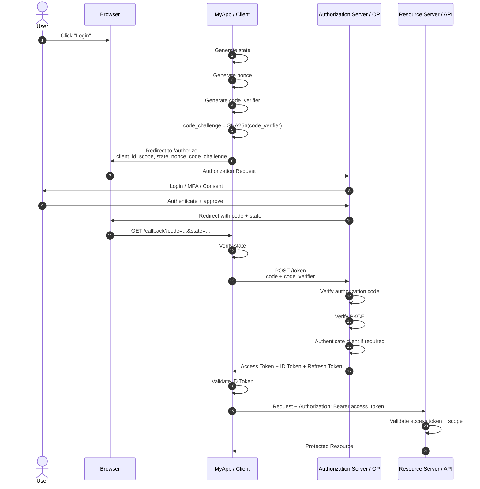

Absolutely. The easiest way to stop forgetting OAuth is to **stop memorizing grant types and parameters individually**.

Instead, keep one mental model:

> **OAuth 2.0 answers: “What is this application allowed to access?”**
> **OIDC answers: “Who is the user?”**

Everything else—authorization code, PKCE, state, nonce, access tokens, refresh tokens, scopes, client secrets, etc.—exists around that basic interaction.

I'll build this as one continuous story, starting with the problem and progressively adding each security mechanism.

---

# OAuth 2.0 + OIDC — the mental model

Imagine you have:

* **MyApp** — your application
* **Alice** — the user
* **Google/Auth0/Keycloak/Entra/etc.** — Identity Provider / Authorization Server
* **My API** — the API your application wants to call

The important thing is that **MyApp does not want Alice's password**.

Instead:

```text
Alice
  |
  | "I want to use MyApp"
  v
+---------+       "Can Alice access these things?"
| MyApp   | ------------------------------+
+---------+                               |
                                          v
                              +----------------------+
                              | Authorization Server |
                              | / Identity Provider  |
                              +----------------------+
                                          |
                                          | Alice logs in
                                          | and gives consent
                                          v
                              +----------------------+
                              | Access granted       |
                              +----------------------+
```

The Authorization Server then gives MyApp something like:

```text
"Here is a credential proving that MyApp
 is allowed to access Alice's photos."

              |
              v
        ACCESS TOKEN
```

MyApp gives that token to the API:

```text
MyApp
  |
  | Authorization: Bearer <access_token>
  v
+----------------+
| Photos API     |
+----------------+
```

That's the core of OAuth.

---

# 1. First: what problem was OAuth solving?

Before OAuth, suppose you wanted an application called:

```text
PhotoPrinter
```

to access your Google Photos.

A terrible solution would be:

```text
                    password
User ---------------------> PhotoPrinter
                               |
                               | username + password
                               v
                            Google
```

You might give PhotoPrinter:

```text
username = alice@gmail.com
password = my-google-password
```

Now PhotoPrinter has Alice's **actual Google password**.

That's awful.

It means:

### Problem 1 — The application gets the user's password

The application can potentially do everything Alice can do.

```text
PhotoPrinter
    |
    +---- Read photos
    +---- Delete photos
    +---- Change settings
    +---- Change password
    +---- Anything else
```

### Problem 2 — No limited permissions

Maybe Alice only wants:

```text
Read my photos
```

But the password gives:

```text
READ EVERYTHING
WRITE EVERYTHING
DELETE EVERYTHING
CHANGE SETTINGS
...
```

### Problem 3 — Revocation is terrible

Alice can't easily say:

> "I don't trust PhotoPrinter anymore, but I still want my Google account."

She would potentially have to change her password.

---

# 2. OAuth's fundamental idea

OAuth changes the model.

Instead of:

```text
MyApp gets user's password
```

we want:

```text
MyApp gets a limited credential
```

For example:

```text
ACCESS TOKEN

Allowed:
    photos.read

Not allowed:
    photos.delete
    account.change_password
```

So:

```text
                 User's password
                       |
                       | NEVER given to MyApp
                       X
                       |
                       v
                  Authorization
                     Server
                       |
                       | access token
                       v
                     MyApp
                       |
                       | access token
                       v
                    Photos API
```

This is the central idea of OAuth.

The OAuth 2.0 framework defines the authorization flow and roles around this model. ([IETF Datatracker][1])

---

# 3. The four actors you must know

OAuth becomes much easier once you understand the actors.

There are traditionally four:

```text
                    +----------------------+
                    |   Resource Owner     |
                    |       Alice          |
                    +----------+-----------+
                               |
                               |
                               v
+-------------+       +----------------------+       +----------------+
|    Client   |       | Authorization Server |       | Resource       |
|   MyApp     |       |       Auth Server    |       | Server         |
|             |       |                      |       | My API         |
+-------------+       +----------------------+       +----------------+
       |                       |                           |
       |                       |                           |
       +-----------------------+---------------------------+
```

### Resource Owner

Usually:

```text
the user
```

Alice owns her photos.

### Client

The application requesting access.

```text
MyApp
```

Important:

> **OAuth calls your application the Client.**

It doesn't necessarily mean a browser client.

### Authorization Server

The server that:

* authenticates the user
* asks for consent
* issues authorization codes
* issues access tokens
* issues refresh tokens

Examples:

```text
Keycloak
Auth0
Microsoft Entra ID
Google
Okta
```

### Resource Server

The API containing protected resources.

```text
https://api.example.com/photos
```

It receives access tokens and decides whether the request is authorized.

---

# 4. OAuth vs OIDC — the distinction that causes enormous confusion

This is probably the most important distinction in the entire subject.

## OAuth 2.0

OAuth answers:

> **"Is this client allowed to access this resource?"**

For example:

```text
Can MyApp read Alice's photos?
```

OAuth gives you an:

```text
ACCESS TOKEN
```

---

## OIDC

OIDC = **OpenID Connect**

OIDC is an identity layer built on top of OAuth 2.0.

It answers:

> **"Who is Alice?"**

OIDC gives you an:

```text
ID TOKEN
```

So:

```text
OAuth 2.0
    |
    | authorization
    v
Access Token
    |
    v
"What can this application access?"


OIDC
    |
    | authentication / identity
    v
ID Token
    |
    v
"Who authenticated?"
```

The OpenID Connect specification explicitly defines authentication on top of OAuth and returns the authentication result in an ID Token. ([OpenID Foundation][2])

### The easiest memory trick

Remember:

```text
ACCESS TOKEN → API
ID TOKEN     → APPLICATION
```

More specifically:

```text
Access Token:
    "This client is authorized to access X."

ID Token:
    "This user authenticated with the Identity Provider."
```

**Do not use an ID token as an API access token.**

That distinction will save you from many OAuth bugs.

---

# 5. Now let's build the modern flow

Suppose:

```text
Frontend:
    https://myapp.example

Authorization Server:
    https://auth.example

API:
    https://api.example
```

Alice clicks:

```text
Login
```

For a modern user-facing application, the flow you'll most commonly encounter is:

> **Authorization Code Flow + PKCE + OIDC**

Think of that as the default modern recipe.

```text
OIDC
  +
OAuth Authorization Code
  +
PKCE
  +
state
  +
nonce
  =
modern login flow
```

The current OAuth security best practice recommends authorization code flow and requires authorization servers to support PKCE; it also recommends S256 for PKCE. ([IETF Datatracker][3])

Now let's walk through it **one step at a time**.

---

# 6. Step 0 — registration

Before MyApp can use the Authorization Server, it needs to be registered.

For example:

```text
Client ID:
    my-app-123

Redirect URI:
    https://myapp.example/oauth/callback

Allowed scopes:
    openid
    profile
    email
    photos.read
```

The Authorization Server now knows:

```text
my-app-123
      |
      +-- belongs to MyApp
      |
      +-- redirect URI = https://myapp.example/oauth/callback
```

This is important because otherwise an attacker could say:

```text
"I am MyApp.
Send the authorization result to:
https://evil.example/callback"
```

The registered redirect URI prevents that.

OIDC requires the redirect URI to match a pre-registered URI, with strict matching rules. ([OpenID Foundation][2])

---

# 7. Public vs Confidential Clients

This is another term you should understand early.

## Confidential client

A backend application that can keep credentials secret.

For example:

```text
Browser
   |
   v
MyApp backend
   |
   v
Authorization Server
```

The backend can have:

```text
client_id
client_secret
```

because the secret lives on the server.

---

## Public client

An application where you **cannot safely keep a secret**.

Examples:

```text
SPA JavaScript
Mobile app
Desktop app
```

Why can't a mobile app have a secret?

Because someone can download the application and inspect it.

If you put:

```text
CLIENT_SECRET=super-secret-123
```

inside JavaScript or a mobile APK:

```text
Attacker
   |
   +--> downloads application
   |
   +--> extracts "secret"
```

It's no longer secret.

Therefore:

```text
Public Client
    |
    X
    | "client_secret"
    |
    v
```

is not a meaningful security boundary.

This is one of the reasons PKCE exists.

---

# 8. Step 1 — the client starts login

Alice clicks:

```text
Login with Example
```

MyApp generates several random values.

Conceptually:

```text
state = random_value_1
nonce = random_value_2

code_verifier = random_value_3
```

The third one is related to PKCE.

Don't worry about it yet.

MyApp then sends Alice's browser to:

```text
https://auth.example/authorize
```

with something like:

```text
GET /authorize?

    client_id=my-app-123

    &redirect_uri=https://myapp.example/oauth/callback

    &response_type=code

    &scope=openid profile email

    &state=abc123

    &nonce=xyz789

    &code_challenge=...
    
    &code_challenge_method=S256
```

Don't memorize every parameter yet.

We'll explain each one.

---

# 9. Why redirect the browser?

This is an extremely important concept.

MyApp wants Alice to authenticate.

But MyApp should **not** ask:

```text
Username?
Password?
MFA?
Passkey?
```

Instead:

```text
Browser
   |
   | redirect
   v
Authorization Server
   |
   | "Please log in"
   v
Alice
```

Now Alice enters her credentials **at the Authorization Server**.

```text
                  +--------------------+
                  | Authorization      |
                  | Server             |
                  |                    |
                  | Email: ______      |
                  | Password: _____    |
                  | MFA: ______        |
                  +--------------------+
                            ^
                            |
                         Alice
```

MyApp never sees the password.

That's a huge part of the security model.

---

# 10. What happens at the Authorization Server?

The Authorization Server:

1. identifies the client
2. validates the redirect URI
3. authenticates Alice
4. determines what Alice is allowed to authorize
5. potentially shows consent
6. generates an authorization code

Conceptually:

```text
Alice
  |
  | logs in
  v
Authorization Server
  |
  | Alice says "yes"
  v
Authorization Code
```

The server redirects Alice's browser back:

```text
https://myapp.example/oauth/callback?
    code=SplxlOBeZQQ...
    &state=abc123
```

Notice something interesting.

It did **not** send:

```text
access_token=...
```

It sent:

```text
code=...
```

This is the **Authorization Code**.

---

# 11. Why not send the access token directly?

Imagine the old-style idea:

```text
Authorization Server
        |
        | access_token
        v
     Browser
        |
        v
      MyApp
```

Now the access token travels through the browser.

That creates more opportunities for token leakage.

The authorization code flow instead does:

```text
Authorization Server
        |
        | short-lived code
        v
     Browser
        |
        v
      MyApp
        |
        | code
        v
Authorization Server
        |
        | tokens
        v
      MyApp
```

The browser only carries the temporary authorization code.

The tokens come from the **token endpoint**.

OIDC's authorization-code flow specifically uses this model: the authorization endpoint returns a code, and the client exchanges it at the token endpoint for the ID Token and Access Token. ([OpenID Foundation][2])

---

# 12. But now we have a new problem

Suppose an attacker steals the authorization code.

```text
Alice's browser
      |
      | code=ABC
      |
      +-----------------> MyApp
      |
      +-----------------> Attacker
```

The attacker could try:

```text
POST /token

code=ABC
```

and exchange the code for tokens.

That's called an **authorization code interception** problem.

This is where PKCE comes in.

---

# 13. PKCE — the missing puzzle piece

PKCE is pronounced:

> **"pixy"**

PKCE = **Proof Key for Code Exchange**.

The fundamental idea:

> The application creates a secret random value before starting the flow and later proves that it knows that value.

The application generates:

```text
code_verifier

                |
                | SHA-256
                v

code_challenge
```

For the recommended S256 method:

```text
code_challenge =
    BASE64URL(
        SHA256(code_verifier)
    )
```

The application sends the challenge first:

```text
Browser
   |
   | code_challenge
   v
Authorization Server
```

But keeps the verifier:

```text
MyApp

code_verifier = SECRET_RANDOM_VALUE

             🔒
```

---

# 14. PKCE visually

Think of it like this:

```text
             BEFORE LOGIN

MyApp
 |
 | generates
 |
 +---- code_verifier = SECRET
 |
 | computes
 |
 +---- code_challenge = SHA256(SECRET)
 |
 | sends challenge
 v
Authorization Server
```

The Authorization Server stores:

```text
authorization_code ABC
        |
        +-- code_challenge = HASH(SECRET)
```

Later:

```text
             TOKEN EXCHANGE

MyApp
 |
 | code = ABC
 | code_verifier = SECRET
 v
Authorization Server
```

The server computes:

```text
SHA256(SECRET)
```

and checks:

```text
SHA256(received_verifier)
             ==
stored_code_challenge
```

If yes:

```text
                    ✓
                 tokens
```

If an attacker only stole:

```text
code = ABC
```

but doesn't know:

```text
code_verifier
```

then:

```text
Attacker
   |
   | code=ABC
   | no verifier
   v
Authorization Server
   |
   X
   |
invalid_grant
```

That's PKCE.

---

# 15. The crucial distinction: state vs PKCE

People frequently confuse these.

They solve **different problems**.

### `state`

Protects the authorization request/callback relationship.

Roughly:

> "Is this callback actually the login transaction that I started?"

```text
Start:
    state = RANDOM123

Callback:
    state = RANDOM123

       |
       +---- match → continue
       |
       +---- mismatch → reject
```

It is commonly used to defend against CSRF and login-flow injection attacks. OIDC describes `state` as an opaque value used to maintain state between the request and callback, commonly for CSRF mitigation. ([OpenID Foundation][2])

---

### PKCE

Protects the authorization code exchange.

Roughly:

> "Does the party exchanging this authorization code possess the secret created when the authorization request started?"

```text
state
  |
  +--> protects request/callback relationship


PKCE
  |
  +--> protects authorization code exchange
```

So:

> **state ≠ PKCE**

Use both.

---

# 16. Back to our flow

Alice returns to:

```text
https://myapp.example/oauth/callback
```

with:

```text
code=ABC
state=XYZ
```

MyApp checks:

```text
received_state == stored_state
```

If not:

```text
STOP
```

If yes:

```text
continue
```

Then MyApp sends a server-to-server request to:

```text
POST https://auth.example/token
```

Something conceptually like:

```text
grant_type=authorization_code
code=ABC
redirect_uri=https://myapp.example/oauth/callback
client_id=my-app-123
code_verifier=SECRET
```

If confidential:

```text
+ client authentication
```

may also occur.

---

# 17. Authorization Server validates everything

The Authorization Server checks things like:

```text
Is this code valid?
        |
        v
Is it expired?
        |
        v
Was it already used?
        |
        v
Does client_id match?
        |
        v
Does redirect_uri match?
        |
        v
Does PKCE verifier match?
        |
        v
Is client authentication valid, if required?
        |
        v
             YES
              |
              v
        issue tokens
```

Then:

```json
{
  "access_token": "...",
  "token_type": "Bearer",
  "expires_in": 3600,
  "refresh_token": "...",
  "id_token": "..."
}
```

Not every flow/provider returns every token, but this is the conceptual OIDC authorization-code result.

---

# 18. We now have THREE important credentials

This is where OAuth starts feeling complicated.

After login, you may have:

```text
Authorization Code
        ↓
    exchanged for
        ↓
+-------------------+
| Access Token      |
| ID Token          |
| Refresh Token     |
+-------------------+
```

They are **not interchangeable**.

---

# 19. Authorization Code

Purpose:

```text
temporary intermediate credential
```

Used:

```text
Client
   |
   | authorization_code
   v
Token Endpoint
```

It is not normally what you use to call your API.

Think:

> **"Here's my one-time ticket; give me the real tokens."**

It should be short-lived and single-use.

---

# 20. Access Token

Purpose:

```text
call protected APIs
```

Example:

```http
GET /api/photos
Authorization: Bearer eyJ...
```

The Resource Server receives:

```text
Access Token
```

and decides whether the request is allowed.

OAuth defines access tokens as credentials used to access protected resources. ([IETF Datatracker][1])

---

# 21. Bearer token

Most access tokens you'll encounter are:

```text
Bearer
```

The meaning is essentially:

> Whoever possesses the token can present it.

Like a physical bearer ticket:

```text
Ticket:
    "VIP entrance"

Person:
    "Here is my ticket."

Security:
    "Okay."
```

They don't necessarily know *who* physically holds it.

RFC 6750 explicitly describes bearer tokens as usable by any party possessing the token, which is why protecting them from disclosure is critical. ([IETF Datatracker][4])

That's why:

```text
Authorization: Bearer <token>
```

must be protected with TLS and careful token handling.

---

# 22. ID Token

The ID Token belongs to OIDC.

It tells your application about the authentication event.

Conceptually:

```text
{
    iss: "https://auth.example",
    sub: "user-123",
    aud: "my-app",
    exp: 1234567890,
    iat: 1234567000,
    nonce: "xyz789"
}
```

The important fields include:

### `iss`

Issuer.

```text
Who issued this token?
```

### `sub`

Subject.

```text
Which user is this?
```

### `aud`

Audience.

```text
Which application is this token intended for?
```

### `exp`

Expiration.

```text
When does this token stop being valid?
```

### `iat`

Issued-at time.

```text
When was it created?
```

### `nonce`

Connects the ID Token to the login transaction.

OIDC defines `nonce` specifically to associate a client session with an ID Token and mitigate replay attacks. ([OpenID Foundation][2])

---

# 23. The ID Token is usually a JWT

You'll commonly see:

```text
eyJhbGciOiJSUzI1NiJ9
.
eyJpc3MiOiJodHRwczovL2F1dGguZXhhbXBsZSJ9
.
signature...
```

That's a JWT.

Conceptually:

```text
HEADER
   .
PAYLOAD
   .
SIGNATURE
```

For example:

```json
HEADER
{
  "alg": "RS256",
  "typ": "JWT"
}
```

and:

```json
PAYLOAD
{
  "iss": "https://auth.example",
  "sub": "12345",
  "aud": "my-app",
  "exp": 1770000000
}
```

The signature lets the client verify:

> "Was this token signed by the trusted Authorization Server?"

---

# 24. JWT does NOT mean encrypted

This is another extremely important distinction.

A JWT can be:

```text
signed
```

without being:

```text
encrypted
```

Therefore:

```text
JWT
  |
  +---- header
  +---- payload
  +---- signature
```

The payload may be readable.

So don't put secrets into JWT claims merely because it's a JWT.

---

# 25. How does MyApp know which public key to trust?

OIDC providers normally publish metadata describing their endpoints and signing keys.

Conceptually:

```text
https://auth.example/.well-known/openid-configuration
```

which can tell the client things like:

```text
authorization_endpoint
token_endpoint
userinfo_endpoint
jwks_uri
issuer
...
```

Then:

```text
MyApp
  |
  | "Where are your signing keys?"
  v
Authorization Server metadata
  |
  v
JWKS endpoint
  |
  v
Public keys
```

The ID Token can then be cryptographically verified.

This is why an ID Token isn't simply:

```text
decode JWT
trust payload
```

You must **validate it**.

---

# 26. ID Token validation

At a high level, your OIDC client verifies things such as:

```text
Signature valid?
       ↓
Issuer correct?
       ↓
Audience contains my client ID?
       ↓
Expiration valid?
       ↓
Nonce matches?
       ↓
Other applicable claims valid?
       ↓
YES
```

OIDC explicitly requires validation of the ID Token and defines checks around its claims and signature. ([OpenID Foundation][2])

This is why you generally want to use a mature OIDC library rather than manually implementing all token validation.

---

# 27. UserInfo endpoint

OIDC can also give you a:

```text
UserInfo Endpoint
```

The application sends an **Access Token**:

```text
MyApp
   |
   | Authorization: Bearer <access_token>
   v
UserInfo endpoint
```

and can receive user claims.

For example:

```json
{
    "sub": "user-123",
    "name": "Alice",
    "email": "alice@example.com"
}
```

The important conceptual distinction is:

```text
ID Token
    |
    +--> information about authentication
    |    intended for the client
    |
    v

UserInfo
    |
    +--> claims about the user
    |    obtained using an access token
    |
    v
```

---

# 28. Scope — what is the application asking for?

Remember our original problem:

> "I don't want to give MyApp everything."

That's what scopes help with.

Suppose MyApp asks:

```text
scope=photos.read photos.write
```

This means roughly:

```text
I want:
    photos.read
    photos.write
```

The Authorization Server can issue an access token whose permissions are limited accordingly.

For OIDC, there's a special scope:

```text
openid
```

This is extremely important.

```text
scope=openid
```

means:

> "This is an OpenID Connect request."

You may also see:

```text
openid profile email
```

Think:

```text
openid
   |
   +--> turn OAuth request into OIDC request

profile
   |
   +--> request standard profile information

email
   |
   +--> request email-related claims
```

---

# 29. Scope vs Role

Don't confuse:

```text
scope
```

with:

```text
role
```

Scope is generally about what the client is authorized to do/access.

Example:

```text
photos.read
photos.write
```

Roles are often an application's authorization model:

```text
admin
manager
user
support
```

For example:

```text
scope:
    invoices.read

role:
    accountant
```

They can interact, but they are conceptually different.

---

# 30. The complete modern flow

Now put everything together.

```text
                         ┌─────────────────────┐
                         │ Authorization       │
                         │ Server / OP         │
                         │                     │
                         │ Login               │
                         │ Consent             │
                         │ Token Endpoint      │
                         │ JWKS                │
                         └─────────┬───────────┘
                                   │
                                   │
             2. redirect          │
        ┌──────────────────────────┘
        │
        v
+---------------+          1. Login
|    Browser    | <-------------------+
+-------+-------+                      |
        |                              |
        |                              |
        | 3. authorization code        |
        | + state                      |
        v                              |
+---------------+                      |
|     MyApp     | ---------------------+
|    Client     |
+-------+-------+
        |
        | 4. code + code_verifier
        |
        v
+-----------------------+
| Token Endpoint        |
+-----------+-----------+
            |
            | 5. tokens
            |
            +---- Access Token
            |
            +---- ID Token
            |
            +---- Refresh Token
            |
            v
       +------------+
       |   MyApp    |
       +------+-----+
              |
              | 6. Bearer access token
              v
       +--------------+
       |  Resource    |
       |   Server     |
       |    / API     |
       +--------------+
```

And PKCE fits around steps 1–5:

```text
MyApp

code_verifier = SECRET
       |
       | SHA-256
       v
code_challenge
       |
       +----------------------+
                              |
                              v
                    Authorization Server
                              |
                     stores challenge
                              |
                              v
                         code = ABC
                              |
                              v
                           MyApp
                              |
                    code + verifier
                              |
                              v
                    Authorization Server
                              |
                    SHA256(verifier)
                              |
                         == challenge?
                              |
                             YES
                              |
                              v
                           tokens
```

---

# 31. The entire flow in one Mermaid diagram



If you can understand this diagram, you understand the majority of OAuth/OIDC.

---

# 32. What exactly does PKCE protect?

Let's explicitly compare.

## Without PKCE

```text
Browser
   |
   | authorization code
   +----------------------+
                          |
                          v
                     MyApp

Attacker somehow steals code
   |
   | code
   v
Token Endpoint
   |
   v
Potential token theft
```

The authorization code itself is the thing being stolen.

---

## With PKCE

```text
MyApp

code_verifier = SECRET
       |
       +---- kept by MyApp

code_challenge = SHA256(SECRET)
       |
       +---- sent to Authorization Server
```

Later:

```text
Attacker:

code = ABC
verifier = ????

         X
```

But:

```text
MyApp:

code = ABC
verifier = SECRET

         ✓
```

So the authorization code isn't sufficient.

This is why PKCE is especially important for public clients, and current OAuth security guidance recommends it broadly. ([IETF Datatracker][3])

---

# 33. Why PKCE doesn't replace client authentication

This is subtle.

A confidential client might have:

```text
client_id
client_secret
```

and also use:

```text
PKCE
```

So:

```text
Client authentication
        +
PKCE
```

can provide two different protections.

Think:

```text
client_secret
    |
    +--> "Which registered client are you?"

PKCE
    |
    +--> "Does this client possess the verifier
          from the original authorization request?"
```

For public clients:

```text
client_secret
    |
    X can't be kept secret

PKCE
    |
    ✓ used instead
```

---

# 34. Why do we need `nonce` if we already have `state`?

Again, different jobs.

```text
state
    |
    +--> OAuth authorization response
    +--> bind request ↔ callback
    +--> CSRF protection


nonce
    |
    +--> OIDC authentication
    +--> bind authentication request ↔ ID Token
    +--> replay protection
```

Visual:

```text
                 LOGIN TRANSACTION

MyApp
 |
 +-- state -------------> callback
 |
 +-- nonce --------------------------> ID Token
 |
 +-- code_challenge -----------------> token exchange
```

Three random values, three jobs:

```text
state
    = request/callback binding

nonce
    = authentication/ID-token binding

code_verifier
    = authorization-code binding
```

That's an excellent thing to memorize.

---

# 35. Refresh Tokens

Access tokens are usually short-lived.

For example:

```text
Access Token
    expires in 5-60 minutes
```

Why?

Because if a bearer token leaks:

```text
attacker has token
       |
       v
limited lifetime
```

But users don't want to log in every 30 minutes.

That's where refresh tokens come in.

```text
                 Access Token
                      |
                   expires
                      |
                      X
                      |
                      v
                  Refresh Token
                      |
                      | POST /token
                      v
              Authorization Server
                      |
                      v
               New Access Token
```

Conceptually:

```text
Access Token:
    short-lived
    used with APIs

Refresh Token:
    longer-lived
    used to obtain new access tokens
```

A refresh token is **not** normally sent to your API.

---

# 36. Refresh flow

Suppose:

```text
Access Token = AT1
Refresh Token = RT1
```

AT1 expires.

MyApp sends:

```text
POST /token

grant_type=refresh_token
refresh_token=RT1
```

Authorization Server responds:

```text
Access Token = AT2
```

Possibly:

```text
Refresh Token = RT2
```

This latter behavior is called **refresh token rotation**.

Conceptually:

```text
RT1
 |
 | refresh
 v
AT2 + RT2
       |
       X
      RT1
```

This can help detect/reduce replay of stolen refresh tokens.

---

# 37. Why refresh tokens are much more sensitive

An access token might expire in:

```text
10 minutes
```

A refresh token could potentially remain valid much longer.

If an attacker gets:

```text
Access Token
```

they may have API access for its remaining lifetime.

If they get:

```text
Refresh Token
```

they may potentially continuously obtain new access tokens.

Therefore:

```text
Refresh Token
     |
     +--> HIGH VALUE
```

Treat it accordingly.

---

# 38. Bearer tokens create an important problem

Remember:

```text
Bearer token
=
whoever possesses it can use it
```

Imagine:

```text
Access Token = ABC123

Attacker steals ABC123
        |
        v
Authorization: Bearer ABC123
        |
        v
API
```

The API may have no idea it's an attacker.

That's a token replay problem.

---

# 39. DPoP — proof of possession

A newer mechanism is:

> **DPoP — Demonstrating Proof of Possession**

Instead of:

```text
"I have the token."
```

the client proves:

```text
"I have the token AND the private key
 associated with that token."
```

Conceptually:

```text
Client
  |
  +---- private key 🔐
  |
  +---- access token
  |
  +---- DPoP proof
  |
  v
API
```

The Authorization Server binds the token to the client's public key.

Then:

```text
Stolen token
     |
     v
Attacker
     |
     X
     |
"No private key"
```

DPoP is standardized in RFC 9449 and is designed to sender-constrain access and refresh tokens to help prevent replay. ([IETF Datatracker][5])

You don't need DPoP to understand normal OAuth, but you should know the term.

---

# 40. Authentication vs authorization

This is worth drilling into.

## Authentication

```text
WHO are you?
```

Examples:

```text
Password
Passkey
MFA
Biometrics
```

OIDC is concerned with communicating the authentication result.

---

## Authorization

```text
WHAT are you allowed to do?
```

Examples:

```text
photos.read
photos.write
calendar.read
```

OAuth is primarily about authorization.

So:

```text
Authentication
     |
     | "Alice successfully logged in"
     v
OIDC / ID Token


Authorization
     |
     | "MyApp may read Alice's photos"
     v
OAuth / Access Token
```

---

# 41. The Authorization Server and Identity Provider aren't necessarily conceptually identical

You'll often hear:

```text
IdP
OP
Authorization Server
OAuth Server
Identity Provider
```

These terms can overlap depending on architecture.

For OIDC terminology:

```text
OP = OpenID Provider
```

For OAuth:

```text
AS = Authorization Server
```

In a typical modern system:

```text
               Auth0 / Keycloak / Entra / etc.
                         |
             +-----------+-----------+
             |                       |
       OAuth authorization       OIDC authentication
             |                       |
       Access Tokens              ID Tokens
```

One system often plays both roles.

---

# 42. What is the Resource Server?

Don't accidentally think:

```text
Authorization Server = API
```

They are logically different.

```text
              Authorization Server
                      |
                      | issues token
                      v
                   Client
                      |
                      | access token
                      v
               Resource Server
                      |
                      v
                   API data
```

For example:

```text
auth.example.com
    |
    +--> login
    +--> /authorize
    +--> /token
    +--> /userinfo
    +--> signing keys


api.example.com
    |
    +--> /users
    +--> /photos
    +--> /orders
```

---

# 43. What does the API actually do with the Access Token?

Suppose:

```http
GET /photos
Authorization: Bearer eyJ...
```

The API needs to determine:

```text
Is this token valid?

Who/what issued it?

Is it expired?

Was it intended for this API?

Does it have the required scope?

Is it revoked/introspected if applicable?

Is the token type correct?
```

Then:

```text
              Access Token
                   |
                   v
             +-----------+
             |    API    |
             +-----------+
                   |
          +--------+--------+
          |                 |
        valid?             scope?
          |                 |
         YES               YES
          |                 |
          +--------+--------+
                   |
                   v
               allow API
```

RFC 6749 describes the Resource Server as validating the access token and ensuring its scope covers the requested resource. ([IETF Datatracker][6])

---

# 44. JWT access tokens vs opaque access tokens

Another thing you'll encounter.

## JWT access token

Looks like:

```text
xxxxx.yyyyy.zzzzz
```

The API may validate it locally.

```text
Access Token
     |
     v
verify signature
     |
     v
read claims
     |
     v
authorize
```

---

## Opaque access token

Looks like:

```text
8f7a6c1e9d...
```

The API can't necessarily understand it directly.

It may call an introspection endpoint:

```text
API
 |
 | Is token valid?
 v
Authorization Server
 |
 | active=true
 | scope=photos.read
 v
API
```

So:

```text
JWT
    = potentially self-contained

Opaque token
    = potentially requires server-side lookup
```

OAuth itself does **not** require access tokens to be JWTs.

This is an important distinction.

---

# 45. OAuth does not require JWT

Another common misconception:

```text
OAuth = JWT
```

No.

OAuth defines an authorization framework.

Tokens can be:

```text
opaque strings
```

or:

```text
JWTs
```

OIDC ID Tokens are commonly JWTs, but access tokens don't have to be.

---

# 46. Client Credentials flow

So far we've had:

```text
Alice
```

involved.

But what if:

```text
Service A
```

needs to call:

```text
Service B
```

and there is no user?

You don't need OIDC.

You may use:

> **Client Credentials Grant**

Conceptually:

```text
Service A
    |
    | client authentication
    | client_id + secret/certificate/etc.
    v
Authorization Server
    |
    | access token
    v
Service A
    |
    | Bearer access token
    v
Service B
```

This represents:

```text
application → application
```

rather than:

```text
user → application
```

No user login is involved.

---

# 47. Authorization Code vs Client Credentials

Remember:

```text
Authorization Code
    =
    user involved

Client Credentials
    =
    no user involved
```

Example:

### User application

```text
Alice
  |
  v
MyApp
  |
  v
Auth Server
  |
  v
API
```

Use authorization code + PKCE.

### Backend service

```text
Service A
   |
   v
Auth Server
   |
   v
Service B
```

Use client credentials where appropriate.

---

# 48. Device Authorization Grant

What about devices that don't have a good browser?

Imagine:

```text
Smart TV
```

You don't want to type:

```text
alice@example.com
VeryLongPassword123!
```

with a TV remote.

Instead:

```text
TV
 |
 | "Go to example.com/device"
 | "Enter code ABCD"
 v
Alice's phone
 |
 | browser
 v
Authorization Server
 |
 | approve
 v
TV gets authorization
```

Conceptually:

```text
TV
 |
 | device_code
 v
Authorization Server
 |
 | user_code = ABCD
 v
TV

Phone
 |
 | enter ABCD
 v
Authorization Server
 |
 | Alice authenticates
 |
 | approve
 v
Authorization Server
 |
 | TV polls / token exchange
 v
TV gets token
```

That's the **Device Authorization Grant**.

---

# 49. Why the Password Grant is legacy

You may see:

```text
grant_type=password
```

This was essentially:

```text
MyApp
 |
 | username + password
 v
Authorization Server
```

The problem is obvious now.

The application sees the user's credentials.

That brings us back toward the original problem OAuth was designed to avoid.

Modern OAuth guidance discourages this legacy pattern.

Similarly, the **Implicit Flow** is no longer the preferred modern approach; authorization code + PKCE is the direction to remember. Current OAuth security guidance explicitly addresses attacks on implicit flow and recommends stronger approaches. ([IETF Datatracker][3])

So your mental table should be:

| Flow                      | Modern mental model                  |
| ------------------------- | ------------------------------------ |
| Authorization Code + PKCE | ⭐ Default for user-facing apps       |
| Client Credentials        | Service → service                    |
| Device Authorization      | TVs / consoles / constrained devices |
| Refresh Token             | Get new access tokens                |
| Implicit                  | Legacy / avoid for new systems       |
| Password Grant            | Legacy / avoid                       |

---

# 50. A very important distinction: grant vs protocol

People often say:

```text
OAuth grant types
```

and mix everything together.

Think of a **grant** as:

> "How does the client obtain authorization?"

Examples:

```text
Authorization Code
Client Credentials
Device Authorization
Refresh Token
```

PKCE isn't really a completely separate "way the user authorizes."

It's a security extension used with authorization code exchange.

So:

```text
Authorization Code
        +
PKCE
```

is the combination you'll commonly use.

---

# 51. What is `response_type=code`?

You'll see:

```text
response_type=code
```

It means:

> "I want an authorization code returned from the authorization endpoint."

So:

```text
/authorize

response_type=code
```

means:

```text
Authorization Server
       |
       v
Authorization Code
```

With OIDC, this is the normal modern authorization-code flow.

---

# 52. What is `grant_type=authorization_code`?

This confuses almost everyone because it sounds almost identical.

They happen at **different endpoints**.

### Authorization request

```text
GET /authorize

response_type=code
```

Meaning:

> "Give me an authorization code."

---

### Token request

```text
POST /token

grant_type=authorization_code
```

Meaning:

> "I am exchanging an authorization code for tokens."

So:

```text
/authorize
    |
    | response_type=code
    v
authorization code
    |
    v
/token
    |
    | grant_type=authorization_code
    v
tokens
```

That distinction is extremely useful.

---

# 53. What is `redirect_uri`?

It's simply:

> Where should the Authorization Server send the browser back?

Example:

```text
https://myapp.com/oauth/callback
```

Flow:

```text
MyApp
 |
 | "After authorization, send browser here"
 v
Authorization Server
 |
 | 302 redirect
 v
https://myapp.com/oauth/callback
```

It is a critical security boundary.

You generally want exact pre-registration rather than accepting arbitrary URLs.

---

# 54. What is `client_id`?

It identifies the application registration.

Think:

```text
client_id = "my-app-123"
```

It is generally **not a secret**.

This is a common misconception.

```text
client_id
    |
    +--> identifier
    |
    +--> okay to expose


client_secret
    |
    +--> credential
    |
    +--> must remain secret
```

And remember:

> A public client doesn't magically become secure by having a "secret" embedded in its source code.

---

# 55. What is `client_secret`?

For confidential clients, the Authorization Server may require the client to authenticate.

Conceptually:

```text
client_id
     +
client_secret
     |
     v
Authorization Server
```

The important part is:

```text
Can the client actually keep this secret?
```

Backend:

```text
YES
```

Browser JavaScript:

```text
NO
```

Mobile app:

```text
Generally no
```

---

# 56. The complete request vocabulary

When you see an OAuth request, mentally group the parameters.

Example:

```text
/authorize?

client_id=...

redirect_uri=...

response_type=code

scope=openid profile email

state=...

nonce=...

code_challenge=...

code_challenge_method=S256
```

Think:

```text
client_id
    ↓
"Which app?"


redirect_uri
    ↓
"Where should I return?"


response_type
    ↓
"What should I return from /authorize?"


scope
    ↓
"What permissions/identity features do I want?"


state
    ↓
"Which login transaction is this?"


nonce
    ↓
"Which authentication transaction is this?"


code_challenge
    ↓
"Prove possession later."


S256
    ↓
"How is the PKCE challenge calculated?"
```

---

# 57. Then `/token`

You'll see:

```text
POST /token

grant_type=authorization_code

code=...

redirect_uri=...

client_id=...

code_verifier=...
```

Think:

```text
grant_type
    ↓
"What kind of token exchange is this?"

code
    ↓
"The authorization code I received"

redirect_uri
    ↓
"Same callback I used"

client_id
    ↓
"My application"

code_verifier
    ↓
"Proof that I started this PKCE transaction"
```

---

# 58. One subtle but important thing: authorization ≠ consent

The user might:

```text
authenticate
```

but not necessarily:

```text
consent
```

For example:

```text
Alice logs in
        |
        v
Authorization Server knows Alice
        |
        v
Does Alice approve requested access?
        |
     +--+--+
     |     |
    YES    NO
     |     |
     v     v
 grant    deny
```

The authorization decision can be based on:

* user consent
* administrator policy
* existing consent
* organizational rules
* requested scopes
* client configuration

OIDC describes authentication and then an authorization/consent decision before releasing information to the client. ([OpenID Foundation][2])

---

# 59. What happens if the user is already logged in?

This is a beautiful part of the model.

Alice visits:

```text
MyApp
```

MyApp redirects:

```text
Browser → Authorization Server
```

But the Authorization Server sees:

```text
Alice already has an active session
```

So instead of asking for the password again:

```text
Authorization Server
       |
       | "Alice already authenticated"
       |
       +----> issue authorization code
```

This is how:

```text
"Sign in with Google"
```

can feel almost instantaneous.

The **Authorization Server owns the login session**.

MyApp doesn't need Alice's Google password.

---

# 60. Your application session is different from the Authorization Server session

Another subtle distinction.

You can have:

```text
Authorization Server session
```

and:

```text
MyApp session
```

They aren't necessarily the same thing.

Example:

```text
Browser

+-----------------------------+
| Auth Server session         |
| "Alice is authenticated"    |
+-----------------------------+

+-----------------------------+
| MyApp session               |
| "Alice is logged into app"  |
+-----------------------------+
```

OAuth/OIDC establishes trust between them.

But your application still needs to manage its own application session.

---

# 61. Web app architecture matters

There are two broad patterns you'll encounter.

## Backend-for-Frontend / server-side application

```text
Browser
    |
    v
MyApp Backend
    |
    v
Authorization Server
```

The backend handles tokens.

This can make token protection easier.

---

## SPA

```text
Browser
    |
    v
JavaScript application
    |
    v
Authorization Server
```

The JavaScript application is a **public client**.

Therefore:

```text
PKCE
```

becomes particularly important.

You also have to think carefully about:

```text
XSS
token storage
refresh token handling
redirect URI
CSRF
```

---

# 62. Why "store the token in localStorage" isn't automatically safe

This is worth understanding conceptually.

Suppose:

```text
access_token = ABC
```

is stored somewhere JavaScript can read.

Then an XSS vulnerability might allow:

```text
malicious JS
    |
    | reads token
    v
access_token = ABC
```

And because it's a bearer token:

```text
ABC
 |
 +--> attacker can potentially use it
```

DPoP can mitigate some consequences of token theft, but it doesn't make XSS safe. The DPoP specification explicitly discusses browser XSS and notes that malicious code running in the application's context can still use the client's signing capability. ([IETF Datatracker][7])

The practical lesson is:

> **Token storage is an application-security problem, not just an OAuth parameter problem.**

---

# 63. The "security layers" mental model

This is probably the best way to remember the whole thing.

Imagine every mechanism as plugging one security hole.

```text
                    OAuth/OIDC

                        |
       +----------------+----------------+
       |                |                |
      OIDC            OAuth             PKCE
       |                |                |
    WHO?              WHAT?        code protection
       |                |                |
       v                v                v

    ID Token        Access Token      Verifier
```

Then:

```text
state
  |
  +--> protects authorization transaction


nonce
  |
  +--> protects authentication transaction


PKCE
  |
  +--> protects authorization code


redirect_uri
  |
  +--> prevents redirecting result somewhere arbitrary


client authentication
  |
  +--> authenticates confidential client


scope
  |
  +--> limits requested authorization


access token expiration
  |
  +--> limits damage window


refresh token rotation
  |
  +--> limits/reveals refresh token replay


TLS
  |
  +--> protects communication in transit


DPoP
  |
  +--> binds token to key / reduces bearer-token replay
```

This is much easier to remember than a giant list of OAuth terms.

---

# 64. The entire security story

Let's imagine OAuth **without all the protections**.

```text
User
 |
 | password
 v
MyApp
 |
 +----> BAD: app knows password
```

OAuth fixes that:

```text
User
 |
 | password
 v
Authorization Server

MyApp
 |
 | authorization
 v
Authorization Server
 |
 | access token
 v
MyApp
```

But now:

```text
authorization code
       |
       v
could be stolen
```

PKCE fixes that:

```text
authorization code
       +
code_verifier
       |
       v
tokens
```

But now:

```text
attacker could inject
a malicious authorization response
```

`state` helps bind the response to the original transaction.

But OIDC has another concern:

```text
Could someone replay/substitute
an ID Token?
```

`nonce` binds the authentication request to the ID Token.

Then:

```text
Access Token
      |
      v
Bearer token stolen
      |
      v
attacker can replay it
```

Short expiry helps reduce the window.

DPoP can provide stronger sender-constraining.

That's the evolution.

---

# 65. A single attack-oriented diagram

This is perhaps the most useful diagram to keep in your notes:

```text
                  WHAT CAN GO WRONG?
                  ==================

1. App sees user's password
        |
        v
    OAuth solves
        |
        +--> User authenticates at Auth Server


2. Authorization code stolen
        |
        v
      PKCE
        |
        +--> Attacker lacks code_verifier


3. Fake/mismatched callback
        |
        v
      state
        |
        +--> callback must match login transaction


4. Fake/replayed ID Token
        |
        v
      nonce + ID Token validation
        |
        +--> bind authentication to transaction


5. Token has excessive permissions
        |
        v
      scope
        |
        +--> least privilege


6. Access token leaked
        |
        v
    short expiration
        |
        +--> smaller damage window


7. Refresh token stolen
        |
        v
 refresh-token rotation / sender constraint
        |
        +--> reduce replay


8. Bearer token replay
        |
        v
       DPoP
        |
        +--> require proof of key possession
```

Now OAuth stops looking like random terminology.

Each feature exists because **something could go wrong**.

---

# 66. The complete flow with the "why" beside every step

```text
Alice
  |
  | 1. Click Login
  v
MyApp
  |
  | 2. Generate:
  |       state
  |       nonce
  |       code_verifier
  |
  |    WHY?
  |       state          -> callback protection
  |       nonce          -> ID token protection
  |       verifier       -> PKCE
  |
  | 3. Calculate:
  |
  |    code_challenge = SHA256(code_verifier)
  |
  | 4. Redirect browser
  v
Authorization Server
  |
  | 5. Authenticate Alice
  |
  | 6. Obtain authorization/consent
  |
  | 7. Generate authorization code
  |
  | 8. Redirect browser
  v
MyApp callback
  |
  | 9. Verify state
  |
  | 10. Receive code
  |
  | 11. Send code + code_verifier
  v
Token Endpoint
  |
  | 12. Verify code
  | 13. Verify PKCE
  | 14. Authenticate client if required
  |
  | 15. Issue:
  |       Access Token
  |       ID Token
  |       Refresh Token
  v
MyApp
  |
  | 16. Validate ID Token
  |
  | 17. Store/use tokens appropriately
  |
  | 18. Call API using Access Token
  v
Resource Server
  |
  | 19. Validate token
  | 20. Check scope/audience/etc.
  |
  v
Protected Resource
```

---

# 67. One thing that trips people up: "login with OAuth"

Technically, saying:

> "OAuth logs the user in"

is imprecise.

OAuth itself is about authorization.

OIDC gives you authentication.

So when someone says:

```text
"Login with Google"
```

the modern conceptual model is:

```text
OAuth 2.0
    +
OpenID Connect
```

not merely OAuth.

---

# 68. OAuth 2.0 isn't a single protocol message

Another reason it feels confusing:

OAuth is more like a **framework** than a single API call.

You have several endpoints:

```text
Authorization Endpoint
        |
        +--> user authorization

Token Endpoint
        |
        +--> token exchange

UserInfo Endpoint
        |
        +--> OIDC user information

Introspection Endpoint
        |
        +--> token validation

Revocation Endpoint
        |
        +--> token revocation

JWKS Endpoint
        |
        +--> public signing keys

Discovery Endpoint
        |
        +--> provider metadata
```

Not every provider necessarily exposes all of these in exactly the same way.

---

# 69. OAuth Discovery

With OIDC, you commonly start from:

```text
https://issuer.example/.well-known/openid-configuration
```

and discover:

```text
issuer
authorization_endpoint
token_endpoint
userinfo_endpoint
jwks_uri
...
```

So instead of hardcoding everything:

```text
MyApp
   |
   | "Tell me about this OIDC provider"
   v
.well-known/openid-configuration
   |
   +--> authorization endpoint
   +--> token endpoint
   +--> userinfo endpoint
   +--> JWKS
```

This is why OIDC configuration can often be mostly automatic in modern libraries.

---

# 70. Audience — who is the token for?

Another important JWT claim:

```text
aud
```

means:

> **Audience**

Suppose:

```text
Access Token
aud = https://api.example.com
```

Then:

```text
api.example.com
```

is the intended audience.

An ID Token might instead have:

```text
aud = my-app-client-id
```

This reinforces an important idea:

```text
ID Token
   |
   +--> intended for the client


Access Token
   |
   +--> intended for the resource/API
```

Don't blindly accept a validly signed token merely because:

```text
signature = valid
```

The token also needs to be appropriate for the thing receiving it.

---

# 71. Issuer — who created the token?

```text
iss
```

means:

```text
issuer
```

Suppose your application trusts:

```text
https://auth.example
```

and receives:

```text
iss = https://evil.example
```

Even if evil.example's token has a perfectly valid cryptographic signature:

```text
VALID SIGNATURE
       +
WRONG ISSUER
       =
REJECT
```

This is why validation isn't merely:

```text
decode JWT
```

---

# 72. Expiration

```text
exp
```

means:

> "Don't accept this token after this time."

So:

```text
now < exp
```

must hold for applicable tokens.

A valid signature does not mean an expired token should be accepted.

---

# 73. `sub` — the stable user identifier

OIDC uses:

```text
sub
```

for the subject identifier.

Example:

```text
sub = "00u123abc"
```

This is generally a much better identity key than:

```text
email = alice@example.com
```

because emails can change.

A useful application model is:

```text
OIDC identity
    |
    +---- issuer
    |
    +---- subject
```

Together they identify the identity context.

---

# 74. What should your application use to identify a user?

Conceptually:

```text
issuer + subject
```

rather than assuming:

```text
email = permanent identity
```

For example:

```text
iss = https://accounts.example.com
sub = 12345
```

becomes the external identity.

Then your own database can map that to:

```text
internal_user_id = 987
```

---

# 75. OAuth scopes and API authorization

Suppose you have:

```text
GET /photos
```

and:

```text
DELETE /photos/123
```

You could define:

```text
photos.read
photos.delete
```

Then:

```text
GET /photos
    requires photos.read

DELETE /photos/123
    requires photos.delete
```

If token contains:

```text
scope = "photos.read"
```

then:

```text
GET /photos
    ✓

DELETE /photos/123
    X
```

That's least privilege.

---

# 76. What happens when the access token expires?

Don't confuse:

```text
access token expired
```

with:

```text
user logged out
```

They're different.

For example:

```text
Access Token
    expires after 10 minutes

Refresh Token
    still valid
```

The application can silently obtain:

```text
Access Token #2
```

without Alice typing her password again.

So:

```text
Token expiry
      ≠
application session expiry
      ≠
IdP session expiry
```

These are different concepts.

---

# 77. What happens when Alice logs out?

Logout is a separate topic from OAuth token acquisition.

There can be multiple layers:

```text
Browser session
       |
       v
MyApp session
       |
       v
Authorization Server session
       |
       v
Access/Refresh tokens
```

Logging out of one doesn't necessarily automatically invalidate all the others.

OIDC provides mechanisms around logout, but the exact behavior depends on the architecture and provider.

The important mental model:

> **"Login" and "logout" are not simply the inverse HTTP operations of each other.**

---

# 78. A very useful vocabulary map

Keep this:

```text
┌─────────────────────────────────────────────────────┐
│                    OAUTH / OIDC                     │
├─────────────────────────────────────────────────────┤
│                                                     │
│ OAuth                                               │
│   Authorization                                     │
│                                                     │
│ OIDC                                                │
│   Authentication / Identity                         │
│                                                     │
├─────────────────────────────────────────────────────┤
│ Actors                                              │
│   Resource Owner = User                             │
│   Client          = Application                     │
│   Authorization Server = Token/authorization issuer │
│   Resource Server = API                             │
│                                                     │
├─────────────────────────────────────────────────────┤
│ Main credentials                                    │
│   Authorization Code = temporary exchange ticket   │
│   Access Token       = call API                     │
│   ID Token           = tell client who authenticated│
│   Refresh Token      = obtain new access tokens    │
│                                                     │
├─────────────────────────────────────────────────────┤
│ Security                                            │
│   state         = callback/request binding          │
│   nonce         = authentication/ID-token binding  │
│   PKCE          = code exchange protection         │
│   TLS           = transport protection             │
│   scope         = permissions                      │
│   expiration    = limit token lifetime             │
│   DPoP          = sender-constrain token            │
│                                                     │
├─────────────────────────────────────────────────────┤
│ Modern flow                                        │
│   Authorization Code + PKCE + OIDC                 │
│                                                     │
├─────────────────────────────────────────────────────┤
│ Other grants                                       │
│   Client Credentials = machine → machine           │
│   Device Code       = TV / constrained device      │
│   Refresh Token     = new access token             │
│   Implicit          = legacy                       │
│   Password          = legacy                       │
└─────────────────────────────────────────────────────┘
```

---

# 79. The "don't mix these up" list

These are the distinctions I would memorize.

### Access Token vs ID Token

```text
Access Token → API
ID Token     → Client/application
```

### Authentication vs Authorization

```text
Authentication → WHO?
Authorization   → WHAT can they access?
```

### OAuth vs OIDC

```text
OAuth  → authorization
OIDC   → authentication/identity
```

### State vs Nonce

```text
state → authorization request/callback
nonce → OIDC authentication/ID Token
```

### State vs PKCE

```text
state → protects transaction/callback
PKCE  → protects authorization-code exchange
```

### Client ID vs Client Secret

```text
client_id     → identifier
client_secret → credential
```

### Access Token vs Refresh Token

```text
access token  → call API
refresh token → get new access token
```

### Authorization Code vs Access Token

```text
authorization code → exchange at token endpoint
access token       → access API
```

### Authorization Server vs Resource Server

```text
Authorization Server → issues/controls tokens
Resource Server      → protects API/data
```

---

# 80. The modern default you should remember

If you're building a normal application where a user logs in:

```text
                OIDC
                  +
          Authorization Code
                  +
                PKCE
                  +
               state
                  +
               nonce
                  |
                  v
            Access Token
                  +
             ID Token
                  +
        optionally Refresh Token
```

And then:

```text
Access Token
      |
      v
Resource Server / API
```

That's the picture you should have in your head.

---

# 81. What NOT to memorize

Don't try to memorize:

```text
RFC 6749 section 4.1.1
RFC 7636 section 4.1
RFC 8693 section 2
...
```

before understanding the flow.

Instead remember this story:

> **The user authenticates with the Authorization Server, not the application.**

Then:

> **The Authorization Server gives the application a temporary authorization code.**

Then:

> **PKCE proves that the application exchanging that code is the same party that started the request.**

Then:

> **The application exchanges the code for tokens.**

Then:

> **The ID Token tells the application who authenticated.**

Then:

> **The Access Token lets the application call the API.**

Then:

> **The Refresh Token lets the application get another Access Token later.**

And:

> **state, nonce, scopes, expiration, redirect URI validation, client authentication, etc. add security and constraints around this process.**

If you remember that paragraph, you can reconstruct most OAuth terminology.

---

# 82. The 30-second explanation

If someone asks you in an interview:

> "Explain OAuth 2.0 + OIDC + PKCE."

You can say:

> OAuth 2.0 is an authorization framework. Instead of an application collecting the user's password, the user authenticates with an Authorization Server. For a modern user login, the application typically uses the Authorization Code flow with PKCE. The application redirects the browser to the Authorization Server with parameters such as client ID, redirect URI, scopes, state, nonce, and a PKCE challenge. After authentication and authorization, the Authorization Server redirects the browser back with a short-lived authorization code. The application verifies the state and exchanges the code, along with the PKCE verifier, at the token endpoint. The Authorization Server then returns an access token and, when using OIDC, an ID token, and potentially a refresh token. The ID token represents the user's authentication and is intended for the client, while the access token is used to access APIs. PKCE protects the authorization code exchange, state helps protect the authorization transaction, and nonce binds the authentication request to the ID token.

That's the entire system in one paragraph.

---

# 83. And the 10-second version

```text
User
  |
  | authenticate
  v
Authorization Server
  |
  | authorization code
  v
MyApp
  |
  | code + PKCE verifier
  v
Authorization Server
  |
  +---- ID Token ----> "WHO is the user?"
  |
  +---- Access Token -> "WHAT can the app access?"
  |
  +---- Refresh Token -> "Get another access token later"
  |
  v
API
```

With:

```text
state  = protect callback transaction
nonce  = protect authentication transaction
PKCE   = protect code exchange
scope  = limit permissions
TLS    = protect transport
```

That is the mental model I'd keep.

---

## Your original links, mapped to the mental model

You don't need to read all of these in arbitrary order. I'd learn them in this order:

1. **OAuth fundamentals** — RFC 6749: [OAuth 2.0 Authorization Framework](https://datatracker.ietf.org/doc/html/rfc6749?utm_source=chatgpt.com)
2. **Authorization Code** — understand the basic flow.
3. **PKCE** — understand why the code needs a verifier. The current security BCP recommends PKCE and specifically recommends `S256`. ([IETF Datatracker][3])
4. **Access Tokens / Bearer Tokens** — understand what the API actually receives. ([IETF Datatracker][4])
5. **OIDC Core** — understand ID Tokens, `nonce`, UserInfo, issuer/audience validation. [OpenID Connect Core 1.0](https://openid.net/specs/openid-connect-core-1_0-final.html?utm_source=chatgpt.com)
6. **Refresh Tokens** — understand long-lived sessions.
7. **Client types** — public vs confidential.
8. **Client Credentials** — service-to-service.
9. **Device Authorization** — TVs/consoles.
10. **OAuth Security BCP (RFC 9700)** — once the fundamentals are clear, learn the modern security recommendations. [OAuth 2.0 Security Best Current Practice](https://datatracker.ietf.org/doc/html/rfc9700?utm_source=chatgpt.com)
11. **DPoP** — useful once you understand bearer-token risks. [RFC 9449 — OAuth 2.0 Demonstrating Proof of Possession](https://datatracker.ietf.org/doc/html/rfc9449?utm_source=chatgpt.com)

And one final rule worth putting at the top of your notes:

> **Don't start from "Which OAuth grant should I use?" Start from "Who is involved, what am I trying to prove, and which party needs which credential?"**

Once you answer those questions, the flow usually becomes obvious.

[1]: https://datatracker.ietf.org/doc/html/rfc6749.html?utm_source=chatgpt.com "RFC 6749 - The OAuth 2.0 Authorization Framework"
[2]: https://openid.net/specs/openid-connect-core-1_0-final.html?utm_source=chatgpt.com "Final: OpenID Connect Core 1.0"
[3]: https://datatracker.ietf.org/doc/draft-ietf-oauth-security-topics/?utm_source=chatgpt.com "RFC 9700 - Best Current Practice for OAuth 2.0 Security"
[4]: https://datatracker.ietf.org/doc/html/rfc6750?utm_source=chatgpt.com "RFC 6750 - The OAuth 2.0 Authorization Framework: Bearer Token Usage"
[5]: https://datatracker.ietf.org/doc/html/rfc9449?utm_source=chatgpt.com "RFC 9449 - OAuth 2.0 Demonstrating Proof of Possession (DPoP)"
[6]: https://datatracker.ietf.org/doc/html/rfc6749.txt?utm_source=chatgpt.com "RFC 6749 - The OAuth 2.0 Authorization Framework"
[7]: https://datatracker.ietf.org/doc/rfc9449/?utm_source=chatgpt.com "RFC 9449 - OAuth 2.0 Demonstrating Proof of Possession (DPoP)"
