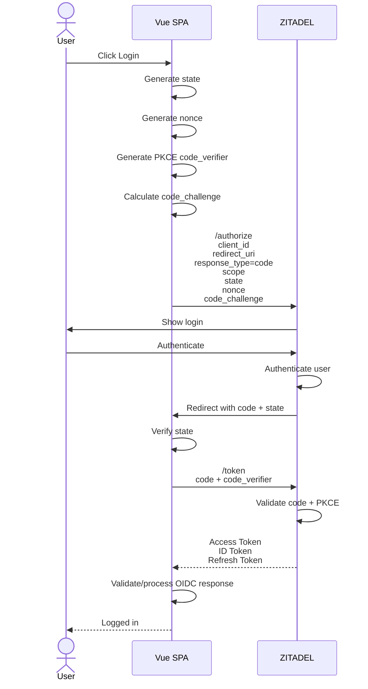
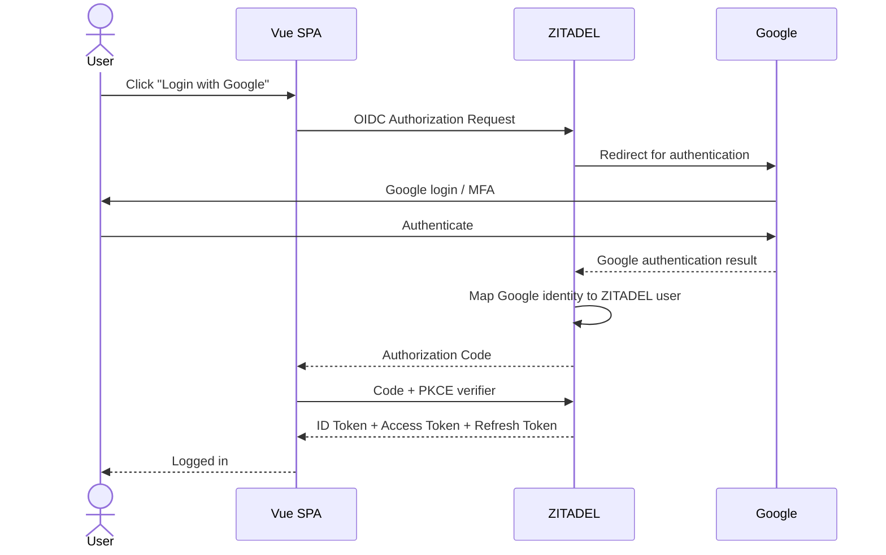
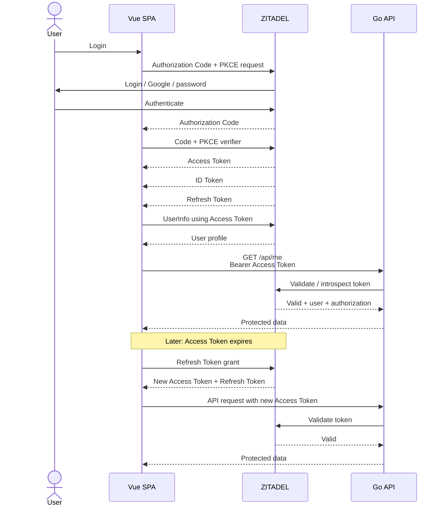
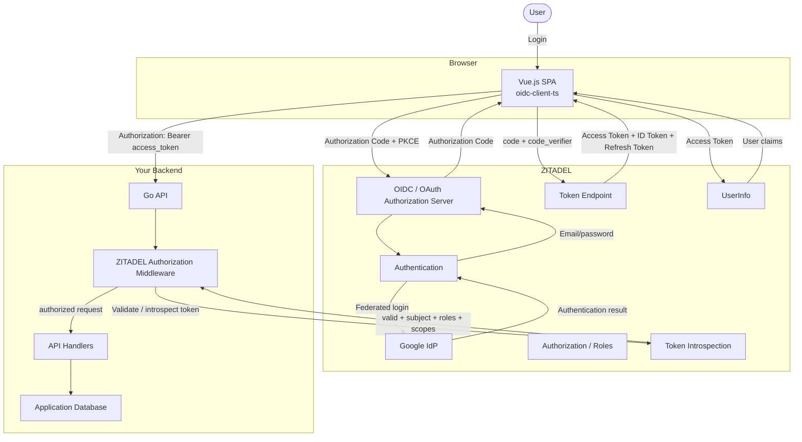

# Zitadel implementation with vue and go API

Yes. Your setup is a very good real-world example because it contains almost all the important pieces we discussed:

```text
Vue SPA
   |
   | OIDC Authorization Code + PKCE
   v
ZITADEL
   |
   | Access Token
   v
Go API
```

And there is one additional layer:

```text
                  ZITADEL
                 /       \
                /         \
       Email/password     Google
             login       login
                \         /
                 \       /
                  User identity
                       |
                       v
                    Vue SPA
```

The most important thing to understand is:

> **Your Vue application does not care whether the user authenticated with a ZITADEL password, Google, passkey, etc. From Vue's perspective, ZITADEL is the OpenID Provider.**

Google is just one of the ways ZITADEL authenticates the user.

I'll walk through your **exact configuration and Go middleware**, rather than giving you another generic OAuth explanation.

---

# 1. Your architecture

Let's name the pieces first.

```text
┌───────────────────────────────────────────────────────────┐
│                         YOUR SYSTEM                       │
│                                                           │
│   ┌─────────────────┐                    ┌─────────────┐  │
│   │   Vue.js SPA    │                    │   Go API    │  │
│   │                 │                    │             │  │
│   │ Browser         │ ─── Bearer ──────> │ /api/...    │  │
│   │ oidc-client-ts  │     Access Token   │             │  │
│   └────────┬────────┘                    └──────┬──────┘  │
│            │                                    │         │
└────────────┼────────────────────────────────────┼─────────┘
             │                                    │
             │ OIDC                               │ OAuth
             │                                    │ introspection/
             │                                    │ authorization
             v                                    v
      ┌────────────────────────────────────────────────┐
      │                    ZITADEL                     │
      │                                                │
      │  Authorization Server + OpenID Provider        │
      │                                                │
      │  • Login                                       │
      │  • Registration                                │
      │  • Google IdP                                  │
      │  • Authorization                               │
      │  • Token issuance                              │
      │  • UserInfo                                    │
      │  • Token introspection                         │
      └────────────────────┬───────────────────────────┘
                           │
                           │ upstream authentication
                           v
                    ┌─────────────┐
                    │   Google    │
                    │     IdP     │
                    └─────────────┘
```

The key insight:

**Google is not directly issuing the access token that your Go API consumes. ZITADEL is the OAuth/OIDC server your application trusts.**

ZITADEL can act as an identity broker and use external identity providers such as Google. ([ZITADEL][1])

---

# 2. First understand your three relationships

You actually have **three different relationships**.

## Relationship 1 — Vue ↔ ZITADEL

This is:

```text
OIDC
```

Vue says:

> "ZITADEL, authenticate this user and tell me who they are."

---

## Relationship 2 — Vue ↔ Go API

This is:

```text
OAuth 2.0
```

Vue says:

> "Go API, here's an access token proving that I have authorization."

---

## Relationship 3 — Go API ↔ ZITADEL

This is where your Go middleware comes in.

The Go API says:

> "ZITADEL, is this access token valid, who does it belong to, what permissions/roles does it have, and is it intended for me?"

Your `authorization.New(...)` and middleware handle this side.

So your whole system is:

```text
                    AUTHENTICATION
                    ──────────────
Vue ───────────────> ZITADEL
       OIDC


                    AUTHORIZATION
                    ─────────────
Vue ───────────────> Go API
      Access Token


                    TOKEN VALIDATION
                    ────────────────
Go API ─────────────> ZITADEL
          introspection / authorization
```

That's the architecture I would keep in your head.

---

# 3. Your Vue configuration

You have:

```ts
export const oidcSettings: UserManagerSettings = {
  authority: import.meta.env.VITE_ZITADEL_AUTHORITY,
  client_id: import.meta.env.VITE_ZITADEL_CLIENT_ID,
  redirect_uri: import.meta.env.VITE_ZITADEL_REDIRECT_URI,
  post_logout_redirect_uri: import.meta.env.VITE_ZITADEL_POST_LOGOUT_URI,

  response_type: 'code',

  scope: [
    'openid',
    'profile',
    'email',
    'offline_access',
    `urn:zitadel:iam:org:project:id:${import.meta.env.VITE_ZITADEL_PROJECT_ID}:aud`,
  ].join(' '),

  loadUserInfo: true,
}
```

Let's translate every line into plain English.

---

# 4. `authority`

```ts
authority: import.meta.env.VITE_ZITADEL_AUTHORITY
```

This is essentially:

> **"Who do I trust as my OIDC provider?"**

For example:

```text
https://your-instance.zitadel.cloud
```

Your `oidc-client-ts` library uses the authority to discover things such as:

```text
/.well-known/openid-configuration
```

which tells it where the authorization endpoint, token endpoint, JWKS, UserInfo endpoint, etc. are.

So:

```text
Vue
 |
 | authority
 v
ZITADEL
 |
 +--> authorization_endpoint
 +--> token_endpoint
 +--> userinfo_endpoint
 +--> jwks_uri
 +--> issuer
```

`oidc-client-ts` describes `authority` as the URL of the OIDC/OAuth2 provider. ([authts.github.io][2])

---

# 5. `client_id`

```ts
client_id: import.meta.env.VITE_ZITADEL_CLIENT_ID
```

This identifies your Vue application.

Think:

```text
ZITADEL

Application:
    My Vue App

Client ID:
    123456789...
```

This is **not a secret**.

And that's important because:

```text
VITE_...
```

variables are compiled into your frontend and therefore visible to users.

That's okay for:

```text
client_id
```

but not okay for:

```text
client_secret
```

Your SPA is a public client.

ZITADEL recommends Authorization Code + PKCE for user-agent/public applications such as SPAs. ([ZITADEL][3])

---

# 6. `redirect_uri`

```ts
redirect_uri: import.meta.env.VITE_ZITADEL_REDIRECT_URI
```

Suppose:

```text
https://app.example.com/auth/callback
```

The flow is:

```text
Vue
 |
 | "After login, send the browser here"
 v
ZITADEL
 |
 | login
 |
 | 302
 v
https://app.example.com/auth/callback?code=ABC&state=XYZ
```

The important thing is:

**ZITADEL must already know this redirect URI.**

Otherwise an attacker could try:

```text
redirect_uri=https://evil.example.com/callback
```

and steal the authorization response.

---

# 7. `response_type: 'code'`

```ts
response_type: 'code'
```

This is saying:

> "Use Authorization Code Flow."

So you get:

```text
ZITADEL
   |
   | authorization code
   v
Vue
```

rather than directly receiving an access token from `/authorize`.

This is the modern flow you want.

---

# 8. But where is PKCE in your code?

You may have noticed something interesting.

Your configuration contains:

```ts
response_type: 'code'
```

but you don't explicitly have:

```ts
code_challenge
code_verifier
```

That's because you're using an OIDC client library.

`oidc-client-ts` has PKCE support as part of its OIDC client configuration; `disablePKCE` is an option, meaning PKCE is normally used unless explicitly disabled. ([authts.github.io][2])

So conceptually, your library does this for you:

```text
Vue
 |
 | generate random code_verifier
 |
 | SHA256(code_verifier)
 |
 v
code_challenge
 |
 v
ZITADEL
```

Later:

```text
Vue
 |
 | code + code_verifier
 v
ZITADEL /token
```

You don't have to manually implement the PKCE cryptography.

That's exactly what you want.

---

# 9. Your complete login flow

Now let's run your actual application.

User visits:

```text
https://app.example.com
```

and clicks:

```text
Login
```

Your Vue app calls something like:

```ts
userManager.signinRedirect()
```

Conceptually.

Then:



That is what your `oidcSettings` represents.

---

# 10. Now the interesting part: email/password

Suppose Alice chooses:

```text
Email:
alice@example.com

Password:
********
```

Where does the password go?

**Not to Vue's application backend.**

Conceptually:

```text
Browser
   |
   | login
   v
ZITADEL
   |
   | email/password
   v
ZITADEL authentication
```

Your Vue application doesn't need to know the password.

It only eventually gets:

```text
authorization code
       ↓
access token
       +
ID token
       +
refresh token
```

So:

```text
Vue
 X
 |
 | NEVER receives user's ZITADEL password
 |
 v
ZITADEL
```

This is one of the major benefits of OIDC.

---

# 11. Now Google login

This is where many people misunderstand their architecture.

Suppose the user clicks:

```text
Continue with Google
```

Your Vue application still does:

```text
Vue
  |
  | OIDC
  v
ZITADEL
```

ZITADEL then says:

```text
"Ah, this authentication should happen through Google."
```

So ZITADEL redirects the browser:

```text
Vue
 |
 v
ZITADEL
 |
 | Google authentication
 v
Google
 |
 | user authenticates
 v
ZITADEL
 |
 | creates/updates identity
 |
 | authorization code
 v
Vue
```

The complete flow:



Notice:

> **Vue doesn't have to implement a separate Google OAuth flow.**

That's one of the really nice architectural properties of using ZITADEL as your identity infrastructure.

Your application trusts:

```text
ZITADEL
```

and ZITADEL can trust:

```text
Google
```

---

# 12. The identity chain

This gives you:

```text
                 YOUR APPLICATION
                       |
                       | trusts
                       v
                   ZITADEL
                       |
                       | may use
                       v
                    Google
```

So Google is an **upstream identity provider** from ZITADEL's perspective.

Your application doesn't need to care whether:

```text
authentication method =
    password
    Google
    passkey
    another OIDC provider
    etc.
```

Your application sees:

```text
ZITADEL user
       |
       v
OIDC identity
       |
       +-- sub
       +-- email
       +-- name
       +-- etc.
```

---

# 13. Now let's examine your scopes

You have:

```ts
scope: [
  'openid',
  'profile',
  'email',
  'offline_access',
  `urn:zitadel:iam:org:project:id:${PROJECT_ID}:aud`,
].join(' ')
```

This is actually a very informative configuration.

Each scope has a different purpose.

```text
openid
    ↓
"I am doing OIDC."


profile
    ↓
"I want basic profile information."


email
    ↓
"I want email information."


offline_access
    ↓
"I want a refresh token."


urn:zitadel:iam:org:project:id:<PROJECT_ID>:aud
    ↓
"Put this ZITADEL project in the access-token audience."
```

ZITADEL documents `openid`, `profile`, `email`, and `offline_access` as standard scopes, with `offline_access` enabling refresh tokens in the code flow. ([ZITADEL][4])

---

# 14. The most important scope in your application

This one:

```text
urn:zitadel:iam:org:project:id:${PROJECT_ID}:aud
```

is particularly important because of your Go API.

Your comment says:

```ts
// Adds your PaaS API project as an audience (`aud`) of the access token.
```

Exactly.

You're essentially telling ZITADEL:

> "I am authenticating this user through my frontend application, but the resulting access token will also be used to call my backend project/API."

ZITADEL documents this exact mechanism for a frontend calling a backend in another project. ([ZITADEL][5])

---

# 15. Why does the API care about `aud`?

Imagine the token says:

```json
{
  "sub": "alice",
  "aud": [
    "some-other-application"
  ]
}
```

Your Go API shouldn't say:

> "Well, the token is valid, so I'll accept it."

Because:

```text
valid token
    ≠
token intended for my API
```

You want:

```text
Access Token

aud:
    [
       "my-api-project"
    ]
```

Then your Go API can say:

```text
Is this token intended for me?

YES
    ↓
continue

NO
    ↓
401
```

ZITADEL explicitly recommends checking that the resource server is represented in the access token's `aud` claim. ([ZITADEL][5])

---

# 16. Your architecture therefore looks like this

This is the most important diagram for **your specific system**:

```text
                         ┌─────────────────────┐
                         │       ZITADEL       │
                         │                     │
                         │ Authorization       │
                         │ Server + OIDC OP    │
                         └──────────┬──────────┘
                                    │
                     Access Token   │
                     audience =     │
                     Go API project │
                                    │
             ┌──────────────────────┴────────────────────┐
             │                                           │
             │                                           │
             v                                           v
      ┌──────────────┐                           ┌──────────────┐
      │   Vue SPA    │                           │    Go API    │
      │              │                           │              │
      │ OIDC Client  │ ── Bearer Access Token ─>│ Middleware   │
      │              │                           │              │
      └──────────────┘                           └──────┬───────┘
                                                       │
                                                       │ validate
                                                       v
                                                ┌──────────────┐
                                                │   ZITADEL    │
                                                │              │
                                                │ introspection│
                                                │ / authz      │
                                                └──────────────┘
```

The same ZITADEL instance is involved on both sides, but **for different purposes**.

---

# 17. Now your Go code

You have:

```go
authZ, err := authorization.New(
    ctx,
    zitadel.New(cfg.Domain),
    oauth.DefaultAuthorization(cfg.KeyPath),
)
```

This is fundamentally saying:

> "Create a ZITADEL authorization component that my API can use to verify/authorize incoming access tokens."

The ZITADEL Go SDK's API example uses the same pattern with `authorization.New`, `zitadel.New`, and `oauth.DefaultAuthorization`; its example describes this as OAuth2 introspection-based authorization. ([ZITADEL][6])

So your Go API becomes a:

```text
Resource Server
```

---

# 18. What does `cfg.KeyPath` mean?

This is important.

Your API has something like:

```text
key.json
```

which is associated with your ZITADEL API authorization/client configuration.

Conceptually:

```text
Go API
   |
   | configured credentials
   v
ZITADEL authorization infrastructure
```

The key is **not sent to the browser**.

So:

```text
Vue
 |
 X
 | does NOT know key.json
 |
 v

Go API
 |
 | key.json
 v
ZITADEL
```

This is one reason the Go backend is a confidential/server-side component while the Vue SPA is a public client.

---

# 19. What happens when Vue calls your Go API?

Suppose Vue calls:

```http
GET /api/projects
Authorization: Bearer eyJ...
```

The request is:

```text
┌──────────────┐
│   Browser    │
│              │
│ Vue          │
└──────┬───────┘
       │
       │ Authorization:
       │ Bearer ACCESS_TOKEN
       │
       v
┌──────────────┐
│    Go API    │
│              │
│ Middleware   │
└──────────────┘
```

Your middleware intercepts this **before the handler**.

---

# 20. `RequireAuth()`

You have:

```go
func (m *Middleware) RequireAuth() func(http.Handler) http.Handler {
    return m.mw.RequireAuthorization()
}
```

Think:

```text
HTTP request
     |
     v
RequireAuthorization()
     |
     +---- token exists?
     |
     +---- token valid?
     |
     +---- token not expired?
     |
     +---- token intended appropriately?
     |
     +---- authorization checks?
     |
     v
   handler
```

So:

```go
router.Handle(
    "/api/projects",
    mw.RequireAuth()(handler),
)
```

means:

> **Only an authenticated/authorized access-token request gets to this handler.**

ZITADEL's Go API example uses `RequireAuthorization()` for exactly this type of protected endpoint. ([ZITADEL][6])

---

# 21. What actually happens inside the middleware?

Conceptually:

```text
HTTP Request
     |
     v
Authorization header?
     |
     +---- NO ----> 401
     |
     YES
     |
     v
Bearer token
     |
     v
ZITADEL authorization middleware
     |
     v
Validate/introspect token
     |
     +---- invalid ----> 401
     |
     valid
     |
     v
Check authorization
     |
     v
Put authenticated identity
into Go context
     |
     v
Your handler
```

The exact internals depend on SDK/version/configuration, but your use of `oauth.DefaultAuthorization(cfg.KeyPath)` is the SDK's standard OAuth authorization/introspection setup. ([ZITADEL][6])

---

# 22. This is where `UserID()` becomes interesting

You have:

```go
func (m *Middleware) UserID(ctx context.Context) string {
    return m.mw.Context(ctx).UserID()
}
```

Suppose Alice's access token represents:

```json
{
  "sub": "123456789"
}
```

The middleware processes the request and puts the authenticated identity into the request context.

Then:

```go
userID := middleware.UserID(r.Context())
```

conceptually gives:

```text
"123456789"
```

So your request becomes:

```text
HTTP request
     |
     | access token
     v
ZITADEL middleware
     |
     | authenticated identity
     v
Go context
     |
     | UserID()
     v
your handler
```

The ZITADEL Go example similarly retrieves `UserID()` from the middleware authorization context. ([ZITADEL][6])

---

# 23. This is the connection between OIDC identity and your database

Suppose your application database has:

```text
users
--------------------------------
id
zitadel_subject
email
created_at
...
```

Alice logs in.

ZITADEL gives you:

```text
sub = "234567890"
```

Your API can use:

```text
ZITADEL sub
     |
     v
your user record
     |
     v
internal user
```

For example:

```text
ZITADEL

sub:
    234567890

        |
        | lookup
        v

Your DB

id:
    42

zitadel_subject:
    234567890
```

Then you can use your own:

```text
internal user ID = 42
```

throughout your application.

---

# 24. Don't use the email as your primary identity key

This is an important practical rule.

Don't build:

```text
users.email = identity
```

as your fundamental identity relationship.

Prefer:

```text
users.zitadel_subject = OIDC sub
```

because an email address can change.

Think:

```text
ZITADEL identity
    |
    +-- issuer
    +-- sub
            |
            v
       YOUR USER ID
```

For your application, the ZITADEL `sub` is the stable external identity identifier.

---

# 25. Now roles

You have:

```go
func (m *Middleware) RequireRole(role string) func(http.Handler) http.Handler {
    return m.mw.RequireAuthorization(
        authorization.WithRole(role),
    )
}
```

This changes the question from:

> "Is this user authenticated?"

to:

> **"Is this user authenticated AND does their authorization include this role?"**

For example:

```go
RequireRole("admin")
```

means:

```text
Request
   |
   v
Valid token?
   |
   YES
   |
   v
Does user have "admin"?
   |
  +---+
  |   |
 YES  NO
  |   |
  v   v
200  403
```

ZITADEL's Go example demonstrates the same `WithRole("admin")` pattern for role-protected endpoints. ([ZITADEL][6])

---

# 26. Authentication vs authorization in YOUR code

Now the distinction becomes concrete.

You have:

```go
RequireAuth()
```

That's roughly:

```text
AUTHENTICATION / TOKEN VALIDITY

"Is there a valid authorization
for this request?"
```

Then:

```go
RequireRole("admin")
```

is:

```text
AUTHORIZATION

"Does this authenticated identity
have the required application role?"
```

So:

```text
                 Incoming request
                        |
                        v
               ┌────────────────┐
               │ Valid token?   │
               └───────┬────────┘
                       │ YES
                       v
               ┌────────────────┐
               │ Required role? │
               └───────┬────────┘
                       │ YES
                       v
                   Handler
```

---

# 27. Where does `"admin"` come from?

This is the ZITADEL side.

You might have a ZITADEL project:

```text
My SaaS
│
├── Applications
│   ├── Vue SPA
│   └── API
│
└── Roles
    ├── admin
    ├── user
    └── manager
```

Then users receive role assignments.

For example:

```text
Alice
   |
   +---- admin
   +---- user

Bob
   |
   +---- user
```

ZITADEL projects are the container for applications and roles, and applications within a project share the project's roles and role assignments. ([ZITADEL][7])

---

# 28. How does the API know Alice is admin?

This is a critical piece.

ZITADEL needs to make role information available to the authorization mechanism.

ZITADEL supports role information through token claims/UserInfo, and role assertion can be configured at the project/application level or requested through appropriate role scopes. ([ZITADEL][5])

Conceptually:

```text
ZITADEL
   |
   | Alice
   |
   +---- role assignments
          |
          +---- admin
          +---- user
```

Then the authorization/token machinery can expose that information.

Your Go middleware can eventually ask:

```go
IsGrantedRole("admin")
```

and:

```text
ZITADEL authorization context
          |
          v
    roles for user
          |
          v
    "admin" exists?
          |
       YES/NO
```

---

# 29. `IsGrantedRole()`

You have:

```go
func (m *Middleware) IsGrantedRole(
    ctx context.Context,
    role string,
) bool {
    return m.mw.Context(ctx).IsGrantedRole(role)
}
```

This is slightly different from `RequireRole`.

### `RequireRole`

Stops the request before the handler if the role isn't present.

```text
No admin
   |
   v
403
```

### `IsGrantedRole`

Lets your handler decide what to do.

```go
if middleware.IsGrantedRole(ctx, "admin") {
    // special behavior
}
```

So:

```text
RequireRole("admin")
    =
hard authorization boundary


IsGrantedRole("admin")
    =
ask authorization question inside handler
```

---

# 30. Your final Go request flow

Put your actual middleware into the bigger picture:

```text
                    Browser
                       |
                       |
                       | Authorization:
                       | Bearer <access_token>
                       |
                       v
              ┌───────────────────┐
              │      Go API       │
              │                   │
              │ RequireAuth()     │
              └─────────┬─────────┘
                        |
                        | validate/introspect
                        v
                 ┌───────────────┐
                 │   ZITADEL     │
                 │               │
                 │ Token/AuthZ   │
                 └───────┬───────┘
                         |
                    valid token?
                         |
                        YES
                         |
                         v
                 ┌───────────────┐
                 │ Go Context    │
                 │               │
                 │ UserID()      │
                 │ roles         │
                 └───────┬───────┘
                         |
                         v
                    Your handler
```

---

# 31. Your `RequireRole` flow

For:

```go
RequireRole("admin")
```

it's:

```text
                       Request
                          |
                          v
                 ┌─────────────────┐
                 │ Bearer token?   │
                 └────────┬────────┘
                          |
                          v
                 ┌─────────────────┐
                 │ Token valid?    │
                 └────────┬────────┘
                          |
                          v
                 ┌─────────────────┐
                 │ Audience valid? │
                 └────────┬────────┘
                          |
                          v
                 ┌─────────────────┐
                 │ User has admin? │
                 └────────┬────────┘
                          |
                    +-----+-----+
                    |           |
                   YES          NO
                    |           |
                    v           v
                Handler        403
```

This is the API authorization boundary.

---

# 32. Now let's connect the Vue token to the Go middleware

This is the entire journey of one access token.

```text
                    LOGIN
                      |
                      v
              ┌──────────────┐
              │   ZITADEL    │
              └──────┬───────┘
                     |
                     | Access Token
                     |
                     v
              ┌──────────────┐
              │   Vue SPA    │
              └──────┬───────┘
                     |
                     | Authorization:
                     | Bearer AT
                     |
                     v
              ┌──────────────┐
              │    Go API    │
              └──────┬───────┘
                     |
                     | validate
                     v
              ┌──────────────┐
              │   ZITADEL    │
              └──────┬───────┘
                     |
               valid + audience
               + authorization
                     |
                     v
              ┌──────────────┐
              │ Go handler   │
              └──────────────┘
```

Notice:

> **The Vue application's authentication state and the Go API's authorization decision are related, but they're not the same thing.**

Vue can say:

```text
"I have a logged-in user."
```

But the API says:

```text
"I received a valid access token intended for me,
and this token authorizes this request."
```

The API should make its own authorization decision.

---

# 33. This is why you should NOT send the ID token to your API

Suppose Vue has:

```text
ID Token
Access Token
```

Your API request should normally use:

```http
Authorization: Bearer <ACCESS_TOKEN>
```

not:

```http
Authorization: Bearer <ID_TOKEN>
```

Because:

```text
ID Token
    ↓
Vue/client identity information

Access Token
    ↓
API authorization
```

Your architecture is:

```text
Vue
 |
 | ID Token
 | "Who logged in?"
 |
 +----------------------+
                        |
                        v
                      Vue


Vue
 |
 | Access Token
 | "I'm authorized to call API"
 |
 v
Go API
```

This is one of the most important rules in your implementation.

---

# 34. What does `loadUserInfo: true` do?

You have:

```ts
loadUserInfo: true
```

This tells `oidc-client-ts`:

> **After obtaining the tokens, load additional user identity data from the OIDC UserInfo endpoint.**

The library describes `loadUserInfo` as loading additional identity data from the UserInfo endpoint to populate the user's profile. ([authts.github.io][2])

So instead of only:

```text
ID Token
```

you can have:

```text
ID Token
     +
UserInfo response
```

Conceptually:

```text
Vue
 |
 | Access Token
 v
ZITADEL UserInfo endpoint
 |
 | user information
 v
Vue user profile
```

---

# 35. So your login actually has two kinds of user information

Potentially:

```text
                  ZITADEL
                     |
          +----------+----------+
          |                     |
          v                     v
      ID Token              UserInfo
          |                     |
          |                     |
          +----------+----------+
                     |
                     v
                Vue user
```

The ID Token is part of the authentication result.

UserInfo is an API call using the access token.

---

# 36. `offline_access`

You have:

```ts
'offline_access'
```

This is what allows ZITADEL to return a refresh token in your code flow. ZITADEL documents `offline_access` as the scope for requesting refresh tokens. ([ZITADEL][4])

So your token set is conceptually:

```text
ZITADEL
   |
   +---- Access Token
   |
   +---- ID Token
   |
   +---- Refresh Token
```

The access token might expire:

```text
10 minutes
```

while the refresh token allows the SPA to obtain a new access token without requiring the user to authenticate interactively again.

ZITADEL's token endpoint supports the refresh-token grant and returns a new refresh token in the documented flow. ([ZITADEL][8])

---

# 37. Your commented-out `automaticSilentRenew`

You currently have:

```ts
// automaticSilentRenew: true,
```

This is worth understanding because the name can be misleading.

In `oidc-client-ts`, `automaticSilentRenew` means automatically attempting to renew the access token before expiration. Its documentation says the attempt starts one minute before expiration by default. ([authts.github.io][2])

But don't mentally equate:

```text
silent renew
=
refresh token
```

The exact renewal mechanism depends on the library/provider/configuration.

Your application is already asking for:

```text
offline_access
```

which enables refresh-token issuance.

So the important conceptual mechanism is:

```text
Access Token expires
        |
        v
Refresh Token
        |
        v
ZITADEL /token
        |
        v
New Access Token
```

---

# 38. A complete diagram of your token lifecycle



That is essentially your application.

---

# 39. The role of your special audience scope

Let's zoom into this:

```ts
`urn:zitadel:iam:org:project:id:${PROJECT_ID}:aud`
```

Imagine:

```text
Frontend project:
    FRONTEND_PROJECT

Backend project:
    API_PROJECT
```

Your Vue app authenticates against:

```text
FRONTEND_PROJECT
```

but you request:

```text
urn:zitadel:iam:org:project:id:API_PROJECT:aud
```

So ZITADEL adds something like:

```json
{
  "aud": [
    "API_PROJECT"
  ]
}
```

to the access token.

Then:

```text
                 ZITADEL
                    |
                    | Access Token
                    |
                    | aud = API_PROJECT
                    v
               ┌─────────┐
               │ Go API  │
               └─────────┘
```

This is exactly the pattern ZITADEL documents for a frontend project accessing a backend project. ([ZITADEL][5])

---

# 40. Audience does NOT mean permission

This is an extremely important subtlety.

Suppose:

```json
{
  "aud": ["API_PROJECT"]
}
```

That means:

> "This token is intended for API_PROJECT."

It does **not automatically mean**:

> "This user can perform every operation in API_PROJECT."

Think:

```text
audience
    =
WHO should accept this token?


role/scope/permission
    =
WHAT may this token/user do?
```

So:

```text
aud = API_PROJECT
             +
role = admin
             |
             v
        authorization
```

ZITADEL itself warns that audience alone is not sufficient as an authorization check. ([help.zitadel.com][9])

---

# 41. This gives you a very useful 3-question API model

Your Go API should conceptually ask:

```text
1. Is the token valid?

2. Is this token intended for my API?

3. Is this user authorized to perform this operation?
```

Diagram:

```text
Request
  |
  v
┌─────────────────────┐
│ 1. Token valid?     │
└─────────┬───────────┘
          |
         YES
          |
          v
┌─────────────────────┐
│ 2. Audience valid?  │
└─────────┬───────────┘
          |
         YES
          |
          v
┌─────────────────────┐
│ 3. Authorized?      │
│    role/scope/etc.   │
└─────────┬───────────┘
          |
         YES
          |
          v
       Handler
```

This is a great mental model for backend API security.

---

# 42. `RequireAuth()` vs `RequireRole()` in your architecture

You can now interpret your two functions as:

```text
RequireAuth()
    |
    +--> valid authenticated authorization
    +--> valid access token
    +--> appropriate token
    |
    v
"Any authorized user"


RequireRole("admin")
    |
    +--> everything above
    +--> admin role
    |
    v
"Admin users only"
```

Example:

```go
GET /api/profile
    -> RequireAuth()

GET /api/admin/users
    -> RequireRole("admin")
```

Conceptually:

```text
                    API
                     |
          +----------+----------+
          |                     |
          v                     v
    /api/profile         /api/admin/users
          |                     |
     RequireAuth()       RequireRole("admin")
          |                     |
          v                     v
    authenticated             admin
       users                   users
```

---

# 43. Where Google disappears from your backend

This is a beautiful property of your setup.

Suppose Alice logged in with Google.

Your Go API does **not** need to ask:

```text
"Was this Google?"
```

It doesn't care.

The backend sees:

```text
Access Token
    |
    v
ZITADEL
    |
    +-- sub
    +-- audience
    +-- roles
    +-- scopes
    +-- expiration
```

So:

```text
Password login ──┐
                 │
Google login ────┼──> ZITADEL ──> same API authorization model
                 │
Passkey ─────────┤
                 │
Other IdP ───────┘
```

That's a major architectural benefit of centralizing identity.

---

# 44. Login and registration are also mostly ZITADEL concerns

You said:

> "I use auth for login or registration using email and password or with Google."

From the application's perspective:

```text
                 Vue
                  |
                  | "Authenticate"
                  v
               ZITADEL
              /        \
             /          \
       Register/login   Google
             \          /
              \        /
               identity
                  |
                  v
               Vue
```

Your Vue app shouldn't implement:

```text
password hashing
password verification
Google OAuth protocol
MFA
account recovery
email verification
etc.
```

Those are identity infrastructure concerns.

Your application consumes the resulting identity.

---

# 45. Your system in one giant diagram

This is the diagram I would actually put in your project documentation.



---

# 46. Now let's annotate the actual tokens

Your system has this:

```text
                    ZITADEL
                       |
          +------------+------------+
          |            |            |
          v            v            v
      ID Token    Access Token   Refresh Token
          |            |            |
          |            |            |
          v            v            v
        Vue          Go API       ZITADEL
```

### ID Token

Used by:

```text
Vue
```

Meaning:

```text
"ZITADEL authenticated this subject."
```

---

### Access Token

Used by:

```text
Vue → Go API
```

Meaning:

```text
"Here is an authorization credential
for calling the API."
```

---

### Refresh Token

Used by:

```text
Vue → ZITADEL
```

Meaning:

```text
"Give me a new access token."
```

Not:

```text
Vue → Go API
```

---

# 47. Your browser request should look like this

```http
GET /api/me HTTP/1.1
Host: api.example.com
Authorization: Bearer eyJ...
```

Not:

```http
Authorization: Bearer <ID_TOKEN>
```

Not:

```http
Authorization: Bearer <REFRESH_TOKEN>
```

The access token is the API credential.

---

# 48. Your Go API should never trust Vue's idea of the user

This is another important practical rule.

Bad:

```text
Vue:

{
    "userId": 123,
    "role": "admin"
}
```

Go API:

```text
"Oh, user 123 says they're admin."
```

No.

The browser is controlled by the user.

Instead:

```text
Vue
 |
 | access token
 v
Go API
 |
 | validate authorization
 v
trusted identity
```

So:

```text
Browser supplied userId
    = UNTRUSTED


Validated token subject
    = TRUSTED IDENTITY
```

---

# 49. Likewise, don't send "role=admin" from Vue

Bad:

```http
POST /api/delete-user
Content-Type: application/json

{
    "role": "admin"
}
```

The user can change it.

Instead:

```text
Access Token
     |
     v
Go middleware
     |
     v
role = admin?
     |
     v
allow
```

The frontend can hide/show buttons for UX:

```text
if admin:
    show Delete button
```

but that is **not the security boundary**.

The Go API must enforce the role.

---

# 50. Frontend authorization vs backend authorization

This distinction is useful:

```text
Vue role check
    =
UX


Go API role check
    =
SECURITY
```

Example:

```text
Vue:

admin?
   |
   +--> show Admin menu


Go:

admin?
   |
   +--> allow DELETE /users
```

Someone can bypass Vue:

```text
curl
Postman
browser DevTools
custom script
```

But they shouldn't be able to bypass:

```text
Go API authorization
```

---

# 51. What your ZITADEL project is doing

Think of your ZITADEL project as the security container for your application.

```text
ZITADEL Project: My SaaS
│
├── Applications
│   │
│   └── Vue SPA
│
├── Roles
│   ├── admin
│   ├── user
│   └── manager
│
└── Role assignments
    │
    ├── Alice → admin
    ├── Bob   → user
    └── Carol → manager
```

The API then asks:

```text
Alice
 |
 +---- valid token?
 |
 +---- audience = my API?
 |
 +---- admin?
```

This is where ZITADEL's project/role model becomes your application's authorization model. ([ZITADEL][7])

---

# 52. One subtle point about your roles

Your current frontend scope does **not** explicitly contain a role scope such as:

```text
urn:zitadel:iam:org:projects:roles
```

That's not necessarily a problem.

ZITADEL provides project/application settings for asserting roles during authentication, and roles can be made available in tokens/UserInfo through configuration or scopes. ([ZITADEL][7])

So if:

```go
RequireRole("admin")
```

is working in your current implementation, the SDK/ZITADEL configuration is already getting the relevant authorization information through the mechanism you've configured.

But if you ever wonder:

> "Why isn't `admin` appearing in my token/UserInfo?"

check your ZITADEL **role assertion/token settings and requested role claims/scopes**. ([ZITADEL][5])

---

# 53. One thing I would change in your mental comments

You currently have:

```ts
// Adds your PaaS API project as an audience (`aud`) of the access token.
// This allows the API to validate that the token was intended for it.
```

That's good, but I'd mentally make it:

```text
audience
    =
"which resource server is this token intended for?"

role/scope
    =
"what is this token/user allowed to do?"
```

Because **audience alone is not authorization**.

That's an important distinction, especially as your application grows. ZITADEL itself cautions against treating `aud` as the sole authorization check. ([help.zitadel.com][9])

---

# 54. Your whole application as a request/response timeline

Let's make it painfully concrete.

## A. User opens Vue

```text
Browser
   |
   v
Vue SPA
```

No token yet.

---

## B. User clicks Login

```text
Vue
 |
 | /authorize
 | response_type=code
 | scope=openid ...
 | PKCE
 v
ZITADEL
```

---

## C. ZITADEL authenticates

Email:

```text
Browser
   |
   v
ZITADEL
   |
   +-- email/password
```

Google:

```text
Browser
   |
   v
ZITADEL
   |
   v
Google
   |
   v
ZITADEL
```

---

## D. ZITADEL redirects back

```text
ZITADEL
   |
   | code=ABC
   | state=XYZ
   v
Vue callback
```

---

## E. Vue exchanges code

```text
Vue
 |
 | code=ABC
 | code_verifier=SECRET
 v
ZITADEL /token
```

---

## F. ZITADEL returns tokens

```text
ZITADEL
   |
   +---- access_token
   +---- id_token
   +---- refresh_token
   |
   v
Vue
```

---

## G. Vue calls your API

```text
Vue
 |
 | GET /api/me
 | Authorization: Bearer ACCESS_TOKEN
 v
Go API
```

---

## H. Go middleware validates

```text
Go API
 |
 | token
 v
ZITADEL
 |
 | valid
 | subject = Alice
 | audience = API
 | role = user
 v
Go middleware
```

---

## I. Context is populated

```text
Go context

UserID()
   |
   +---- "alice's-zitadel-sub"

IsGrantedRole("admin")
   |
   +---- false
```

---

## J. Handler executes

```text
Go handler
    |
    +---- UserID()
    |
    +---- business logic
    |
    +---- database
```

That's your actual system.

---

# 55. And when Alice becomes an admin

Suppose you assign:

```text
Alice
   |
   +---- admin
```

Then her next appropriate token/authorization context may contain:

```text
roles:
    admin
```

Now:

```go
RequireRole("admin")
```

passes.

```text
Alice
 |
 | Access Token
 v
Go API
 |
 | valid?
 | audience?
 | admin?
 |
 +---- YES
       |
       v
   Admin handler
```

While Bob:

```text
Bob
 |
 | Access Token
 v
Go API
 |
 | valid ✓
 | audience ✓
 | admin ✗
 |
 v
403 Forbidden
```

That's the entire RBAC story.

---

# 56. 401 vs 403 in your API

This is useful to understand.

### `401 Unauthorized`

Usually means:

```text
"I don't accept your authentication credential."
```

Examples:

```text
no access token
expired token
invalid token
invalid credentials
```

---

### `403 Forbidden`

Means more like:

```text
"I know who/what you are,
but you're not allowed to do this."
```

Example:

```text
valid token
+
correct audience
+
user role = user
+
endpoint requires admin
=
403
```

So:

```text
No valid authentication
       ↓
      401


Authenticated but insufficient authorization
       ↓
      403
```

---

# 57. The most important diagram for debugging

When something doesn't work, walk through this:

```text
                API REQUEST
                    |
                    v
          ┌───────────────────┐
          │ Authorization     │
          │ header present?   │
          └─────────┬─────────┘
                    |
                   YES
                    |
                    v
          ┌───────────────────┐
          │ Access token      │
          │ valid?            │
          └─────────┬─────────┘
                    |
                   YES
                    |
                    v
          ┌───────────────────┐
          │ Correct audience? │
          │ aud contains API? │
          └─────────┬─────────┘
                    |
                   YES
                    |
                    v
          ┌───────────────────┐
          │ Required role /   │
          │ permission?       │
          └─────────┬─────────┘
                    |
                   YES
                    |
                    v
                HANDLER
```

When debugging your system, identify **which box failed**.

---

# 58. Your application in one sentence

I would describe your architecture as:

> **A Vue SPA is a public OIDC client using Authorization Code + PKCE against ZITADEL; ZITADEL authenticates users directly or through Google; the SPA receives an access token intended for the Go API; the Go API acts as the resource server and uses ZITADEL's authorization middleware to validate the token and enforce roles.**

That's exactly what you're building.

---

# 59. The mental model I recommend you keep

Forget the individual libraries for a moment.

Keep this:

```text
                       USER
                         |
                         | "Login"
                         v
                  ┌─────────────┐
                  │  ZITADEL    │
                  │             │
                  │ WHO are you?│
                  └──────┬──────┘
                         |
               +---------+---------+
               |                   |
          password              Google
               |                   |
               +---------+---------+
                         |
                         v
                   authenticated
                      identity
                         |
                         | Authorization Code
                         | + PKCE
                         v
                  ┌─────────────┐
                  │   Vue SPA   │
                  └──────┬──────┘
                         |
                         | Access Token
                         | Bearer
                         v
                  ┌─────────────┐
                  │   Go API    │
                  │             │
                  │ Is token    │
                  │ valid?      │
                  │             │
                  │ aud correct?│
                  │             │
                  │ role?       │
                  └──────┬──────┘
                         |
                         v
                    APPLICATION
                    DATA / DB
```

And the three credentials:

```text
             ZITADEL
                |
       +--------+--------+
       |        |        |
       v        v        v
   ID Token Access Token Refresh Token
      |         |             |
      v         v             v
     Vue       Go API       ZITADEL
   "WHO?"    "CAN API?"   "NEW TOKEN"
```

And the three security mechanisms:

```text
state
   |
   +---- "Is this callback from MY login transaction?"

PKCE
   |
   +---- "Does the party exchanging this code
         possess the original verifier?"

nonce
   |
   +---- "Does this ID Token belong to MY
         authentication transaction?"
```

Finally, your API authorization:

```text
             Access Token
                  |
                  v
          ┌───────────────┐
          │ Valid?        │
          └───────┬───────┘
                  |
                  v
          ┌───────────────┐
          │ aud = my API? │
          └───────┬───────┘
                  |
                  v
          ┌───────────────┐
          │ role/scope?   │
          └───────┬───────┘
                  |
                  v
              HANDLER
```

**If you can mentally replay those four diagrams, you essentially understand your entire Vue + ZITADEL + Go authentication architecture.**

[1]: https://zitadel.com/docs/guides/integrate/identity-providers/generic-oidc?utm_source=chatgpt.com "Configure a Generic OIDC Identity Provider in ZITADEL | ZITADEL Docs"
[2]: https://authts.github.io/oidc-client-ts/interfaces/UserManagerSettings.html?utm_source=chatgpt.com "UserManagerSettings | oidc-client-ts"
[3]: https://zitadel.com/docs/guides/integrate/login/oidc/oauth-recommended-flows?utm_source=chatgpt.com "Recommended authorization flows with OpenID Connect (OIDC) and OAuth 2.x | ZITADEL Docs"
[4]: https://zitadel.com/docs/apis/openidoauth/scopes?utm_source=chatgpt.com "Scopes in ZITADEL | ZITADEL Docs"
[5]: https://zitadel.com/docs/guides/integrate/retrieve-user-roles?utm_source=chatgpt.com "Retrieve User Roles in ZITADEL | ZITADEL Docs"
[6]: https://zitadel.com/docs/examples/secure-api/go?utm_source=chatgpt.com "Secure Go API Application with ZITADEL | ZITADEL Docs"
[7]: https://zitadel.com/docs/guides/manage/console/projects-overview?utm_source=chatgpt.com "ZITADEL Projects: Manage Apps, Services & Roles | ZITADEL Docs"
[8]: https://zitadel.com/docs/apis/openidoauth/endpoints?utm_source=chatgpt.com "OpenID Connect Endpoints in ZITADEL | ZITADEL Docs"
[9]: https://help.zitadel.com/security-best-practices-validating-audience-aud-claims-in-zitadel-access-tokens?utm_source=chatgpt.com "Security Best Practices: Validating Audience (aud) Claims in ZITADEL Access Tokens"
