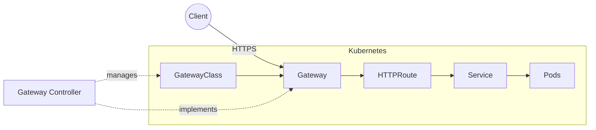

# Kubernetes Gateway API

## What is Gateway API?

**Gateway API** is a Kubernetes-native API for configuring how external traffic enters a cluster and is routed to Services.

It is the modern, more expressive alternative to the traditional Kubernetes **Ingress API**.

Instead of putting all routing configuration into one `Ingress` resource, Gateway API separates responsibilities into multiple resources.

---

## Architecture



The main components are:

| Resource         | Purpose                                              |
| ---------------- | ---------------------------------------------------- |
| **GatewayClass** | Defines which Gateway controller manages the Gateway |
| **Gateway**      | Defines listeners, ports, TLS, and entry points      |
| **HTTPRoute**    | Defines HTTP routing rules                           |
| **Service**      | Kubernetes service receiving the traffic             |

For example:

```text
Internet
   │
   ▼
Gateway
   │
   ├── app.example.com → frontend-service
   │
   └── api.example.com → api-service
```

---

## Why do we need Gateway API?

Ingress works well for simple routing, but complex traffic management often becomes controller-specific.

For example, you may want:

* Canary deployments
* Traffic splitting
* Header-based routing
* Path-based routing
* Multiple teams managing different routes
* TLS configuration
* Gradual migration between services

With Ingress, these features often require **controller-specific annotations**.

Gateway API provides standardized resources for these use cases.

For example, traffic splitting can be expressed directly:

```yaml
backendRefs:
  - name: api-v1
    port: 8080
    weight: 90

  - name: api-v2
    port: 8080
    weight: 10
```

This means:

```text
          ┌── 90% → api-v1
Gateway ──┤
          └── 10% → api-v2
```

---

## Gateway API vs Ingress

|                    | Ingress                     | Gateway API                 |
| ------------------ | --------------------------- | --------------------------- |
| Simplicity         | ✅ Very simple               | More complex                |
| Basic HTTP routing | ✅                           | ✅                           |
| TLS                | ✅                           | ✅                           |
| Path/host routing  | ✅                           | ✅                           |
| Traffic splitting  | Limited/controller-specific | ✅ Standardized              |
| Advanced routing   | Limited                     | ✅                           |
| Team separation    | Limited                     | ✅                           |
| Extensibility      | Limited                     | ✅                           |
| Best for           | Simple applications         | Platforms & complex routing |

**Important:** Gateway API does not mean Ingress is obsolete. Ingress is still perfectly suitable for many applications.

---

## When should I use Gateway API?

### Use Ingress when:

* You have a small application.
* You only need host/path routing.
* Your routing requirements are simple.
* You want the simplest possible configuration.

Example:

```text
app.example.com → frontend
api.example.com → backend
```

Ingress is enough.

### Use Gateway API when:

* You're building a **platform/PaaS**.
* You have multiple teams or services.
* You need canary/weighted traffic.
* You need advanced routing rules.
* You want to reduce dependency on controller-specific annotations.
* You want clear separation between infrastructure and application routing.

For a PaaS like yours, **Gateway API is a strong long-term choice**, especially if routing requirements will grow.

---

## Key Concept: Separation of Responsibilities

One of Gateway API's biggest advantages is separating infrastructure from application routing:

```text
Platform Team
      │
      ▼
 GatewayClass
      │
      ▼
   Gateway
      │
      ├──────────────┐
      ▼              ▼
 HTTPRoute A     HTTPRoute B
      │              │
   Team A           Team B
```

The platform team controls the **Gateway**, while application teams can control their own **HTTPRoutes** without needing to modify the underlying infrastructure.

---

## Interview Answer

> **Gateway API is a Kubernetes-native API for managing traffic into the cluster. It extends the basic Ingress model with more expressive and standardized routing capabilities such as traffic splitting, header-based routing, and better separation of responsibilities. I would use Ingress for simple applications and Gateway API when building a platform or when advanced traffic management and multi-team ownership are required.**
