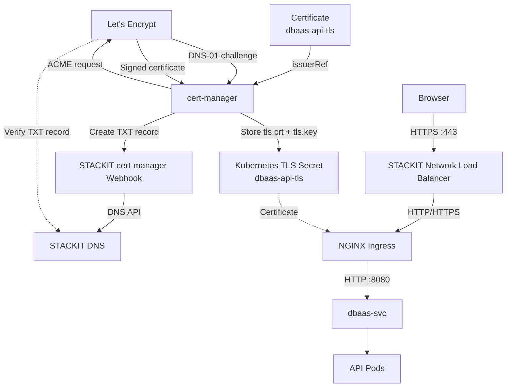

# TLS/SSL Certificate Flow with cert-manager, STACKIT DNS & Let's Encrypt

The goal is to automatically obtain and serve a trusted TLS certificate for:

```text
api.foyez.runs.onstackit.cloud
```

The main components are:

```text
Browser
   │
   │ HTTPS
   ▼
STACKIT Network Load Balancer
   │
   ▼
NGINX Ingress
   │
   │ uses TLS Secret
   ▼
Kubernetes Service
   │
   ▼
Application


Certificate issuance:

cert-manager
     │
     │ DNS-01
     ▼
STACKIT DNS
     ▲
     │ DNS verification
     │
Let's Encrypt
```

The certificate issuance path is separate from normal application traffic.

---

## 1. The `Issuer` tells cert-manager how to get certificates

Your configuration:

```yaml
apiVersion: cert-manager.io/v1
kind: Issuer
metadata:
  name: letsencrypt-prod
  namespace: dbaas-api

spec:
  acme:
    email: foyez.lifestyle@gmail.com

    server: https://acme-v02.api.letsencrypt.org/directory

    privateKeySecretRef:
      name: letsencrypt-prod

    solvers:
      - dns01:
          webhook:
            solverName: stackit
            groupName: acme.stackit.de
            config:
              projectId: e7990770-226d-4f75-b9a7-e2269a8d2194
```

This basically says:

> "For certificates in the `dbaas-api` namespace, use Let's Encrypt and prove domain ownership through STACKIT DNS using the DNS-01 challenge."

The STACKIT documentation confirms that the `projectId` must correspond to the STACKIT DNS zone and that cert-manager needs credentials capable of creating/deleting the temporary TXT records. ([Docs][1])

### What each important field means

```yaml
kind: Issuer
```

An **Issuer** is a cert-manager resource that defines **who can issue certificates and how**.

Because this is an `Issuer`, it is namespace-scoped:

```text
dbaas-api
   │
   └── letsencrypt-prod
```

---

### `email`

```yaml
email: foyez.lifestyle@gmail.com
```

The email associated with the Let's Encrypt ACME account.

Let's Encrypt can use it for expiration or account-related notifications.

---

### `server`

```yaml
server: https://acme-v02.api.letsencrypt.org/directory
```

This is the Let's Encrypt **production ACME endpoint**.

ACME is the protocol cert-manager uses to communicate with Let's Encrypt.

Think:

```text
cert-manager
     │
     │ ACME protocol
     ▼
Let's Encrypt
```

---

### `privateKeySecretRef`

```yaml
privateKeySecretRef:
  name: letsencrypt-prod
```

cert-manager creates/stores the private key associated with its ACME account in this Kubernetes Secret.

Don't confuse this with the eventual application TLS Secret.

You have two different concepts:

```text
letsencrypt-prod
    │
    └── ACME account key


dbaas-api-tls
    │
    ├── tls.crt
    └── tls.key
```

The second one is the actual certificate used by NGINX.

---

# 2. The DNS-01 solver

This part is particularly important:

```yaml
solvers:
  - dns01:
      webhook:
        solverName: stackit
        groupName: acme.stackit.de
        config:
          projectId: e7990770-226d-4f75-b9a7-e2269a8d2194
```

It tells cert-manager:

> "Use the DNS-01 challenge, and use the STACKIT webhook to manipulate DNS."

The architecture is:

```text
cert-manager
     │
     │ DNS-01 request
     ▼
STACKIT cert-manager webhook
     │
     │ STACKIT DNS API
     ▼
STACKIT DNS
```

The STACKIT webhook is a separate component installed into the cluster. STACKIT's documentation describes it as the component that enables cert-manager to create/delete the temporary TXT records. ([Docs][1])

---

# 3. What is the `projectId`?

```yaml
projectId: e7990770-226d-4f75-b9a7-e2269a8d2194
```

This identifies the STACKIT project containing the DNS zone.

For example:

```text
STACKIT Project
      │
      ▼
DNS Zone
foyez.runs.onstackit.cloud
      │
      ├── A record
      ├── TXT record
      └── ...
```

The STACKIT webhook needs to know **which STACKIT project/DNS zone it should modify**.

STACKIT specifically notes that the project ID should correspond to the zone used for the certificate. ([Docs][1])

---

# 4. Now we request the actual certificate

Your `Certificate` resource:

```yaml
apiVersion: cert-manager.io/v1
kind: Certificate
metadata:
  name: dbaas-api-tls
  namespace: dbaas-api

spec:
  secretName: dbaas-api-tls

  issuerRef:
    name: letsencrypt-prod
    kind: Issuer

  commonName: "api.foyez.runs.onstackit.cloud"
  duration: 8760h0m0s

  dnsNames:
    - "api.foyez.runs.onstackit.cloud"
```

This says:

> "Using the `letsencrypt-prod` Issuer, obtain a certificate for `api.foyez.runs.onstackit.cloud` and store it in the `dbaas-api-tls` Secret."

---

# 5. `issuerRef`

```yaml
issuerRef:
  name: letsencrypt-prod
  kind: Issuer
```

This connects the two resources:

```text
Certificate
    │
    │ issuerRef
    ▼
Issuer
    │
    │ ACME + DNS-01 + STACKIT
    ▼
Let's Encrypt
```

So the `Certificate` says **what certificate I want**, while the `Issuer` says **how to obtain it**.

---

# 6. `dnsNames`

```yaml
dnsNames:
  - "api.foyez.runs.onstackit.cloud"
```

This is the hostname that the certificate will be valid for.

The resulting certificate is effectively:

```text
Certificate
────────────────────────────
Subject/SAN:
api.foyez.runs.onstackit.cloud

Issuer:
Let's Encrypt
```

---

# 7. `secretName`

```yaml
secretName: dbaas-api-tls
```

This is very important.

After Let's Encrypt issues the certificate, cert-manager stores it in:

```text
Kubernetes Secret
        │
        ▼
dbaas-api-tls
```

The Secret contains roughly:

```text
dbaas-api-tls
├── tls.crt   ← certificate
└── tls.key   ← private key
```

So:

```text
Let's Encrypt
      │
      │ certificate
      ▼
cert-manager
      │
      │ writes
      ▼
dbaas-api-tls Secret
```

---

# 8. What is `duration`?

You have:

```yaml
duration: 8760h0m0s
```

That's approximately:

```text
8760 hours
= 365 days
= 1 year
```

It is the requested certificate duration.

However, don't think of this as "the certificate will definitely be valid for exactly one year." The CA ultimately determines the certificate's validity according to its policies, and cert-manager handles renewal.

The important concept is:

```text
Certificate
     │
     ├── issued
     │
     ├── approaches expiration
     │
     ▼
cert-manager renews it
```

---

# 9. The actual certificate issuance flow

Now we can connect your configuration to the complete sequence.

### Step 1 — Certificate exists

You apply:

```yaml
kind: Certificate
```

cert-manager sees:

```text
Certificate:
api.foyez.runs.onstackit.cloud
```

---

### Step 2 — cert-manager contacts Let's Encrypt

Using the Issuer:

```text
Issuer
 ├── ACME server = Let's Encrypt
 └── solver = DNS-01 / STACKIT
```

cert-manager requests the certificate.

---

### Step 3 — Let's Encrypt gives a challenge

Let's Encrypt says:

> "Prove that you control `api.foyez.runs.onstackit.cloud`."

For DNS-01, the proof involves creating a special TXT record.

Conceptually:

```text
_acme-challenge.api.foyez.runs.onstackit.cloud

TXT = <validation-value>
```

This is the **challenge**.

---

# 10. What exactly is a challenge?

A challenge is simply:

> **A proof that you control the domain.**

Without this, anyone could request:

```text
google.com
amazon.com
example.com
```

and get certificates for them.

The challenge prevents that.

For DNS-01:

```text
Let's Encrypt
     │
     │ "Put this value in DNS"
     ▼
cert-manager
     │
     ▼
STACKIT DNS
```

---

# 11. cert-manager creates the TXT record

cert-manager uses the STACKIT webhook:

```text
cert-manager
      │
      ▼
STACKIT cert-manager webhook
      │
      │ API request
      ▼
STACKIT DNS
```

STACKIT DNS gets:

```text
_acme-challenge.api.foyez.runs.onstackit.cloud
                 │
                 ▼
                TXT
                 │
                 ▼
       <validation-value>
```

The STACKIT documentation explicitly describes this as a temporary TXT record that cert-manager creates and later removes. ([Docs][1])

---

# 12. What is a TXT record?

A DNS record is information stored in DNS.

For example:

### A record

```text
api.foyez.runs.onstackit.cloud
        │
        ▼
A
        │
        ▼
<Load Balancer IP>
```

This answers:

> **"Where should traffic for this hostname go?"**

---

### TXT record

```text
_acme-challenge.api.foyez.runs.onstackit.cloud
        │
        ▼
TXT
        │
        ▼
<validation-value>
```

This answers:

> **"Can you prove control of this domain?"**

So:

```text
A record  → traffic routing
TXT record → domain ownership verification
```

---

# 13. Let's Encrypt independently checks DNS

This is an important security property.

Let's Encrypt doesn't simply trust cert-manager saying:

> "I created the TXT record."

Instead, Let's Encrypt performs its own DNS lookup.

```text
Let's Encrypt
      │
      │ DNS query
      ▼
STACKIT authoritative DNS
      │
      ▼
TXT record
      │
      ▼
validation-value
```

If the value matches:

```text
✅ Challenge valid
```

---

# 14. What is authoritative DNS?

The authoritative DNS servers are effectively the **source of truth** for your DNS zone.

For example:

```text
foyez.runs.onstackit.cloud
             │
             ▼
     STACKIT DNS
             │
             ├── A records
             ├── TXT records
             └── other records
```

Let's Encrypt ultimately needs to be able to resolve the TXT record through the public DNS system.

That's why the DNS zone must be correctly delegated to STACKIT DNS. STACKIT's guide explicitly calls out that the zone must be delegated to STACKIT DNS so the DNS-01 process can resolve the records correctly. ([Docs][1])

---

# 15. Certificate gets issued

Once the DNS challenge is valid:

```text
Let's Encrypt
      │
      │ Challenge valid
      ▼
Certificate issued
```

The certificate is returned to cert-manager.

```text
Let's Encrypt
      │
      │ signed certificate
      ▼
cert-manager
```

---

# 16. cert-manager creates the Kubernetes Secret

cert-manager now writes:

```text
dbaas-api-tls
```

containing:

```text
tls.crt
tls.key
```

You can check it with:

```bash
kubectl get certificate -n dbaas-api
```

You should eventually see:

```text
NAME            READY   SECRET          AGE
dbaas-api-tls   True    dbaas-api-tls   ...
```

You can also inspect:

```bash
kubectl describe certificate dbaas-api-tls -n dbaas-api
```

---

# 17. Where does NGINX come into this?

This is where your original YAML needs one correction.

You showed:

```yaml
tls:
  - hosts:
      - api.foyez.runs.onstackit.cloud
    secretName: dbaas-api-tls
```

That **does not belong inside the `Certificate` resource**.

It belongs inside your **Ingress**.

For example:

```yaml
apiVersion: networking.k8s.io/v1
kind: Ingress
metadata:
  name: dbaas-api-ingress
  namespace: dbaas-api
spec:
  ingressClassName: nginx

  tls:
    - hosts:
        - api.foyez.runs.onstackit.cloud
      secretName: dbaas-api-tls

  rules:
    - host: api.foyez.runs.onstackit.cloud
      http:
        paths:
          - path: /
            pathType: Prefix
            backend:
              service:
                name: dbaas-svc
                port:
                  number: 8080
```

Now the relationship is:

```text
Certificate
     │
     │ creates
     ▼
Secret: dbaas-api-tls
     ▲
     │ references
     │
Ingress
     │
     ▼
NGINX
```

---

# 18. The final HTTPS flow

Once everything is configured, a browser requests:

```text
https://api.foyez.runs.onstackit.cloud
```

The traffic flow is:

```text
Browser
   │
   │ HTTPS :443
   ▼
STACKIT Network Load Balancer
   │
   ▼
NGINX Ingress Controller
   │
   │ looks at SNI hostname
   │
   │ api.foyez.runs.onstackit.cloud
   │
   │ selects dbaas-api-tls
   ▼
TLS Certificate
   │
   ▼
TLS handshake
   │
   ▼
NGINX
   │
   │ HTTP
   ▼
dbaas-svc
   │
   ▼
API Pod
```

---

# 19. What is SNI?

**SNI = Server Name Indication.**

During the TLS handshake, the browser tells NGINX which hostname it wants.

For example:

```text
Browser
   │
   │ TLS ClientHello
   │
   │ SNI:
   │ api.foyez.runs.onstackit.cloud
   ▼
NGINX
```

NGINX can then select:

```text
api.foyez.runs.onstackit.cloud
             │
             ▼
       dbaas-api-tls
```

This allows the same NGINX controller to serve many domains with different certificates.

---

# 20. Browser validates the certificate

NGINX presents:

```text
dbaas-api-tls
```

The browser checks:

```text
Does certificate contain:
api.foyez.runs.onstackit.cloud?
        │
        ├── Yes
        │
Is certificate expired?
        │
        ├── No
        │
Is it signed by a trusted CA?
        │
        ├── Yes
        │
        ▼
       ✅
```

Because Let's Encrypt is trusted by normal browsers, the browser accepts the certificate.

The TLS handshake completes.

```text
Browser
   │
   │ 🔒 encrypted HTTPS
   ▼
NGINX
```

---

# Complete architecture



---

# The whole process in one sequence

```text
1. Create Certificate resource
           │
           ▼
2. cert-manager sees the request
           │
           ▼
3. cert-manager contacts Let's Encrypt
           │
           ▼
4. Let's Encrypt creates DNS-01 challenge
           │
           ▼
5. cert-manager asks STACKIT webhook
   to create TXT record
           │
           ▼
6. STACKIT DNS creates:
   _acme-challenge.api.foyez...
           │
           ▼
7. Let's Encrypt independently queries DNS
           │
           ▼
8. TXT value matches
           │
           ▼
9. Challenge = VALID
           │
           ▼
10. Let's Encrypt issues certificate
           │
           ▼
11. cert-manager stores certificate
    in dbaas-api-tls Secret
           │
           ▼
12. Ingress references dbaas-api-tls
           │
           ▼
13. NGINX loads certificate
           │
           ▼
14. Browser connects via HTTPS
           │
           ▼
15. NGINX presents certificate
           │
           ▼
16. Browser validates certificate
           │
           ▼
17. TLS handshake succeeds
           │
           ▼
18. 🔒 Encrypted HTTPS traffic
```

## One important distinction

There are **two completely different DNS flows** happening here:

### Normal application DNS

```text
api.foyez.runs.onstackit.cloud
            │
            ▼
        A record
            │
            ▼
STACKIT Network Load Balancer
```

This gets the browser to your application.

### Certificate validation DNS

```text
_acme-challenge.api.foyez.runs.onstackit.cloud
            │
            ▼
        TXT record
            │
            ▼
Let's Encrypt verification
```

This proves to Let's Encrypt that you control the domain.

**A record → "Where is my application?"**

**TXT record → "Can I prove I control this domain?"**

That's the key distinction to remember.

[STACKIT's official DNS-01 + cert-manager guide](https://docs.stackit.cloud/products/network/core-networking/dns/tutorials/use-stackit-dns-for-dns01-to-act-as-a-dns01-acme-issuer-with-cert-manager/?utm_source=chatgpt.com) ([Docs][1])

[1]: https://docs.stackit.cloud/products/network/core-networking/dns/tutorials/use-stackit-dns-for-dns01-to-act-as-a-dns01-acme-issuer-with-cert-manager "Use STACKIT DNS for DNS01 to act as a DNS01 ACME Issuer with Cert-Manager | Docs"
