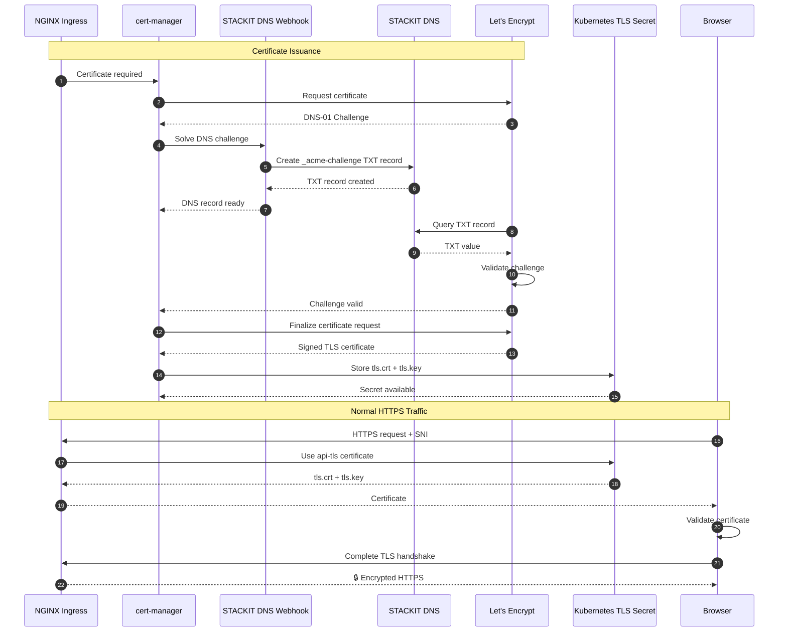

# TLS/SSL Certificate Flow with cert-manager, STACKIT DNS & Let's Encrypt

This note focuses only on **how HTTPS/TLS certificates are obtained, validated, stored, and finally served by NGINX Ingress**.

The easiest way to understand it is:

```text
                    CERTIFICATE ISSUANCE

NGINX Ingress
     │
     │ "I need a certificate for this hostname"
     ▼
cert-manager
     │
     │ requests certificate
     ▼
Let's Encrypt
     │
     │ "Prove you control the domain"
     ▼
DNS-01 Challenge
     │
     ▼
STACKIT DNS
     │
     │ temporary TXT record
     ▼
Let's Encrypt verifies DNS
     │
     │ valid
     ▼
Certificate issued
     │
     ▼
cert-manager
     │
     │ stores certificate
     ▼
Kubernetes TLS Secret
     │
     ▼
NGINX Ingress
     │
     │ serves certificate
     ▼
Browser
     │
     │ HTTPS / TLS
     ▼
🔒 Secure connection
```

---

# 1. The main actors

```text
┌─────────────────────────────────────────────────────┐
│ Kubernetes Cluster                                  │
│                                                     │
│  NGINX Ingress                                      │
│       │                                             │
│       ▼                                             │
│  cert-manager                                       │
│       │                                             │
│       ▼                                             │
│  STACKIT DNS Webhook                                │
│       │                                             │
│       ▼                                             │
│  Kubernetes TLS Secret                              │
│                                                     │
└─────────────────────────────────────────────────────┘
               │
               │ Internet
               ▼
        ┌───────────────┐
        │ STACKIT DNS   │
        └───────────────┘
               │
               │
        ┌───────────────┐
        │ Let's Encrypt │
        └───────────────┘
```

Each component has a different responsibility:

| Component                 | Responsibility                                        |
| ------------------------- | ----------------------------------------------------- |
| **NGINX Ingress**         | Serves HTTPS and uses the certificate                 |
| **cert-manager**          | Automates certificate lifecycle                       |
| **STACKIT DNS Webhook**   | Allows cert-manager to create DNS records in STACKIT  |
| **STACKIT DNS**           | Hosts the authoritative DNS records                   |
| **Let's Encrypt**         | Validates domain ownership and issues the certificate |
| **Kubernetes TLS Secret** | Stores the certificate and private key                |

---

# 2. What are we trying to achieve?

Suppose your API is:

```text
api.foyez.runs.onstackit.cloud
```

You want:

```text
https://api.foyez.runs.onstackit.cloud
```

The browser must receive a valid TLS certificate for that hostname.

The certificate essentially says:

```text
This certificate belongs to:

api.foyez.runs.onstackit.cloud

and was signed by:

Let's Encrypt
```

---

# 3. cert-manager sees the certificate requirement

Your Ingress can reference a cert-manager Issuer:

```yaml
metadata:
  annotations:
    cert-manager.io/cluster-issuer: letsencrypt-prod
```

and TLS:

```yaml
spec:
  tls:
    - hosts:
        - api.foyez.runs.onstackit.cloud
      secretName: api-tls
```

This tells cert-manager:

> "Get me a certificate for `api.foyez.runs.onstackit.cloud` and put it into the `api-tls` Secret."

So:

```text
Ingress
   │
   ▼
cert-manager
   │
   ▼
"I need a certificate for api.foyez..."
```

---

# 4. What is a certificate?

A TLS certificate is essentially a **digital identity for a domain**.

It contains information such as:

```text
Domain:
api.foyez.runs.onstackit.cloud

Issuer:
Let's Encrypt

Valid from:
...

Valid until:
...
```

It is digitally signed by the Certificate Authority (CA).

### What is a CA?

**CA = Certificate Authority**

A CA is an organization trusted by browsers and operating systems to issue certificates.

In this setup:

```text
Let's Encrypt = Certificate Authority
```

Because browsers trust Let's Encrypt, they can trust certificates signed by it.

---

# 5. But why does Let's Encrypt trust us?

This is where **domain validation** comes in.

Let's Encrypt cannot simply give anyone a certificate for:

```text
google.com
```

Otherwise anyone could impersonate Google.

So Let's Encrypt says:

> "Prove that you control this domain."

This proof is called a **challenge**.

---

# 6. What is a Challenge?

A **challenge** is a task that Let's Encrypt gives you to prove domain ownership.

There are different ACME challenge types.

The one we're using is:

```text
DNS-01
```

The idea is:

> "Put a special value into your domain's DNS records. If I can find that value, I'll know you control the DNS."

So Let's Encrypt gives cert-manager a challenge.

Conceptually:

```text
Let's Encrypt
      │
      │ Challenge:
      │ "Put this value in DNS"
      ▼
cert-manager
```

---

# 7. What is DNS-01?

**DNS-01** is an ACME domain-validation method that uses a DNS **TXT record**.

Let's Encrypt expects a special record:

```text
_acme-challenge.api.foyez.runs.onstackit.cloud
```

with a specific value:

```text
TXT = "random-validation-value"
```

The important part is:

```text
_acme-challenge
```

This is a special hostname reserved for ACME DNS validation.

---

# 8. What is a TXT record?

DNS has different types of records.

For example:

### A record

```text
api.foyez.runs.onstackit.cloud
        ↓
A
        ↓
192.0.2.10
```

It means:

> "This hostname points to this IPv4 address."

This is normally used to get users to your Load Balancer.

---

### TXT record

```text
_acme-challenge.api.foyez.runs.onstackit.cloud
        ↓
TXT
        ↓
"random-validation-value"
```

It means:

> "Here is some text associated with this DNS name."

For ACME, this text is used as **proof of domain ownership**.

---

# 9. cert-manager creates the TXT record

cert-manager needs to put that TXT record into STACKIT DNS.

It doesn't manually do this.

It uses the:

```text
STACKIT cert-manager Webhook
```

The flow is:

```text
cert-manager
     │
     │ "Create DNS challenge record"
     ▼
STACKIT cert-manager Webhook
     │
     │ STACKIT DNS API
     ▼
STACKIT DNS
```

The STACKIT webhook is configured with credentials that allow it to modify DNS records.

---

# 10. The TXT record is created

STACKIT DNS now contains:

```text
_acme-challenge.api.foyez.runs.onstackit.cloud

TXT

"random-validation-value"
```

This record is temporary.

It exists only for the certificate validation process.

---

# 11. Let's Encrypt checks the DNS

This is a very important part.

Let's Encrypt **doesn't trust cert-manager saying**:

> "I created the TXT record."

Instead, Let's Encrypt independently checks DNS.

```text
Let's Encrypt
      │
      │ DNS query
      ▼
STACKIT DNS
      │
      ▼
_acme-challenge.api.foyez...
      │
      ▼
TXT = "random-validation-value"
```

Let's Encrypt compares the returned value with the expected value.

If they match:

```text
✅ Domain ownership proven
```

---

# 12. What is an authoritative DNS server?

An **authoritative DNS server** is the source of truth for a DNS zone.

For example:

```text
foyez.runs.onstackit.cloud
        │
        ▼
STACKIT authoritative nameservers
```

When Let's Encrypt asks:

> "What is the TXT record for `_acme-challenge...`?"

the authoritative DNS infrastructure ultimately provides the official answer.

This is why the DNS zone needs to be correctly configured/delegated to STACKIT DNS.

---

# 13. What happens after validation?

Once Let's Encrypt confirms:

```text
TXT record = correct
```

the challenge becomes:

```text
VALID
```

Then cert-manager can complete the certificate request.

The flow becomes:

```text
Challenge
    │
    │ valid
    ▼
Let's Encrypt
    │
    ▼
Certificate issued
```

---

# 14. What is the issued certificate?

Let's Encrypt creates a signed certificate for:

```text
api.foyez.runs.onstackit.cloud
```

Conceptually:

```text
Certificate

Domain:
api.foyez.runs.onstackit.cloud

Issued by:
Let's Encrypt

Valid:
2026-08-14 → ...
```

The certificate is accompanied by a **private key**.

The private key is extremely sensitive and must not be exposed.

---

# 15. cert-manager stores it in Kubernetes

cert-manager stores the certificate and private key in a Kubernetes Secret.

For example:

```text
Secret: api-tls

├── tls.crt    ← certificate
└── tls.key    ← private key
```

Think of the Secret as:

> "A secure Kubernetes storage object containing the TLS credentials."

---

# 16. NGINX Ingress uses the Secret

Your Ingress references:

```yaml
tls:
  - hosts:
      - api.foyez.runs.onstackit.cloud
    secretName: api-tls
```

So NGINX knows:

```text
For:
api.foyez.runs.onstackit.cloud

Use:
api-tls
```

NGINX loads:

```text
tls.crt
tls.key
```

and is now ready to serve HTTPS.

---

# 17. Browser connects

Now a real user visits:

```text
https://api.foyez.runs.onstackit.cloud
```

The browser connects to your public Load Balancer and eventually reaches NGINX.

During the TLS handshake, the browser tells NGINX which hostname it wants using **SNI**.

---

# 18. What is SNI?

**SNI = Server Name Indication**

It allows the browser to tell the server:

> "I want the certificate for `api.foyez.runs.onstackit.cloud`."

For example:

```text
Browser
   │
   │ TLS ClientHello
   │
   │ SNI:
   │ api.foyez.runs.onstackit.cloud
   ▼
NGINX
```

NGINX uses the SNI hostname to select the correct certificate.

This is particularly useful when one NGINX instance hosts many domains:

```text
api.foyez...      → api-tls
app.foyez...      → app-tls
admin.foyez...    → admin-tls
```

---

# 19. Browser validates the certificate

NGINX presents the certificate.

The browser checks several things:

```text
Certificate
     │
     ├── Is the hostname correct?
     │
     ├── Is it expired?
     │
     ├── Is it signed by a trusted CA?
     │
     └── Is the certificate chain valid?
```

If everything is valid:

```text
✅ Certificate trusted
```

---

# 20. TLS handshake completes

The browser and NGINX establish encryption keys.

After that:

```text
Browser
   │
   │ 🔒 Encrypted HTTPS
   ▼
NGINX
```

Nobody between them can normally read the HTTP content.

---

# Complete Flow



---

# The 6 terms you should remember

If you're presenting this, these are the most important ones:

### 1. Certificate

Digital identity for your domain.

```text
api.example.com
       ↓
TLS Certificate
```

### 2. CA

**Certificate Authority** — trusted organization that signs certificates.

```text
Let's Encrypt = CA
```

### 3. Challenge

A task used by Let's Encrypt to verify domain ownership.

```text
"Prove you control this domain."
```

### 4. DNS-01

A challenge method where ownership is proven using DNS.

```text
Let's Encrypt
      ↓
Check TXT record
```

### 5. TXT record

Temporary DNS record containing the ACME validation value.

```text
_acme-challenge.example.com
        ↓
TXT
        ↓
validation-value
```

### 6. TLS Secret

Kubernetes Secret containing:

```text
tls.crt → certificate
tls.key → private key
```

NGINX uses these to serve HTTPS.

---

# A Record vs TXT Record

This distinction is especially important:

```text
                 STACKIT DNS
                      │
          ┌───────────┴───────────┐
          │                       │
       A RECORD                TXT RECORD
          │                       │
          ▼                       ▼
     NLB IP address          ACME validation
          │                       │
          ▼                       ▼
   "Where is my app?"      "Do I control it?"
          │                       │
          ▼                       ▼
      Browser              Let's Encrypt
```

**A record gets users to your application.**

**TXT record proves domain ownership for certificate issuance.**

---

## The short interview answer

> **I use cert-manager with Let's Encrypt and STACKIT DNS for automatic TLS certificates. cert-manager requests a certificate and receives a DNS-01 challenge from Let's Encrypt. It uses the STACKIT DNS webhook to create a temporary TXT record under `_acme-challenge`. Let's Encrypt independently queries the authoritative DNS servers and validates that record to prove domain ownership. Once validated, Let's Encrypt issues the certificate. cert-manager stores the certificate and private key in a Kubernetes TLS Secret, which NGINX Ingress uses to terminate TLS and serve trusted HTTPS connections.**
