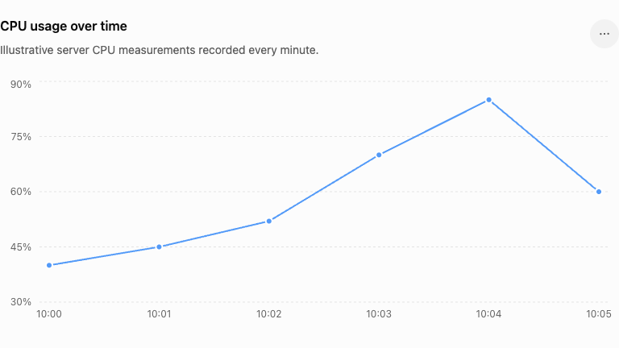

# Time-series data

**Time-series data = measurements recorded over time.**

For example, suppose your server's CPU usage is monitored every minute:

```text id="7d2k4m"
Time       CPU
10:00      40%
10:01      45%
10:02      52%
10:03      70%
10:04      85%
10:05      60%
```

The important part is that every measurement has a **timestamp**.

You can visualize it as:



### In Prometheus

A metric might look like:

```text
id="0r3c7y"
cpu_usage{server="web-01"} 85
```

Prometheus doesn't just care that the value is `85`. It stores the value **together with its timestamp**:

```text id="5k2m8p"
Timestamp        Value
10:00            40
10:01            45
10:02            52
10:03            70
10:04            85
10:05            60
```

That's a **time series**.

### Why is this useful?

Because now you can ask questions like:

> "What was CPU usage over the last hour?"

> "When did CPU usage start increasing?"

> "What was CPU usage during the incident?"

> "Is CPU usage normally higher at 9 AM?"

This is why monitoring systems like **Prometheus** are fundamentally based around time-series data.

### One important connection

Remember the concepts you've learned:

```text id="r7v4nz"
Metric
  ↓
CPU usage = 85%
  ↓
Timestamp
  ↓
10:04
  ↓
Time-series data
```

And if you have:

```text id="8x1qvf"
10:00 → 40%
10:01 → 45%
10:02 → 52%
10:03 → 70%
10:04 → 85%
```

you can see the **trend**, which is often much more useful than a single number.
