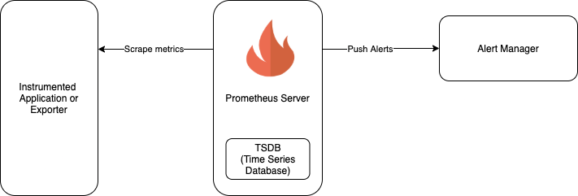

# Prometheus

Prometheus is an open-source **monitoring and alerting system** that **collects, stores, and queries metrics** from applications and infrastructure.

The terms map roughly like this:

* **Instrument** → add metrics to your application/system
* **Collect** → Prometheus gathers those metrics
* **Store** → Prometheus stores the time-series data
* **Query** → use **PromQL** to analyze the metrics
* **Alerting** → trigger alerts based on metric conditions
* **Dashboarding** → visualize metrics, often with **Grafana**

The simplest mental model is:

> **Your applications expose metrics → Prometheus collects them → Prometheus stores them as time-series data → you query them → Grafana visualizes them → Alertmanager can notify you.**

One important distinction: **Prometheus itself is not an API or SDK.** It is primarily a **monitoring/metrics platform**. It does expose APIs and has client libraries (SDK-like tools) that applications can use to integrate with it.

## Basic Architecture of Prometheus

The basic components of a Prometheus setup are:

- Prometheus Server (the server which scrapes and stores the metrics data).
- Targets to be scraped, for example an instrumented application that exposes its metrics, or an exporter that exposes metrics of another application.
- Alertmanager to raise alerts based on preset rules.

(Note: Apart from this Prometheus has push_gateway which is not covered here).



```
Applications
    ↓
Metrics
    ↓
Prometheus
    ├── Scrapes metrics
    ├── PromQL query engine
    ├── Alerting
    └── TSDB  ← stores the time-series data
```

```text id="k4m8qp"
        Your application
              │
              │ exposes metrics
              ▼
        /metrics endpoint
              │
              │ scrape
              ▼
         Prometheus
              │
              │ stores
              ▼
       Time-series database
              │
              │ PromQL queries
              ▼
           Grafana
              │
              ▼
         Dashboard
```

For example, your application might expose:

```text id="2n7x5c"
http_requests_total{method="GET",status="200"} 15234
http_requests_total{method="GET",status="500"} 42
```

Prometheus periodically **scrapes** that endpoint and stores the values.

## What does "scrape" mean?

This is one of the first Prometheus concepts to understand.

Prometheus usually **pulls** metrics from your applications.

For example:

```text id="8v3k1m"
Every 15 seconds:

Prometheus ────────> Application
           GET /metrics

Prometheus <──────── Application
           metrics
```

This is called **scraping**.

The application doesn't normally need to send the metrics directly to Prometheus.

## What does Prometheus actually store?

Remember **time-series data**.

Suppose your application exposes:

```text id="5c9r2p"
http_requests_total{status="200"} 1000
```

At different points in time:

```text id="m7q4xz"
10:00 → 1000
10:01 → 1150
10:02 → 1320
10:03 → 1500
```

Prometheus stores those measurements as a time series.

The combination of:

```text id="w2h8nc"
metric name
+
labels
```

identifies a particular time series.

For example:

```text id="p6y3vk"
http_requests_total{method="GET",status="200"}
```

is one time series.

While:

```text id="r9s5jd"
http_requests_total{method="POST",status="200"}
```

is another.

This connects directly to the **cardinality** concept.

## How to Use <sup>[ref](https://prometheus.io/docs/tutorials/getting_started/)</sup>

Prometheus is written using Go and all you need to run it is the binary compiled for your operating system.

Prometheus exposes its own metrics which can be consumed by itself or another Prometheus server.

All that we need is just the binary and a configuration file. Prometheus uses yaml files for configuration.

```yaml
global:
  scrape_interval: 15s

scrape_configs:
  - job_name: prometheus
    static_configs:
      - targets: ["localhost:9090"]
```

In the above configuration file we have mentioned the scrape_interval, i.e how frequently we want Prometheus to scrape the metrics. We have added scrape_configs which has a name and target to scrape the metrics from. Prometheus by default listens on port 9090. So add it to targets.

```sh
prometheus --config.file=prometheus.yml
```

## How Prometheus Works

### Pull-Based Scraping Model

Unlike most monitoring systems (which have agents *push* metrics), Prometheus *pulls* (scrapes) metrics from targets on a schedule.

```
Prometheus Server
  │
  │  every 15s (scrape_interval)
  │  HTTP GET /metrics
  │
  ├──→ Go API pod     :8080/metrics
  ├──→ CNPG pod       :9187/metrics  (postgres_exporter sidecar)
  ├──→ kube-state-metrics :8080/metrics
  ├──→ node-exporter  :9100/metrics
  └──→ CNPG Operator  :8080/metrics
```

**How Prometheus discovers targets:**

In Kubernetes, Prometheus uses **ServiceMonitor** and **PodMonitor** custom resources (from the kube-prometheus-stack CRDs) instead of manually listing IPs. Prometheus watches for these resources and automatically configures its scrape targets.

```yaml
# ServiceMonitor tells Prometheus:
# "scrape the paas-api Service on port metrics, path /metrics"
apiVersion: monitoring.coreos.com/v1
kind: ServiceMonitor
metadata:
  name: paas-api-monitor
spec:
  selector:
    matchLabels:
      app: paas-api
  endpoints:
    - port: metrics
      path: /metrics
      interval: 30s
```

### The Data Model: Metrics & Labels

Every Prometheus metric has a **name** and a set of **labels**:

```
cnpg_pg_stat_activity_count{datname="app", state="active", namespace="paas-databases", pod="dev-db-1"}  3

│───────────────────────────────────────────────────────────────────────────────────────────────────────│
│  metric name                                                                                          │
│                              │──────────────────────────────────────────────────────────────────────│ │
│                              │  labels (key=value pairs — the dimensions you can filter/group by)   │ │
│                                                                                                    value
```

**Four metric types:**

| Type | Description | Example |
|---|---|---|
| **Counter** | Monotonically increasing | `http_requests_total` |
| **Gauge** | Can go up or down | `memory_usage_bytes` |
| **Histogram** | Distribution of values (buckets) | `http_request_duration_seconds` |
| **Summary** | Like histogram but pre-calculated quantiles | `go_gc_duration_seconds` |

### PromQL Basics

Prometheus has its own query language called **PromQL**. You use it in Grafana panels and alert rules.

For example:

```text id="a4k7mz"
http_requests_total
```

means:

> Give me the `http_requests_total` time series.

You can filter labels:

```text id="f8q2nw"
http_requests_total{status="500"}
```

> Give me HTTP 500 requests.

And calculate a rate:

```text id="u5r9cx"
rate(http_requests_total[5m])
```

> How many requests per second are happening, based on the last 5 minutes?

This is where your understanding of **Counters** becomes useful.

A counter might continually increase:

```text id="j3v6qa"
1000
1100
1250
1400
```

But you usually care about:

> **How fast is it increasing?**

That's what `rate()` helps you determine.

```promql
# Instant vector: current value of a metric
up

# Filter by label
up{job="paas-api"}

# Rate: per-second rate of increase over 5m window
# (use rate() for counters, never for gauges)
rate(http_requests_total{status="500"}[5m])

# Aggregation: sum across all pods, keeping the namespace label
sum by (namespace) (cnpg_pg_stat_user_tables_seq_scan)

# Comparison: alert when CPU > 80%
(1 - avg(rate(node_cpu_seconds_total{mode="idle"}[5m])) by (instance)) * 100 > 80

# Join two metrics: calculate ratio
rate(http_requests_total{status=~"5.."}[5m])
  /
rate(http_requests_total[5m])
```

Prometheus + Grafana

It's important to understand that **Prometheus and Grafana are not the same thing**.

**Prometheus:**

> Collects, stores, and queries metrics.

**Grafana:**

> Visualizes data and creates dashboards/alerts.

For example:

```text id="c8w2pn"
Prometheus
    │
    │ PromQL
    ▼
Grafana
    │
    ▼
┌─────────────────────────┐
│ CPU          72%        │
│                         │
│ Requests     850/sec    │
│                         │
│ Error rate   0.3%       │
│                         │
│ p95 latency  320 ms     │
└─────────────────────────┘
```

---

## Prometheus isn't everything

Prometheus is primarily for **metrics**.

You might have:

```text
             Observability
                  │
       ┌──────────┼──────────┐
       │          │          │
     Metrics     Logs      Traces
       │          │          │
 Prometheus      Loki      Tempo
       │          │          │
       └──────────┼──────────┘
                  │
               Grafana
```

So:

* **Prometheus** → metrics
* **Loki** → logs
* **Tempo** → traces
* **Grafana** → visualization/exploration
* **Alertmanager** → alert routing/notifications
* **OpenTelemetry** → instrumentation/collection framework

---

## A practical example

Imagine you have an API.

You want to know:

> "Is my API healthy?"

You instrument it with:

```text id="n5c7xr"
http_requests_total
http_request_duration_seconds
```

Prometheus collects them.

You can then answer:

**How many requests?**

```text id="t2m8vq"
rate(http_requests_total[5m])
```

**How many errors?**

```text id="z7k3pc"
rate(http_requests_total{status=~"5.."}[5m])
```

**How fast are requests?**

You use the histogram:

```text id="r4x9mw"
http_request_duration_seconds
```

and calculate something such as p95 latency.

Grafana can then put all of this onto one dashboard.

## Alerting with AlertManager

```
Prometheus evaluates alert rules every 15s
        │
        │  rule condition is true for > `for: 5m`
        ▼
AlertManager receives the alert
        │
        ├── Groups similar alerts (deduplication)
        ├── Routes to correct receiver (Slack, PagerDuty, email)
        └── Silences during maintenance windows
```

---