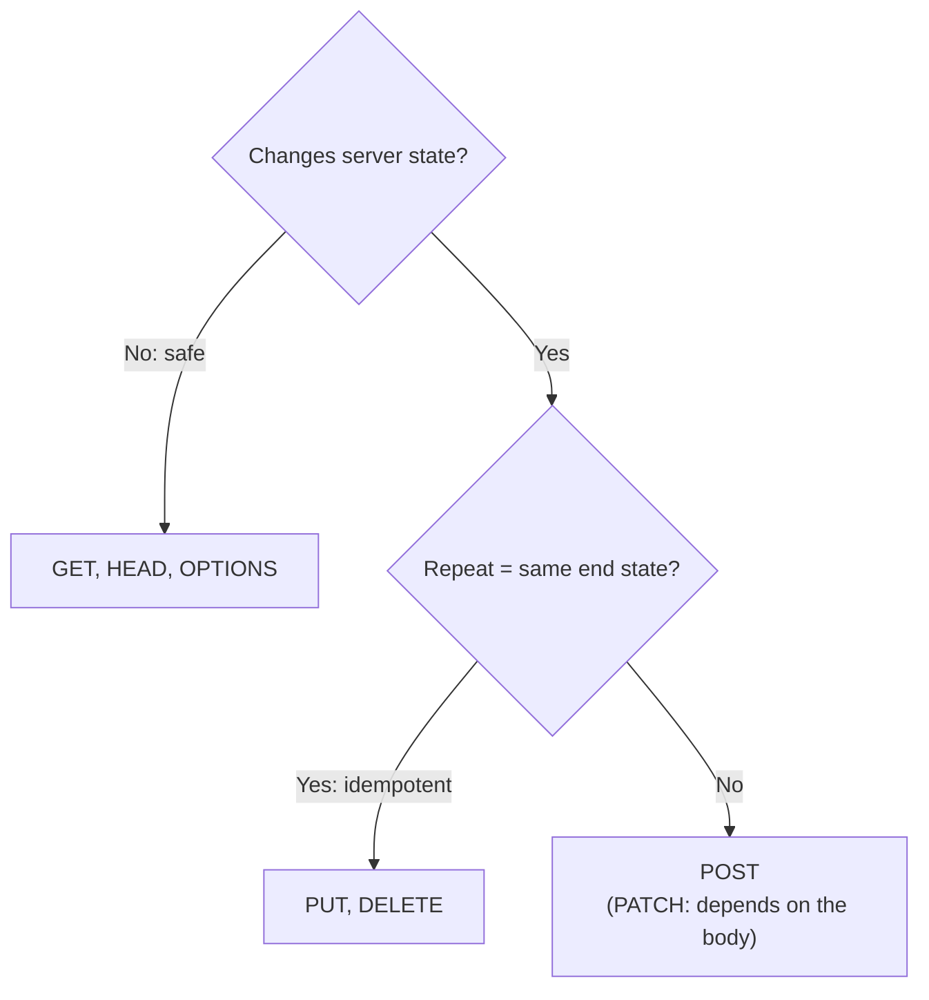
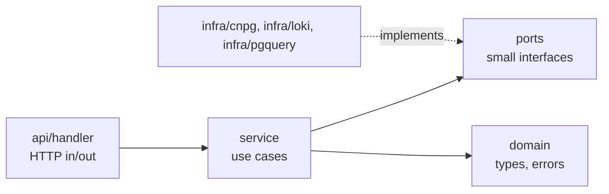

# API design in Go

!!! abstract "Where it's used in this project"
    The REST API in [`platform/`](https://github.com/foyez/dbaas-platform/tree/main/platform): routes in [`api/router/router.go`](https://github.com/foyez/dbaas-platform/blob/main/platform/internal/api/router/router.go), the error mapping in [`httpx/errors.go`](https://github.com/foyez/dbaas-platform/blob/main/platform/internal/httpx/errors.go), and the contract in [`platform/docs/openapi.yaml`](https://github.com/foyez/dbaas-platform/blob/main/platform/docs/openapi.yaml). Idempotency, validation, CORS and limits are on [Hardening the API](api-hardening.md). Overview: [REST API](../components/api.md).

## Key ideas

### What REST is

REST is an architectural style, not a protocol. There is no REST spec to comply with, only a set of constraints. Each constraint exists to solve one problem:

| Constraint | What it buys you |
|---|---|
| Client-server | UI and backend evolve independently (here: Vue UI, Go SDK, one API) |
| Stateless | Every request carries everything needed (the bearer token), so any replica can serve it |
| Resources | URLs name things (`/instances/42`), HTTP methods are the actions |
| Uniform interface | The same methods and status codes mean the same thing on every endpoint |
| Cacheable | Responses can say whether and how long they may be cached |
| Layered | The client can't tell a load balancer or gateway from the server, so infra can change |

Most real APIs stop at "resources + correct methods + correct status codes" (level 2 of the Richardson maturity model). Level 3, HATEOAS (responses embed links to next actions), is rarely used in practice.

### Resources and URLs

The API has one main resource, an instance, plus sub-resources:

```text
POST   /api/v1/instances                    create         → 202
GET    /api/v1/instances?limit=&cursor=     list           → 200
GET    /api/v1/instances/{id}               get one        → 200 / 404
PATCH  /api/v1/instances/{id}               change fields  → 202
DELETE /api/v1/instances/{id}               delete         → 202
GET    /api/v1/instances/{id}/credentials   sub-resource   → 200
GET    /api/v1/instances/{id}/logs          sub-resource   → 200
POST   /api/v1/instances/{id}/query         SQL console    → 200 / 422
GET    /api/v1/audit-logs                   admin only     → 200
```

| Rule | Good | Bad |
|---|---|---|
| Nouns, plural | `/instances` | `/getInstances`, `/createInstance` |
| The method is the verb | `PATCH /instances/42` | `POST /instances/42/update` |
| Nest one level, then flatten | `/instances/42/logs` | `/users/1/instances/42/logs/7` |
| Filters, sort and paging go in the query | `/audit-logs?resourceId=42&limit=50` | `/audit-logs/resource/42/page/2` |
| No body on GET | `GET /instances?limit=20` | `GET /instances` with a JSON body |

`POST /instances/{id}/query` is a deliberate exception: running SQL is an action, not a resource, and a POST body is the right place for a statement that can be long.

### HTTP methods

Two questions describe every method. **Safe**: does it leave server state unchanged? **Idempotent**: does repeating it leave the same end state as doing it once?



| Method | Safe | Idempotent | Used here for |
|---|---|---|---|
| GET | yes | yes | Reading instances, credentials, logs |
| HEAD | yes | yes | Not used (GET without the body) |
| OPTIONS | yes | yes | CORS preflight, answered by the CORS middleware |
| POST | no | no | Create, SQL console |
| PUT | no | yes | Not used |
| PATCH | no | depends | Change version or storage |
| DELETE | no | yes | Delete an instance |

Idempotent means the same **state**, not the same **response**. Once the instance is gone, another `DELETE /instances/42` returns `404` instead of `202`, but the end state is the same: no instance.

**PUT replaces, PATCH merges.** A PUT must send the whole resource; any field left out is wiped. A PATCH sends only what changes. This API uses PATCH with pointer fields (`Version *int`, `Storage *string` in `api/dto.go`), so "not sent" (`nil`) is different from "set to empty". A PATCH body of absolute values (`{"version": 16}`) is idempotent. A delta (`{"storage": {"add": "1Gi"}}`) would not be, which is a good reason to avoid deltas.

### Status codes

Think in classes first: **2xx** it worked, **4xx** the client's request is the problem, **5xx** the server is the problem.

| Code | Meaning | Where this API returns it |
|---|---|---|
| 200 OK | Done, here's the result | GET, SQL console success |
| 201 Created | New resource exists now | Not used: nothing exists yet when the API replies |
| 202 Accepted | Accepted, work happens later | Create, PATCH, DELETE: the operator does the work |
| 204 No Content | Done, no body | Not used: DELETE returns a small status body instead |
| 400 Bad Request | Malformed or invalid input | Bad JSON, failed binding, missing `Idempotency-Key` |
| 401 Unauthorized | Who are you? | Missing or invalid token (ZITADEL middleware) |
| 403 Forbidden | I know you, but no | Non-admin calling `/audit-logs` |
| 404 Not Found | Doesn't exist (or not yours) | Unknown id, or another user's instance |
| 409 Conflict | Clashes with current state | `INSTANCE_NOT_READY`: credentials or query before Ready |
| 422 Unprocessable | Valid request, can't be processed | SQL rejected by Postgres, query timeout |
| 429 Too Many Requests | Slow down | Not yet: no rate limiting (see [hardening](api-hardening.md#rate-limiting)) |
| 500 Internal Error | Our bug | Any unmapped error, with a generic message |
| 502 / 503 / 504 | Bad upstream / unavailable / upstream timeout | Usually from a proxy or gateway, not the app |

Two pairs get mixed up:

- **401 vs 403.** 401 means "not authenticated" (no or bad token). 403 means "authenticated, but not allowed".
- **400 vs 422.** A common split: 400 for "can't parse it", 422 for "parsed fine, but the values are wrong". This API uses 400 for all input validation and keeps 422 for a request that is well-formed but that the database rejects. Either convention works; consistency is what matters.

### One error shape

Every error goes through `httpx.RespondError`, so clients parse one shape:

```json
{
  "error": {
    "code": "QUERY_FAILED",
    "message": "relation \"ordrs\" does not exist",
    "details": { "sqlState": "42P01", "position": 15 }
  }
}
```

| Field | Purpose |
|---|---|
| `code` | Machine-readable and stable (`httpx/error_codes.go`). Clients branch on this, never on the message |
| `message` | Human-readable; can be reworded without breaking clients |
| `details` | Optional structured data for a specific code (here, Postgres's own error position) |

The service returns sentinel errors (`service.ErrNotFound`, `ErrInstanceNotReady`, ...). `httpx` maps each one to a status and code with `errors.Is`, so a wrapped error (`fmt.Errorf("executing query: %w", err)`) still matches. Anything unmapped becomes `500 INTERNAL_ERROR` with `"something went wrong"`. **Log the details, return little**: the full error goes to the log (with the trace ID), not to the client.

### Versioning and breaking changes

An API is a contract; changing it in place breaks clients that rely on the old shape. The version goes in the URL path (`/api/v1`) because it's explicit, easy to route and easy to test with curl. Header or query-param versions hide it.

One test decides whether a change is breaking: **could an existing client, written against the old response, fail?**

| Breaking (needs `v2`) | Not breaking (ship it) |
|---|---|
| Remove or rename a field | Add an optional field |
| Change a field's type | Add an endpoint or query parameter |
| Make an optional field required | Relax validation |
| Change a status code (202 → 200) | Fix a bug without changing the contract |
| Change the error shape | Add a new error code clients can treat as generic |

For a breaking change, overlap old and new: add the new field next to the old one, mark the old one deprecated with a date, then remove it. It's the same expand → migrate → contract pattern as a database schema migration.

### Pagination: offset vs cursor

| | Offset (`?page=3&limit=20`) | Cursor (`?cursor=...&limit=20`) |
|---|---|---|
| How | `LIMIT 20 OFFSET 40` | "Continue after this point" |
| Deep pages | Slow: the DB scans and discards every skipped row | Constant: jumps straight to the anchor |
| Rows inserted mid-scroll | Can skip or repeat rows | Stable |
| Jump to page N, total count | Yes | No |

This API is cursor-only, because both backends only support cursors:

- **Instances** come from the Kubernetes List API, which has `limit` and a `continue` token but no offset. The token is passed through as `nextCursor`.
- **Audit logs** come from Loki, which queries by time range. The cursor is the oldest entry's timestamp; the next page ends there.

Both cap `limit` (instances: default 20, max 100; audit logs: default 50, max 200). Without a cap, `?limit=999999` defeats the point. An empty `nextCursor` means there are no more pages.

### API-first with OpenAPI

The contract is written in `openapi.yaml`, and the code implements it. The UI and the SDK are built against the contract, not against whatever the handlers happen to return. The API serves it at `/openapi.yaml`, with Swagger UI at `/docs`.

### Pragmatic clean architecture

Dependencies point inwards: HTTP and Kubernetes are details; the use cases don't import them.



- **Handlers stay thin**: bind, call the service, map errors to status codes. No business rules.
- **Define interfaces where they're consumed.** The service declares the few methods it needs; the infra package just has to satisfy them. Small interfaces make test doubles trivial (`ports/mocks`).
- **Don't abstract prematurely.** Add an interface for a real reason: inverting a dependency, a test double, or a second implementation.
- **Shared HTTP conventions live apart from features.** `httpx` owns the response envelope and error codes, so every handler returns errors the same way.

## What I learned building it

- **202 is the honest answer for async work.** Create, update and delete only write the desired state; the operator does the work. Returning `201` or `200` would claim the database is ready when it isn't. After a PATCH, the API reports `Pending` instead of the stale `Running` status.
- **Don't leak existence.** Another user's instance returns `404`, not `403` or `409`, which would confirm it exists.
- **Let the backend pick the pagination style.** Kubernetes and Loki have no offset, so the API exposes cursors instead of faking page numbers.
- **Map the error, keep the sentinel's message.** `RespondError` returns `mapping.err.Error()`, not the wrapped `err.Error()`, so internal context like "executing query:" never reaches the client.
- **Binding errors still leak a little.** Create and PATCH return the validator's raw message, which names Go struct fields (`CreateInstanceRequest.Name`). A friendlier version would translate it into per-field `details`.

## Review questions

??? question "REST is a style, not a protocol. What does that mean in practice?"
    There's no spec or wire format to comply with, only constraints (stateless, resources, uniform interface, ...). An API is "RESTful" to the degree it follows them. SOAP, by contrast, is a protocol with a fixed envelope format.

??? question "Why does statelessness make horizontal scaling easy?"
    No replica holds session state, because every request carries its own token. A load balancer can send any request to any API pod, and pods can be added or killed freely.

??? question "A repeated DELETE can return 404. Why is it still idempotent?"
    Idempotency is about the end state, not the response. After one call or ten, the instance doesn't exist.

??? question "What's the difference between PUT and PATCH, and why does this API's PATCH use pointer fields?"
    PUT replaces the whole resource, so omitted fields are wiped. PATCH changes only the fields sent. Pointers let the handler tell "not sent" (`nil`) from "sent as empty", which a plain `string` can't.

??? question "Why does create return 202 and not 201?"
    201 means the resource exists now. Here the API only writes a custom resource; the operator creates the database later, so the honest answer is "accepted, status `Pending`".

??? question "401 or 403: no token? Valid token, not an admin, calling `/audit-logs`?"
    No token: 401 (not authenticated). Valid non-admin token: 403 (authenticated, not allowed).

??? question "Why should clients branch on `error.code` and not on `error.message`?"
    The code is part of the contract and stays stable. The message is for humans and can be reworded at any time.

??? question "Is adding a field to `InstanceResponse` a breaking change? Renaming one?"
    Adding an optional field isn't: old clients ignore it. Renaming is: to an old client it looks like the field was removed.

??? question "Why is offset pagination slow on deep pages, and why doesn't this API offer it?"
    `OFFSET n` makes the database read and throw away n rows first, so the cost grows with the page number. This API can't offer it anyway: the Kubernetes List API and Loki only support continue tokens and time ranges.

??? question "Where should an interface be declared in Go, and why?"
    In the package that uses it, listing only the methods it needs. The consumer controls the contract, the interface stays small, and the implementation doesn't need to know about it.
