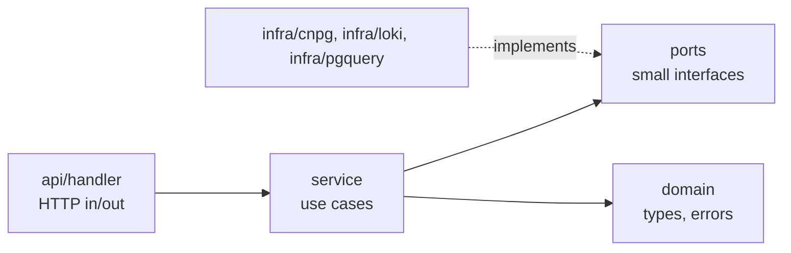

# API design in Go

!!! abstract "Where it's used in this project"
    The REST API in [`platform/`](https://github.com/foyez/dbaas-platform/tree/main/platform), its OpenAPI contract in [`platform/docs/openapi.yaml`](https://github.com/foyez/dbaas-platform/blob/main/platform/docs/openapi.yaml), and the idempotent create in `infra/cnpg/client.go`. See [REST API](../components/api.md).

## Key ideas

### Pragmatic clean architecture

Dependencies point inwards: HTTP and Kubernetes are details; the use cases don't import them.

- **Handlers stay thin**: bind, validate, call the service, map errors to status codes. No business rules.
- **Define interfaces where they're consumed.** The service declares the few methods it needs; the infra package just has to satisfy them. Small interfaces make test doubles trivial (`ports/mocks`).
- **Don't abstract prematurely.** Add an interface for a real reason: inverting a dependency, a test double, or a second implementation. Not because the diagram has a circle.
- **Shared HTTP conventions live apart from features.** `httpx` owns response envelopes and error codes so every handler returns errors the same way.

### HTTP semantics

| Method | Safe | Idempotent |
|---|---|---|
| GET | yes | yes |
| PUT, DELETE | no | yes |
| PATCH | no | not by definition |
| POST | no | no |

**Safe** means no state change: crawlers, prefetchers and caches may call it freely. **Idempotent** means repeating it has the same effect as doing it once, so clients can retry after a timeout. POST isn't idempotent, which is exactly why creates need an idempotency key.

### API-first with OpenAPI

The contract is written in `openapi.yaml` and the code implements it. Clients (UI, SDK) are built against the contract, not against whatever the handlers happen to return.

## How this project uses it

**Idempotent create without an idempotency table:**

1. The client sends `POST /instances` with an `Idempotency-Key` header.
2. The API derives the resource name: `instance-` + `sha256(userID + ":" + key)`.
3. It calls `Create` on the Kubernetes API. If the name already exists, it fetches the existing resource and returns it instead of an error.

The API server's uniqueness check on names is the atomic deduplication step, so it works across any number of API replicas. Creation is asynchronous: the API returns `202 Accepted` with status `Pending`, and the operator does the work.

## What I learned building it

- **Scope idempotency keys per user.** The first version hashed only the key, so two users sending the same key would collide on one resource name. The fix hashes `userID:key`, and keeps an ownership check as defense in depth.
- **Don't leak existence.** When a resource belongs to someone else, return `404 Not Found`, not `409 Conflict` or `403 Forbidden`, which would confirm it exists.
- **Cursor pagination fits the backend.** The Kubernetes List API and Loki have no offset, only continue tokens, so the API exposes cursors too.
- **Asynchronous operations need honest status.** After an update, the API reports `Pending` until the operator catches up, instead of returning the old status as if nothing had changed.

## Review questions

??? question "Why is POST not idempotent, and how does this API make create safe to retry?"
    Each POST may create a new resource. Here the client's `Idempotency-Key` (scoped to the user) becomes a deterministic resource name, so a retry hits `AlreadyExists` and gets the original resource back.

??? question "Why does deriving the name from the key work across multiple API replicas?"
    Uniqueness is enforced by the Kubernetes API server (backed by etcd), not by any one API pod's memory, so two replicas racing on the same key can't both succeed.

??? question "Where should an interface be declared in Go, and why?"
    In the package that uses it, listing only the methods it needs. The consumer controls the contract, the interface stays small, and the implementation doesn't need to know about it.

??? question "What's the difference between `httpx` and `api/handler`?"
    `api/handler` is feature-specific HTTP code. `httpx` is shared HTTP plumbing: response formatting and the mapping from domain errors to status codes and error codes.

??? question "What gap does the current idempotency design still have?"
    Reusing a key with a different request body returns the original resource instead of an error. A full implementation would store a hash of the body and reject a mismatch with `422`.
