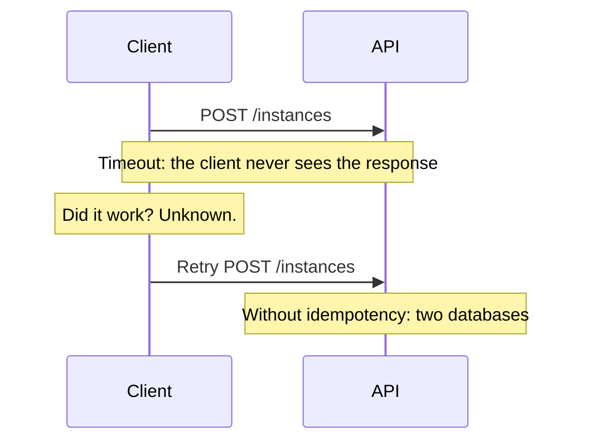
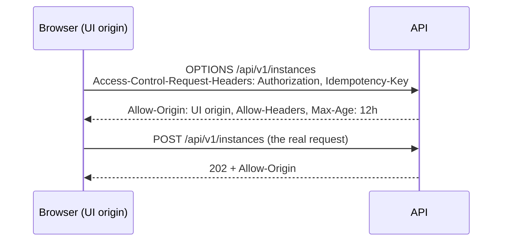

# Hardening the API

!!! abstract "Where it's used in this project"
    The idempotent create in [`infra/cnpg/client.go`](https://github.com/foyez/dbaas-platform/blob/main/platform/internal/infra/cnpg/client.go), request validation in [`api/dto.go`](https://github.com/foyez/dbaas-platform/blob/main/platform/internal/api/dto.go) and `service/instance.go`, the SQL console limits in [`infra/pgquery/pool.go`](https://github.com/foyez/dbaas-platform/blob/main/platform/internal/infra/pgquery/pool.go), and CORS in [`api/router/router.go`](https://github.com/foyez/dbaas-platform/blob/main/platform/internal/api/router/router.go). Overview: [API design in Go](api-design.md).

## Key ideas

Everything here follows from one rule: **never trust what comes from outside**. The network can drop a response, the client can send anything, and a browser page can be on any origin.

### Idempotency: safe retries

The problem is a timeout on a POST:



The client can't know whether the first request was processed, so retrying is the only sensible move. The server has to make the retry safe. The standard fix is an **idempotency key**:

- **The client generates it** (usually a UUID) and sends the same key on every retry. Only the client is present for both attempts; the server may never have seen the first one. The Go SDK takes it as `IdempotencyKey` and sends it as the `Idempotency-Key` header.
- **One key per logical operation.** A new instance gets a new key.
- **The duplicate check must be atomic.** "Look up the key, then create" has a race: two concurrent requests can both see "not found" and both create. The check has to be one atomic step, usually a unique constraint.

**How this API does it, without a key table:**

1. `POST /instances` without the header is rejected with `400 MISSING_IDEMPOTENCY_KEY`.
2. The API derives the resource name: `instance-` + the first 8 bytes of `sha256(userID + ":" + key)`, in hex.
3. It calls `Create` on the Kubernetes API. If the name already exists (`AlreadyExists`), it fetches that resource and returns it instead of an error.

The Kubernetes API server's name uniqueness (backed by etcd) is the atomic step, so it works across any number of API replicas. The [operators page](operators.md#how-this-projects-operator-is-built) shows the whole sequence from request to running database.

| Concern | Typical design (e.g. payments) | This API |
|---|---|---|
| Where keys live | A table or Redis, with a 24h TTL | The resource name itself |
| Atomic check | Unique index on the key column | Unique resource name in etcd |
| Same key, different body | Rejected (`400`/`422`) using a stored body hash | Not checked: returns the original instance |
| Key after the resource is deleted | Still remembered until TTL | Forgotten: a retry would create a new instance |

### Input validation

**Validate on the server, always.** Client-side checks in the UI are for instant feedback; anyone with curl skips them.

**Allow-list, don't block-list.** A block-list ("reject input containing `DROP`") can always be dodged by an encoding nobody thought of. An allow-list ("version must be 14, 15 or 16") is closed by construction.

Validation here happens in layers, each a backstop for the one before:

| Layer | Example in this project |
|---|---|
| Binding tags | `binding:"required,min=3,max=63"` on `name`, `oneof=14 15 16` on `version`, `min=1,max=5` on `instances` |
| Service rules | Create needs a non-empty `storage`; PATCH needs at least one field (`NO_UPDATE_FIELDS`) |
| CRD schema | The API server rejects a `PostgreSQL` resource without `version`, `storage` or `database`, or with `instances < 1` |

**Validation vs sanitization.** Validation is a gate: accept or reject. Sanitization is a transform: trim, lowercase, escape. Use validation for anything security-relevant; silently "fixing" input hides bugs.

### Injection: data vs code

Injection happens when user input is pasted into code text (SQL, LogQL, a shell command) and breaks out of its quotes:

```text
SELECT * FROM users WHERE name = '{input}'
input:  admin' --
result: SELECT * FROM users WHERE name = 'admin' --'   ← the rest is commented out
```

The fix is to keep data and code separate:

- **Values: use parameters.** `db.Query("... WHERE id = $1", id)` sends the value on a separate channel, so no character in it can be parsed as SQL. This is a different mechanism from escaping, not a better form of it.
- **Identifiers can't be parameters.** A column name in `ORDER BY` can't be `$1`, so check it against a fixed allow-list before putting it in the string.
- **Other query languages need the same care.** The API builds LogQL for Loki from the instance ID and the `resourceId` query parameter. It quotes them with `%q` (`{instance_id=%q}`), so they stay string values.

### The SQL console: limiting blast radius

`POST /instances/{id}/query` runs whatever SQL the user sends, so injection isn't the threat model: the user *is* writing the SQL. What matters is that one user can't hurt anyone else or the API:

| Risk | Control |
|---|---|
| Querying someone else's database | Ownership check before connecting, same as every other endpoint |
| Too many privileges | Connects with the instance's app user (the CNPG `-app` secret), not the superuser |
| A runaway query | 10 s timeout; pgx cancels the statement on the server |
| `SELECT *` on a huge table | At most 500 rows returned, with `truncated: true` |
| Connection exhaustion | At most 3 connections per instance; idle pools closed after 10 minutes |
| Leaking data into logs | SQL text is never logged or traced, only the SQLSTATE and row count |

Rejected SQL returns `422 QUERY_FAILED` with Postgres's own message and position, because that's the user's mistake to fix, not an API failure.

### CORS

CORS is enforced by the **browser**, not the server. The request still reaches the API; the browser decides whether the page's JavaScript may read the response. That's why curl and Postman are never "blocked by CORS".

An origin is scheme + host + port: `https://app.example.com` and `https://api.example.com` are different origins, so the Vue UI calling the API is a cross-origin request.



- **Preflight** (`OPTIONS`) happens for anything a plain HTML form couldn't send: methods like PATCH or DELETE, JSON bodies, and custom headers like `Authorization`. So every API call from the UI is preflighted.
- **Every custom header must be listed.** `Idempotency-Key` is in `AllowHeaders`; without it the browser would refuse to send create requests.
- **`MaxAge`** caches the preflight result (12 hours here), so the browser doesn't repeat `OPTIONS` before every call.
- **No wildcard with credentials.** `Allow-Origin: *` with `Allow-Credentials: true` is forbidden by the spec. The allowed origins come from `SERVER_ALLOW_ORIGINS`.

**CORS is not CSRF protection.** CORS stops another site from *reading* the response; it doesn't stop the request being *sent*. CSRF matters when the browser attaches credentials automatically, i.e. cookies. This API takes a bearer token in the `Authorization` header, which another site can't make the browser attach, so CSRF isn't a practical risk.

### HTTPS

TLS gives confidentiality, integrity, and server authentication through the certificate. See [TLS 1.3](networking.md#tls-13) and [Exposing services](exposing-services.md) for how the cluster terminates it. Two API rules follow: **tokens go in headers, never in URLs** (URLs end up in logs and browser history), and **credentials only ever travel over HTTPS**.

### Rate limiting

Without a limit, one buggy or malicious client can use up shared capacity for everyone. This API has none yet; it relies on the per-request limits above.

| Algorithm | How it works | Trade-off |
|---|---|---|
| Fixed window | N requests per clock minute | Simple, but allows 2N across a window boundary |
| Sliding window | N requests in the last 60 s | Accurate, more state per client |
| Token bucket | Bucket of N tokens refills at a steady rate; each request takes one | Allows short bursts, then a steady rate. The common default |
| Leaky bucket | Requests queue and drain at a fixed rate | Smooth output, no bursts |

- **Key by user ID** for authenticated endpoints. IP addresses are shared behind NAT and trivial to change.
- **Different limits per endpoint.** Creating a database and running SQL are far more expensive than listing instances.
- **Centralize the counter.** With several replicas, per-pod counters let N × limit through. Use a shared store (Redis) or enforce it at the gateway.
- **Tell the client.** Return `429` with `Retry-After` so clients back off for the right time instead of guessing.

### Caching

| Header | Meaning |
|---|---|
| `Cache-Control: max-age=60` | May be reused for 60 s |
| `Cache-Control: private` | Browser only, never a shared cache or CDN |
| `Cache-Control: no-cache` | May be stored, but must be revalidated before every use |
| `Cache-Control: no-store` | Never stored anywhere. For secrets |
| `ETag` + `If-None-Match` | Revalidation: `304 Not Modified` with no body if unchanged |

`no-cache` doesn't mean "don't cache"; `no-store` does. This API sets no caching headers. Instance status changes all the time, so caching it gains little. `GET /credentials` returns a password and is the one response that should send `no-store`.

## What I learned building it

- **Scope idempotency keys per user.** The first version hashed only the key, so two users sending the same key would collide on one resource name. The fix hashes `userID:key`, and keeps an ownership check as defense in depth.
- **Let something else be the atomic step.** Kubernetes already guarantees unique names, so the API doesn't need its own key table or lock.
- **My idempotency still has gaps.** Reusing a key with a different body returns the original instance instead of an error, and a key stops working once its instance is deleted. A full version would store a body hash with a TTL.
- **For the SQL console, limit what it can do rather than what it can say.** Filtering SQL is a block-list that will lose. A low-privilege user, a timeout, a row cap and a connection cap hold whatever the statement is.
- **Every custom header is a CORS decision.** Adding `Idempotency-Key` meant adding it to `AllowHeaders` too, or the browser would block every create from the UI.

## Review questions

??? question "Why must the client, not the server, generate the idempotency key?"
    The key has to be the same on the original request and the retry. If the first request timed out before reaching the server, the server never generated anything, so only the client can supply a key that links the two.

??? question "Why is 'check if the key exists, then create' not enough?"
    Two concurrent requests can both pass the check before either one writes. The check and the write must be one atomic step: a unique index, or here, the Kubernetes API server's unique names.

??? question "Why does deriving the name from the key work across multiple API replicas?"
    Uniqueness is enforced by the Kubernetes API server (backed by etcd), not by any one API pod's memory, so two replicas racing on the same key can't both succeed.

??? question "What should happen when a key is reused with a different request body, and what does this API do?"
    Ideally reject it (`422`): the key no longer identifies one operation. This API returns the original instance, because it stores no hash of the body.

??? question "Why is a block-list a weak way to validate input?"
    The set of bad inputs is unbounded, so there's always an encoding or variant it misses. An allow-list accepts only known-good values, so anything new is rejected by default.

??? question "Why can't a column name be a query parameter, and what do you do instead?"
    Placeholders stand in for values, not for parts of the query's structure like table or column names. Check the name against a fixed allow-list, then put it in the string.

??? question "The SQL console runs arbitrary SQL. What stops it from harming other users or the API?"
    Ownership checks, a non-superuser database user, a 10 s timeout, a 500-row cap, and at most 3 connections per instance. SQL text is never logged.

??? question "Why does curl never hit CORS errors, and why does the UI trigger a preflight on every call?"
    CORS is enforced by browsers, and curl isn't one. The UI sends `Authorization` and JSON bodies, which a plain form couldn't, so the browser asks permission with `OPTIONS` first.

??? question "Why is `Access-Control-Allow-Origin: *` with credentials forbidden?"
    It would let any site read responses made with the user's credentials. With credentials, the server must name the allowed origin explicitly.

??? question "Why does rate limiting break with several API replicas unless the counter is shared?"
    Each pod counts only the requests it sees, so a client spread across N pods gets N times the limit. The count has to live in one shared place, like Redis or the gateway.

??? question "`no-cache` vs `no-store`: which one for `GET /credentials`?"
    `no-store`. `no-cache` still allows storing the response (it only forces revalidation); a password should never be written to any cache.
