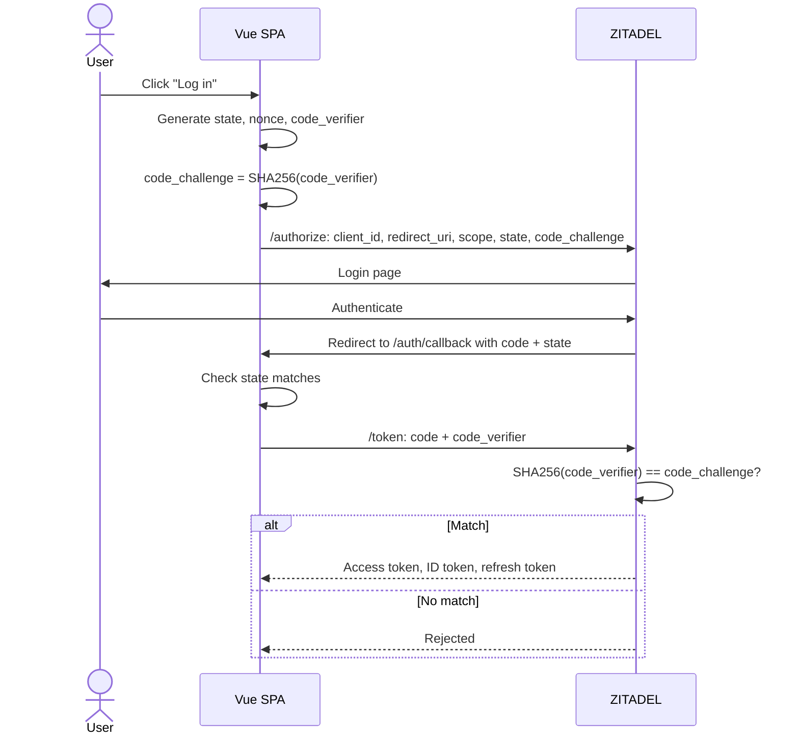
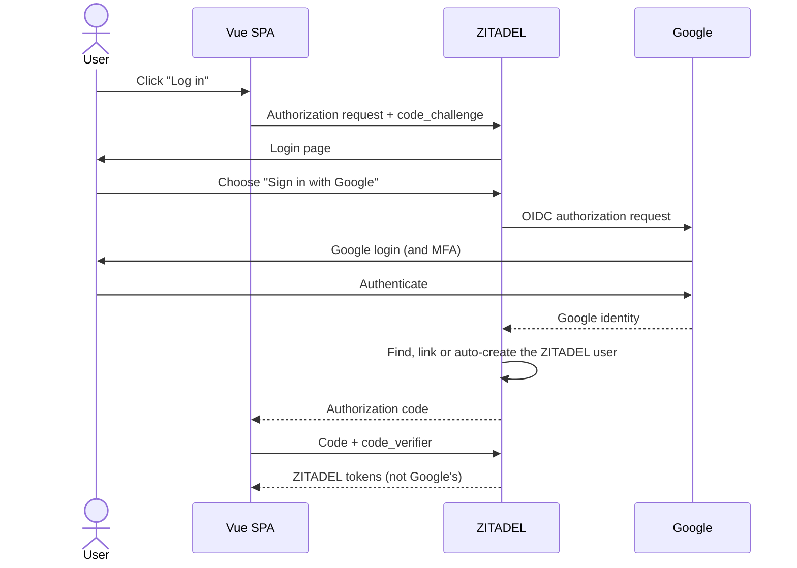
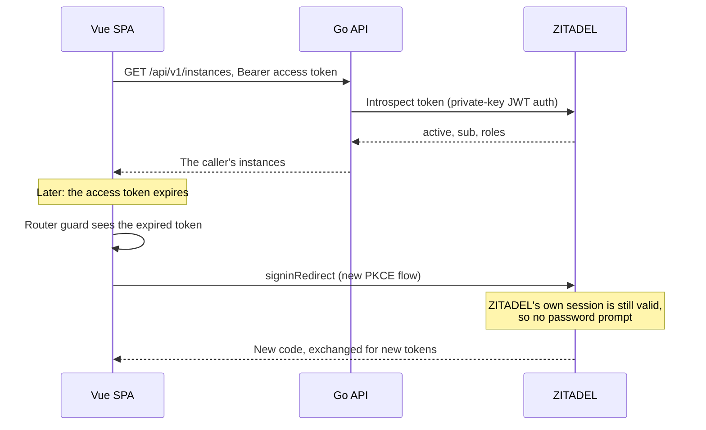

# Authentication: OAuth 2.0, OIDC and ZITADEL

!!! abstract "Where it's used in this project"
    Login in the UI ([`client/src/auth/oidc.ts`](https://github.com/foyez/dbaas-platform/blob/main/client/src/auth/oidc.ts)), token checks in the API ([`platform/internal/auth`](https://github.com/foyez/dbaas-platform/tree/main/platform/internal/auth)) and the ZITADEL setup in [`infra/zitadel/tf`](https://github.com/foyez/dbaas-platform/tree/main/infra/zitadel/tf). See [Authentication](../components/auth.md).

## Key ideas

**OAuth 2.0 is about authorization**: letting an app call an API on a user's behalf without seeing their password. **OpenID Connect (OIDC)** adds **authentication** on top: an ID token that says who the user is.

| Actor | In this project |
|---|---|
| Resource owner | The user |
| Client | The Vue SPA (`dbaas-web`) |
| Authorization server | ZITADEL |
| Resource server | The Go API (`dbaas-api`) |

| Token | For | Read by |
|---|---|---|
| Authorization code | One-time, short-lived; exchanged for tokens | ZITADEL |
| Access token | Calling the API, as `Authorization: Bearer …` | The API |
| ID token | Telling the client who logged in | The client only |
| Refresh token | Getting new access tokens without logging in again | ZITADEL |

**Public vs confidential clients.** A server-side app can keep a client secret. A browser app can't, since anything in it is visible. So a SPA is a public client, and uses **PKCE** instead of a secret.

**Authorization Code flow with PKCE:**

1. The SPA generates a random `code_verifier` and sends `code_challenge = SHA256(code_verifier)` with the login redirect.
2. The user logs in at ZITADEL, which redirects back with an authorization code.
3. The SPA exchanges the code **plus the original `code_verifier`**. ZITADEL hashes it and checks it matches the challenge.

A stolen authorization code is useless without the verifier, which never left the browser. PKCE protects the code exchange; the separate `state` parameter protects against CSRF on the redirect. Neither encrypts anything.

## How this project uses it

- **Two ZITADEL apps**: `dbaas-web` (user-agent, PKCE, no secret) for login, and `dbaas-api` (API app, private-key JWT) so the API can call ZITADEL's introspection endpoint.
- **The SPA requests the API's audience** with the scope `urn:zitadel:iam:org:project:id:<project>:aud`. Without it, the API's introspection rejects the token as "not valid for this client".
- **The API introspects every token** instead of validating JWTs locally, so revocation takes effect immediately. See [design decision 6](../design-decisions/auth-with-zitadel.md).
- **Roles come from ZITADEL.** Project role assertion puts `dbaas.user` and `dbaas.admin` into tokens; a registration action gives every new user `dbaas.user`.
- **Identity is the `sub` claim**, which becomes the owner label on every instance.

**Logging in with Google.** ZITADEL sits between the app and Google, so the app's flow doesn't change at all: it still does PKCE with ZITADEL and gets ZITADEL tokens. Google login is configured in production; the local setup leaves it out.

**Calling the API, and what happens when the token expires:**

## What I learned building it

- **Audience is not permission.** `aud` only says who a token is *for*. The API still checks roles for admin routes, and ownership for every instance.
- **Never trust the client's idea of the user.** The UI's user ID and roles are for display; the API derives both from the validated token.
- **Use `sub`, not email, as the identity key.** Emails change; `sub` doesn't.
- **Redirect URIs are compared exactly.** Moving to HTTPS, or to the local `*.dbaas.localhost` hosts, means updating them in ZITADEL. A bug where the sign-in callback overrode the configured `redirect_uri` broke login until it was fixed.
- **Where the SPA keeps tokens is a real trade-off.** The project uses `oidc-client-ts` defaults (tokens in `sessionStorage`), which is simple but readable by injected scripts. The stronger design from my notes is a backend-for-frontend: access token in memory only, refresh token in an `HttpOnly` cookie with rotation and CSRF protection.
- **A refresh token isn't a refresh flow.** The app requests `offline_access` and receives a refresh token, but automatic renewal is commented out; an expired token sends the user back through ZITADEL instead. That works because ZITADEL's session cookie skips the password, but API calls made with an expired token in between get `401`.
- **ZITADEL creates login names from the org domain.** The local admin's login name is `admin@dbaas.auth.dbaas.localhost`, not its email address, which is why the local Terraform looks the admin up by email instead of username.

## Review questions

??? question "OAuth 2.0 vs OIDC in one sentence each?"
    OAuth 2.0 lets a client get an access token to call an API on a user's behalf. OIDC adds an ID token and standard claims so the client also learns who the user is.

??? question "What attack does PKCE prevent, and how?"
    Authorization code interception: someone who steals the code from the redirect can't exchange it, because they don't have the `code_verifier` whose hash was sent at the start.

??? question "Why does the API call ZITADEL for every request instead of validating the JWT itself?"
    Introspection reflects revocation and expiry immediately. Local JWT validation is faster and avoids the network call, but a revoked token stays valid until it expires.

??? question "The UI is logged in, but every API call returns 401. What do you check?"
    That the access token's audience includes the API's project (the `:aud` scope), that the API's introspection key belongs to the same project, and that the API's issuer matches the token's `iss` exactly, including scheme and port.

??? question "Why is the ID token not sent to the API?"
    It's meant for the client, to describe the login. The API's contract is the access token, which has the right audience and roles for it.
