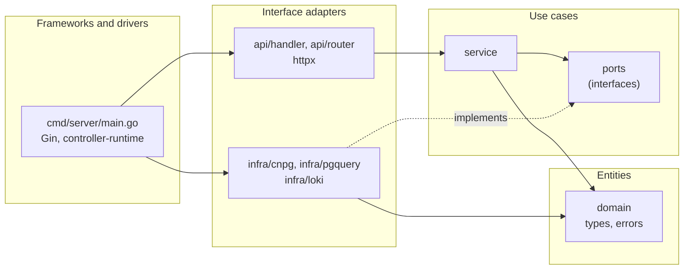
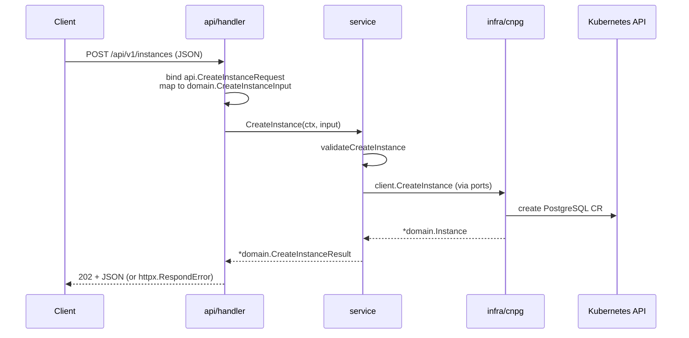

# Clean architecture and project structure

!!! abstract "Where it's used in this project"
    The Go API's layout in [`platform/internal`](https://github.com/foyez/dbaas-platform/tree/main/platform/internal): `domain`, `service`, `ports`, `infra/*` and `api/*`, wired together in [`cmd/server/main.go`](https://github.com/foyez/dbaas-platform/blob/main/platform/cmd/server/main.go). The repository itself is split into separate Go modules for the [operator](https://github.com/foyez/dbaas-platform/tree/main/operator), [API](https://github.com/foyez/dbaas-platform/tree/main/platform) and [SDK](https://github.com/foyez/dbaas-platform/tree/main/sdk). The principles behind it are on [Clean code principles](code-design-principles.md). Overview: [REST API](../components/api.md).

## Key ideas

### The idea in three rules

Clean architecture is the SOLID ideas applied to a whole codebase:

1. **Business rules sit in the middle.** What an instance is, which versions are allowed, who may see it.
2. **Technical details sit on the outside.** HTTP, Gin, Kubernetes, CNPG, Loki, pgx.
3. **Dependencies point inward.** Outer code imports inner code, never the reverse.

The reason: tools change more often than business rules. If the rules don't import the tools, replacing a tool touches only the outside. You can also test the rules without a cluster or a server.

### The layers



| Layer | Contains | This project | Changes when |
|---|---|---|---|
| Entities | Core types and rules, no framework imports | `domain` (`Instance`, `InstanceStatus`, `ErrNotFound`) | the meaning of an instance changes |
| Use cases | Workflows the user cares about | `service` (create, update, run a query) | app behaviour changes |
| Interface adapters | Translation to and from the outside | `api/handler` and `httpx` (HTTP), `infra/*` (Kubernetes, SQL, Loki) | the API shape or a backend changes |
| Frameworks and drivers | Setup and wiring | `cmd/server/main.go`, Gin, controller-runtime | a tool or its config changes |

### The dependency rule

Inner packages never import outer ones. The use case says "I need something that can get an instance" (`ports.InstanceClient`). It never says "I need the controller-runtime client".

| Allowed | Not allowed |
|---|---|
| `service` imports `domain` and `ports` | `domain` imports `infra/...` |
| `api/handler` imports `service` and `domain` | `service` imports `gin` or returns an HTTP status |
| `infra/cnpg` imports `ports` and `domain` | `service` imports `infra/cnpg` |

The direction is what makes `infra/cnpg` replaceable: it depends on `ports`, so `ports` doesn't depend on it. That's also why the sentinel errors live in `domain/errors.go`. `infra/cnpg` must return `ErrNotFound`, and if that error lived in `service`, `infra` would have to import `service`, pointing the arrow outward.

Go helps enforce this: anything under `internal/` can't be imported from outside the module, and an import cycle is a compile error.

### A request through the layers



Each layer translates into the next one's language. The handler turns JSON into a `domain` input. The service works only with `domain` types. `infra/cnpg` turns those into a Kubernetes custom resource and back. On the way out, `httpx` turns a `domain` error into a status code.

### The composition root

There has to be one place that knows every concrete type. It's `run()` in `cmd/server/main.go`:

```go
instanceClient := cnpg.NewClient(k8sClient, cfg.Server.PublicDBHost)
lokiClient := loki.NewClient(cfg.Server.LokiURL)
querier := pgquery.NewPool()

svc := service.NewInstanceService(instanceClient, querier, lokiClient, log)
handler := handler.NewInstanceHandler(svc, log, authmw, metrics)
```

Swapping an implementation (a fake client for local development, another log store) is a change here and in a new `infra` package. Nothing in `service` or `domain` moves.

### Where does this code belong?

Ask: "is this a business rule, or a technical detail?"

| Code | Layer | Package here |
|---|---|---|
| An instance is `Pending`, `Running`, `Failed`, ... | Entity | `domain/instance.go` |
| Version must be 14–16; an update needs at least one field | Use case | `service/instance.go` |
| `Idempotency-Key` header is required, JSON field names | Adapter (HTTP) | `api/handler`, `api/dto.go` |
| `ErrNotFound` → `404 NOT_FOUND` | Adapter (HTTP) | `httpx/errors.go` |
| Instance stored as a `PostgreSQL` CR with a user-id label | Adapter (storage) | `infra/cnpg` |
| Pool per instance, statement timeout | Adapter (driver) | `infra/pgquery` |
| Read config, build clients, start the server | Framework | `cmd/server/main.go` |

### Keep the models apart

The same "instance" exists in three shapes, and each one changes for a different reason:

| Model | Package | Shaped by |
|---|---|---|
| `api.CreateInstanceRequest` | `api/dto.go` | the public JSON contract (`json` and `binding` tags) |
| `domain.Instance` | `domain` | what the business needs, no tags |
| `databasev1.PostgreSQL` | `operator/api/v1` | the Kubernetes CRD schema |

Mapping between them looks like boilerplate. It's what lets you rename a JSON field without touching the CRD, or change the CRD without breaking API clients.

### Project structure

Clean architecture tells you which way dependencies go. It doesn't dictate folder names. What this repository does:

| Level | Choice | Why |
|---|---|---|
| Repository | One repo, one directory per deployable: `operator/`, `platform/`, `sdk/`, `client/`, plus `infra/` (Terraform) and `gitops/` (Argo CD) | Each part builds and ships separately, but changes that cross parts land in one commit |
| Go modules | `operator`, `platform` and `sdk` each have their own `go.mod` | The SDK's users don't download the API's dependencies; the API pins a released `operator` version for the CRD types |
| Inside the API | `cmd/server` (entry point) and `internal/` (everything else) | `internal/` can't be imported from outside, so nothing becomes public API by accident |
| Packages | Grouped by layer: `domain`, `service`, `ports`, `infra/<backend>`, `api/<handler,router>` | With one main resource (instances), layer is the clearest split |
| Cross-cutting | `httpx`, `auth`, `config`, `logger`, `observability` as their own packages | Shared by every handler, owned by no feature |
| Tests | Next to the code (`errors_test.go` beside `errors.go`); mocks in `ports/mocks`, `domain/mocks` | Go convention; mocks are importable by any test |
| Frontend | `client/src` split by role: `api/` (HTTP calls), `composables/` (data and polling), `pages/`, `components/` | The same idea: views don't call `fetch` directly |

**Package by layer vs by feature.** Grouping by layer suits one resource. With many resources (instances, backups, users), grouping by feature (`internal/instance/{handler,service,store}.go`) keeps a feature's code together. The dependency rule still holds inside each feature.

### When not to bother

Layers add files and indirection. A small CLI or a one-off script doesn't need ports and adapters. The operator is a good example in this repo: its reconciler talks to Kubernetes directly, because Kubernetes *is* its business. It splits by responsibility (`cnpg.go`, `tcpexpose.go`, `portallocator.go`) instead of by layer.

## What I learned building it

- **The dependency rule is easy to break by accident.** `domain/service.go` imports `infra/loki` to use `loki.LogLine` in the `InstanceService` interface, and `service` holds a concrete `*loki.Client` instead of a port. The fix is a `domain.LogLine` type and a small `ports.LogQuerier` interface that `infra/loki` implements.
- **Shared errors belong in the innermost layer.** Keeping the sentinels in `domain/errors.go` lets `infra/cnpg` return `ErrNotFound` without importing `service`. `service/errors.go` re-exports them so handlers can still write `service.ErrNotFound`.
- **Map DTOs to domain types in the handler, not later.** The handler builds `domain.CreateInstanceInput` from the request, so the service never sees a `json` tag or a Gin context.
- **One composition root makes the wiring readable.** Every concrete type is built in one function in `main.go`. To see what the API depends on, read that function.

## Review questions

??? question "What does 'dependencies point inward' mean, concretely, in this Go API?"
    Import statements only go toward the centre: `api/handler` → `service` → `ports`/`domain`, and `infra/*` → `ports`/`domain`. `domain` imports none of them, and `service` never imports `infra` or Gin.

??? question "Why are ErrNotFound and friends declared in domain and not in service?"
    `infra/cnpg` has to return them. If they lived in `service`, `infra` would import `service`, which points the dependency outward (and risks an import cycle). `domain` can be imported by every layer.

??? question "Where should the ports interfaces live, next to the implementation or the consumer? Why?"
    Next to the consumer (`ports`, used by `service`). The use case states what it needs, and the adapter adapts to it. If the interface lived in `infra/cnpg`, the service would have to import `infra` to name it.

??? question "What is the composition root, and where is it here?"
    The one place where concrete implementations are created and connected. Here it's `run()` in `platform/cmd/server/main.go`, which builds the CNPG client, Loki client and query pool, and passes them into `NewInstanceService`.

??? question "Why have separate DTO, domain and CRD types for an instance?"
    They change for different reasons: the public JSON contract, the business model and the Kubernetes schema. Keeping them apart means a change in one doesn't ripple into the others.

??? question "Which import in this codebase breaks the dependency rule, and how would you fix it?"
    `domain/service.go` imports `infra/loki` for `loki.LogLine`, and `service` depends on the concrete `*loki.Client`. Fix it with a `domain.LogLine` type and a `ports.LogQuerier` interface that `infra/loki` implements.

??? question "When is clean architecture not worth it?"
    For small tools, scripts and prototypes, and for code whose job is the technical detail. The operator talks to Kubernetes directly, because reconciling Kubernetes objects is its whole purpose.
