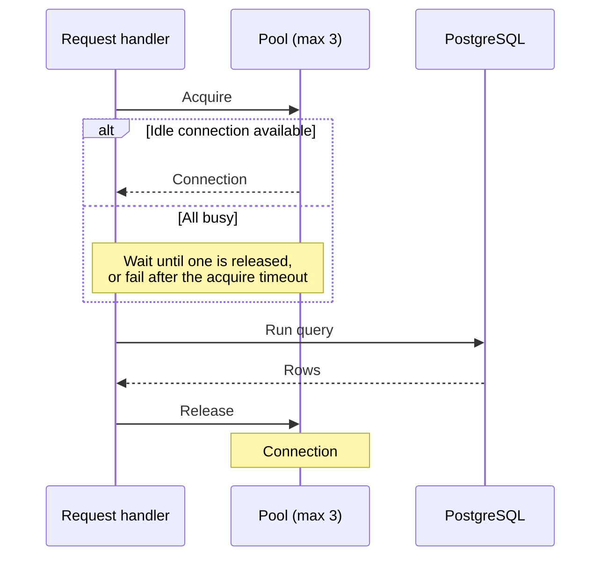
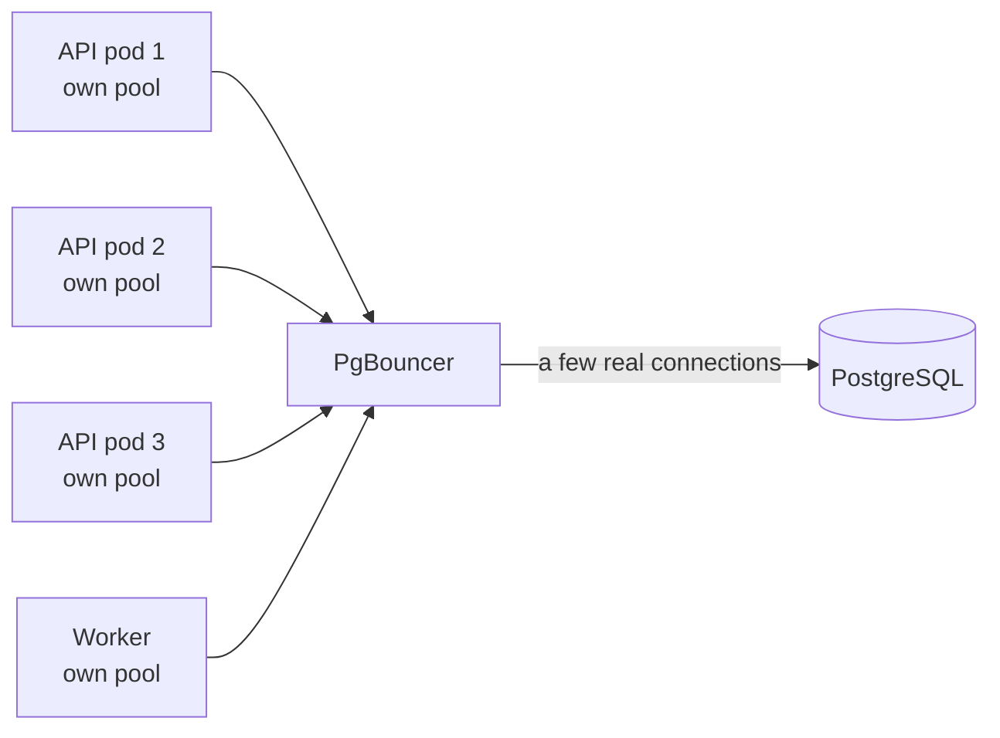

# Database connection pooling

!!! abstract "Where it's used in this project"
    The SQL console's per-instance pools in [`platform/internal/infra/pgquery/pool.go`](https://github.com/foyez/dbaas-platform/blob/main/platform/internal/infra/pgquery/pool.go). See [design decision 5](../design-decisions/sql-console-through-api.md).

## Key ideas

Opening a PostgreSQL connection is expensive: a TCP (and often TLS) handshake, authentication, and a new backend process on the server with its own memory. Doing that per request adds latency and load.

A **connection pool** keeps connections open and lends them out. A request borrows one, uses it and returns it.

- **`MinConns`** keeps a few ready, so the first request doesn't pay the setup cost.
- **`MaxConns`** caps how many exist. When all are busy, new requests wait (up to a timeout) instead of opening more.
- The right maximum depends on the database's `max_connections`, how many app replicas share it, and how long queries take. More connections past a point make the database slower, not faster.

**PgBouncer** pools *between* many clients and the database. Many app instances, each with their own pool, can still add up to too many backend connections; PgBouncer multiplexes them onto a small number of real ones. App-side pools and PgBouncer solve different problems and are often used together.

## How this project uses it

The API keeps one small pgx pool **per database instance**, created on first use:

| Setting | Value | Why |
|---|---|---|
| Max connections per instance | 3 | The console is interactive and low-volume |
| Query timeout | 10 s | pgx cancels the query on the server too, so it can't hold a connection forever |
| Max rows returned | 500 | A `SELECT *` on a big table can't exhaust API memory or the browser |
| Idle eviction | 10 min | Pools for instances nobody is querying get closed |

## What I learned building it

- **Lazy pools need eviction.** Without it the API would slowly hold open connections to every instance anyone has ever queried.
- **Timeouts must reach the server.** Cancelling only the client side leaves the query running in PostgreSQL. pgx propagates context cancellation to the server.
- **Per-pod state is a trade-off.** Each API replica has its own pools, so total connections per instance are up to 3 × replicas.

## Review questions

??? question "Why is opening a new connection per request a problem?"
    Each connection costs a network handshake, authentication and a new server process. Under load that adds latency and can exhaust `max_connections`.

??? question "What happens when every pooled connection is busy?"
    New requests wait for one to be returned, up to an acquire timeout. They don't open extra connections beyond the maximum.

??? question "When would you add PgBouncer even though the app has a pool?"
    When many app instances (or many services) connect to one database, so the sum of their pools exceeds what PostgreSQL handles well. PgBouncer multiplexes them onto fewer real connections.

??? question "How many connections can the SQL console open to one instance?"
    Up to 3 per API replica, so with the HPA's maximum of 10 replicas, up to 30.
