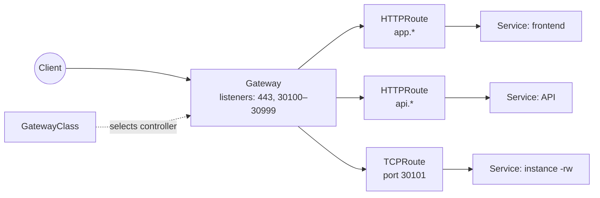
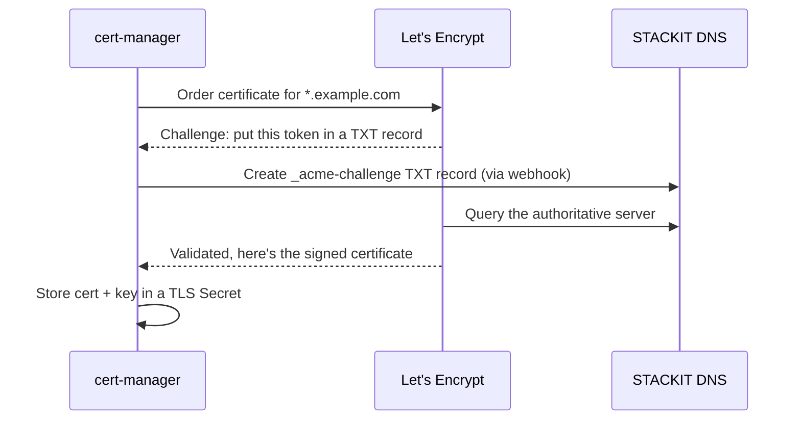

# Exposing services and TLS certificates

!!! abstract "Where it's used in this project"
    ingress-nginx routes `app.*` and `api.*` to the UI and API ([`gitops/*/base/ingress.yaml`](https://github.com/foyez/dbaas-platform/tree/main/gitops)), and passes raw TCP to databases. cert-manager gets Let's Encrypt certificates through STACKIT DNS. See [Architecture](../architecture/index.md).

## Key ideas

### Ways in

| Option | Layer | Use |
|---|---|---|
| `NodePort` Service | L4 | Port 30000–32767 on every node; fine for labs |
| `LoadBalancer` Service | L4 | One cloud load balancer and public IP per Service |
| **Ingress** + controller | L7 | One load balancer, many HTTP hosts and paths |
| **Gateway API** | L4/L7 | Ingress's successor: `GatewayClass` → `Gateway` (listeners, TLS) → `HTTPRoute`/`TCPRoute`, with roles split between platform and app teams |

An Ingress resource does nothing on its own; an **Ingress controller** such as ingress-nginx watches Ingresses and configures its proxy. One controller sits behind one cloud load balancer and serves every host.

How this platform's traffic would map onto Gateway API, including the database passthrough that ingress-nginx does today with its `tcp-services` ConfigMap:

### Certificates with cert-manager

cert-manager is an operator that turns a `Certificate` resource into a Secret holding a certificate and key, and renews it before it expires.

- An **Issuer** (namespaced) or **ClusterIssuer** says how to get certificates: ACME server, account key, solver.
- **HTTP-01** proves control by serving a file over HTTP on port 80. **DNS-01** proves it with a TXT record, works for wildcard certificates, and doesn't need the cluster to be reachable from the internet.
- The Ingress references the Secret in its `tls:` section; ingress-nginx terminates TLS there and forwards plain HTTP to the pods.

## How this project uses it

- **One load balancer for everything.** ingress-nginx serves both hostnames over HTTPS, and the same load balancer carries PostgreSQL traffic: the operator adds each instance's port to the `tcp-services` ConfigMap, and ingress-nginx proxies raw TCP on it.
- **DNS-01 through STACKIT DNS**, with the STACKIT cert-manager webhook creating the TXT records and a wildcard certificate for the frontend.
- **The local setup mirrors it without TLS**: kind maps port 80 and ports 30100–30119 to `127.0.0.1`, and the same Ingresses use `*.dbaas.localhost` hosts.

## What I learned building it

- **On STACKIT, DNS-01 beats HTTP-01.** The STACKIT webhook supports it directly and gives wildcard certificates, so new subdomains don't need new challenges.
- **Secrets can't be shared across namespaces.** The frontend's certificate Secret couldn't be used by the API's Ingress in another namespace, so the API got its own Issuer and Certificate.
- **Changing the URL changes the auth config.** Moving to HTTPS meant updating ZITADEL's redirect URIs; OIDC compares them exactly.
- **ingress-nginx can't proxy gRPC on plain HTTP.** Its HTTP/2 support needs TLS, which is why local Terraform reaches ZITADEL's gRPC API through a port-forward instead of the Ingress.
- **ingress-nginx is retired upstream** (final release v1.15, March 2026). Gateway API is the long-term replacement, with `TCPRoute` covering the database passthrough.

## Review questions

??? question "Ingress vs Ingress controller?"
    An Ingress is a resource describing routing rules. An Ingress controller is the running proxy that reads those rules and serves traffic. Without a controller, Ingresses do nothing.

??? question "Why use DNS-01 instead of HTTP-01?"
    DNS-01 supports wildcard certificates and doesn't require port 80 to be reachable from the internet. It needs API access to the DNS zone, which the STACKIT webhook provides.

??? question "Where is TLS terminated in this platform, and what does the pod receive?"
    At ingress-nginx. It decrypts HTTPS using the certificate Secret and forwards plain HTTP to the API and UI pods inside the cluster.

??? question "Why does the platform need only one load balancer even though every database gets a public endpoint?"
    Databases are told apart by port, not IP. ingress-nginx listens on each allocated port and proxies it to that instance's `-rw` Service.

??? question "What does Gateway API improve over Ingress?"
    It splits responsibilities into separate resources (infrastructure in `GatewayClass`/`Gateway`, routing in routes owned by app teams), supports non-HTTP protocols like TCP natively, and standardises features that Ingress left to controller-specific annotations.
