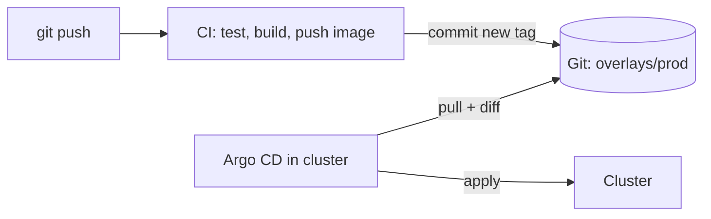

# GitOps and CI/CD

!!! abstract "Where it's used in this project"
    Forgejo workflows in [`.forgejo/workflows`](https://github.com/foyez/dbaas-platform/tree/main/.forgejo/workflows), Kustomize overlays in [`gitops/`](https://github.com/foyez/dbaas-platform/tree/main/gitops) and the Argo CD app-of-apps in [`gitops/argocd`](https://github.com/foyez/dbaas-platform/tree/main/gitops/argocd). See [Delivery](../components/delivery.md).

## Key ideas

**GitOps**: Git holds the desired state of the cluster, and an agent inside the cluster (Argo CD) continuously makes the cluster match it. CI never talks to the cluster directly; it only writes an intention into Git, such as a new image tag.

| Concept | Meaning |
|---|---|
| Argo CD `Application` | "Make path X of repo Y match namespace Z" |
| Sync | Apply Git's state to the cluster |
| Self-heal | Revert manual changes made directly in the cluster |
| Prune | Delete cluster objects that were removed from Git |
| App-of-apps | One root Application whose path contains the other Applications, so new apps are added by committing a file |

**Kustomize** layers changes over plain YAML without templates: a `base/` with shared manifests and `overlays/<env>/` that patch it (image tags, replicas, hosts, TLS).

**Conventional commits** (`feat:`, `fix:`, `docs:`, `chore:`, `ci:`, with an optional scope like `fix(client):`) make history readable and let tooling group changes.

## How this project uses it

- **One workflow per component**, triggered only by changes under its directory: build the image, tag it with the short commit SHA, push it to the registry, then commit the new tag into `gitops/<component>/overlays/prod`.
- **The bot rebases before pushing** the tag bump, so it doesn't fail when someone pushed to `main` in the meantime.
- **App-of-apps**: the root Application syncs automatically, with prune and self-heal. The child Applications are synced manually for now, a deliberate brake while the platform was being built.
- **Two overlays per component**: `dev` for the local kind cluster and `prod` for SKE.
- **Secrets stay out of Git**: the registry pull secret and ZITADEL key are created in the cluster, and Argo CD's repository credentials too.

## What I learned building it

- **Image tags should be immutable.** The short commit SHA ties a running pod to an exact commit, and `git revert` of the tag bump is a rollback.
- **Bootstrapping is a chicken-and-egg problem.** Argo CD can't install itself from Git before it exists, so the first Applications are applied once by hand (or by the bootstrap workflow), and app-of-apps removes the manual step for everything after.
- **Kubebuilder already supports overlays.** Its `config/default` works as a Kustomize base, so the operator's GitOps overlay only overrides the image and namespace.
- **The registry moved during the project**, from Docker Hub to the STACKIT registry. Using scoped access tokens as CI secrets rather than account passwords made that a configuration change.
- **Concurrent tag bumps can race.** Two workflows bumping different components can both rebase and push at once; one fails and needs a retry. A workflow `concurrency` group would serialise them.

## Review questions

??? question "Why doesn't CI deploy straight to the cluster with `kubectl apply`?"
    In GitOps the cluster pulls its state from Git. CI needs no cluster credentials, every deployment is a commit with history, and rollback is a revert.

??? question "What do prune and self-heal do?"
    Prune deletes resources that were removed from Git. Self-heal reverts changes made directly in the cluster so it matches Git again.

??? question "Why tag images with the commit SHA instead of `latest`?"
    `latest` is mutable, so you can't tell which code is running and the kubelet may not pull the new image. A SHA tag is unique, traceable and lets Argo CD see a real change in Git.

??? question "What problem does app-of-apps solve?"
    Applications themselves become files in Git. Adding a component means committing an Application manifest; nothing is applied by hand after the initial bootstrap.
