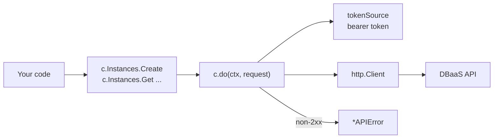

# Building a Go SDK

!!! abstract "Where it's used in this project"
    The Go client in [`sdk/`](https://github.com/foyez/dbaas-platform/tree/main/sdk), its fake API in [`sdk/dbaastest`](https://github.com/foyez/dbaas-platform/tree/main/sdk/dbaastest) and its examples in [`sdk/example_test.go`](https://github.com/foyez/dbaas-platform/blob/main/sdk/example_test.go). See [Go SDK](../components/sdk.md).

## Key ideas

### An SDK is the API's contract, in the client's language

An SDK turns HTTP details (paths, headers, status codes, JSON shapes, auth) into types and methods. That only helps if it matches the contract exactly. If a field name or response shape is wrong, the SDK is worse than raw HTTP, because it hides the mistake behind a type. The contract is [`openapi.yaml`](https://github.com/foyez/dbaas-platform/blob/main/platform/docs/openapi.yaml), not what the SDK author remembers about the handlers.

### Shape of the client

- **One entry point, grouped services.** `dbaas.New` returns a `*Client`. Calls are grouped by resource (`c.Instances.Get`), the same pattern as `go-github`, so it's easy to discover what's available.
- **One request path.** Every method builds a `request` and calls `c.do`. Encoding, auth headers, error decoding and response decoding happen in one place, so a fix there fixes every endpoint.
- **Functional options.** `New(baseURL, opts ...Option)` keeps the required argument positional, and lets new settings (`WithPollInterval`) be added without breaking callers. Options only *record* settings. `New` builds the token source after all options run, so their order doesn't matter.
- **`context.Context` first, everywhere.** The caller decides timeouts and cancellation; the SDK never chooses for them.

### Authentication: client credentials

Machine users can't log in through a browser, so they use the **OAuth 2.0 client credentials grant**: the client sends its ID and secret to the token endpoint and gets an access token back. There's no user and no refresh token: when the token expires, the client asks again.

`golang.org/x/oauth2/clientcredentials` does this. Its `TokenSource` is wrapped in a `ReuseTokenSource`, which caches the token and fetches a new one shortly before expiry. The SDK calls `tokenSource.Token()` on each request and sets `Authorization: Bearer …`. With ZITADEL, the token must also carry the project's **audience** scope, or the API rejects it ([Authentication](authentication.md)).

### Errors as values you can match

The API returns `{"error": {"code": "NOT_FOUND", "message": "..."}}`. The SDK turns that into an `*APIError`, then gives callers two ways to inspect it:

| Want | Use | Example |
|---|---|---|
| Decide what to do | `errors.Is(err, dbaas.ErrNotFound)` | Treat "already deleted" as success |
| Read the details | `errors.As(err, &apiErr)` | Log `apiErr.Code`, show `QueryDetails()` |

`errors.Is` works because `*APIError` has an `Is(target error) bool` method that maps its code to a sentinel. Errors keep their wrapping (`get instance: dbaas: 404 NOT_FOUND: ...`), and `errors.Is` and `errors.As` see through it. Not every error comes from the handlers: the auth middleware writes a plain-text 401, so `Is` falls back to the status code.

### Asynchronous operations need a wait helper

Create, update and delete return `202 Accepted`. The operator does the actual work later. Every caller would otherwise write the same polling loop, so the SDK has one: `WaitUntilRunning` calls `Get` on a `time.Ticker` until the status is `Running`. It stops early on `Failed` (`ErrInstanceFailed`) or when the context is done. It has no timeout of its own: the caller passes `context.WithTimeout`, and errors from it match `context.DeadlineExceeded`.

### Pagination with iterators

`List` returns one page and a `NextCursor`. `All` returns an `iter.Seq2[*Instance, error]` (Go 1.23 range-over-func), so callers write `for inst, err := range c.Instances.All(ctx, 0)` and pages are fetched as the loop needs them. Two rules for writing one: stop as soon as `yield` returns `false` (the caller did `break`), and yield an error once, then return.

### Testable examples

A function named `ExampleXxx` in a `_test.go` file is compiled, shown in the package docs next to `Xxx`, and run by `go test`. If it ends in an `// Output:` comment, its stdout must match. So the examples are both documentation and tests, and they can't silently rot.

| Name | Documents |
|---|---|
| `Example` | The package |
| `ExampleWithClientCredentials` | A function |
| `ExampleClient_Health` | A method: `Type_Method` |
| `ExampleInstancesService_Create_retry` | A second example for a method: lower-case suffix |

`go vet` rejects example names that don't refer to a real identifier.

### Testing layers and the fake server

Examples with `// Output:` must be **deterministic** and **self-contained**: no network, no clock, no random IDs in the output. That rules out a real cluster. So the SDK ships `dbaastest`, an in-memory fake of the API built on `net/http/httptest`, in the spirit of `net/http/httptest` itself.

| Layer | Fast? | Catches |
|---|---|---|
| Examples + unit tests against the fake | ms, no setup | Wire format, error mapping, iteration, waiting |
| Integration test against the real API (`//go:build integration`) | minutes, needs `make dev` | Contract drift between the fake and the real API, auth setup |

A fake is only as good as its fidelity. It must reuse the real error codes and status codes, and the real quirks: the plain-text 401, the `202` on create, the ID derived from the idempotency key. The integration test is what checks that the fake hasn't drifted.

## How this project uses it

1. `make test` runs the examples and unit tests against `dbaastest`; CI runs it on every change to `sdk/`.
2. `make test-integration` loads `sdk/.env`, logs in as the `sdk-test-dev` machine user and runs a whole lifecycle against the local platform: create, retry the create, wait, list, credentials, a good and a bad query, delete.
3. [`examples/provision`](https://github.com/foyez/dbaas-platform/blob/main/sdk/examples/provision/main.go) shows the main use case: a CI job that needs a database prints `DATABASE_URL` and deletes it afterwards, using the same idempotency key for both runs.

## What I learned building it

- **The first version's examples needed a running cluster.** `go test ./...` failed for anyone without `make dev` and a filled-in `.env`, so in practice nobody ran them. Moving them to an in-memory fake made them pass everywhere, and kept the real-API run as an opt-in integration test.
- **The SDK had drifted from the API, and nothing noticed.** `List` decoded into `[]*Instance`, but the API returns `{"items": [...], "nextCursor": "..."}`. `Instance` was missing `database` and `externalPort`. An example expected `Get` to return the input `Name`, but `Name` is the generated ID and the chosen name is `Database`. Each one was a silent zero value, not an error. Writing examples with exact `// Output:` is what exposed them.
- **String errors aren't an API.** `fmt.Errorf("unexpected status %d: %s", ...)` forced callers to parse error text. A typed `APIError` with sentinels makes "treat not found as already deleted" a one-liner.
- **Wrapping the `http.Client` for auth fights with `WithHTTPClient`.** The first version replaced `c.httpClient` with an OAuth2 client, so `WithHTTPClient` after `WithClientCredentials` silently dropped auth, and the other order dropped the custom client. Keeping the token source separate and adding the header in `do` removed the ordering trap.
- **Escape path parameters.** `"/instances/" + id` lets an ID like `../audit-logs` change which endpoint is called. `url.PathEscape` keeps it one path segment.
- **Don't generate idempotency keys inside the SDK.** A key generated per call is different on every retry, so it doesn't stop duplicates. The key must come from the caller, who knows what counts as "the same create".

## Review questions

??? question "Why do the examples run against a fake instead of the real API?"
    An example with `// Output:` is a test that `go test` always runs. It has to be fast, deterministic and need no setup. A real cluster is none of those. The real API is still tested, by the integration test behind a build tag.

??? question "What makes `errors.Is(err, dbaas.ErrNotFound)` true when the API returns a 404?"
    `c.do` returns an `*APIError`, and the method wraps it with `%w`. `errors.Is` unwraps the chain and calls `(*APIError).Is(ErrNotFound)`. That method maps the code `NOT_FOUND`, or failing that the 404 status, to the sentinel.

??? question "How does the SDK avoid fetching a new token on every request?"
    `clientcredentials.Config.TokenSource` returns a `ReuseTokenSource`. It caches the token and only calls the token endpoint again when the cached one is about to expire. `TestClientCredentials` checks that three calls make one token request.

??? question "Why does `WaitUntilRunning` not take a timeout argument?"
    The context already carries one. The caller uses `context.WithTimeout`, which also covers cancellation (Ctrl-C, a parent request ending) and composes with the rest of their code. The wait returns the context's error, so callers check `errors.Is(err, context.DeadlineExceeded)`.

??? question "What must a range-over-func iterator do when `yield` returns false?"
    Return immediately, without calling `yield` again. `false` means the loop body did `break` or `return`. `TestAllStopsWhenLoopBreaks` checks that `All` doesn't fetch another page after that.

??? question "What can't the fake catch, and what does?"
    Differences between the fake and the real API, such as a renamed field, a new validation rule, or auth configuration. The integration test runs the same operations against the real API and ZITADEL, and catches them.

??? question "Why is `IdempotencyKey` a header and `json:\"-\"` in `CreateInstanceInput`?"
    The API reads it from the `Idempotency-Key` header, the common convention for retry-safe POSTs. `json:"-"` keeps it out of the JSON body, and `Create` moves it into the header.
