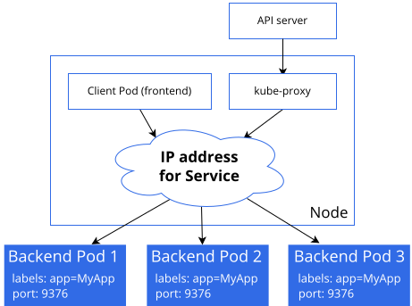
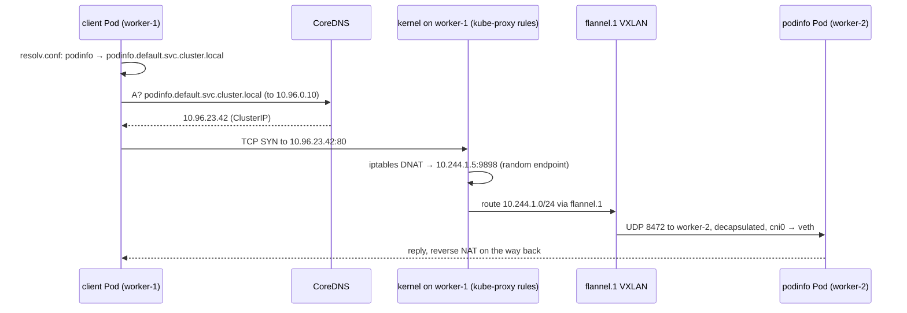

# Cluster networking: CNI, Services and DNS

!!! abstract "Where it's used in this project"
    The OpenStack clusters ran Flannel in VXLAN mode with `--pod-network-cidr=10.244.0.0/16`, and a blocked UDP 8472 broke cross-node DNS ([Kubernetes on VMs](kubernetes-on-vms.md)). On SKE, the API reaches each database through its CloudNativePG `-rw` Service by DNS name, and external clients come in through one shared load balancer ([design decision 3](../design-decisions/shared-loadbalancer.md), [exposing services](exposing-services.md)). Overview: [Kubernetes concepts and architecture](kubernetes-concepts.md).

## Key ideas

Cluster networking isn't one feature. It's a stack of three problems, each solved by a different component:

| Layer | Question | Solved by | Address |
|---|---|---|---|
| **Pod network** | How does a Pod get an IP and reach any other Pod? | CNI plugin + network addon (Flannel, Calico, Cilium) | Pod IP from the cluster CIDR, e.g. `10.244.1.7` |
| **Service network** | How do I reach a changing set of Pods at one stable address? | kube-proxy (or an eBPF replacement) | ClusterIP from the service CIDR, e.g. `10.96.23.42` |
| **DNS** | How do I find that address by name? | CoreDNS | `podinfo.default.svc.cluster.local` |

Two different CIDRs matter and must not overlap with each other or with the node network: the **Pod CIDR** (`--cluster-cidr`, often `10.244.0.0/16`) and the **service CIDR** (`--service-cluster-ip-range`, often `10.96.0.0/12`).

### The Kubernetes networking model

Kubernetes defines the *outcome*, not the mechanism:

1. **Every Pod gets its own IP.** No sharing, no port conflicts between Pods.
2. **Pods reach each other directly by IP, without NAT**, on any node.
3. **The IP a Pod sees for itself is the IP others use to reach it.**

So applications can bind well-known ports and talk as if they were on one flat network. Containers in the *same* Pod share the network namespace, so they talk over `localhost`.

Kubernetes itself wires none of this. The kubelet asks the runtime for a sandbox; the **runtime** calls **CNI** to set up the Pod on that node; a **network addon** coordinates between nodes. It helps to split it in two:

| Layer | Solves |
|---|---|
| Node-level setup | Interfaces, IPs and local connectivity for Pods on one node |
| Cluster-level coordination | Unique subnets per node and routes or tunnels between nodes |

### Node-level: CNI

A CNI plugin is **not a daemon or a Kubernetes object**: it's an executable in `/opt/cni/bin/` that the runtime runs with a JSON config (from `/etc/cni/net.d/`) and environment variables saying "ADD this netns" or "DEL it". When a Pod starts:

1. the scheduler binds the Pod to a node
2. the kubelet asks containerd for a sandbox, which includes a network namespace
3. containerd reads the first config in `/etc/cni/net.d/`
4. containerd runs that plugin
5. the plugin creates the interface, assigns an IP (via an IPAM plugin), and adds routes

If `/etc/cni/net.d/` is empty, step 3 fails, containerd reports `NetworkPluginNotReady`, and the node is `NotReady`.

The simplest setup is the **bridge** plugin: a Linux bridge `cni0` on the node, and one **veth pair** per Pod, with one end in the Pod and the other on the bridge.

```json
{
  "cniVersion": "1.0.0",
  "name": "bridge",
  "type": "bridge",
  "bridge": "cni0",
  "isGateway": true,
  "ipMasq": true,
  "ipam": {
    "type": "host-local",
    "subnet": "10.244.0.0/24",
    "routes": [{ "dst": "0.0.0.0/0" }]
  }
}
```

| Field | Meaning |
|---|---|
| `bridge: cni0` | Name of the Linux bridge to create |
| `isGateway: true` | Give the bridge an IP so it's the Pods' default gateway |
| `ipMasq: true` | SNAT traffic leaving the Pod subnet so it can reach the node network |
| `ipam.type: host-local` | Hand out IPs from a local pool, tracked in `/var/lib/cni/` |
| `ipam.subnet` | This node's Pod subnet. **Must be different on every node.** |


<small>Image: [Kubernetes the (Very) Hard Way](https://labs.iximiuz.com/courses/kubernetes-the-very-hard-way-0cbfd997), iximiuz Labs</small>

Same-node traffic is plain bridging: client Pod → its veth → `cni0` → the other Pod's veth. `ip route` on the node shows `10.244.0.0/24 dev cni0`. No tunnel, no routing.

### Cluster-level: why cross-node fails, and network addons

With bridge alone, worker-1 has `10.244.0.0/24` on its `cni0` and worker-2 has `10.244.1.0/24` on its own. Both nodes are `Ready`, both Pods are `Running`, and a request from worker-1 to a Pod on worker-2 **times out**: worker-1 has no route for `10.244.1.0/24`, so the packet goes to its default gateway, which doesn't know either.


<small>Image: [Kubernetes the (Very) Hard Way](https://labs.iximiuz.com/courses/kubernetes-the-very-hard-way-0cbfd997), iximiuz Labs</small>

Adding the routes by hand proves it's purely a routing problem:

```bash
# on worker-1                                   # on worker-2
ip route add 10.244.1.0/24 via 172.16.0.4       ip route add 10.244.0.0/24 via 172.16.0.3
```

That works but doesn't scale: every node needs a route to every other node's subnet, kept current as nodes come and go. A **network addon** automates it. Addons typically:

- **allocate** a unique subnet per node (often by reading the node's `spec.podCIDR`, which kube-controller-manager assigns from `--cluster-cidr` when `--allocate-node-cidrs=true`, `/24` per node by default)
- **write the CNI config** on each node, so you don't
- **connect nodes**, either by distributing routes (for example with BGP, as Calico can) or with an **overlay**

An **overlay** wraps each Pod-to-Pod packet in another packet addressed node-to-node, so it works even when the underlying network won't route Pod subnets (cloud VPCs, OpenStack security groups). **VXLAN** is the common encapsulation: Pod packets inside UDP, port 8472 for Flannel.


<small>Image: [Kubernetes the (Very) Hard Way](https://labs.iximiuz.com/courses/kubernetes-the-very-hard-way-0cbfd997), iximiuz Labs</small>

**Flannel** has two parts: the `flanneld` daemon on each node (normally a DaemonSet; a systemd service in the hard way), which reads node subnets from the API (`--kube-subnet-mgr`) and sets up VXLAN; and the `flannel` CNI plugin, which delegates to the same bridge plugin but fills in the node's subnet automatically. The config files become identical on every node. Afterwards `ip route` on worker-1 shows:

```text
10.244.0.0/24 dev cni0       # local Pods: bridge
10.244.1.0/24 via 10.244.1.0 dev flannel.1 onlink   # worker-2's Pods: VXLAN tunnel
```

| Addon | Approach | Notes |
|---|---|---|
| Flannel | VXLAN overlay (or host-gw routes) | Simple; no NetworkPolicy support on its own |
| Calico | BGP routes or VXLAN/IPIP | NetworkPolicy, widely used on-prem |
| Cilium | eBPF | NetworkPolicy at L3–L7, can replace kube-proxy |

### Services and kube-proxy

Pod IPs are **ephemeral**: every rollout, rescale or reschedule brings new ones. That's a feature (Pods are disposable), but clients need something stable, and with three replicas, something to balance across.


<small>Image: [Kubernetes the (Very) Hard Way](https://labs.iximiuz.com/courses/kubernetes-the-very-hard-way-0cbfd997), iximiuz Labs</small>

A **Service** selects Pods by **label** and gets a **ClusterIP** from the service CIDR that lasts as long as the Service. The EndpointSlice controller keeps **EndpointSlices** listing the IPs of the matching, *ready* Pods (readiness probes decide who is in).


<small>Image: [Kubernetes the (Very) Hard Way](https://labs.iximiuz.com/courses/kubernetes-the-very-hard-way-0cbfd997), iximiuz Labs</small>

**A ClusterIP is virtual.** No interface holds it, and nothing answers ARP or ping for it. Without kube-proxy, the Service and its EndpointSlices look perfect in `kubectl` and every request to the ClusterIP still times out: it's a phone number nobody wired up.

**kube-proxy** runs on every node and follows the controller pattern: watch Services and EndpointSlices, translate them into kernel packet rules, update them when Pods change. In the default **iptables** mode, each Service becomes a chain that:

1. **matches** packets to `ClusterIP:port`
2. **picks** a backend at random (`-m statistic --probability`)
3. **DNATs** the packet to that Pod's `IP:targetPort`

All of it happens in the kernel; no traffic passes through the kube-proxy process.



<small>Image: [Kubernetes documentation, virtual IPs and service proxies](https://kubernetes.io/docs/reference/networking/virtual-ips/), CC BY 4.0</small>

```bash
sudo iptables -t nat -L KUBE-SERVICES -n | grep podinfo     # entry for the ClusterIP
sudo iptables -t nat -L KUBE-SVC-<hash> -n                  # one rule per endpoint, with probabilities
```

| Mode | Mechanism | Notes |
|---|---|---|
| `iptables` | iptables NAT rules | Default; rule updates slow down with thousands of Services |
| `ipvs` | Kernel IPVS load balancer | Scales better, more balancing algorithms; needs IPVS modules |
| `nftables` | nftables rules | Newer replacement for iptables (beta in 1.31, GA in 1.33) |

kube-proxy is **optional**: Cilium can replace it with eBPF.

### Service types

Each type builds on the previous one:

| Type | Reachable from | How |
|---|---|---|
| `ClusterIP` (default) | Inside the cluster | Virtual IP, kube-proxy rules on every node |
| `NodePort` | Outside, `<any-node-IP>:30000–32767` | ClusterIP + the same port opened on every node |
| `LoadBalancer` | Outside, via a cloud LB's IP | NodePort + the [cloud-controller-manager](kubernetes-control-plane.md#cloud-controller-manager-optional) creates a load balancer pointing at it |
| `ExternalName` | Inside | Just a DNS CNAME to an outside name |
| Headless (`clusterIP: None`) | Inside | No virtual IP; DNS returns the Pod IPs themselves |

**Headless Services** are for clients that need a *specific* Pod, like database replicas: a normal Service says "give me one stable address and balance for me"; a headless one says "give me the addresses of the Pods". Combined with a StatefulSet, each Pod gets its own stable name, `postgres-0.postgres.<ns>.svc.cluster.local`.

L7 routing (one load balancer, many hosts and paths, TLS termination) is Ingress or Gateway API; see [exposing services](exposing-services.md).

### DNS and CoreDNS

Even a ClusterIP has to come from somewhere, and a recreated Service gets a new one. DNS is the last mile. Every Service gets a predictable name:

```text
<service>.<namespace>.svc.<cluster-domain>      e.g. podinfo.default.svc.cluster.local
```

Two pieces make it work:

1. **The kubelet** writes each Pod's `/etc/resolv.conf` from `clusterDNS` and `clusterDomain`:

    ```text
    nameserver 10.96.0.10
    search default.svc.cluster.local svc.cluster.local cluster.local
    options ndots:5
    ```

2. **CoreDNS** watches Services and EndpointSlices through the API and answers queries. It normally runs as a Deployment behind the `kube-dns` Service at `10.96.0.10`. It replaced kube-dns (three containers: dnsmasq, a sidecar, a Kubernetes DNS server) as the default in 1.13.

| Name used in a Pod in `default` | Works from |
|---|---|
| `podinfo` | Same namespace (search domain fills in the rest) |
| `podinfo.default` | Any namespace |
| `podinfo.default.svc` | Any namespace |
| `podinfo.default.svc.cluster.local` | Anywhere; the FQDN |

The core of a Corefile:

```text
.:53 {
    errors
    health
    ready
    kubernetes cluster.local in-addr.arpa ip6.arpa   # answer *.svc.cluster.local from the API
    forward . /etc/resolv.conf                        # everything else goes upstream
    cache 30
    loop
    reload
    loadbalance
}
```

`ndots:5` means any name with fewer than five dots is tried against the search domains first, so `api.github.com` causes several cluster lookups before the real one. Ending a name with a dot (`api.github.com.`) skips them.

### The full path of one request

What happens when a client Pod on worker-1 runs `curl http://podinfo` and the chosen backend lives on worker-2:



Each hop maps to one component: **CoreDNS** for the name, **kube-proxy's rules** for the ClusterIP, the **network addon** for the cross-node hop, **CNI** for the last step into the Pod.

### NetworkPolicy

By default every Pod can reach every other Pod. A **NetworkPolicy** is a Pod-level firewall: once any policy selects a Pod for `Ingress` (or `Egress`), only traffic explicitly allowed by some policy gets through.

```yaml
apiVersion: networking.k8s.io/v1
kind: NetworkPolicy
metadata:
  name: postgres-allow-api-only
spec:
  podSelector:
    matchLabels: {app: postgres}       # applies TO these Pods
  policyTypes: [Ingress]
  ingress:
    - from:
        - podSelector:
            matchLabels: {app: api}    # only these may connect
      ports:
        - {protocol: TCP, port: 5432}
```

The policy is only enforced if the **network addon supports it** (Calico, Cilium yes; plain Flannel no). Otherwise it's silently ignored.

### Troubleshooting by layer

| Symptom | Layer | Check |
|---|---|---|
| Node `NotReady`, `NetworkPluginNotReady` | CNI | `/etc/cni/net.d/` empty; addon Pod/daemon on that node |
| Same-node Pods talk, cross-node don't | Addon | Routes (`ip route`), VXLAN port UDP 8472 open between nodes |
| Pod IP works, ClusterIP doesn't | kube-proxy | kube-proxy running; `iptables -t nat -L KUBE-SERVICES` |
| Service has no endpoints | Selector | `kubectl get endpointslices -l kubernetes.io/service-name=<svc>`; labels match; Pods Ready |
| ClusterIP works, name doesn't | DNS | Pod's `/etc/resolv.conf`; CoreDNS Pods and logs; `nslookup` from a debug Pod |
| Works in namespace A, not B | DNS | Use `<svc>.<namespace>` |
| Port-forward works, NodePort doesn't | Firewall | Security group / UFW for 30000–32767 |

```bash
kubectl run tmp --rm -it --image=busybox:1.36 --restart=Never -- sh
# nslookup podinfo ; wget -qO- http://podinfo ; wget -qO- http://<pod-ip>:9898
```

## What I learned building it

- **"Ready" and "Running" don't mean "connected".** Both nodes were `Ready` with the bridge plugin and cross-node traffic still failed. Readiness only checks that *a* CNI config exists.
- **Most cross-node failures are routing or firewalls.** On OpenStack, a security group missing UDP 8472 broke VXLAN, which surfaced as DNS failures because CoreDNS was on the other node.
- **A Service is data, kube-proxy makes it real.** A ClusterIP you can't ping is normal; a ClusterIP that `curl` can't reach means rules aren't programmed or there are no ready endpoints.
- **Empty endpoints are almost always labels.** The Service selector and the Pod template labels must match exactly, and the Pods must pass readiness.
- **Use DNS names, never IPs.** The API reaches databases by their CloudNativePG `-rw` Service names, which keep pointing at the current primary across failovers.

## Review questions

??? question "What are the three rules of the Kubernetes networking model?"
    Every Pod has its own IP; Pods reach each other directly without NAT, across nodes; and a Pod sees itself at the same IP others use to reach it.

??? question "Both nodes are `Ready` but Pods on different nodes can't talk. Why, and what fixes it?"
    Each node only knows its own Pod subnet; nothing routes between them. A network addon fixes it, either by distributing routes (BGP) or by tunnelling with an overlay like VXLAN. Static routes prove it but don't scale.

??? question "Why can't you ping a ClusterIP?"
    It's virtual: no interface holds it. It exists only as kube-proxy's DNAT rules for the Service's TCP/UDP ports, and ICMP isn't covered by those rules.

??? question "What does kube-proxy do in iptables mode, and is it in the data path?"
    It watches Services and EndpointSlices and writes NAT rules that match `ClusterIP:port`, pick an endpoint at random, and DNAT to it. It is not in the data path: packets are rewritten by the kernel.

??? question "When would you use a headless Service?"
    When clients need to address individual Pods rather than be load-balanced, for example database or Kafka members in a StatefulSet. DNS returns Pod IPs and each Pod gets a stable name.

??? question "A Pod in namespace `web` can't resolve `api`, which lives in namespace `backend`. Why?"
    The short name is expanded with the Pod's own namespace first (`api.web.svc.cluster.local`). Use `api.backend`.

??? question "You applied a NetworkPolicy and nothing changed. What's the likely reason?"
    The network addon doesn't enforce NetworkPolicy (for example plain Flannel). The API stores it, but nothing implements it.

??? question "What's the difference between the Pod CIDR and the service CIDR?"
    The Pod CIDR (`--cluster-cidr`) is split into per-node subnets for real Pod interfaces. The service CIDR (`--service-cluster-ip-range`) holds virtual ClusterIPs that only exist in kube-proxy's rules. They must not overlap.
