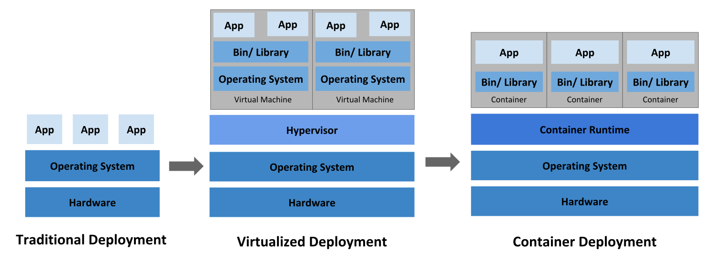
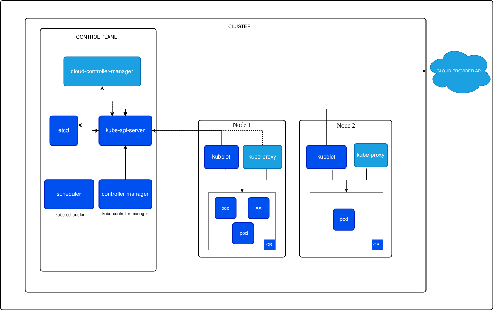
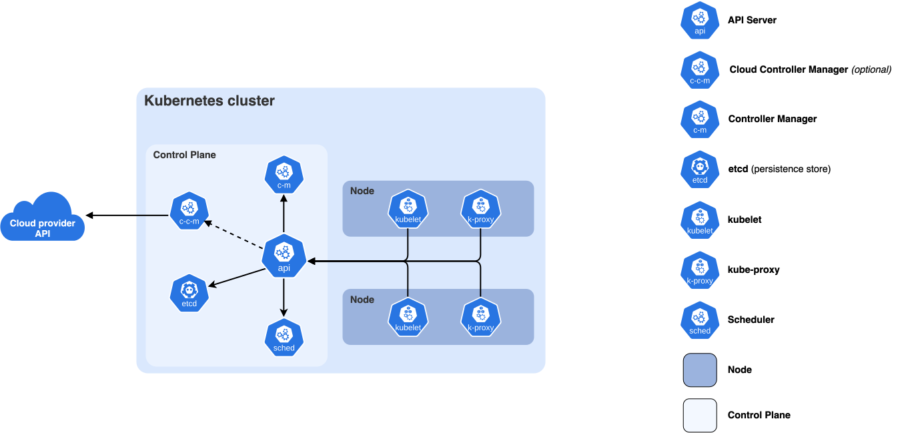
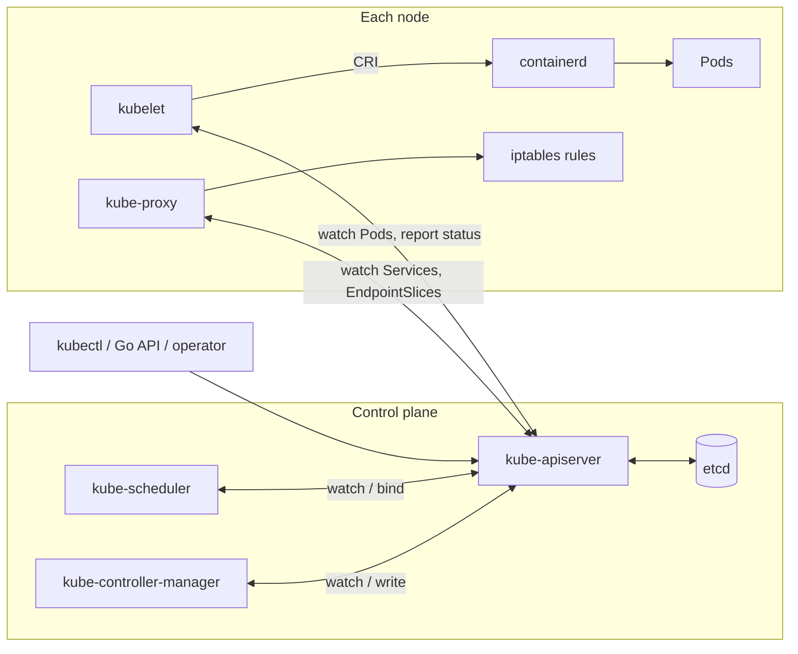
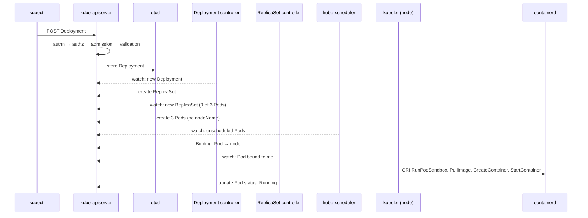

# Kubernetes concepts and architecture

!!! abstract "Where it's used in this project"
    Everything after the OpenStack phase runs on Kubernetes: the operator, API, UI, CloudNativePG and every database. These are the ideas the rest of the notes build on. This page is the map; the deeper pages are [control plane](kubernetes-control-plane.md), [nodes](kubernetes-nodes.md), [cluster networking](kubernetes-cluster-networking.md), [workloads and scheduling](kubernetes-workloads.md) and [storage](kubernetes-storage.md).

Sources: the official [Kubernetes docs](https://kubernetes.io/docs/concepts/architecture/), a Kubernetes fundamentals course, and [Kubernetes the (Very) Hard Way](https://labs.iximiuz.com/courses/kubernetes-the-very-hard-way-0cbfd997) on iximiuz Labs, which installs every component by hand as a systemd service.

## Key ideas

### What Kubernetes is

Kubernetes is a **container orchestration engine**: it deploys, scales and manages containers across a cluster of machines. It came out of Google's internal systems **Borg** and **Omega**, was open-sourced in **2014**, and is now maintained by the [CNCF](https://www.cncf.io/about). The name is Greek for helmsman.

Without it, you decide by hand which server runs what, restart crashed containers yourself, wire up networking between them and scale manually. Kubernetes automates that:

- service discovery and load balancing
- automatic rollouts and rollbacks
- self-healing (failed containers restarted, lost pods replaced)
- horizontal scaling
- **declarative configuration**: you describe *what* you want, Kubernetes works out *how*

<small>Image: [Kubernetes documentation](https://kubernetes.io/docs/concepts/overview/), CC BY 4.0</small>

### Cluster architecture

A cluster is a **control plane** plus one or more **worker nodes**. Nodes run the Pods; the control plane decides what should run where and keeps it that way. In production the control plane runs on several machines and there are many nodes, so one machine failing doesn't take the cluster down.

<small>Image: [Kubernetes documentation](https://kubernetes.io/docs/concepts/architecture/), CC BY 4.0</small>

<small>Image: [Kubernetes documentation](https://kubernetes.io/docs/concepts/overview/components/), CC BY 4.0</small>

| Component | Runs on | Job | If it's down |
|---|---|---|---|
| **kube-apiserver** | Control plane | Front door to the cluster: authenticates, authorizes, validates and stores every object | Nothing can be created, changed or deleted. Running workloads keep running. |
| **etcd** | Control plane | Consistent key-value store holding all cluster state | The cluster loses its memory. Back it up. |
| **kube-scheduler** | Control plane | Picks a node for each new Pod | New Pods stay `Pending`; existing ones are unaffected |
| **kube-controller-manager** | Control plane | Runs the built-in control loops (ReplicaSet, Deployment, Node, Job, ...) | No self-healing: deleted Pods aren't replaced, dead nodes aren't handled |
| **cloud-controller-manager** | Control plane (optional) | Talks to the cloud API: load balancers, node metadata, routes | No new cloud load balancers or node metadata |
| **kubelet** | Every node | Node agent: makes the Pods assigned to its node actually run | Node goes `NotReady`; its containers may keep running but nothing new starts there |
| **container runtime** | Every node | Pulls images and runs containers (containerd, CRI-O) | kubelet can't start, stop or restart containers on that node |
| **kube-proxy** | Every node (optional) | Turns Services into iptables/IPVS/nftables rules | Service ClusterIPs stop routing on that node |
| **CNI plugin / network addon** | Every node | Gives Pods IPs and connects them across nodes | Node stays `NotReady`; Pods can't reach each other |
| **CoreDNS** | In the cluster (addon) | Resolves Service names to ClusterIPs | Name lookups fail; IPs still work |

!!! tip "Kubernetes isn't a monolith"
    It is a set of small, focused programs that only cooperate through the API. Many "Kubernetes problems" turn out to be ordinary Linux, networking or certificate problems once you know which component owns the symptom.

### The API server is the hub

The single most useful mental model: **every component is a client of the API server, and only the API server talks to etcd.** The scheduler, the controllers, every kubelet, kube-proxy, CoreDNS, `kubectl` and this project's operator all do the same thing: *watch* some objects, decide something, *write* the result back.

Nobody calls anybody directly. The scheduler never tells a kubelet to start a Pod: it sets `spec.nodeName`, and the kubelet on that node, which is watching for Pods bound to it, notices. That's why components can crash and restart independently, and why the Very Hard Way course can add them one at a time and watch each gap close:

- API server + etcd alone: a **database**. A ReplicaSet with 3 replicas is stored, but no Pods appear.
- \+ scheduler: Pods get a node, but stay `Pending` because no kubelet runs them.
- \+ controller-manager: the ReplicaSet now produces Pods, and deleted Pods come back.
- \+ kubelet joined: containers actually run.
- \+ network addon, kube-proxy, CoreDNS: Pods reach each other, Services, and names.

### Desired state vs actual state

You **declare** what you want; controllers **keep working** to make it true.

- Desired state lives in `.spec`, written by you.
- Actual state is reported in `.status`, written by the controller.
- A controller loops forever: **observe → compare → act → repeat**, like a thermostat.

<small>Image: [Kubernetes the (Very) Hard Way](https://labs.iximiuz.com/courses/kubernetes-the-very-hard-way-0cbfd997), iximiuz Labs</small>

Because each loop compares states rather than reacting to events, it's self-correcting: a missed event doesn't matter, the next pass sees the difference. The same pattern runs at every level: the ReplicaSet controller cluster-wide, the kubelet per node, kube-proxy per node for Services, and this project's [operator](operators.md) for `PostgreSQL` resources.

### End to end: `kubectl apply` to a running container

Creating a Deployment with 3 replicas:

The same pattern handles failure:

- **Pod deleted:** the ReplicaSet controller sees 2 of 3 and creates one more.
- **Container crashes:** the kubelet restarts it in the same Pod.
- **Node dies:** its heartbeats stop, the node lifecycle controller marks it `NotReady` and evicts its Pods, and the ReplicaSet controller replaces them on other nodes.

Controllers and resources often share a name (Deployment controller, Deployment resource), but one is the worker and the other is the to-do item.

### How components trust each other

Every arrow in the diagrams above is an authenticated TLS connection. In the hard way you create these by hand; `kubeadm` and managed clusters generate them for you.

| Client | Identity it presents | Authorized by |
|---|---|---|
| Admin `kubectl` | Client cert with `O=system:masters` | Superuser group, bypasses RBAC |
| kube-scheduler | Client cert `CN=system:kube-scheduler` | Built-in ClusterRole `system:kube-scheduler` |
| kube-controller-manager | Client cert `CN=system:kube-controller-manager` (plus one ServiceAccount per controller) | Built-in ClusterRoles |
| kubelet | Cert `CN=system:node:<name>`, `O=system:nodes`, obtained by [TLS bootstrapping](kubernetes-nodes.md#joining-a-node-tls-bootstrapping) | `Node` authorizer: only its own Node and Pods |
| kube-proxy, CoreDNS, Flannel | Their own client certs or ServiceAccount tokens | ClusterRoles scoped to what they read |
| API server → etcd | etcd client cert (mTLS) | etcd's own CA |
| API server → kubelet | kubelet client cert | kubelet webhook authn/authz |
| Pods (operator, Go API) | ServiceAccount token | RBAC, see [Kubernetes security](kubernetes-security.md) |

A certificate's **CN becomes the username and O becomes the groups**. That is the link between PKI and RBAC.

### Core resources

| Resource | Purpose | More |
|---|---|---|
| Pod | One or more containers sharing an IP and volumes; the unit that gets scheduled | [Workloads](kubernetes-workloads.md#pods) |
| Deployment → ReplicaSet | Keeps N identical stateless Pods running and rolls out changes | [Workloads](kubernetes-workloads.md#workload-controllers) |
| StatefulSet | Pods with stable names and their own volumes (databases) | [Workloads](kubernetes-workloads.md#workload-controllers) |
| DaemonSet, Job, CronJob | One Pod per node; run to completion; run on a schedule | [Workloads](kubernetes-workloads.md#workload-controllers) |
| Service | Stable virtual IP and DNS name in front of changing Pod IPs | [Networking](kubernetes-cluster-networking.md#services-and-kube-proxy) |
| PersistentVolumeClaim | A request for storage that outlives the Pod | [Storage](kubernetes-storage.md) |
| Namespace | Partition for access control, quotas and naming | |
| ConfigMap / Secret | Configuration and sensitive values, mounted or injected into Pods | [Security](kubernetes-security.md#secrets) |
| CustomResourceDefinition | Teaches the API server a new kind, like this project's `PostgreSQL` | [Operators](operators.md) |

## What I learned building it

- **The API server is the hub.** Only it talks to etcd. The scheduler, controllers and kubelets are all just clients that watch and update objects. This is also why this project can use the Kubernetes API as its only database (see [design decision 1](../design-decisions/kubernetes-as-state-store.md)).
- **The API server is "just" a REST server.** You can create a Node object for a machine that doesn't exist, and it will happily store it. Meaning only comes from the controllers and agents acting on the data.
- **Building it by hand made the managed cluster less magic.** On SKE the control plane is hidden, but knowing which component owns which job tells you where to look: a `Pending` Pod is the scheduler's story, a missing replacement Pod is the controller-manager's, `NotReady` is the kubelet's or the CNI's.
- **Debug from the outside in.** Context → namespace → Deployment → Pods → logs → `describe` → events → node → Service → config. Most problems show up in `kubectl describe` events before they show up anywhere else.
- **Pod status names are clues.** `Pending` means not scheduled (resources, node selectors, taints, unbound PVC). `ImagePullBackOff` means a wrong image name or missing pull secret. `CrashLoopBackOff` means the container starts and exits, so read its logs with `--previous`.
- **Stop one component and predict the symptom.** It's the fastest way to make the table above stick.
- **k9s speeds up the same workflow**: `:ns`, `:deploy`, `:po`, then `l` for logs and `d` for describe.

## Review questions

??? question "Which component is the only one that talks to etcd, and why is that a good design?"
    kube-apiserver. Centralising access means authentication, authorization, admission and validation happen in one place, and every component sees the same consistent state. etcd itself stays protected from direct access.

??? question "You stop kube-scheduler. What still works and what doesn't?"
    Running Pods keep running and you can still create objects. New Pods are stored but stay `Pending` with no `nodeName`, because nothing binds them to a node.

??? question "You stop kube-controller-manager and delete a Pod owned by a ReplicaSet. What happens?"
    The Pod is gone and nothing replaces it. The ReplicaSet object still says 3 replicas, but the loop that compares desired and actual state isn't running. Once the controller-manager comes back it creates the missing Pod.

??? question "What's the difference between the kubelet and the ReplicaSet controller? Both 'keep pods running'."
    The ReplicaSet controller works cluster-wide on Pod *objects*: it makes sure the right number exist. The kubelet works on one node on *containers*: it makes sure the Pods bound to its node are actually running, restarting crashed containers.

??? question "How does a Pod get from `kubectl apply` to a running container? Name each component in order."
    kubectl → API server (authn, authz, admission, validation) → etcd. Deployment controller creates a ReplicaSet; ReplicaSet controller creates Pods. Scheduler binds each Pod to a node. That node's kubelet sees the Pod and asks containerd, over the CRI, to create the sandbox, pull the image and start the containers, then reports status back.

??? question "How does the API server know a client is the kube-scheduler?"
    The scheduler presents a client certificate signed by the cluster CA with `CN=system:kube-scheduler`. The CN becomes the username, and RBAC grants that user the built-in `system:kube-scheduler` ClusterRole.

??? question "Why does a Service exist when pods already have IPs?"
    Pod IPs change every time a Pod is replaced. A Service gives a stable virtual IP and DNS name and load-balances across whichever Pods currently match its selector. See [cluster networking](kubernetes-cluster-networking.md).
