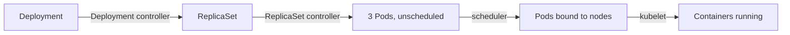

# Kubernetes concepts

!!! abstract "Where it's used in this project"
    Everything after the OpenStack phase runs on Kubernetes: the operator, API, UI, CloudNativePG and every database. These are the ideas the rest of the notes build on.

## Key ideas

**Components do the work; resources describe the wanted state.** Components are processes: `kube-apiserver`, `etcd`, `kube-scheduler`, `kube-controller-manager` on the control plane, and `kubelet`, `kube-proxy` and a container runtime on each node. Resources are objects stored through the API server in etcd: Pods, Deployments, Services, ConfigMaps, and custom resources like this project's `PostgreSQL`.

The core resources:

| Resource | Purpose |
|---|---|
| Pod | One or more containers sharing an IP and volumes; the unit that gets scheduled |
| Deployment → ReplicaSet | Keeps N identical stateless pods running and rolls out changes |
| StatefulSet | Pods with stable names and their own volumes (databases) |
| Service | Stable virtual IP and DNS name in front of changing pod IPs |
| Namespace | Partition for access control, quotas and naming |
| ConfigMap / Secret | Configuration and sensitive values, mounted or injected into pods |

**Everything is a control loop.** A controller watches one kind of resource and keeps nudging the real world towards its spec. Creating a Deployment with 3 replicas:

Each step only reads and writes objects through the API server; nobody calls anybody directly. The same pattern handles failure:

- **Pod deleted:** the ReplicaSet controller sees 2 of 3 and creates one more.
- **Container crashes:** the kubelet restarts it in the same pod.
- **Node dies:** its pods are marked lost, and the ReplicaSet controller replaces them on other nodes.

Controllers and resources often share a name (Deployment controller, Deployment resource), but one is the worker and the other is the to-do item.

## What I learned building it

- **The API server is the hub.** Only it talks to etcd. The scheduler, controllers and kubelets are all just clients that watch and update objects. This is also why this project can use the Kubernetes API as its only database (see [design decision 1](../design-decisions/kubernetes-as-state-store.md)).
- **Debug from the outside in.** Context → namespace → Deployment → Pods → logs → `describe` → events → node → Service → config. Most problems show up in `kubectl describe` events before they show up anywhere else.
- **Pod status names are clues.** `Pending` means not scheduled (resources, node selectors). `ImagePullBackOff` means a wrong image name or missing pull secret. `CrashLoopBackOff` means the container starts and exits, so read its logs with `--previous`.
- **k9s speeds up the same workflow**: `:ns`, `:deploy`, `:po`, then `l` for logs and `d` for describe.

## Review questions

??? question "What's the difference between the kubelet and the ReplicaSet controller? Both 'keep pods running'."
    The ReplicaSet controller works cluster-wide on Pod *objects*: it makes sure the right number exist. The kubelet works on one node on *containers*: it makes sure the pods assigned to its node are actually running, restarting crashed containers.

??? question "Why does a Service exist when pods already have IPs?"
    Pod IPs change every time a pod is replaced. A Service gives a stable virtual IP and DNS name and load-balances across whichever pods currently match its selector.

??? question "Deployment or StatefulSet for PostgreSQL, and why?"
    StatefulSet-like behaviour: each instance needs a stable identity and its own persistent volume. In this project CloudNativePG manages the database pods and their PVCs directly instead of using a StatefulSet, but for the same reasons.

??? question "A pod is stuck in `Pending`. Where do you look?"
    `kubectl describe pod` events. Usually there aren't enough CPU or memory requests available on any node, a PVC can't be bound, or a node selector or taint doesn't match.
