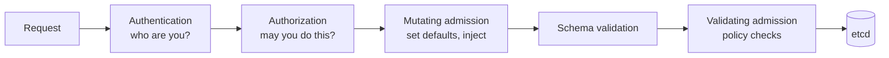
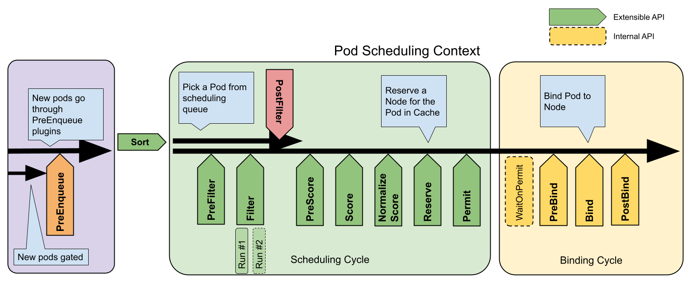
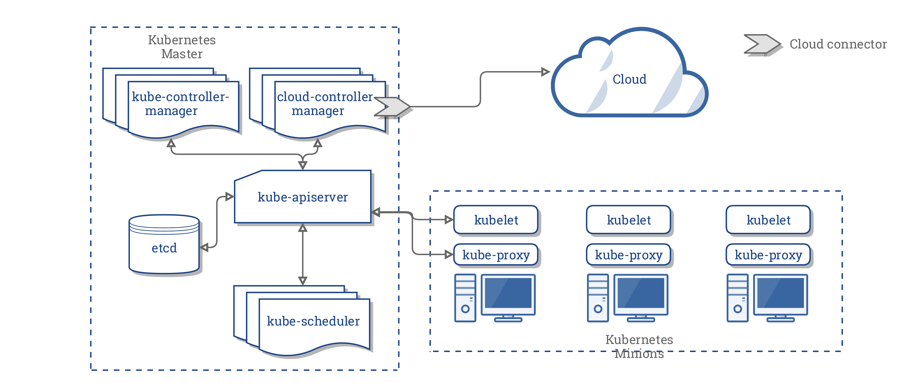

# The control plane

!!! abstract "Where it's used in this project"
    On the OpenStack clusters, `kubeadm` ran these components as static Pods on the control-plane VM ([Kubernetes on VMs](kubernetes-on-vms.md)). On STACKIT SKE they're managed and hidden, but the operator, the Go API and Argo CD are all clients of the same API server, and the operator follows the same reconcile pattern as the built-in controllers. Overview: [Kubernetes concepts and architecture](kubernetes-concepts.md).

## Key ideas

The control plane makes global decisions (scheduling) and reacts to cluster events (a Deployment is short of replicas). It has four core components plus an optional cloud one. Each section below follows the order the Very Hard Way course installs them: storage first, then the API in front of it, then the components that act on the data.

### etcd: the cluster's memory


<small>Image: [Kubernetes the (Very) Hard Way](https://labs.iximiuz.com/courses/kubernetes-the-very-hard-way-0cbfd997), iximiuz Labs</small>

**etcd** is a distributed, strongly consistent key-value store (originally from CoreOS, now CNCF) that holds every object in the cluster: Pods, Deployments, Secrets, ConfigMaps, CRs, node registrations.

**Raft and quorum.** etcd members use the Raft consensus algorithm. All writes go through an elected **leader** and are committed once a majority (a *quorum*) has them. If the leader dies, the others elect a new one.


<small>Image: [Kubernetes the (Very) Hard Way](https://labs.iximiuz.com/courses/kubernetes-the-very-hard-way-0cbfd997), iximiuz Labs</small>

| Members | Quorum | Failures tolerated |
|---|---|---|
| 1 | 1 | 0 |
| 3 | 2 | 1 |
| 4 | 3 | 1 (no better than 3) |
| 5 | 3 | 2 |

That's why clusters run an **odd number** of members. Strong consistency matters: if components saw stale data, the scheduler could overfill a node or two controllers could make conflicting decisions.

**Only the API server talks to etcd.** That keeps authentication, authorization, admission and validation in one place.

**Security and backups.** etcd holds Secrets, ServiceAccount token keys and certificates, so it needs TLS for encryption and **mTLS** so only the API server (with a client cert signed by etcd's CA) can connect. Losing etcd data means losing the cluster's state, so regular snapshots (`etcdctl snapshot save`) are essential. Secrets are only base64 in etcd unless you enable [encryption at rest](https://kubernetes.io/docs/tasks/administer-cluster/encrypt-data/).

**What's inside.** Keys follow `/registry/<resource>/[<namespace>/]<name>`, and values are **protobuf**, not JSON:

```bash
etcdctl get --prefix /registry --keys-only            # /registry/namespaces/default, /registry/pods/default/web-..., ...
etcdctl get /registry/namespaces/default --print-value-only | auger decode   # protobuf → YAML
```

The API server is the translator: it validates a request, serializes it to protobuf and writes it; on reads it does the reverse.

### kube-apiserver: the front door


<small>Image: [Kubernetes the (Very) Hard Way](https://labs.iximiuz.com/courses/kubernetes-the-very-hard-way-0cbfd997), iximiuz Labs</small>

Its four roles:

- **Gateway to etcd**: the only component that reads and writes persistent state
- **Communication hub**: every other component talks only to it
- **Security enforcer**: every request passes authentication, authorization and admission
- **State coordinator**: everyone sees one consistent view of desired and actual state

If it's down, nothing can be managed, but running workloads keep running. In production several instances run behind a load balancer; they're stateless, so this is easy.

**Kubernetes API vs API server vs kube-apiserver.** The *Kubernetes API* is the REST specification; an *API server* implements it; *kube-apiserver* is the reference implementation that almost every cluster runs.

**It's just REST.** Every resource is an HTTP endpoint, and `kubectl` is a convenient HTTP client:

```bash
curl --cacert ca.crt --cert admin.crt --key admin.key \
  https://localhost:6443/api/v1/namespaces                       # list
curl ... -X POST -H 'Content-Type: application/json' \
  -d '{"apiVersion":"v1","kind":"Namespace","metadata":{"name":"test"}}' \
  https://localhost:6443/api/v1/namespaces                       # create
kubectl get pods -v=8                                            # see the HTTP requests kubectl sends
```

Core resources live under `/api/v1/...`; everything else under `/apis/<group>/<version>/...` (for example `/apis/apps/v1/namespaces/default/deployments`, or this project's `/apis/database.example.com/v1/...`).

**The request pipeline.** Every request goes through the same stages, and fails at the first one that says no:



| Stage | Options | Fails with |
|---|---|---|
| Authentication | X.509 client certs (CN = user, O = groups), bearer tokens (ServiceAccount, bootstrap, static token file), OIDC | `401 Unauthorized` |
| Authorization | `RBAC`, `Node`, `Webhook`, `ABAC`, `AlwaysAllow`, `AlwaysDeny`. Modes are tried in order; the first to *allow* wins, otherwise denied. Production uses `--authorization-mode=Node,RBAC`. | `403 Forbidden` |
| Admission | Built-in plugins (ServiceAccount, LimitRanger, ResourceQuota, PodSecurity, ...) and webhooks, such as an operator's validating webhook | `400`/`403` with the plugin's message |

**Watches.** Clients don't poll. They *list* once, then open a *watch* and the API server streams changes to them, each tagged with a `resourceVersion`. Controllers use **informers**, which keep a local cache fed by a watch, so reconciling doesn't hammer the API server.

**kubeconfig.** Clients (`kubectl`, the scheduler, the controller-manager, kubelets) find the API server through a kubeconfig file with three lists: **clusters** (server URL + CA), **users** (credentials) and **contexts** (cluster + user + default namespace). `kubectl config use-context` just switches which pair is active.

**Important flags** from the hand-built unit file:

| Flag | Purpose |
|---|---|
| `--etcd-servers`, `--etcd-cafile/certfile/keyfile` | Where etcd is, and the mTLS client cert to reach it |
| `--service-cluster-ip-range=10.96.0.0/12` | Range for Service ClusterIPs. The first IP, `10.96.0.1`, goes to the `kubernetes` Service, so it must be in the server cert's SANs. |
| `--service-account-issuer`, `--service-account-signing-key-file`, `--service-account-key-file` | Sign and verify ServiceAccount tokens |
| `--tls-cert-file`, `--tls-private-key-file`, `--client-ca-file` | Serve TLS, and verify client certs |
| `--authorization-mode=Node,RBAC`, `--anonymous-auth=false` | Who may do what |
| `--kubelet-client-certificate/key` | Identity used when calling kubelets (`logs`, `exec`, `port-forward`) |
| `--enable-bootstrap-token-auth` | Let new nodes join with a bootstrap token |

### kube-scheduler: where should this Pod run?


<small>Image: [Kubernetes the (Very) Hard Way](https://labs.iximiuz.com/courses/kubernetes-the-very-hard-way-0cbfd997), iximiuz Labs</small>

The scheduler watches for Pods with no `spec.nodeName` and picks the best node for each. It doesn't start anything; the kubelet on the chosen node does that.

**Filter, then score.** Nodes that can't run the Pod are removed (not enough requested CPU/memory, `nodeSelector` or required affinity doesn't match, an untolerated taint, a volume in another zone). The rest are scored on preferences (spread, preferred affinity, balanced resource use) and the highest wins. If nothing passes the filter, the Pod stays `Pending` and the reason shows up in `kubectl describe pod` events. The rules you can set are in [workloads and scheduling](kubernetes-workloads.md#scheduling).



<small>Image: [Kubernetes documentation, scheduling framework](https://kubernetes.io/docs/concepts/scheduling-eviction/scheduling-framework/), CC BY 4.0</small>

**Binding.** Pods are (mostly) immutable, so the scheduler can't just update `nodeName`. Instead it POSTs a **Binding** to the Pod's `/binding` subresource, a narrow API that only sets the node:

```json
{"apiVersion": "v1", "kind": "Binding",
 "metadata": {"name": "web-abc12"},
 "target": {"apiVersion": "v1", "kind": "Node", "name": "worker-1"}}
```

You can bypass the scheduler entirely by setting `spec.nodeName` when you create a Pod. kube-scheduler is only the *default* scheduler; a Pod can name another with `schedulerName`.

**Experiments from the hard way.** With no scheduler a Pod stays unscheduled forever. A fake Node object made with `kubectl apply` gets Pods bound to it, but they stay `Pending` because no kubelet runs them. And a node with no kubelet reporting gets a `node.kubernetes.io/not-ready` taint, which keeps the scheduler away.

### kube-controller-manager: making it true


<small>Image: [Kubernetes the (Very) Hard Way](https://labs.iximiuz.com/courses/kubernetes-the-very-hard-way-0cbfd997), iximiuz Labs</small>

Without controllers the API server is just a database: a ReplicaSet asking for 3 replicas sits there with zero Pods. **kube-controller-manager** bundles dozens of controllers into one binary. Each is logically separate and runs as its own loop; bundling them is purely an operational convenience. They all talk only to the API server, never to etcd.

**Workload controllers:**

| Controller | What it does |
|---|---|
| ReplicaSet | Keeps the desired number of Pod replicas running |
| Deployment | Manages ReplicaSets: rolling updates and rollbacks |
| DaemonSet | One Pod on every (or every selected) node |
| StatefulSet | Stable identity, ordered rollout, per-Pod volumes |
| Job / CronJob | Run to completion, once or on a schedule |

**Infrastructure controllers:**

| Controller | What it does |
|---|---|
| ServiceAccount | Creates the `default` ServiceAccount in every new namespace |
| Namespace | Deletes everything in a namespace being deleted |
| Node lifecycle | Notices nodes that stop heartbeating, marks them `NotReady`, taints and evicts their Pods |
| Garbage collector | Deletes dependents whose owner is gone (via `ownerReferences`) |
| EndpointSlice | Keeps each Service's list of ready Pod IPs current |
| CSR approving/signing | Approves and signs node certificate requests during [TLS bootstrapping](kubernetes-nodes.md#joining-a-node-tls-bootstrapping) |
| Node IPAM | Carves `--cluster-cidr` into a per-node `podCIDR` (with `--allocate-node-cidrs`) |

`--controllers` chooses which run, and `--use-service-account-credentials` gives each controller its own ServiceAccount so RBAC can be per controller.

**Controllers compose.** Nobody orchestrates the whole chain: a Deployment controller creates a ReplicaSet, the ReplicaSet controller creates Pods, the scheduler binds them, kubelets run them. Each loop handles one concern. Deleting a Pod shows **self-healing**: the ReplicaSet controller sees 2 of 3 and creates another, with no special signal needed.

**Core vs cloud vs custom controllers:**

| Kind | Lives in | Examples |
|---|---|---|
| Core | kube-controller-manager | ReplicaSet, Deployment, Job, Namespace |
| Cloud | cloud-controller-manager | Node metadata, routes, `LoadBalancer` Services |
| Custom (operators) | Your own Deployment | cert-manager, Argo CD, CloudNativePG, this project's [operator](operators.md) |

### cloud-controller-manager (optional)



<small>Image: [Kubernetes documentation, cloud controller manager](https://kubernetes.io/docs/concepts/architecture/cloud-controller/), CC BY 4.0</small>

Cloud-specific logic used to live inside kube-controller-manager, with every provider's code in the main Kubernetes repo. The **cloud-controller-manager** split it out so providers can release on their own schedule. It contains:

- **Node controller**: fills in instance ID, zone, addresses; deletes Node objects whose VM is gone
- **Route controller**: programs cloud routes for Pod networking where needed
- **Service controller**: creates a cloud load balancer for every `type: LoadBalancer` Service

If it's down, workloads keep running but new LoadBalancer Services never get an external IP. On a managed cluster like SKE, this is the piece that turns the ingress-nginx `LoadBalancer` Service into a real cloud load balancer. A plain kubeadm cluster has no CCM, so a `LoadBalancer` Service stays `<pending>` and NodePorts are the way in.

### High availability and leader election

- **API server**: stateless, so run several behind a load balancer; all of them active.
- **etcd**: 3 or 5 members, either stacked on the control-plane nodes or on separate machines.
- **Scheduler and controller-manager**: run one per control-plane node, but only one of each is **leader** at a time. They hold a **Lease** object in `kube-system`; if the leader stops renewing it, another instance takes over. This project's operator uses the same mechanism (`--leader-elect`).

## What I learned building it

- **Without a controller-manager, Kubernetes is a validated database.** Creating a ReplicaSet and seeing no Pods made it obvious that `spec` is a wish and controllers make it real.
- **The scheduler only writes one field.** Everything after `spec.nodeName` is set is the kubelet's job, which is why "scheduled but not running" and "not scheduled" are different problems.
- **Every component is configured like `kubectl`.** The scheduler and controller-manager each get a client cert and a kubeconfig, exactly like an admin user. There's no hidden back channel.
- **The service CIDR has to match** between kube-apiserver and kube-controller-manager, and `10.96.0.1` must be in the API server certificate, or Pods calling `https://kubernetes.default` fail TLS verification.
- **`kubectl -v=8` demystifies kubectl**: it prints every HTTP request it makes.

## Review questions

??? question "Why do etcd clusters use 3 or 5 members rather than 4?"
    Quorum is a majority. 4 members need 3 for quorum and tolerate 1 failure, the same as 3 members, while adding another machine that can fail and more replication traffic.

??? question "A request returns 401 vs 403. Which pipeline stage rejected it?"
    401 is authentication: the API server doesn't know who you are. 403 is authorization (or an admission plugin): it knows who you are but you're not allowed.

??? question "How does the scheduler assign a Pod to a node when Pods are immutable?"
    It creates a Binding through the Pod's `/binding` subresource, a dedicated API that only sets `spec.nodeName`.

??? question "Why is kube-controller-manager one binary if each controller is independent?"
    Operational convenience. Deploying and upgrading dozens of separate controller binaries would be painful; logically they're still separate loops that only share a process.

??? question "Why does cloud-controller-manager exist as a separate binary?"
    Cloud providers release at a different pace from Kubernetes. Moving provider code out of tree lets each provider ship its own CCM, and keeps kube-controller-manager cloud-agnostic.

??? question "Two kube-controller-manager instances run for HA. Why don't they both create replacement Pods?"
    Leader election: only the instance holding the Lease in `kube-system` runs the loops. The other waits and takes over if the leader stops renewing.

??? question "How would you read the raw `default` namespace object from etcd, and why does it look like binary?"
    `etcdctl get /registry/namespaces/default --print-value-only`. Kubernetes stores objects as protobuf; `auger decode` turns it back into YAML.
