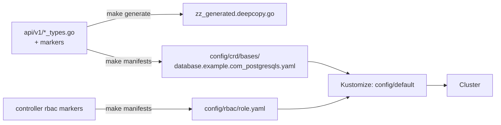

# Building an operator with Kubebuilder

!!! abstract "Where it's used in this project"
    The whole [`operator/`](https://github.com/foyez/dbaas-platform/tree/main/operator) directory was scaffolded by Kubebuilder (layout `go.kubebuilder.io/v4`, recorded in [`operator/PROJECT`](https://github.com/foyez/dbaas-platform/blob/main/operator/PROJECT)). I write the Go types and `Reconcile()`. Kubebuilder's tools generate the CRD, RBAC, DeepCopy code and deployment manifests. Concepts behind it: [Custom resources and operators](operators.md).

## Key ideas

### What Kubebuilder is (and isn't)

Three separate projects are easy to mix up:

| Tool | Role | When it runs |
|---|---|---|
| **Kubebuilder** | CLI that scaffolds the project: folders, `main.go`, Makefile, `config/` | Once, plus when adding an API |
| **controller-gen** (controller-tools) | Reads `// +kubebuilder:` markers and writes CRD YAML, RBAC and DeepCopy code | On every `make manifests` / `make generate` |
| **controller-runtime** | The Go library the operator runs on: manager, cache, work queue, client | At runtime, inside the pod |

Kubebuilder writes code once and then steps aside. What's left in the repo is a plain Go program using controller-runtime, plus a Makefile that calls controller-gen.

### Scaffolding: two commands

```sh
kubebuilder init --domain example.com --repo github.com/foyez/dbaas-platform/operator
kubebuilder create api --group database --version v1 --kind PostgreSQL
```

`init` creates the project skeleton. `create api` adds one kind. The **group + domain** become the API group, so `database` + `example.com` gives `apiVersion: database.example.com/v1`. Both answers are stored in `PROJECT`, so later commands know the layout.

### Project layout

```
operator/
  PROJECT                         scaffolding metadata (don't edit)
  api/v1/
    postgresql_types.go           Spec, Status and markers: I write this
    groupversion_info.go          group/version and the scheme registration
    zz_generated.deepcopy.go      generated by `make generate`
  internal/controller/
    postgresql_controller.go      Reconcile() + SetupWithManager(): I write this
    cnpg.go, tcpexpose.go, ...    helpers I added
    suite_test.go                 envtest setup
  cmd/main.go                     builds the manager and registers the controller
  config/                         Kustomize manifests (crd, rbac, manager, default)
  test/e2e/                       end-to-end tests against a Kind cluster
```

A rough rule: **`api/` is the contract, `internal/controller/` is the behaviour, `config/` is how it's deployed.**

### Markers: comments that generate YAML

Markers are Go comments that controller-gen reads. They sit on the type, its fields, or the controller.

```go
type PostgreSQLSpec struct {
	// +kubebuilder:validation:Required
	Version string `json:"version"`

	// +kubebuilder:default=1
	// +kubebuilder:validation:Minimum=1
	Instances int32 `json:"instances,omitempty"`
	...
}

// +kubebuilder:object:root=true
// +kubebuilder:subresource:status
// +kubebuilder:printcolumn:name="PHASE",type="string",JSONPath=".status.phase"
// +kubebuilder:printcolumn:name="EXTERNAL-PORT",type="integer",JSONPath=".status.externalPort"
type PostgreSQL struct { ... }
```

| Marker | Effect |
|---|---|
| `validation:Required`, `validation:Minimum=1` | OpenAPI rules in the CRD. The API server rejects a bad CR before the operator ever sees it. |
| `default=1` | The API server fills in the value when it's omitted. |
| `object:root=true` | This type is a top-level kind (it gets `TypeMeta`/`ObjectMeta` and DeepCopyObject). |
| `subresource:status` | Enables `/status`, so spec and status are written separately. |
| `printcolumn` | Extra columns in `kubectl get postgresqls`. |
| `rbac:groups=...,resources=...,verbs=...` | A rule in the generated ClusterRole `manager-role`. |

The RBAC markers live above the reconciler:

```go
// +kubebuilder:rbac:groups=database.example.com,resources=postgresqls,verbs=get;list;watch;create;update;patch;delete
// +kubebuilder:rbac:groups=database.example.com,resources=postgresqls/status,verbs=get;update;patch
// +kubebuilder:rbac:groups=database.example.com,resources=postgresqls/finalizers,verbs=update
// +kubebuilder:rbac:groups=postgresql.cnpg.io,resources=clusters,verbs=get;list;watch;create;update;patch;delete
// +kubebuilder:rbac:groups="",resources=secrets,verbs=get;list;watch
```

So permissions sit next to the code that needs them. Add a `client.Get` on a new kind, add a marker, run `make manifests`.

### The generate loop



| Make target | What it does |
|---|---|
| `make generate` | DeepCopy methods, needed because every Kubernetes object must be copyable (`runtime.Object`) |
| `make manifests` | CRD YAML and the `manager-role` ClusterRole from markers |
| `make test` | Runs `manifests` and `generate` first, then unit + envtest tests |
| `make run` | Runs the operator on my machine against the current kubeconfig |
| `make install` / `make deploy` | Apply the CRD only, or CRD + RBAC + Deployment |

**Rule: change a type or a marker, re-run `make manifests generate`, commit the generated files.** Generated files are in Git so that GitOps can apply them without running Go.

### The manager: what `main.go` wires up

`cmd/main.go` is the composition root. It does three things:

1. **Builds a scheme**: the list of Go types the client can encode and decode. This operator registers built-in kinds, its own `PostgreSQL`, and CNPG's `Cluster`:

    ```go
    utilruntime.Must(clientgoscheme.AddToScheme(scheme)) // Pod, Service, Secret...
    utilruntime.Must(databasev1.AddToScheme(scheme))     // my PostgreSQL CRD
    utilruntime.Must(cnpgv1.AddToScheme(scheme))         // CNPG's Cluster CRD
    ```

    Forget one and the client fails with "no kind is registered for the type".

2. **Creates the manager** (`ctrl.NewManager`): shared cache and client, metrics server, health probes (`/healthz`, `/readyz`) and leader election (`--leader-elect`).

3. **Registers the controller** and starts everything:

    ```go
    func (r *PostgreSQLReconciler) SetupWithManager(mgr ctrl.Manager) error {
        return ctrl.NewControllerManagedBy(mgr).
            For(&databasev1.PostgreSQL{}).   // reconcile when a PostgreSQL changes
            Owns(&cnpgv1.Cluster{}).         // ...or when a Cluster it owns changes
            Complete(r)
    }
    ```

### The `config/` directory

Kubebuilder generates a Kustomize tree. `config/default` pulls the rest together and adds a namespace and name prefix:

| Folder | Contents |
|---|---|
| `config/crd` | The generated CRD |
| `config/rbac` | ServiceAccount, `manager-role` + binding, leader-election Role, viewer/editor/admin roles for users |
| `config/manager` | The operator Deployment |
| `config/default` | Combines the above; namespace `postgresql-dbpaas-platform-system`, prefix `postgresql-dbpaas-platform-` |

In this project, GitOps doesn't call `make deploy`. [`gitops/operator/base`](https://github.com/foyez/dbaas-platform/blob/main/gitops/operator/base/kustomization.yaml) uses `operator/config/default` as its base, and the dev/prod overlays only change the namespace (`dbaas-operator`) and the image. See [GitOps](gitops.md).

### Testing with envtest

envtest starts a real `kube-apiserver` and `etcd` (no kubelet, no controllers) and loads CRDs from disk. Tests then call `Reconcile()` directly and check what was created:

```go
testEnv = &envtest.Environment{
    CRDDirectoryPaths:     []string{filepath.Join("..", "..", "config", "crd", "bases")},
    ErrorIfCRDPathMissing: true,
}
```

| Test type | Runs against | Good for |
|---|---|---|
| envtest (`make test`) | API server + etcd only | Reconcile logic, validation, owner refs; fast, no cluster needed |
| e2e (`test/e2e`) | A Kind cluster with the real image | Deployment, RBAC, metrics; slow |

Nothing runs CNPG in envtest, so a created CNPG `Cluster` never becomes ready. Tests check the operator's own work, not CNPG's.

## What I learned building it

- **Kubebuilder is a starting point, not a framework.** After scaffolding, the code is plain controller-runtime. Understanding the manager, cache and client mattered more than knowing Kubebuilder commands.
- **Forgetting `make manifests` fails quietly.** A new validation marker does nothing until the CRD is regenerated and re-applied. The cluster just keeps the old schema.
- **envtest needs every CRD the controller touches.** The operator creates CNPG `Cluster` objects, so a copy of CNPG's CRD sits in `config/crd/bases` for tests. It's not listed in `config/crd/kustomization.yaml`, so deploying the operator never installs it (CNPG does that).
- **RBAC markers with `namespace=` clash with Kustomize.** They generate namespaced Roles, and `config/default`'s blanket namespace transform then moves them all into one namespace. The port-allocator and ingress-nginx permissions are hand-written Roles instead, scoped by `resourceNames`.
- **The cached client needs list/watch RBAC.** The first `Get` on a kind starts a cluster-wide informer. For the two ConfigMaps the operator may only touch by name, I added an uncached `RawClient` (`client.New`) next to the manager's client.

## Review questions

??? question "What's the difference between Kubebuilder, controller-gen and controller-runtime?"
    Kubebuilder scaffolds the project once. controller-gen turns markers into CRD YAML, RBAC and DeepCopy code on every build. controller-runtime is the library the operator runs on.

??? question "How does `apiVersion: database.example.com/v1` come about?"
    The group (`database`) plus the domain (`example.com`) from `kubebuilder init` / `create api`, and the version `v1`. It's set in `groupversion_info.go` with `+groupName`.

??? question "You add `+kubebuilder:validation:Maximum=5` to `Instances`. What else must you do?"
    Run `make manifests` to regenerate the CRD, commit it, and re-apply the CRD to the cluster. Until then the API server still uses the old schema.

??? question "Why does every API type need DeepCopy methods?"
    Objects come from a shared cache. Controllers must copy before changing them, and the `runtime.Object` interface requires `DeepCopyObject`. `make generate` writes these.

??? question "What goes into the scheme in `main.go`, and what breaks if CNPG's types are missing?"
    Every Go type the client reads or writes: built-ins, `PostgreSQL` and CNPG's `Cluster`. Without CNPG's types, creating or watching a `Cluster` fails with "no kind is registered".

??? question "What does envtest give you, and what doesn't it?"
    A real API server and etcd with your CRDs installed, so validation, owner references and Reconcile logic can be tested. No kubelet and no other controllers, so pods never run and CNPG never makes the cluster ready.

??? question "Where do the operator's RBAC permissions come from?"
    Mostly from `+kubebuilder:rbac` markers, generated into `config/rbac/role.yaml`. Narrow, name-scoped permissions in other namespaces are hand-written Roles, because namespaced markers clash with Kustomize's namespace transform.
