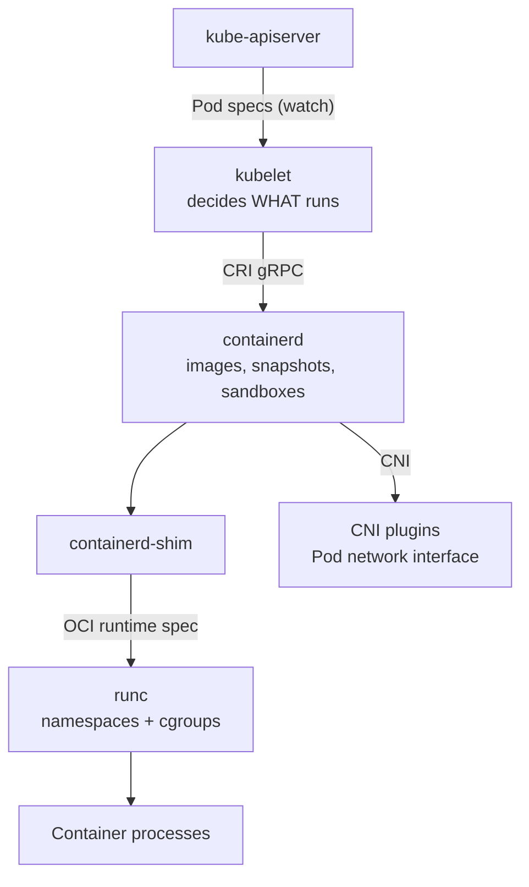
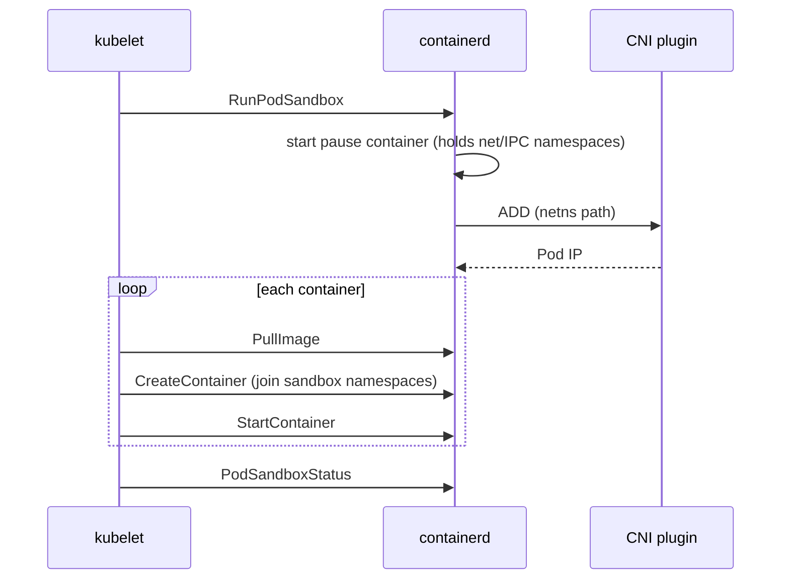
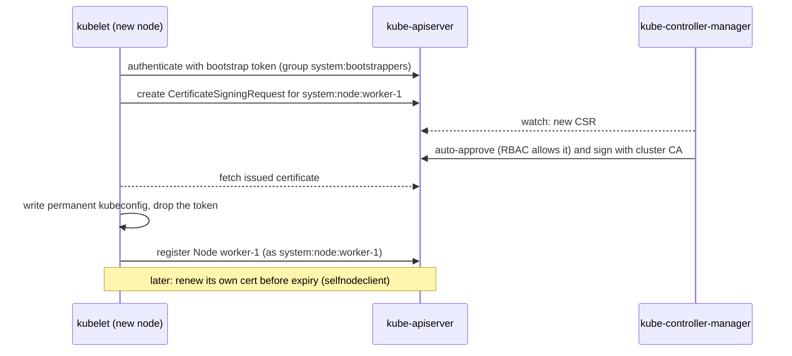

# Worker nodes: kubelet and the container runtime

!!! abstract "Where it's used in this project"
    The OpenStack clusters' Ansible roles install containerd with the systemd cgroup driver, then `kubelet` and `kubeadm`, then join workers with a bootstrap token ([Kubernetes on VMs](kubernetes-on-vms.md)). On SKE the nodes are managed, but every database Pod still runs through the same kubelet → CRI → containerd → runc chain. Overview: [Kubernetes concepts and architecture](kubernetes-concepts.md).

## Key ideas

A node is where Pods stop being YAML and become Linux processes. Three layers make that happen, each handing off to the next through a standard interface:



| Interface | Between | Defined by | Lets you swap |
|---|---|---|---|
| **CRI** (Container Runtime Interface) | kubelet ↔ runtime | Kubernetes | containerd, CRI-O |
| **OCI runtime spec** | high-level ↔ low-level runtime | Open Container Initiative | runc, crun, gVisor, Kata |
| **CNI** (Container Network Interface) | runtime ↔ network plugins | CNCF | bridge, Flannel, Calico, Cilium |

The **kubelet decides *what* should run; the container runtime decides *how* it runs.**

### containerd: the high-level runtime


<small>Image: [Kubernetes the (Very) Hard Way](https://labs.iximiuz.com/courses/kubernetes-the-very-hard-way-0cbfd997), iximiuz Labs</small>

[containerd](https://containerd.io) came out of Docker and is now a CNCF project. It provides:

- **container lifecycle**: create, start, stop, delete, report status
- **image management**: pull from registries, store, unpack
- **storage**: container filesystems (snapshots) and mounts
- **networking**: calls CNI plugins to wire up each Pod
- **runtime management**: hands the actual process creation to an OCI runtime

It runs on **every node**, control-plane nodes included.

**OCI runtime.** containerd decides *what* to run (image, network, storage); a low-level **OCI runtime** does the *how*: creating Linux namespaces and cgroups and starting the process. Docker Engine used to do all of this in one monolith; the OCI specs split it into standard pieces. The reference runtime is [`runc`](https://github.com/opencontainers/runc); alternatives include `crun` (same model, faster), gVisor (user-space kernel) and Kata (lightweight VMs). Without runc installed, `ctr run` fails with `exec: "runc": executable file not found in $PATH`.


<small>Image: [Kubernetes the (Very) Hard Way](https://labs.iximiuz.com/courses/kubernetes-the-very-hard-way-0cbfd997), iximiuz Labs</small>

**containerd-shim** sits between containerd and runc, one per Pod sandbox. It keeps containers running even if containerd restarts, handles their stdio, and reaps their processes when they exit.

**cgroups and the systemd driver.** cgroups limit a container's CPU, memory and I/O, and are how Pod `resources.limits` are enforced. On a systemd host, both containerd (`SystemdCgroup = true` in `/etc/containerd/config.toml`) and the kubelet (`cgroupDriver: systemd`) must use the **systemd cgroup driver**, so there's one cgroup hierarchy. A mismatch is a classic `kubeadm init` failure and causes instability under memory pressure.

**CNI.** In the same way, containerd delegates networking: when it creates a Pod sandbox it runs the CNI plugin configured in `/etc/cni/net.d/`, an executable from `/opt/cni/bin/`, to create the network namespace's interface, assign an IP and set routes. See [cluster networking](kubernetes-cluster-networking.md#node-level-cni).


<small>Image: [Kubernetes the (Very) Hard Way](https://labs.iximiuz.com/courses/kubernetes-the-very-hard-way-0cbfd997), iximiuz Labs</small>

**Docker?** The kubelet used to have Docker support built in (*dockershim*). It was deprecated in 1.20 and removed in 1.24. Docker-built images still work everywhere because they're standard OCI images; only Docker Engine as the node runtime went away (`cri-dockerd` exists if you really need it).

### kubelet: the node agent


<small>Image: [Kubernetes the (Very) Hard Way](https://labs.iximiuz.com/courses/kubernetes-the-very-hard-way-0cbfd997), iximiuz Labs</small>

The kubelet runs on every node and is the "hands and feet" of Kubernetes there. It's a controller for one node:

1. **watch** the API server for Pods bound to this node (and the static Pod directory)
2. **compare** what should run with what is running
3. **act** through the CRI: create sandboxes, pull images, start and restart containers
4. **report** Pod status and node status back to the API server

It also mounts volumes, injects Secrets and ConfigMaps, writes each Pod's `/etc/resolv.conf`, runs **liveness, readiness and startup probes** (see [health checks](health-and-scaling.md)), and evicts Pods when the node runs low on memory or disk.

**Config.** Most settings live in a `KubeletConfiguration` file. Drop-ins in `/var/lib/kubelet/config.d/` are merged alphabetically, so prefixes like `50-`, `70-`, `99-` set the order:

```yaml
apiVersion: kubelet.config.k8s.io/v1beta1
kind: KubeletConfiguration
containerRuntimeEndpoint: unix:///var/run/containerd/containerd.sock
cgroupDriver: systemd
staticPodPath: /etc/kubernetes/manifests
clusterDNS: [10.96.0.10]     # written into every Pod's /etc/resolv.conf
clusterDomain: cluster.local
```

**The kubelet API (port 10250).** The kubelet is also a server. When you run `kubectl logs`, `exec` or `port-forward`, the API server forwards the request to the kubelet on that Pod's node. That's why port 10250 must be open from the control plane to every node, and why the API server needs a kubelet client certificate. In production the kubelet authenticates callers with x509 or webhook token review and asks the API server whether they're authorized; never `AlwaysAllow`.


<small>Image: [Kubernetes the (Very) Hard Way](https://labs.iximiuz.com/courses/kubernetes-the-very-hard-way-0cbfd997), iximiuz Labs</small>

**Node heartbeats.** The kubelet updates its Node's `status` and renews a **Lease** in `kube-node-lease`. If the Lease stops being renewed, the node lifecycle controller marks the node `NotReady`/`Unknown`, taints it, and eventually evicts its Pods. If the kubelet is down, containers already running may keep running, but nothing new starts on that node and failed containers aren't restarted.

### Static Pods and the chicken-and-egg problem

**Static Pods** are Pods the kubelet runs straight from manifest files in its `staticPodPath`, with no API server involved. Drop a file in, the Pod starts; delete it, the Pod stops; if it crashes, the kubelet restarts it.

Why they matter: the control plane itself has to run somewhere. You need a control plane to schedule Pods, but you want the control plane *as* Pods. Static Pods break the loop. This is exactly how `kubeadm` runs etcd, kube-apiserver, kube-scheduler and kube-controller-manager: as manifests in `/etc/kubernetes/manifests/` on the control-plane node. The kubelet there starts them first, and *then* also registers with the API server it just started, like any other node.

- The kubelet creates a read-only **mirror Pod** in the API server so `kubectl get pods` shows it. Deleting the mirror does nothing; only the file controls it.
- The Pod name gets the node name appended (`podinfo` on `worker` → `podinfo-worker`).
- Static Pods **can't reference API objects** such as Secrets, ConfigMaps or ServiceAccounts. They can use only what's on the node (`hostPath`, `emptyDir`), which is why control-plane manifests mount certificates from `/etc/kubernetes/pki`.
- They usually use `hostNetwork: true`, sharing the node's IP.

### Pods, sandboxes and pause containers

The CRI has two services:

- **RuntimeService**: Pod sandboxes and containers (`RunPodSandbox`, `CreateContainer`, `StartContainer`, `PodSandboxStatus`, ...)
- **ImageService**: images (`PullImage`, `ListImages`, `RemoveImage`)


<small>Image: [Kubernetes the (Very) Hard Way](https://labs.iximiuz.com/courses/kubernetes-the-very-hard-way-0cbfd997), iximiuz Labs</small>

Starting a Pod is always **sandbox first, then containers**:



A **pod sandbox** is the shared environment the Pod's containers live in: the network namespace (one IP, shared `localhost`), IPC namespace, and the Pod's cgroup. containerd implements it with a tiny **pause container** whose only job is to sleep forever and keep the namespaces alive, because Linux namespaces need a process. That comes from the pre-CRI Docker days, when Pods were faked with `--net=container:<pause-id>`. VM-based runtimes (Kata, Firecracker) don't need one: the VM is the sandbox.

### Tools for poking at a node

| Tool | Talks to | Sees | Use |
|---|---|---|---|
| `ctr` | containerd native API | Everything, per containerd namespace (`ctr -n k8s.io containers ls`) | Low-level debugging |
| `nerdctl` | containerd native API | Same, with Docker-like UX (`nerdctl -n k8s.io ps`) | Familiar commands |
| `crictl` | CRI, same socket as the kubelet | Pods and containers as the kubelet sees them; no pause containers | First stop when a node misbehaves |
| `kubeletctl` | kubelet API on 10250 | Pods, logs, exec, merged config (`configz`) | Kubelet debugging |

Kubernetes containers live in containerd's `k8s.io` namespace, so a plain `nerdctl ps` looks empty on a busy node.

```bash
sudo crictl pods                     # sandboxes, like kubectl get pods for this node
sudo crictl ps -a                    # containers, including exited ones
sudo crictl logs <container-id>      # works even if the API server is down
journalctl -u kubelet -f             # kubelet's own logs
```

### Joining a node: TLS bootstrapping

A kubelet joining a cluster has to (1) connect to the API server and register a Node, (2) be authenticated and allowed to manage only its own Node and Pods, and (3) start watching for Pods. The control-plane components got hand-made certificates, but that doesn't scale to hundreds of nodes, especially with autoscaling. **TLS bootstrapping** lets the kubelet start with a weak, temporary credential and trade it for a real certificate.


<small>Image: [Kubernetes the (Very) Hard Way](https://labs.iximiuz.com/courses/kubernetes-the-very-hard-way-0cbfd997), iximiuz Labs</small>



What each side needs:

| Side | Needs |
|---|---|
| Control plane | `--enable-bootstrap-token-auth`; a bootstrap token (`<id>.<secret>`, stored as a `bootstrap.kubernetes.io/token` Secret in `kube-system`); kube-controller-manager with `--cluster-signing-cert-file/key-file` |
| RBAC | `system:bootstrappers` → `system:node-bootstrapper` (may create CSRs); `system:bootstrappers` → `...:nodeclient` (initial CSR auto-approved); `system:nodes` → `...:selfnodeclient` (renewals auto-approved) |
| Worker | The cluster **CA certificate** (the only file copied by hand), a bootstrap kubeconfig with the API server URL and token, and kubelet flags `--bootstrap-kubeconfig` and `--kubeconfig` (where it writes the permanent one) |

This is what `kubeadm token create --print-join-command` and `kubeadm join` automate, including short-lived, per-join tokens. `kubectl get csr` shows the requests as `Approved,Issued`.

After joining, the node is usually **`NotReady`**: the kubelet is fine, but containerd reports `NetworkPluginNotReady` because `/etc/cni/net.d/` is empty. It turns `Ready` once a CNI config exists. See [cluster networking](kubernetes-cluster-networking.md).

## What I learned building it

- **Each layer fails with its own message.** No runc: "executable file not found". No CNI plugins: `failed to find plugin "bridge" in path [/opt/cni/bin]`. No CNI config: node `NotReady` with `NetworkPluginNotReady`. Knowing the chain makes the error point to the layer.
- **`crictl` is the right tool on a node**, not `docker` or plain `nerdctl`: it shows what the kubelet sees, in the right namespace, even when the API server is unreachable.
- **The cgroup driver must match** between containerd and the kubelet. The Ansible `containerd` role sets `SystemdCgroup = true` for this reason.
- **`kubectl logs` and `exec` go through the node.** If they hang while `get pods` works, check that the control plane can reach the kubelet on port 10250.
- **Static Pods explained `kubeadm`.** Seeing etcd and the API server as files in `/etc/kubernetes/manifests` made the control-plane node much less mysterious, and editing one of those files is how you change a control-plane flag on a kubeadm cluster.

## Review questions

??? question "What's the division of labour between the kubelet, containerd and runc?"
    The kubelet decides what should run on the node from Pod specs and talks CRI. containerd pulls images, manages snapshots and sandboxes, and calls CNI for networking. runc creates the namespaces and cgroups and starts the process, following the OCI runtime spec.

??? question "Why do control-plane components run as static Pods on a kubeadm cluster?"
    To avoid the chicken-and-egg problem: the API server can't schedule itself. The kubelet runs static Pods straight from files on disk, so the control plane can start before any API server exists, and still be visible as (mirror) Pods.

??? question "What is a pause container, and why doesn't `crictl ps` show it?"
    It holds the Pod sandbox's network and IPC namespaces so all containers in the Pod share one IP and `localhost`. It's containerd's implementation detail of a CRI pod sandbox, so CRI tools don't list it as a container.

??? question "Docker support was removed in Kubernetes 1.24. Do Docker images still work?"
    Yes. Only dockershim, the kubelet's built-in Docker Engine integration, was removed. Images built by Docker are OCI images and run on containerd or CRI-O.

??? question "A new node joins but stays `NotReady`. What do you check first?"
    `kubectl describe node`: the Ready condition's message. Usually it's `NetworkPluginNotReady`, meaning no CNI config in `/etc/cni/net.d/` yet, so the network addon's Pod or daemon isn't running on that node.

??? question "In TLS bootstrapping, what's the only piece of PKI copied to the worker by hand, and why is it enough?"
    The cluster CA certificate, so the kubelet can verify the API server. The kubelet generates its own key, and the API server signs its CSR; the bootstrap token only authenticates that first request.

??? question "`kubectl get pods` works but `kubectl logs` times out. Why?"
    `logs` is proxied from the API server to the kubelet on port 10250 of the Pod's node. That path is blocked (firewall/security group) or the API server lacks a working kubelet client certificate.
