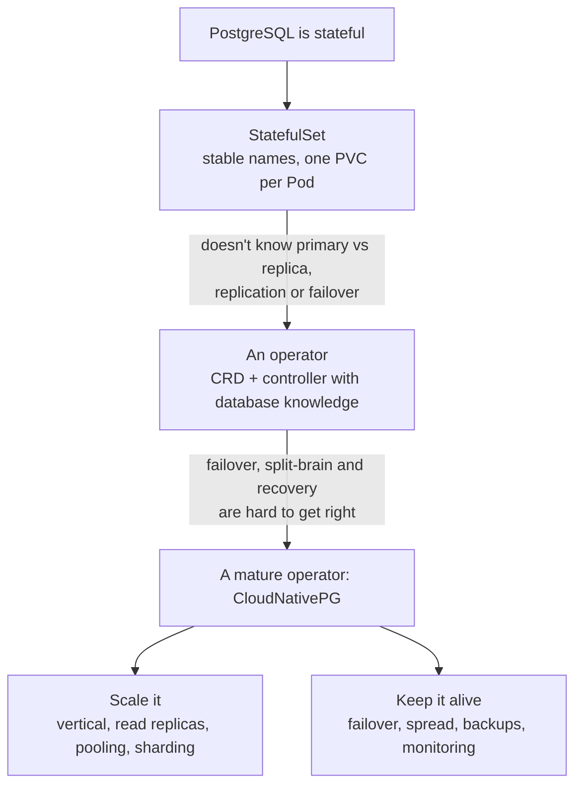
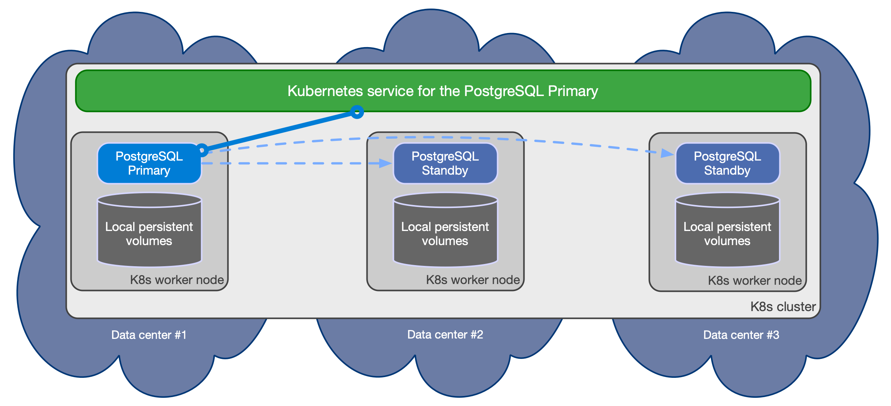
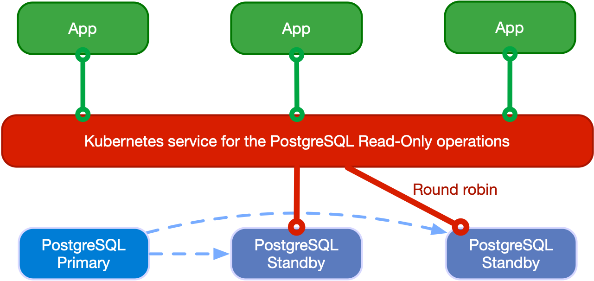
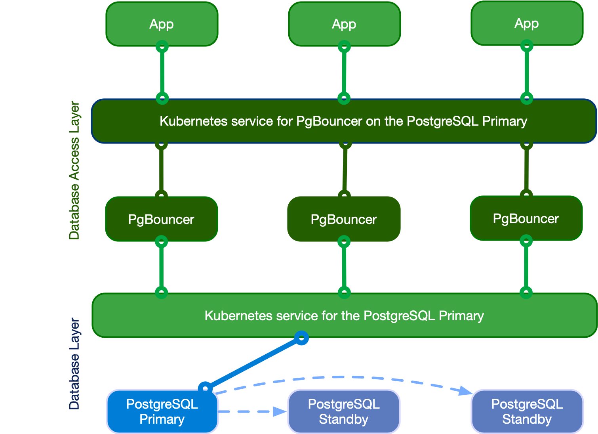
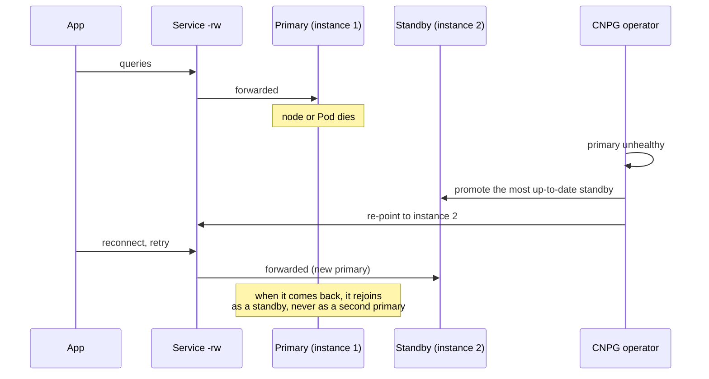

# Running PostgreSQL on Kubernetes

!!! abstract "Where it's used in this project"
    Every customer database is a CloudNativePG `Cluster` built by the operator in [`cnpg.go`](https://github.com/foyez/dbaas-platform/blob/main/operator/internal/controller/cnpg.go); the API and the external port both reach it through the `-rw` Service. This page tells the story of *why* the stack looks like that, and how it scales. Overview: [Kubernetes concepts and architecture](kubernetes-concepts.md).

## Key ideas

### The chain of decisions

Each step solves the previous step's gap. This is also the order to explain it in an interview: not "we use CNPG", but why each layer is there.



| Layer | Solves | Doesn't solve |
|---|---|---|
| StatefulSet | Workload identity and per-Pod storage | Anything PostgreSQL-specific |
| PostgreSQL operator (CNPG) | Database lifecycle: replication, failover, backups, upgrades | Too many client connections, write capacity |
| PgBouncer + read replicas | Connection count and read throughput | Write throughput |
| Sharding | Writes and data size beyond one primary | Simplicity: cross-shard queries and transactions |

### Step 1: StatefulSet, not Deployment

A Deployment treats Pods as interchangeable: random names, shared or no storage, replaced in any order. A database instance isn't interchangeable. It owns its data directory and other instances need to find it by name. The full comparison is in [Workload controllers](kubernetes-workloads.md#workload-controllers); the storage side in [StatefulSets and volumes](kubernetes-storage.md#statefulsets-and-volumes).

A plain StatefulSet for PostgreSQL:

```yaml
apiVersion: apps/v1
kind: StatefulSet
metadata:
  name: postgres
spec:
  serviceName: postgres          # headless Service: postgres-0.postgres, postgres-1.postgres, ...
  replicas: 3
  selector:
    matchLabels: {app: postgres}
  template:
    metadata:
      labels: {app: postgres}
    spec:
      containers:
        - name: postgres
          image: postgres:17
          ports: [{containerPort: 5432}]
          env:
            - name: POSTGRES_PASSWORD
              valueFrom: {secretKeyRef: {name: postgres-secret, key: password}}
          volumeMounts:
            - {name: data, mountPath: /var/lib/postgresql/data}
  volumeClaimTemplates:          # one PVC per Pod: data-postgres-0, data-postgres-1, ...
    - metadata: {name: data}
      spec:
        accessModes: [ReadWriteOnce]
        resources: {requests: {storage: 20Gi}}
```

### Step 2: why a StatefulSet isn't enough

The manifest above gives three Pods with three disks, and **three unrelated databases**. Each one runs `initdb` on its own empty volume. Nothing makes `postgres-1` a replica of `postgres-0`.

Kubernetes knows Pods, Services and volumes. It doesn't know:

- which instance is the **primary** (takes writes) and which are **standbys**
- how to set up **streaming replication** and clone a new replica from the primary
- when to **promote** a standby, and how to stop the old primary from taking writes again (**split-brain**)
- how to archive **WAL** and restore to a point in time
- how to upgrade PostgreSQL without losing the primary mid-rollout

You can script all of this with init containers and sidecars, but then you are writing an operator badly.

### Step 3: an operator

An operator adds a CRD ("a PostgreSQL cluster") and a controller that reconciles it with database knowledge built in. You declare "three instances, 100Gi each" and the controller does the PostgreSQL-specific work. How CRDs, CRs and reconcile loops work is in [Custom resources and operators](operators.md).

### Step 4: use a mature one, don't build it

Writing a PostgreSQL operator with Kubebuilder is possible. Writing one that is safe under failure isn't a side project:

| Responsibility | Difficulty |
|---|---|
| Bootstrap, users, databases | Medium |
| Primary/standby setup, streaming replication | High |
| Automatic failover | Very high |
| Split-brain prevention (fencing the old primary) | Very high |
| Backups, WAL archiving, point-in-time recovery | High |
| Minor and major version upgrades | High |
| Volume resize, metrics, TLS, rotation of credentials | Medium |

The hard parts are exactly the ones that only show up during an outage, so they need continuous failure testing. Established operators (CloudNativePG, Crunchy PGO, Zalando's postgres-operator) already have that. This project picked **CloudNativePG (CNPG)** and wraps it in its own small operator for product logic.

### CloudNativePG

A CNPG `Cluster` replaces the whole StatefulSet above:

```yaml
apiVersion: postgresql.cnpg.io/v1
kind: Cluster
metadata:
  name: customer-db
spec:
  instances: 3
  storage:
    size: 100Gi
  resources:
    requests: {cpu: "2", memory: 4Gi}
    limits:   {memory: 4Gi}
```

The CNPG controller then:

1. creates the first instance, runs `initdb`, and makes it primary
2. clones the others from it with `pg_basebackup` and starts them as streaming standbys
3. creates the Services (below) and the app user's Secret
4. watches health through an instance manager that runs inside every Pod, and fails over when the primary is lost

CNPG **doesn't create a StatefulSet**. It manages Pods and PVCs directly, which gives the same guarantees (stable names like `customer-db-1`, one PVC per instance) plus control a StatefulSet can't offer, such as choosing which instance to restart or promote.



<small>Image: [CloudNativePG documentation](https://cloudnative-pg.io/docs/current/architecture), Apache 2.0</small>

**The Services** are how clients pick a role:

| Service | Points at | Use for |
|---|---|---|
| `<name>-rw` | The current primary only | All writes, and reads that must see the latest write |
| `<name>-ro` | Standbys only | Read-only traffic that tolerates lag |
| `<name>-r` | Any instance | Read-only traffic where any instance will do |

After a failover CNPG moves `-rw` to the new primary, so clients that use the Service name (never a Pod IP) only need to reconnect.

### Scaling

Go down the list in order. Each step costs more complexity than the one before.

**A. Vertical: bigger instances.** Raise CPU and memory in `spec.resources`, or the volume size in `spec.storage` (needs a StorageClass with `allowVolumeExpansion`). CNPG applies resource changes as a rolling update: standbys first, then a switchover so the primary restarts last. Simple, and enough for most databases, but there is a ceiling and each change restarts every instance.

**B. Horizontal: read replicas.** Raise `instances`; CNPG clones and attaches the new standbys. That adds **read** capacity only, since every write still goes to the one primary. Two things are easy to miss:

- **More replicas don't move any traffic by themselves.** The application has to send reads to `-ro` and writes to `-rw` (two connection strings), or a proxy has to split them.
- **Replicas lag.** Replication is asynchronous by default, so a read from `-ro` right after a write to `-rw` may not see it. Read-your-own-writes paths stay on `-rw`.



<small>Image: [CloudNativePG documentation](https://cloudnative-pg.io/docs/current/architecture), Apache 2.0</small>

**C. Connection pooling.** Each PostgreSQL connection is a backend process. 50 app Pods with a pool of 50 each is 2,500 connections, which exhausts `max_connections` and memory long before CPU runs out. PgBouncer sits in front and multiplexes many client connections onto a few real ones ([Connection pooling](connection-pooling.md)). CNPG runs it for you through a `Pooler` resource:

```yaml
apiVersion: postgresql.cnpg.io/v1
kind: Pooler
metadata:
  name: customer-db-pooler-rw
spec:
  cluster: {name: customer-db}
  instances: 3
  type: rw                        # pool in front of the -rw Service
  pgbouncer:
    poolMode: transaction
    parameters: {max_client_conn: "1000", default_pool_size: "10"}
```



<small>Image: [CloudNativePG documentation](https://cloudnative-pg.io/docs/current/connection_pooling), Apache 2.0</small>

**D. Sharding.** When one primary can't take the write load even after tuning, bigger hardware and pooling, split the data across several independent clusters by a key (customer ID ranges, tenants, a hash). Options are application-level routing or an extension like Citus. It is the last resort: cross-shard joins and transactions get hard, rebalancing is a project, and CNPG manages each shard cluster separately rather than sharding for you.

| Bottleneck | Fix |
|---|---|
| CPU or memory on every instance | Vertical scaling |
| Read queries | Read replicas + route reads to `-ro` |
| Too many connections | PgBouncer (`Pooler`) |
| Write throughput or data size of one primary | Sharding |

### High availability: what a failover looks like



Things that decide how well this works:

- **Spread instances across nodes and zones.** Three instances on one node are one failure. CNPG adds pod anti-affinity by default, and its `affinity` settings control the topology key. See [Scheduling](kubernetes-workloads.md#scheduling).
- **Clients must reconnect.** Open connections to the old primary break. Pools and drivers need retry with backoff.
- **Async replication can lose the last writes.** A standby may be slightly behind when promoted. Synchronous replication removes that window at the cost of write latency, and of writes stalling if no synchronous standby is available.
- **One instance means no failover.** A single-instance cluster comes back only when its Pod restarts on its volume.

### Backups and monitoring

Replicas protect against a dead node, not against `DROP TABLE` or a lost cluster. Those need backups **outside** the Kubernetes cluster:

- **Base backups** (full copies) on a schedule, with a `ScheduledBackup` resource, to object storage (Barman Cloud) or as volume snapshots.
- **Continuous WAL archiving**: every change log segment shipped to object storage.
- **Point-in-time recovery (PITR)**: a new cluster bootstrapped from a base backup plus WAL replayed up to a timestamp, such as one minute before the bad migration.

A backup you haven't restored isn't a backup. Restore drills are part of the setup.

For monitoring, CNPG exposes a Prometheus metrics endpoint on every instance. The signals that matter most:

| Signal | Why |
|---|---|
| Instance up, primary present | The cluster is serving at all |
| Replication lag | Stale reads, and data at risk on failover |
| Connections vs `max_connections` | Whether pooling is needed |
| Disk usage and growth | A full volume stops the database |
| Slow queries, transactions | Where vertical scaling or indexes help |
| Last successful backup / WAL archive | Whether recovery is possible |

### The full picture

| Layer | Technology | Purpose |
|---|---|---|
| Application | Deployment | Stateless app Pods |
| Connections | PgBouncer (`Pooler`) | Cap and reuse connections |
| Routing | `-rw` / `-ro` Services | Writes to the primary, reads to standbys |
| Orchestration | CloudNativePG | Replication, failover, upgrades, backups |
| Instances | PostgreSQL, one Pod each | Store the data |
| Storage | PVC + CSI, one per instance | Data survives Pod restarts |
| Backup | Base backups + WAL in object storage | Disaster recovery, PITR |
| Monitoring | Prometheus + Grafana | Lag, connections, disk, health |

## How this project uses it

The platform's `PostgreSQL` CR is a small product API over CNPG. The operator copies a handful of fields into a `Cluster` ([`cnpg.go`](https://github.com/foyez/dbaas-platform/blob/main/operator/internal/controller/cnpg.go)):

| `PostgreSQL` spec | CNPG `Cluster` | Notes |
|---|---|---|
| `instances` (default 1) | `spec.instances` | 1 means no standby, so no failover |
| `version` | `spec.imageName` | `ghcr.io/cloudnative-pg/postgresql:<version>` |
| `storage` | `spec.storage.size` | |
| `database`, `username` | `spec.bootstrap.initdb` | First database and its owner |
| `app.example.com/user-id` label | `spec.inheritedMetadata.labels` | Reaches the Pods, Services and Secrets CNPG creates, for log scoping |

Everything connects through `-rw`: the API's SQL console builds `<name>-rw.<namespace>.svc.cluster.local` ([`client.go`](https://github.com/foyez/dbaas-platform/blob/main/platform/internal/infra/cnpg/client.go)), and the external port is proxied by ingress-nginx to `<namespace>/<name>-rw:5432` ([`tcpexpose.go`](https://github.com/foyez/dbaas-platform/blob/main/operator/internal/controller/tcpexpose.go)). Metrics are scraped with a `PodMonitor` on every instance ([Observability](../components/observability.md)).

Not used yet, in the order I'd add them: resource requests and limits, scheduled backups with WAL archiving, a CNPG `Pooler` (the hand-written PgBouncer StatefulSet in `pgbouncer.go` is disabled), and a `-ro` endpoint for read traffic.

## What I learned building it

- **A StatefulSet gives identity, not a database cluster.** Three replicas of the plain manifest are three separate databases. Replication and roles have to come from something that understands PostgreSQL.
- **Wrap the operator, don't replace it.** My operator only maps a product-level CR onto a CNPG `Cluster` and handles what CNPG doesn't (external ports, labels). Failover and replication stay CNPG's problem.
- **Always connect through the role Service.** Using `-rw` everywhere is what makes failover invisible apart from a reconnect.
- **Replicas aren't backups.** They copy a mistake to every instance within milliseconds. Only backups outside the cluster bring data back.

## Review questions

??? question "Why run PostgreSQL as a StatefulSet (or with an operator) instead of a Deployment?"
    Each instance needs a stable name and its own persistent disk that follows it across restarts. A Deployment gives interchangeable Pods with random names and no per-Pod volume.

??? question "You apply a StatefulSet with `replicas: 3` and the `postgres` image. What do you get?"
    Three independent databases, each initialised on its own empty volume. Nothing configures primary/standby roles or replication, and nothing handles failover.

??? question "What does a PostgreSQL operator add on top of what a StatefulSet does?"
    Database knowledge in a controller: bootstrapping, cloning standbys, streaming replication, promoting a standby on failure, fencing the old primary, backups and PITR, rolling upgrades.

??? question "Why use CloudNativePG instead of writing your own operator?"
    The difficult parts (failover, split-brain prevention, recovery) are rare, dangerous and need continuous failure testing. A mature operator already has that; your own would only be tested properly in your first outage.

??? question "What are the `-rw`, `-ro` and `-r` Services?"
    `-rw` always points at the current primary, `-ro` at standbys only, `-r` at any instance. Apps send writes to `-rw` and lag-tolerant reads to `-ro`.

??? question "You raised `instances` from 3 to 5 but the primary is still overloaded. Why?"
    New replicas only help if read traffic is actually sent to them through `-ro` or a proxy. And they never help with writes, which all go to the primary.

??? question "When is PgBouncer the right fix, and when is sharding?"
    PgBouncer when the problem is the number of connections (many app Pods, each with a pool). Sharding when a single primary can't keep up with write volume or data size after vertical scaling and tuning.

??? question "Walk through what happens when the primary's node dies."
    CNPG sees the primary is gone, promotes the most up-to-date standby, and re-points `-rw` to it. Clients reconnect through the same Service name. When the old instance returns it rejoins as a standby. With async replication, writes the standby hadn't received yet can be lost.

??? question "Why do you still need backups when you have three replicas?"
    Replicas protect against losing an instance. A bad `DELETE`, a broken migration or losing the whole cluster is replicated or shared by every instance. Base backups plus WAL in external object storage allow restoring to a point before the mistake.
