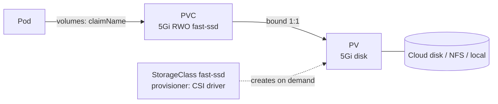
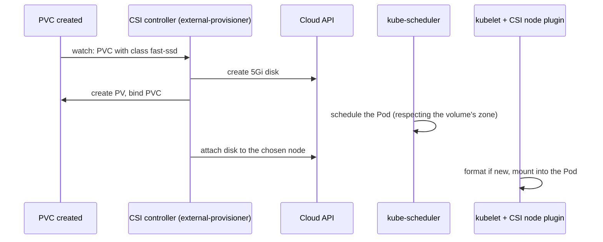

# Storage: volumes, PVs and PVCs

!!! abstract "Where it's used in this project"
    Every database instance's data lives on PersistentVolumeClaims that CloudNativePG creates from the `PostgreSQL` resource's `storage` size, dynamically provisioned by the cluster's default StorageClass on SKE. See [Operator](../components/operator.md). Overview: [Kubernetes concepts and architecture](kubernetes-concepts.md).

## Key ideas

### The problem

A container's filesystem lives and dies with the container. Restart a database container without a volume and every row is gone. Kubernetes solves this by attaching storage whose lifetime is **independent of the Pod**.

| | Ephemeral | Persistent |
|---|---|---|
| Survives container restart | Only in a volume | Yes |
| Survives Pod deletion | No | Yes |
| Example | Cache, scratch files, log buffer | Database files, uploads |
| Mechanism | Container filesystem, `emptyDir` | PersistentVolume via a PVC |

### Volumes

A **volume** is a directory mounted into a Pod's containers, declared in `spec.volumes` and mounted with `volumeMounts`.

| Type | Lives as long as | Use |
|---|---|---|
| `emptyDir` | The Pod | Scratch space; sharing files between containers (sidecar log pattern) |
| `hostPath` | The node | Node agents reading `/proc`, `/var/log`. Ties data to one node, so not for app data. |
| `configMap`, `secret`, `projected` | The source object | Config files, certificates, ServiceAccount tokens |
| `persistentVolumeClaim` | The claim | Real persistent data |

### PV, PVC and StorageClass

Kubernetes separates *having* storage from *asking* for it:

| Object | Who creates it | What it is | Analogy |
|---|---|---|---|
| **PersistentVolume (PV)** | Admin, or a provisioner | A real piece of storage (cloud disk, NFS export, local disk); cluster-scoped | The office space |
| **PersistentVolumeClaim (PVC)** | The app's manifest | A request: "5Gi, ReadWriteOnce, class `fast-ssd`"; namespaced | The rental agreement |
| **StorageClass** | Admin | How to create PVs on demand: provisioner, parameters, reclaim policy | The rental agency |

The Pod only mentions the PVC by name and doesn't know whether it's backed by Cinder, EBS or NFS.



**Static provisioning:** an admin creates PVs ahead of time; a PVC binds to one that fits (size, access mode, class).

**Dynamic provisioning** (the normal case): the PVC names a StorageClass, the class's provisioner creates a disk and a PV for it, and the two are bound. A cluster usually marks one class as **default** (annotation `storageclass.kubernetes.io/is-default-class: "true"`), used when the PVC names none.

```yaml
apiVersion: storage.k8s.io/v1
kind: StorageClass
metadata:
  name: fast-ssd
provisioner: ebs.csi.aws.com          # a CSI driver
parameters: {type: gp3, encrypted: "true"}
reclaimPolicy: Delete
allowVolumeExpansion: true
volumeBindingMode: WaitForFirstConsumer
---
apiVersion: v1
kind: PersistentVolumeClaim
metadata:
  name: data
spec:
  accessModes: [ReadWriteOnce]
  storageClassName: fast-ssd
  resources:
    requests: {storage: 5Gi}
```

**Access modes:**

| Mode | Meaning | Typical backing |
|---|---|---|
| `ReadWriteOnce` (RWO) | Mounted read-write by **one node** | Block disks (EBS, Cinder); databases |
| `ReadOnlyMany` (ROX) | Read-only by many nodes | Shared static content |
| `ReadWriteMany` (RWX) | Read-write by many nodes | NFS, CephFS, cloud file shares |
| `ReadWriteOncePod` | Read-write by **one Pod** | Strict single-writer |

**Reclaim policy** decides what happens to the PV when its PVC is deleted: `Delete` removes the PV and the underlying disk (the default for dynamic provisioning); `Retain` keeps them for manual recovery.

**`volumeBindingMode: WaitForFirstConsumer`** delays creating the disk until a Pod using the PVC is scheduled, so the disk is created in the same zone as the node. With `Immediate`, a disk can end up in a zone where the Pod can't run.

### CSI: who actually creates the disk

Storage drivers used to be compiled into Kubernetes. Now they're **CSI** (Container Storage Interface) drivers, the storage counterpart of CRI and CNI:

- a **controller** part (a Deployment) that creates, deletes, attaches and snapshots volumes through the cloud API
- a **node** part (a DaemonSet) that the kubelet calls to mount the volume into the Pod



### StatefulSets and volumes

A StatefulSet's `volumeClaimTemplates` create one PVC per Pod, named `<template>-<statefulset>-<ordinal>` (`data-postgres-0`). When `postgres-0` is rescheduled it reattaches to `data-postgres-0`. Scaling down or deleting the StatefulSet **doesn't delete those PVCs** by default, which protects data but means cleaning up by hand. CloudNativePG follows the same model with PVCs named after each instance.

| Scenario | Use |
|---|---|
| Share temporary files between containers in a Pod | `emptyDir` |
| Node agent reading host files | `hostPath` (read-only) |
| Config or certificates | `configMap` / `secret` volume |
| A database | PVC, RWO, one per instance (StatefulSet or operator) |
| Files shared by many Pods | PVC with RWX (NFS or a file-share CSI driver) |

### Troubleshooting

| Symptom | Likely cause | Check |
|---|---|---|
| PVC `Pending`, "no persistent volumes available" | No default StorageClass, or no static PV that fits | `kubectl get storageclass`; `kubectl describe pvc` |
| PVC `Pending`, "waiting for first consumer" | Normal with `WaitForFirstConsumer` | Create the Pod that uses it |
| Pod `Pending`, "unbound immediate PersistentVolumeClaims" | PVC isn't bound | `kubectl describe pvc` |
| Pod stuck `ContainerCreating`, `Multi-Attach error` | RWO disk still attached to the old node | Wait for detach, or check the old node |
| Pod `Pending`, "volume node affinity conflict" | Disk is in another zone | `WaitForFirstConsumer`; topology-aware scheduling |
| Disk full | PVC too small | Expand the PVC if `allowVolumeExpansion: true` |

## What I learned building it

- **The PVC is the API; the PV is an implementation detail.** Apps and operators only ever create PVCs. Only an admin doing static provisioning touches PVs.
- **Deleting a Pod never deletes its disk; deleting the owner chain can.** Here the CNPG `Cluster` is owned by the `PostgreSQL` CR, so deleting the CR cascades through the garbage collector to the Pods and PVCs, and the `Delete` reclaim policy then removes the disks (see [operators](operators.md#cleanup-owner-references-and-finalizers)). With a plain StatefulSet, PVCs stay behind unless you delete them.
- **Storage is zonal.** A block disk can only attach to nodes in its zone, which is why `WaitForFirstConsumer` is the right default for multi-zone clusters.
- **`hostPath` is not persistence.** It survives a Pod restart on the same node, but the next scheduling decision can put the Pod somewhere the data isn't.

## Review questions

??? question "PV vs PVC vs StorageClass in one sentence each?"
    A PV is an actual piece of storage in the cluster. A PVC is a namespaced request for storage that gets bound to one PV. A StorageClass tells a provisioner how to create PVs on demand when a PVC asks for that class.

??? question "Why use `ReadWriteOnce` for PostgreSQL and not `ReadWriteMany`?"
    Each instance must be the only writer of its data directory, and block disks (which give the performance a database needs) are attachable to one node at a time. Replication between instances is PostgreSQL's job, not the filesystem's.

??? question "What does `WaitForFirstConsumer` solve?"
    It postpones provisioning until a Pod is scheduled, so the disk is created in that node's zone instead of a random one the Pod can't reach.

??? question "You delete a StatefulSet. What happens to its data?"
    The Pods are deleted but their PVCs, and so the PVs and disks, stay by default. Recreating the StatefulSet reattaches them.

??? question "Where is CSI in the Kubernetes architecture?"
    It's a plug-in interface like CRI and CNI: a controller component talks to the storage backend to create and attach volumes, and a node component is called by the kubelet to mount them into Pods.
