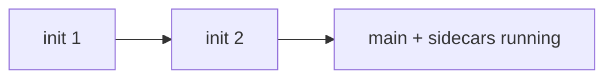
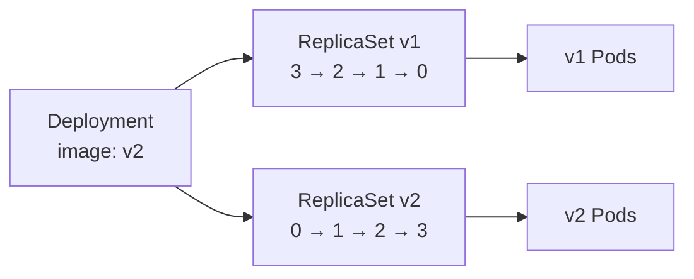
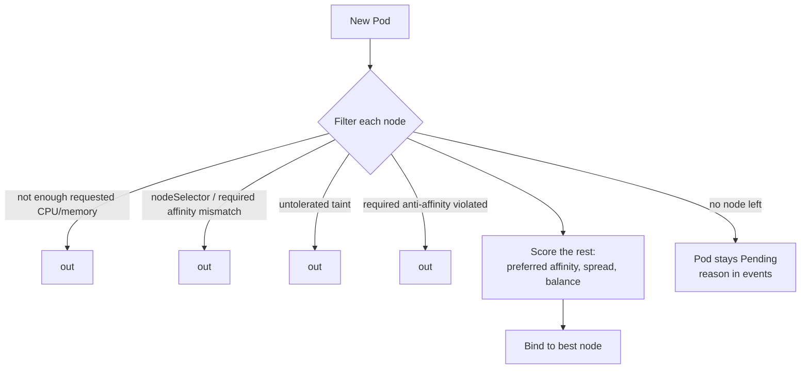

# Workloads and scheduling

!!! abstract "Where it's used in this project"
    The Go API is a Deployment with probes and an HPA, and the UI is a plain Deployment; the operator is a Deployment with leader election; databases are Pods and PVCs managed by CloudNativePG, which handles them the way a StatefulSet would. Code: [`gitops/`](https://github.com/foyez/dbaas-platform/tree/main/gitops), [`operator/`](https://github.com/foyez/dbaas-platform/tree/main/operator). Overview: [Kubernetes concepts and architecture](kubernetes-concepts.md).

## Key ideas

### Pods

A **Pod** is the smallest thing Kubernetes schedules: one or more containers that share a network namespace (one IP, talk over `localhost`), can share volumes, and are scheduled together onto one node. Pods are **ephemeral**: they're replaced, not repaired or moved. A bare Pod that dies stays dead; a controller is what brings a replacement.

```yaml
apiVersion: v1
kind: Pod
metadata:
  name: web
  labels: {app: web}
spec:
  containers:
    - name: web
      image: nginx:1.27.4
      ports: [{containerPort: 80}]
```

**Multi-container patterns.** Most Pods run one container. Extra containers are for helpers that must share the main container's network or files:

| Pattern | What | Example |
|---|---|---|
| **Sidecar** | Runs alongside the app for its whole life | Log shipper reading a shared `emptyDir`; Envoy proxy doing mTLS |
| **Init container** | Runs to completion *before* the app starts, one at a time, in order | Wait for a database; fix volume permissions; fetch config |



If an init container fails, the kubelet retries it and the Pod shows `Init:CrashLoopBackOff`; `kubectl logs <pod> -c <init-name>` shows why.

**Lifecycle.** `Pending` (not scheduled yet, or pulling images) → `Running` → `Succeeded` / `Failed`. Container-level states like `CrashLoopBackOff` and `ImagePullBackOff` show up in the `STATUS` column too. `restartPolicy` (`Always`, `OnFailure`, `Never`) decides whether the kubelet restarts a container that exits.

### Labels, selectors and annotations

**Labels** are short key-value pairs used to **select** objects. They're the glue of Kubernetes: Services find Pods by label, ReplicaSets count Pods by label, the scheduler matches nodes by label. **Annotations** are non-identifying metadata for tools and people (`git.commit`, ingress-nginx settings); nothing selects on them.

```yaml
metadata:
  labels:
    app.kubernetes.io/name: order-service
    app.kubernetes.io/part-of: shop
    env: production
  annotations:
    git.commit: "a3f9b12"
```

A typo silently breaks things: `env: prod` in a Service selector and `env: production` on the Pods means a Service with no endpoints. Pick a standard (the `app.kubernetes.io/*` recommended labels are a good one) and stick to it.

### Workload controllers

You rarely create Pods directly. A workload resource holds a **Pod template** and a controller in [kube-controller-manager](kubernetes-control-plane.md#kube-controller-manager-making-it-true) stamps out Pods from it.

| Resource | Use for | Key behaviour |
|---|---|---|
| **ReplicaSet** | Keeping N identical Pods | Counts Pods matching its selector, creates or deletes to match. Almost never created by hand. |
| **Deployment** | Stateless apps | Manages ReplicaSets: rolling updates, rollback, scaling |
| **StatefulSet** | Databases, queues | Stable names (`pg-0`, `pg-1`), one PVC per Pod, ordered start (0→1→2) and stop (2→1→0) |
| **DaemonSet** | One Pod per node | Log collectors, node exporters, CNI agents, kube-proxy |
| **Job** | Run to completion | Retries failed Pods, `completions`, `parallelism`, `backoffLimit` |
| **CronJob** | Jobs on a schedule | Cron syntax (`"0 2 * * *"` = daily at 02:00) creates a Job each time |

**Deployments and rolling updates.** Changing the Pod template (say, the image tag) makes the Deployment controller create a *new* ReplicaSet and shift Pods across, bounded by `maxSurge` and `maxUnavailable`. The old ReplicaSet is kept at 0 replicas, which is what makes rollback instant.



```bash
kubectl rollout status deployment/api
kubectl rollout history deployment/api
kubectl rollout undo deployment/api
kubectl scale deployment/api --replicas=5
```

New Pods only count as available once their **readiness probe** passes, so a broken version stalls the rollout instead of replacing every healthy Pod. See [health checks](health-and-scaling.md).

**StatefulSet vs Deployment:**

| | Deployment | StatefulSet |
|---|---|---|
| Pod names | Random (`api-7f4bc-xk2p`) | Ordinal (`postgres-0`) |
| Storage | Shared or none | `volumeClaimTemplates`: each Pod gets its own PVC, kept across restarts |
| Network identity | Through a normal Service | Plus a headless Service: `postgres-0.postgres.<ns>.svc` |
| Ordering | Parallel | Sequential start, reverse-order shutdown |

**Ownership and garbage collection.** Each created object carries an `ownerReference` to its creator (Pod → ReplicaSet → Deployment). Deleting the owner lets the garbage collector delete the dependents. The operator sets owner references on what it creates for the same reason.

### Configuration: ConfigMaps and Secrets

Both keep configuration out of the image. **ConfigMaps** hold non-sensitive settings; **Secrets** hold credentials. Either can be injected as environment variables (`valueFrom`, `envFrom`) or mounted as files. Mounted files update when the object changes; environment variables don't until the Pod restarts.

Secrets are only **base64-encoded**, not encrypted. Protection comes from RBAC, encryption at rest in etcd, and not logging them. See [Kubernetes security](kubernetes-security.md#secrets).

### Scheduling

The [scheduler](kubernetes-control-plane.md#kube-scheduler-where-should-this-pod-run) **filters** out nodes that can't take the Pod, then **scores** the rest. Most Pods need no hints. These are the knobs when they do:



**Requests and limits** are the most important hint:

```yaml
resources:
  requests: {cpu: 500m, memory: 256Mi}   # what the scheduler reserves on a node
  limits:   {cpu: "1",  memory: 512Mi}   # enforced by cgroups at runtime
```

- The scheduler only looks at **requests**, never at actual usage. No requests means the scheduler thinks the Pod is free.
- Exceeding the **CPU limit** throttles the container; exceeding the **memory limit** gets it **OOMKilled**.
- Requests and limits set the **QoS class**: `Guaranteed` (requests = limits for everything), `Burstable` (some requests), `BestEffort` (none). Under node memory pressure, `BestEffort` Pods are evicted first.

**Choosing nodes:**

| Mechanism | Says | Strength |
|---|---|---|
| `nodeSelector` | "Only nodes with these labels" | Hard, exact match |
| `nodeAffinity` required | Same, with operators (`In`, `NotIn`, `Exists`, `Gt`, ...) | Hard |
| `nodeAffinity` preferred | "Prefer these nodes", weighted 1–100 | Soft |
| **Taints** on a node + **tolerations** on a Pod | "Keep off this node unless you tolerate it" | Hard (`NoSchedule`, `NoExecute`) or soft (`PreferNoSchedule`) |

Affinity *attracts* Pods to nodes; taints *repel* them. Control-plane nodes carry `node-role.kubernetes.io/control-plane:NoSchedule`, which is why ordinary Pods don't land there (and why a single-node lab cluster needs it removed). Not-ready and unreachable nodes get `NoExecute` taints, which is how Pods get evicted from a dead node.

`IgnoredDuringExecution` in the long affinity field names means the rule is checked at scheduling time only; changing a node's labels later doesn't evict running Pods.

**Placing Pods relative to each other:**

| Mechanism | Says | Typical use |
|---|---|---|
| `podAffinity` | "Run near Pods with these labels" | A chatty web tier next to its cache |
| `podAntiAffinity` | "Don't run near Pods with these labels" | Database or cache replicas on different nodes |
| `topologySpreadConstraints` | "Keep the count per zone/node within `maxSkew`" | Even spread across zones |

`topologyKey` defines what "near" means: `kubernetes.io/hostname` (same node), `topology.kubernetes.io/zone` (same zone), `topology.kubernetes.io/region`.

```yaml
affinity:
  podAntiAffinity:
    preferredDuringSchedulingIgnoredDuringExecution:
      - weight: 100
        podAffinityTerm:
          labelSelector:
            matchLabels: {app: redis}
          topologyKey: kubernetes.io/hostname
```

**Guidelines:**

- Always set requests on real workloads.
- Prefer `preferred` rules over `required`. Hard rules leave Pods `Pending` when a node fails or the cluster is small.
- Spread replicas of anything stateful across nodes (and zones): one node failure must not take out every replica.
- Don't over-constrain. Every hard rule shrinks the set of eligible nodes, and combinations can leave none.

### Why is my Pod `Pending`?

The scheduler writes its reason into the Pod's events:

```bash
kubectl describe pod <name>        # read Events at the bottom
kubectl get nodes --show-labels
kubectl describe nodes | grep -A 5 "Allocated resources"
```

| Event message | Cause | Fix |
|---|---|---|
| `Insufficient cpu` / `Insufficient memory` | No node has enough unrequested capacity | Lower requests, add nodes, or let the cluster autoscaler add them |
| `didn't match Pod's node affinity/selector` | Label missing or misspelled | Label the node or fix the selector |
| `had untolerated taint` | Node is tainted (control plane, not-ready, dedicated) | Add a toleration, or schedule elsewhere |
| `didn't match pod anti-affinity rules` | More replicas than eligible nodes | Add nodes or use `preferred` |
| `pod has unbound immediate PersistentVolumeClaims` | PVC can't be bound | See [storage](kubernetes-storage.md#troubleshooting) |
| No events at all | No scheduler running, or wrong `schedulerName` | Check kube-scheduler |

## What I learned building it

- **Labels are load-bearing.** A Deployment's `selector` must match its template labels, and a Service's selector must match those same labels. Most "it deployed but nothing reaches it" bugs were label mismatches.
- **Requests are a scheduling contract, not a measurement.** A Pod using 2 CPUs with a 100m request still counts as 100m; that's how nodes get overcommitted.
- **Single-node clusters need the control-plane taint removed**, or nothing but system Pods will schedule.
- **Rollouts are only as safe as the readiness probe.** Without one, a Deployment considers a crashing-on-first-request Pod available and keeps going.
- **Databases need identity and their own disk.** That's what StatefulSets give; CloudNativePG gives the same guarantees by managing Pods and PVCs itself, plus failover a StatefulSet doesn't know how to do. The full reasoning is in [Running PostgreSQL on Kubernetes](kubernetes-postgres.md).

## Review questions

??? question "Why don't you create Pods directly in production?"
    A bare Pod isn't replaced when it dies or its node fails. A controller (Deployment, StatefulSet, Job) recreates it from its template.

??? question "How does a Deployment roll back so quickly?"
    It keeps the old ReplicaSet at 0 replicas. Rolling back scales that ReplicaSet up again and the new one down; no re-creation of the template needed.

??? question "Deployment or StatefulSet for PostgreSQL, and why?"
    StatefulSet-like behaviour: each instance needs a stable identity and its own persistent volume, and order matters. In this project CloudNativePG manages the database Pods and their PVCs directly instead of using a StatefulSet, but for the same reasons.

??? question "What's the difference between an init container and a sidecar?"
    Init containers run one after another to completion before the app starts. Sidecars run alongside the app for its whole life.

??? question "A Pod uses far more CPU than it requested. What happens, and what if it exceeds its memory limit?"
    The scheduler doesn't care, it only counted the request. CPU above the limit is throttled. Memory above the limit gets the container OOMKilled and restarted.

??? question "Node affinity vs taints and tolerations?"
    Affinity is set on the Pod and attracts it to nodes with certain labels. Taints are set on the node and repel all Pods except those that tolerate them. To dedicate nodes to a workload you usually need both.

??? question "A Pod is stuck in `Pending`. Where do you look?"
    `kubectl describe pod` events. Usually not enough requested CPU or memory on any node, a PVC that can't be bound, or a node selector, affinity or taint that doesn't match.

??? question "How do you keep three replicas of a cache from landing on one node?"
    Pod anti-affinity on the app's label with `topologyKey: kubernetes.io/hostname` (preferred if there may be fewer than three nodes), or a topology spread constraint.
