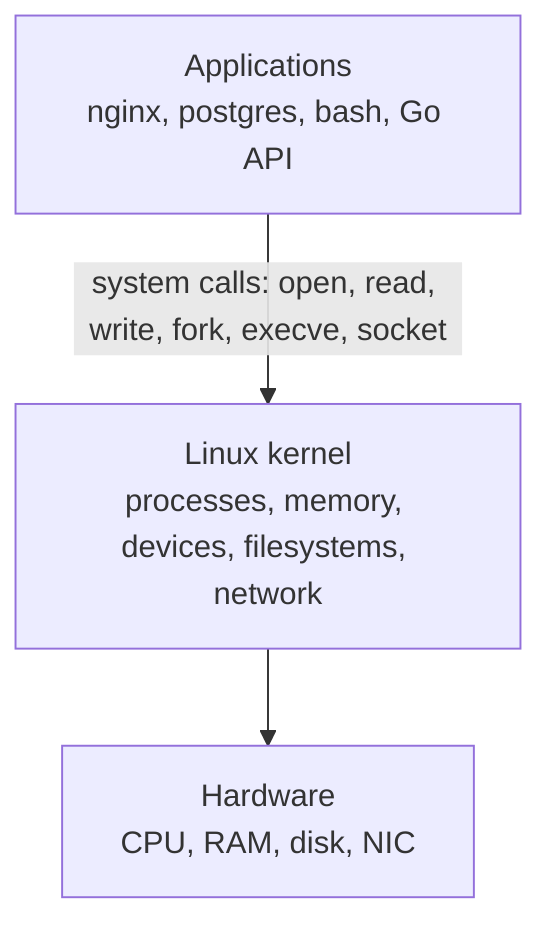
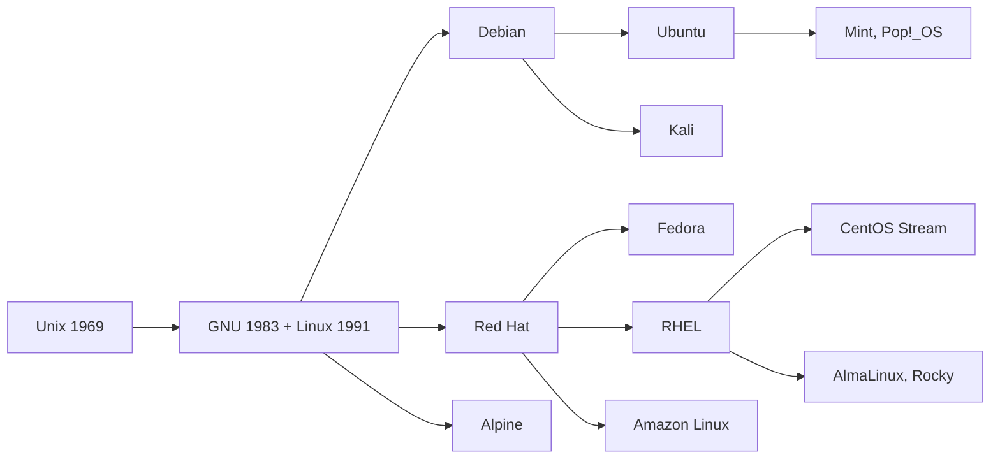

# Linux fundamentals: kernel, distributions and the shell

!!! abstract "Where it's used in this project"
    Every layer runs on Linux: the DevStack host, the Ubuntu VMs that Terraform creates on OpenStack and Ansible configures over SSH ([Kubernetes on VMs](kubernetes-on-vms.md)), the SKE nodes, and every container image. The Linux notes are [fundamentals](linux-fundamentals.md) (this page), [users and permissions](linux-users-permissions.md), [processes and services](linux-processes-services.md), [networking and security](linux-networking-security.md), and [logs and troubleshooting](linux-logs-troubleshooting.md).

## Key ideas

### Kernel, system calls and userland

An **operating system** sits between hardware and applications and shares the CPU, memory, disks and network between programs. **Linux** is strictly the **kernel**: the first program loaded at boot, running until shutdown.

| Kernel job | Example |
|---|---|
| Process management | Which process gets the CPU next |
| Memory management | Giving RAM to processes, swap, killing processes when memory runs out (the OOM killer) |
| Device drivers | Disks, NICs, USB |
| Filesystems | ext4, xfs, overlayfs |
| Networking | TCP/IP stack, routing, netfilter (firewall) |
| System calls | The API programs use to ask for all of the above |



Programs never touch hardware directly; they make system calls (`strace -f <cmd>` shows them). The kernel alone isn't usable: you can't log in to a bare kernel. The tools on top (shell, `ls`, `cp`, compilers) mostly came from the **GNU** project, started by Richard Stallman in 1983, which had everything but a kernel. Linus Torvalds released the kernel in 1991 as "just a hobby", under the GPL from 1992. Together they're GNU/Linux, usually just called Linux.

The kernel is GPL-licensed (**copyleft**: if you distribute modified versions you must publish the changes), which is why it can be audited, patched by anyone, and customised by everyone from Android to cloud providers.

**Why it matters for containers:** a container is just a group of Linux processes isolated with kernel features (namespaces, cgroups). **Containers share the host's kernel**; the image only brings the userland. An Alpine image on an Ubuntu node is Alpine's tools and libraries on Ubuntu's kernel. See [worker nodes](kubernetes-nodes.md) and [processes](linux-processes-services.md#containers-are-just-processes).

### Distributions

A **distribution** is the kernel plus everything that makes a usable system:

| Part | Purpose | Examples |
|---|---|---|
| Kernel | Hardware and resources | Linux 6.x |
| Init system | Boots the system, runs services | systemd (PID 1) |
| Shell | Command interpreter | bash, zsh, sh |
| Core utilities | Basic commands | GNU coreutils, or BusyBox on Alpine |
| C library | What programs link against | glibc, or musl on Alpine |
| Package manager | Install and update software | apt, dnf, apk |



| Distribution | Packages | Best for | Support |
|---|---|---|---|
| **Ubuntu LTS** | `apt` | Cloud VMs, servers; the default image almost everywhere | 5 years per LTS (22.04, 24.04) |
| **Debian** | `apt` | Very stable servers; base of many official Docker images | ~3 years + LTS |
| **AlmaLinux / Rocky** | `dnf` | RHEL-compatible enterprise software | 10 years |
| **Alpine** | `apk` | Container images: ~5 MB, musl + BusyBox, no systemd | ~2 years |
| **Fedora** | `dnf` | Developer workstations, newest packages | ~13 months |

Every distro trades off **stability vs newest packages**, **minimal vs full-featured**, and **community vs enterprise support**. A simple rule: containers get Alpine or distroless, servers get Ubuntu LTS unless something needs RHEL compatibility. Never run a non-LTS Ubuntu on a server; it's supported for 9 months.

**Images:** a small base image means faster pulls and fewer packages to patch. Alpine's musl libc occasionally behaves differently from glibc (DNS resolution, some prebuilt binaries). This project's API image goes further: a static Go binary on **distroless**, with no shell or package manager at all ([Kubernetes security](kubernetes-security.md)).

### Linux in the cloud

| Concept | Meaning |
|---|---|
| Image | OS snapshot a VM boots from (`ubuntu-24.04`) |
| Flavor / instance type | CPU and RAM size |
| SSH key pair | How you log in. Public key on the VM, private key on your laptop; no passwords. |
| Security group | Cloud-level firewall in front of the VM |
| **cloud-init** | Configures a VM on first boot from "user data": hostname, users, SSH keys, packages, commands |

```yaml
#cloud-config
package_update: true
packages: [nginx, ufw]
users:
  - name: deploy
    groups: sudo
    shell: /bin/bash
    ssh_authorized_keys: [ssh-ed25519 AAAA...]
runcmd:
  - ufw allow OpenSSH
  - ufw --force enable
```

cloud-init does first-boot setup; ongoing configuration is a job for a tool like Ansible, which this project uses for the Kubernetes nodes.

**Local practice VMs:** OrbStack (`orb create ubuntu:24.04 lab`, `orb shell -m lab`) and Multipass (`multipass launch 24.04 --name lab --cloud-init cloud-config.yaml`, which tests cloud-init exactly like a cloud would).

### The shell

The **terminal** is the window; the **shell** is the program in it that reads commands and starts processes. bash is the default on most distros, zsh on macOS, and `sh` (POSIX) is what portable scripts and minimal images have.

```text
ubuntu@dev-vm:~$        user@host:current-dir, $ = normal user, # = root
```

Every command is `command [options] [arguments]`: `ls -la /var/log`. Short options combine (`-la`), long ones don't (`--all`). Help is always nearby: `man ls`, `ls --help`, `type cd` (builtin or program?), `which ls` (where is it?).

**Pipes and redirection** are what make small tools powerful: each program reads stdin and writes stdout (and errors to stderr), so they chain:

```bash
grep "Failed password" /var/log/auth.log | awk '{print $11}' | sort | uniq -c | sort -rn | head
cmd > out.txt          # stdout to a file (overwrite);  >> appends
cmd 2> err.txt         # stderr to a file;  2>&1 merges it into stdout
cmd < in.txt           # file as stdin
```

### The filesystem tree

Linux has **one tree rooted at `/`**. Disks, network shares and virtual filesystems are *mounted* into it instead of getting drive letters.

| Path | Holds |
|---|---|
| `/bin`, `/usr/bin` | Programs (on modern distros `/bin` links to `/usr/bin`) |
| `/sbin`, `/usr/sbin` | System administration programs |
| `/etc` | System-wide configuration (text files) |
| `/home/<user>` | Users' home directories (`~`); root's is `/root` |
| `/var` | Data that changes: `/var/log`, `/var/lib` (databases, containerd, kubelet), caches |
| `/tmp` | Temporary files, often cleared on reboot |
| `/opt` | Add-on software (`/opt/cni/bin` for CNI plugins) |
| `/proc` | Virtual: one directory per process, plus kernel info (`/proc/cpuinfo`, `/proc/meminfo`) |
| `/sys` | Virtual: devices, kernel settings, cgroups (`/sys/fs/cgroup`) |
| `/dev` | Device files (`/dev/sda`, `/dev/null`) |
| `/run` | Runtime state such as PID files and sockets (`/run/containerd/containerd.sock`) |

**Everything is a file.** Devices, kernel settings and process information are read and written as files, so the same tools work everywhere: `cat /proc/1/cmdline`, `echo 1 > /proc/sys/net/ipv4/ip_forward`, `cat /sys/fs/cgroup/memory.max`.

### Everyday commands

```bash
# Where am I, what's here
pwd; ls -la; ls -lh /var/log; cd -; cd ..; cd ~
# Create, copy, move, delete
mkdir -p a/b/c; touch file; cp -r src/ dst/; cp -p f g; mv old new; rm -r dir/
# Read files
cat small.conf; less big.log        # in less: / search, G end, q quit
head -n 20 f; tail -n 50 f; tail -f app.log    # -f follows new lines live
# Find things
find /etc -name '*.conf' -mtime -1  # changed in the last day
grep -rn "listen" /etc/nginx/
```

- `rm -rf` has no undo and no recycle bin. Check the path first, for example by running it with `echo` in front.
- `ls -l` reads as `type+permissions links owner group size date name`: `-rw-r--r-- 1 root root 220 ... .bashrc`. See [users and permissions](linux-users-permissions.md).
- `mv` is both move and rename.

**Editing on a server:** `nano` is modeless (`Ctrl+O` save, `Ctrl+X` exit). `vim` is everywhere: `i` to insert, `Esc` back to normal mode, `:wq` save and quit, `:q!` quit without saving, `/text` search, `dd` delete line, `u` undo.

## What I learned building it

- **Containers made the kernel/userland split concrete.** `uname -r` inside any container prints the *node's* kernel version, whatever the base image.
- **The node prep for Kubernetes is pure Linux.** The Ansible `containerd` role turns off swap, loads the `overlay` and `br_netfilter` kernel modules, and writes sysctls to `/etc/sysctl.d/k8s.conf`: memory, filesystem and networking settings straight from this page's kernel table.
- **Ubuntu LTS is the safe default for VMs.** Every guide and package assumes it, and the OpenStack VMs used it.
- **Small images change debugging.** A distroless container has no shell, so you debug from outside (`kubectl debug`, logs) instead of `exec`-ing in.

## Review questions

??? question "Is Linux an operating system?"
    Strictly, Linux is the kernel. A usable OS is a distribution: the kernel plus an init system, shell, core utilities, C library and package manager.

??? question "An Alpine container runs on an Ubuntu node. Whose kernel does it use?"
    The Ubuntu node's. Containers share the host kernel; the image only provides userland files.

??? question "What is a system call, and why can't programs just talk to hardware?"
    It's the interface for asking the kernel to do privileged work (open a file, create a process, open a socket). The kernel mediates hardware so it can share it safely between processes and enforce permissions.

??? question "Why choose Ubuntu LTS over a regular Ubuntu release for a server?"
    LTS gets five years of security updates; a regular release about nine months, which forces frequent upgrades.

??? question "What's the difference between cloud-init and Ansible?"
    cloud-init runs once on a VM's first boot from user data supplied at creation. Ansible connects over SSH at any time and converges the machine to a desired state, so it handles ongoing configuration.

??? question "Where would you look for a program's configuration, its logs, and its data?"
    `/etc` for configuration, `/var/log` (or the journal) for logs, `/var/lib` for data.

??? question "What does 'everything is a file' let you do?"
    Read and change kernel and process state with ordinary tools: `cat /proc/meminfo`, `cat /sys/fs/cgroup/...`, `echo 1 > /proc/sys/net/ipv4/ip_forward`.
