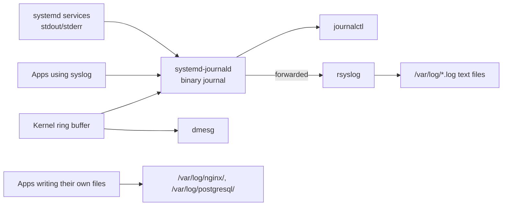
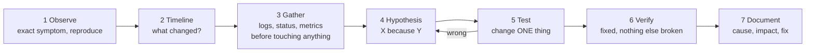

# Linux logs, troubleshooting and backups

!!! abstract "Where it's used in this project"
    Debugging the OpenStack nodes meant `journalctl -u kubelet`, `journalctl -u containerd` and `dmesg`, long before `kubectl` could help ([Kubernetes on VMs](kubernetes-on-vms.md)). In the cluster, container stdout goes to the node's log files and on to Loki ([observability](observability.md)). Overview: [Linux fundamentals](linux-fundamentals.md).

## Key ideas

### Where logs come from

Two logging systems usually run side by side:



| File | Contains | Look here for |
|---|---|---|
| `/var/log/syslog` (Debian) / `/var/log/messages` (RHEL) | General system messages | First stop for unknown problems |
| `/var/log/auth.log` / `/var/log/secure` | SSH logins, sudo, auth failures | Access and security |
| `/var/log/kern.log` | Kernel messages | Hardware, drivers, OOM kills |
| `/var/log/dpkg.log`, `/var/log/apt/history.log` | Package changes | "What changed?" |
| `/var/log/nginx/`, `/var/log/postgresql/` | Application logs | App errors |
| `/var/log/pods/`, `/var/log/containers/` | Container stdout/stderr on a Kubernetes node | What `kubectl logs` reads |

A syslog line is `timestamp host process[pid]: message`:

```text
Mar 28 10:15:32 web-1 sshd[1234]: Failed password for root from 45.33.32.156 port 52914 ssh2
```

**Log rotation** (`logrotate`, configured in `/etc/logrotate.d/`) renames, compresses and deletes old logs on a schedule, so they don't fill the disk. The journal caps itself (`SystemMaxUse=` in `journald.conf`; `journalctl --disk-usage`, `--vacuum-size=500M`). The kubelet rotates container logs (`containerLogMaxSize`).

### journalctl

```bash
journalctl -u kubelet -f                 # follow one service
journalctl -u containerd --since "1 hour ago"
journalctl -u nginx --since "2026-11-17 09:00" --until "09:30"
journalctl -p err -b                     # errors and worse, this boot
journalctl -b -1                         # previous boot: what happened before the crash/reboot?
journalctl -k                            # kernel messages (like dmesg)
journalctl -xeu myapp                    # jump to the end, with explanations: first thing after a failed start
journalctl -u myapp -o json-pretty       # structured fields
```

Priorities, most to least severe: `emerg alert crit err warning notice info debug`.

### Searching text logs

```bash
grep -i "error" /var/log/syslog
grep -C 3 "connection refused" app.log          # 3 lines of context (-A after, -B before)
grep -rn "out of memory" /var/log/
grep -v "GET /health" access.log                # exclude noise
grep -E "error|warn|fail" app.log               # alternatives
tail -f /var/log/syslog | grep -i --line-buffered fail
zgrep "Failed password" /var/log/auth.log.*.gz  # rotated, compressed logs
```

Pipelines turn logs into answers:

```bash
# Top IPs failing SSH logins
grep "Failed password" /var/log/auth.log | awk '{print $(NF-3)}' | sort | uniq -c | sort -rn | head
# Count of each HTTP status in an nginx access log
awk '{print $9}' /var/log/nginx/access.log | sort | uniq -c | sort -rn
# 5xx responses in the last 1000 requests
tail -n 1000 access.log | awk '$9 ~ /^5/' | wc -l
```

`awk '{print $N}'` prints the Nth whitespace-separated field (`$NF` is the last); `sort | uniq -c | sort -rn` is the standard "count and rank".

### Kernel and service diagnostics

```bash
dmesg -T | tail -50                 # recent kernel messages with real timestamps
dmesg -T | grep -iE "oom|killed process"   # OOM killer
dmesg -T | grep -iE "i/o error|nvme|sda"   # disk problems
dmesg -T | grep -i eth0             # link flapping
systemctl --failed                  # every failed unit
systemctl status myapp              # Loaded (enabled?), Active (running/failed), main PID, last log lines
```

`systemctl status` tells you a lot at a glance: `Active: failed (Result: exit-code)` plus the `ExecStart=... status=1/FAILURE` line, and the last log lines underneath. Many daemons can check their own config before you restart: `nginx -t`, `sshd -t`, `visudo -c`, `named-checkconf`, `promtool check config`.

### A troubleshooting method



"What changed?" finds most causes: a deploy, a package upgrade (`/var/log/apt/history.log`), a config edit, a cert expiry, a full disk. Changing one thing at a time is what lets you know which change fixed it.

**Decision trees for the common cases:**

```text
Service not responding
├─ Process running?          ps aux | grep svc;  systemctl status svc
│   └─ no  → journalctl -xeu svc → config error? port in use? permission denied?
├─ Listening on the right address and port?   ss -tulpn | grep PORT
│   └─ no  → check config: wrong port, or bound to 127.0.0.1
└─ Reachable from the client?  nc -zv host PORT
    ├─ refused → nothing listening there, or REJECT rule
    └─ timeout → firewall / security group

Can't SSH in
├─ Timeout   → security group, host firewall, wrong IP, VM down
├─ Refused   → sshd not running or not on that port
└─ Permission denied (publickey) → wrong key/user, or loose permissions on ~/.ssh   (ssh -v)

Disk full
df -h → du -sh /var/* | sort -rh → drill down
├─ big log      → truncate -s 0, fix logrotate
├─ deleted-but-open files → lsof +L1, restart the process
├─ old images   → crictl rmi --prune / docker system prune
└─ df -i full   → too many small files
```

**Port already in use** is the most common start failure (`bind: address already in use`): `ss -tulpn | grep :8080` finds the owning PID, usually a stale old instance. `SIGTERM` it, then start the service.

### Backups

A backup only counts if you've **restored** from it.

```bash
# tar: a single archive (c create, x extract, t list; z gzip, J xz; f file; C target dir)
sudo tar -czf /tmp/nginx-$(date +%Y%m%d-%H%M%S).tar.gz /etc/nginx
tar -tzf /tmp/nginx-*.tar.gz | head           # verify contents
sudo tar -xzf /tmp/nginx-20261117-101532.tar.gz -C /   # restore to original paths

# rsync: copies only differences, locally or over SSH
rsync -avz --dry-run /var/www/ backup@10.0.0.50:/backups/www/   # preview first
rsync -avz --delete --exclude='*.log' /var/www/ backup@10.0.0.50:/backups/www/
```

| rsync flag | Meaning |
|---|---|
| `-a` | Archive: recursive, keep permissions, owners, times, symlinks |
| `-z` | Compress in transit |
| `-n` / `--dry-run` | Show what would happen |
| `--delete` | Make the destination an exact mirror (deletes there too) |

A trailing slash matters: `rsync src/ dst/` copies the *contents* of `src`; `rsync src dst/` creates `dst/src`.

A scheduled backup script, in the shape cron expects:

```bash
#!/usr/bin/env bash
set -euo pipefail                      # stop on errors, unset variables, failed pipes
ts=$(date +%Y%m%d-%H%M%S)
dest=/var/backups/app
mkdir -p "$dest"
tar -czf "$dest/app-$ts.tar.gz" /var/www/app
/usr/bin/rsync -az "$dest/" backup@10.0.0.50:/backups/app/
find "$dest" -name 'app-*.tar.gz' -mtime +7 -delete   # keep a week locally
```

```text
0 2 * * * /usr/local/bin/backup.sh >> /var/log/backup.log 2>&1
```

File copies of a **running database** can be inconsistent. Use the database's own tools (`pg_dump`, `pg_basebackup`, WAL archiving) or a storage snapshot. CloudNativePG builds backups on PostgreSQL's own mechanisms for this reason. For config, the strongest backup is having it in Git, as this project does with Terraform, Ansible and GitOps.

Before a risky change: back up the file, validate the new config (`nginx -t`), apply with a reload rather than a restart, and know your rollback command.

## What I learned building it

- **On a broken node, start with systemd, not kubectl.** The kubeadm prerequisites (swap on, wrong cgroup driver, missing kernel modules) show up in `journalctl -u kubelet` and `journalctl -u containerd`; `kubectl` can only report the result as `NotReady`.
- **`dmesg` explains mysterious restarts.** An `OOMKilled` container has a matching "Killed process" line in the kernel log of its node.
- **"What changed?" first.** With Terraform, Ansible and GitOps all in Git, the history of the last apply or commit is often the quickest timeline.
- **Disk-full on a Kubernetes node has a few usual suspects**: container logs, unused images, and the journal.
- **Backups of config belong in Git; backups of data need the database's own tools.**

## Review questions

??? question "What's the difference between journald and rsyslog, and how do you read each?"
    journald stores structured, binary logs from systemd units, the kernel and syslog; read with `journalctl`. rsyslog writes text files under `/var/log`; read with `less`, `grep`, `tail`. Many systems run both, with journald forwarding to rsyslog.

??? question "A service fails to start. What are your first two commands?"
    `systemctl status <svc>` for the state and last lines, then `journalctl -xeu <svc>` for the full error. Then validate its config if it has a check mode.

??? question "How do you find the top 10 IPs failing SSH logins?"
    `grep "Failed password" /var/log/auth.log | awk '{print $(NF-3)}' | sort | uniq -c | sort -rn | head`.

??? question "How do you confirm a process was killed by the OOM killer?"
    `dmesg -T | grep -i "killed process"` (or `journalctl -k`) shows the kernel's OOM message with the PID and name. In Kubernetes the container status shows `OOMKilled` and exit code 137.

??? question "What does `rsync --delete` do, and why use `--dry-run` with it?"
    It deletes files in the destination that no longer exist in the source, making an exact mirror. A wrong path can wipe the destination, so preview first.

??? question "Why can copying a running PostgreSQL data directory produce a broken backup?"
    Files change during the copy, so the copy can be internally inconsistent. Use `pg_dump`, `pg_basebackup` with WAL, or an atomic storage snapshot.

??? question "Your cron job works when you run it by hand but not from cron. What's the likely cause?"
    cron's minimal environment: a different `PATH`, no shell profile, a different working directory. Use absolute paths and log output to a file to see the error.
