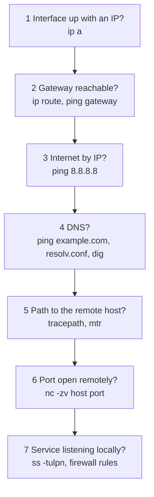
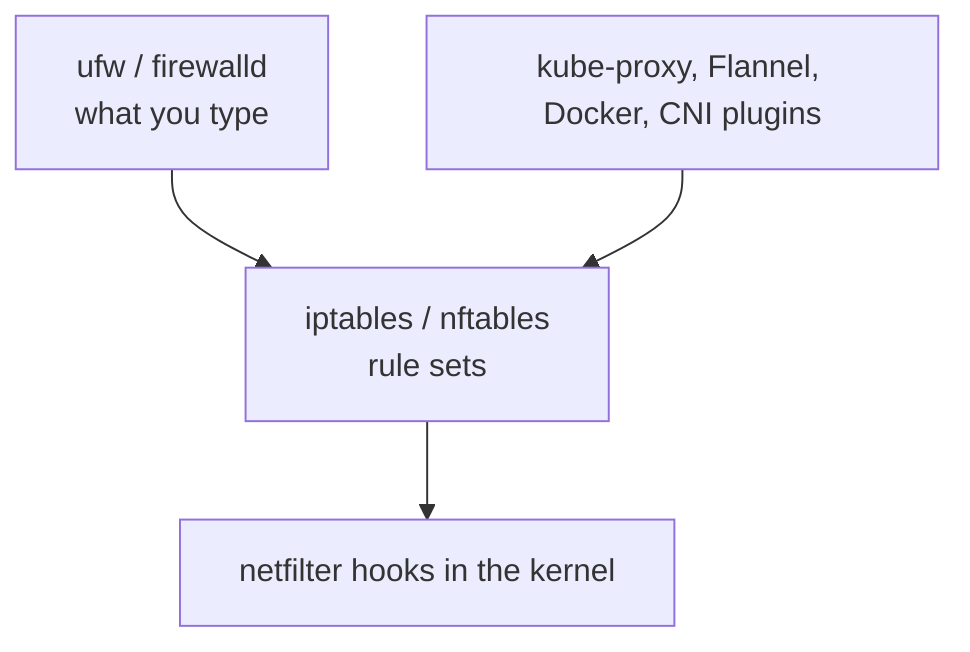
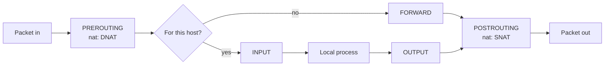

# Linux networking, firewalls and server hardening

!!! abstract "Where it's used in this project"
    The OpenStack VMs needed IP forwarding, `br_netfilter` and open ports between nodes before Kubernetes would work ([Kubernetes on VMs](kubernetes-on-vms.md)); kube-proxy turns every Service into iptables rules ([cluster networking](kubernetes-cluster-networking.md)); and the bastion-only SSH setup reaches private workers with `ProxyJump`. For TCP, DNS and TLS themselves see [networking fundamentals](networking.md). Overview: [Linux fundamentals](linux-fundamentals.md).

## Key ideas

### Addresses, ports and routes

| Concept | Meaning |
|---|---|
| **IP address** | A machine's address on a network: IPv4 `10.0.0.5` (32 bits), IPv6 `fe80::1` (128 bits) |
| **Port** | Which service on that machine: the IP is the building, the port the apartment |
| **Interface** | A network device with its own addresses: `eth0`/`ens3`, `lo`, `docker0`, `cni0`, `flannel.1`, `veth...` |
| **Loopback** | `lo`, `127.0.0.1`: traffic that never leaves the machine |
| **Subnet (CIDR)** | `10.0.0.0/24`: the first 24 bits are the network, so 256 addresses. `/16` = 65,536. |
| **Route** | Where to send packets for a destination. The **default gateway** gets everything else. |

| Port | Service |
|---|---|
| 22 | SSH |
| 53 | DNS (UDP and TCP) |
| 80 / 443 | HTTP / HTTPS |
| 5432 | PostgreSQL |
| 6443 | Kubernetes API server |
| 10250 | kubelet API |
| 8472/udp | Flannel VXLAN |
| 30000–32767 | Kubernetes NodePorts |

```bash
ip a                  # interfaces and addresses (ip addr show eth0)
ip route              # routing table: "default via 10.0.0.1 dev eth0"
ip route get 8.8.8.8  # which route and source IP a packet would use
ip -br link           # one line per interface, up/down
cat /etc/resolv.conf  # which DNS server this machine asks
```

`ip addr` output: `state UP` means the link is up, `link/ether` is the MAC, `inet 10.0.0.5/24` the IPv4 address with prefix. `ifconfig`, `route` and `netstat` are the old tools; `ip` and `ss` replace them.

### Who is listening: bind addresses

```bash
sudo ss -tulpn        # -t TCP, -u UDP, -l listening, -p process, -n numeric
```

```text
tcp LISTEN 0.0.0.0:22         users:(("sshd",pid=512))
tcp LISTEN 127.0.0.1:5432     users:(("postgres",pid=901))
tcp LISTEN [::]:80            users:(("nginx",pid=820))
```

The **local address** is the most important column:

| Bound to | Reachable from |
|---|---|
| `127.0.0.1:5432` | This machine only |
| `0.0.0.0:5432` / `[::]:5432` | Every interface, so anyone who can route to it |
| `10.0.0.5:5432` | Only via that interface's address |

A database on `0.0.0.0` on a public VM is a critical misconfiguration (fix `listen_addresses` in `postgresql.conf`). The reverse bites in containers: an app inside a container **must** bind `0.0.0.0`, because `127.0.0.1` inside the Pod's network namespace is unreachable from the Service, the kubelet's probes, or anyone else.

```bash
ss -tnp state established     # current connections
nc -zv 10.0.0.5 5432          # can I open a TCP connection? (open / refused / timeout)
curl -v http://10.0.0.5:8080/health
```

### Connectivity troubleshooting, bottom up



Read the failure mode:

| Symptom | Usually means |
|---|---|
| `Connection refused` (fast) | Host reachable, nothing listening on that port (or a `REJECT` rule) |
| Timeout (slow) | A firewall/security group is **dropping** packets, or no route |
| `No route to host` | Routing problem, or an ICMP-rejecting firewall |
| Works by IP, not by name | DNS |
| `ping` fails but HTTP works | ICMP is blocked; ping isn't proof of anything |

### Netfilter, iptables and nftables

The kernel's packet filter is **netfilter**. `iptables` and its successor `nftables` are the tools that load rules into it; `ufw` and `firewalld` are friendlier front-ends that generate those rules.



Rules live in **chains** inside **tables**:

| Table | Purpose | Chains used most |
|---|---|---|
| `filter` (default) | Allow or block | `INPUT` (to this host), `FORWARD` (routed through it, like Pod traffic), `OUTPUT` (from it) |
| `nat` | Rewrite addresses | `PREROUTING` (DNAT, e.g. ClusterIP → Pod IP), `POSTROUTING` (SNAT/masquerade) |



Rules are checked **top to bottom**, the first match decides, and the chain's **policy** applies if nothing matches. Targets: `ACCEPT`, `DROP` (silently discard, the client sees a timeout), `REJECT` (discard and reply, the client sees "refused").

```bash
sudo iptables -L -n -v --line-numbers          # filter table, with counters
sudo iptables -t nat -L -n -v                  # NAT table (kube-proxy, Docker)
sudo iptables -A INPUT -p tcp --dport 443 -j ACCEPT
sudo iptables -I INPUT 1 -s 203.0.113.45 -j DROP   # -I inserts at the top
sudo iptables -D INPUT -p tcp --dport 8080 -j DROP
sudo iptables-save > rules.v4                  # dump everything; netfilter-persistent saves across reboots
sudo nft list ruleset                          # nftables view
```

A safe default-deny inbound policy, in this order:

```bash
sudo iptables -A INPUT -i lo -j ACCEPT
sudo iptables -A INPUT -m conntrack --ctstate ESTABLISHED,RELATED -j ACCEPT   # replies to our own traffic
sudo iptables -A INPUT -p tcp --dport 22 -j ACCEPT                            # SSH BEFORE the drop policy
sudo iptables -A INPUT -p tcp -m multiport --dports 80,443 -j ACCEPT
sudo iptables -P INPUT DROP
```

Setting `-P INPUT DROP` (or `ufw enable`) before allowing SSH locks you out of a remote server. Keep a second session open, or have console access, when changing firewalls remotely.

**Why Kubernetes nodes need sysctls:** a node forwards Pod traffic (`net.ipv4.ip_forward=1`), and bridged Pod traffic has to pass through iptables so kube-proxy's rules apply (`br_netfilter` module + `net.bridge.bridge-nf-call-iptables=1`). On a Kubernetes node, `iptables -t nat -L KUBE-SERVICES` shows every Service.

### ufw and firewalld

```bash
sudo ufw allow OpenSSH        # always first
sudo ufw allow 80,443/tcp
sudo ufw allow from 10.0.0.0/24 to any port 6443 proto tcp    # API server, only from the node subnet
sudo ufw deny from 203.0.113.45
sudo ufw enable
sudo ufw status numbered; sudo ufw delete 3
```

`firewalld` (RHEL family) groups rules into **zones** per interface; `--permanent` plus `--reload` persists them:

```bash
sudo firewall-cmd --add-service=https --permanent && sudo firewall-cmd --reload
sudo firewall-cmd --list-all
```

On a cloud VM there are usually **two firewalls**: the provider's security group outside the VM and the host firewall inside it. A port has to be open in both. Host firewalls on Kubernetes nodes can also fight with the rules kube-proxy and the CNI write, so many clusters rely on security groups and NetworkPolicy instead.

### SSH

```bash
ssh-keygen -t ed25519 -C "me@laptop"
ssh-copy-id ubuntu@10.0.0.5
ssh -J ubuntu@bastion ubuntu@10.0.1.12          # ProxyJump through a bastion
ssh -L 6443:10.0.1.10:6443 ubuntu@bastion       # local port-forward to a private API server
ssh -v ubuntu@host                              # debug key and auth problems
```

```text
# ~/.ssh/config
Host k8s-worker-*
    User ubuntu
    ProxyJump ubuntu@<bastion-floating-ip>
    IdentityFile ~/.ssh/id_ed25519
```

### Hardening a new server

Defence in depth: each layer assumes the one above it might fail.

```text
# /etc/ssh/sshd_config  (test with sshd -t, keep the old session open, then systemctl restart ssh)
PasswordAuthentication no
KbdInteractiveAuthentication no
PermitRootLogin no
AllowUsers ubuntu deploy
```

1. `apt update && apt upgrade`, then enable `unattended-upgrades` for security patches.
2. Create a non-root user with sudo; log in with keys only.
3. Harden SSH as above.
4. Firewall: allow SSH first, then only the ports you serve; default-deny inbound.
5. `fail2ban`: watches `auth.log` and temporarily bans IPs after repeated failures (`fail2ban-client status sshd`).
6. Run services as dedicated users ([users and permissions](linux-users-permissions.md)), and bind databases to `127.0.0.1` or a private interface.
7. Audit with `sudo ss -tulpn`: nothing listening that you didn't expect.
8. Watch: `last`, `who`, `grep "Failed password" /var/log/auth.log`, `journalctl -u ssh`.

Moving SSH off port 22 cuts log noise from scanners but isn't security on its own.

## What I learned building it

- **Timeout vs refused tells you where to look.** A timeout between nodes points at a security group or firewall dropping packets; "refused" means the host answered but the component isn't listening (yet).
- **Kubernetes networking is Linux networking.** `cni0`, `veth` pairs, `flannel.1`, routes and the `KUBE-SERVICES` NAT chain are all visible with `ip` and `iptables` on a node.
- **Two firewalls, one port.** NodePorts and the VXLAN port had to be opened in the OpenStack security group; nothing inside the VM was blocking them.
- **`0.0.0.0` vs `127.0.0.1` cuts both ways.** On a VM, databases should stay on loopback. In a container, apps must listen on `0.0.0.0` or probes and Services can't reach them.
- **A bastion plus `ProxyJump` keeps workers private.** Only the control plane had a floating IP; Ansible reached the workers through it.

## Review questions

??? question "`ss -tulpn` shows PostgreSQL on `0.0.0.0:5432`. Why is that a problem, and how do you fix it?"
    It accepts connections on every interface, including public ones. Set `listen_addresses = 'localhost'` (or a private IP) and restart, and block the port in the firewall as a second layer.

??? question "A connection attempt fails instantly with 'connection refused' in one case and times out in another. What does each tell you?"
    Refused: the host answered, but nothing listens on that port (or a REJECT rule). Timeout: packets are being dropped, usually by a firewall or security group, or there's no route.

??? question "What's the relationship between netfilter, iptables, nftables and ufw?"
    Netfilter is the kernel's packet-filtering framework. iptables and nftables load rules into it. ufw and firewalld are front-ends that generate iptables/nftables rules.

??? question "Why does order matter in an iptables chain, and what happens if no rule matches?"
    Rules are evaluated top to bottom and the first match decides. If none matches, the chain's default policy (ACCEPT or DROP) applies.

??? question "Which netfilter table and chain does kube-proxy use to send ClusterIP traffic to a Pod?"
    The `nat` table: it DNATs in `PREROUTING` (for traffic arriving from Pods or outside) and `OUTPUT` (for traffic from the node itself), through its `KUBE-SERVICES` chains.

??? question "Why must an app inside a container listen on `0.0.0.0` rather than `127.0.0.1`?"
    The container has its own network namespace. `127.0.0.1` there is reachable only from inside the Pod, so Services, probes from the kubelet and other Pods can't connect.

??? question "What's the safe order for enabling a firewall on a remote server?"
    Allow SSH (and established traffic) first, then set the default deny or enable ufw, while keeping an existing session open to recover.
