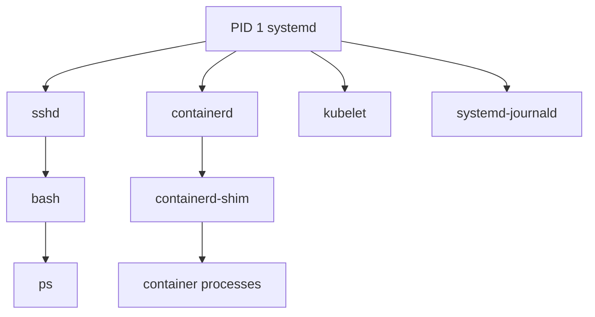

# Linux processes, services and packages

!!! abstract "Where it's used in this project"
    containerd and the kubelet are systemd services on every node, installed with `apt` by the Ansible roles; the Go API shuts down cleanly on `SIGTERM` ([`platform/cmd/server/main.go`](https://github.com/foyez/dbaas-platform/blob/main/platform/cmd/server/main.go)); and container memory limits are enforced by the kernel's cgroups and OOM killer. Overview: [Linux fundamentals](linux-fundamentals.md).

## Key ideas

### Processes

A **process** is a running program: its own memory, open files, and an identity.

| Attribute | Meaning |
|---|---|
| PID | Process ID |
| PPID | Parent's PID: who started it |
| UID / GID | Who it runs as; decides what it may access |
| State | What it's doing right now |
| Nice value | Scheduling priority |
| cgroup | Resource limits it lives under |

New processes are made by **fork** (copy the parent) then **exec** (replace the copy with a new program). So everything forms a tree under **PID 1**, which is `systemd` on most distros:



| State | Code | Meaning |
|---|---|---|
| Running | `R` | On a CPU or ready to run |
| Sleeping | `S` | Waiting for an event; most processes, most of the time |
| Disk sleep | `D` | Uninterruptible wait on I/O. Many `D` processes = storage trouble. Can't be killed until the I/O returns. |
| Stopped | `T` | Paused (`Ctrl+Z`, `SIGSTOP`) |
| Zombie | `Z` | Exited, but the parent hasn't read its exit status yet |

**Zombies and orphans.** When a process exits, it stays a zombie until its parent calls `wait()`. If the parent dies first, the orphan is re-parented to PID 1, which reaps it. Inside a container, *your app* is PID 1, so it must reap children and handle signals, or you get zombies and ignored `SIGTERM`s. That's why tiny init processes like `tini` exist.

### Looking at processes

```bash
ps aux                         # snapshot of every process
ps auxf                        # as a tree
ps -eo pid,ppid,user,ni,stat,%cpu,%mem,cmd --sort=-%cpu | head
pgrep -a nginx                 # PIDs and command lines by name
top                            # live view: P sort by CPU, M by memory, 1 per-CPU, k kill
htop                           # friendlier, if installed
```

`ps aux` columns: `USER PID %CPU %MEM VSZ RSS TTY STAT START TIME COMMAND`. **RSS** is resident memory actually in RAM; **VSZ** is virtual size and is usually much larger and harmless. **TIME** is total CPU time consumed, not wall-clock.

The `top` header tells you about the whole machine:

| Field | Read it as |
|---|---|
| `load average: 0.12, 0.08, 0.05` | Runnable (plus `D`-state) tasks averaged over 1, 5, 15 min. Compare with `nproc`: load above the core count means work is queueing. |
| `us`, `sy` | CPU in user code vs kernel |
| `wa` | CPU idle waiting on disk. High means an I/O bottleneck. |
| `id` | Idle |
| `st` | Stolen by the hypervisor: a noisy neighbour on a VM |
| `buff/cache` | File cache. Linux uses free RAM for it and gives it back on demand; that's healthy, not a leak. |

### Signals

Killing a process means sending it a **signal**:

| Signal | No. | Meaning | Can be caught? |
|---|---|---|---|
| `SIGTERM` | 15 | Please shut down cleanly (the default for `kill`) | Yes |
| `SIGKILL` | 9 | Stop now, the kernel removes it | **No** |
| `SIGINT` | 2 | Interrupt (`Ctrl+C`) | Yes |
| `SIGHUP` | 1 | Terminal hung up; by convention daemons reload config | Yes |
| `SIGSTOP` / `SIGCONT` | 19 / 18 | Pause / resume | No / yes |

```bash
kill 820                # SIGTERM
kill -9 820             # SIGKILL, only if SIGTERM didn't work
kill -HUP $(pgrep -o nginx)   # reload nginx config
pkill -f payment-api    # by command line
```

**Always `SIGTERM` first.** It gives the program a chance to finish in-flight requests, flush buffers and close database connections. `SIGKILL` skips all of that.

**This is exactly how Kubernetes stops a Pod:** the kubelet sends `SIGTERM` to PID 1 in each container, waits `terminationGracePeriodSeconds` (default 30), then sends `SIGKILL`. The Go API listens for it:

```go
ctx, stop := signal.NotifyContext(context.Background(), os.Interrupt, syscall.SIGTERM)
defer stop()
// ... on <-ctx.Done(): server.Shutdown(...) lets in-flight requests finish
```

If an image starts the app through `sh -c "..."`, the shell is PID 1 and may not forward the signal, so the app gets killed after 30 seconds. Use the exec form (`ENTRYPOINT ["/server"]`).

### Priority: nice

The **nice** value runs from −20 (most CPU) to +19 (least); the default is 0. Being "nice" means yielding to others. Only root may lower it.

```bash
nice -n 15 ./backup.sh          # start a low-priority job
sudo renice -n 5 -p 3421        # change a running process
ionice -c3 ./backup.sh          # idle I/O priority, for disk-heavy jobs
```

### Resources: memory, disk, CPU

```bash
free -h            # look at "available", not "free"
df -h              # filesystem usage;  df -i for inodes
du -sh /var/* 2>/dev/null | sort -rh | head     # what's big
uptime; nproc; lscpu; uname -r
```

- **Disk full:** `df -h` to find the filesystem, `du` to drill down, usually to logs. `truncate -s 0 big.log` empties a log without breaking the writer's open file handle. Deleting it doesn't free space until the process closes it (`lsof +L1` shows deleted-but-open files). The lasting fix is log rotation.
- **Out of inodes:** `df -h` shows space free but writes fail; millions of tiny files. Check `df -i`.
- **Swap:** heavy swap use means memory is exhausted. Kubernetes nodes traditionally run with swap off so memory limits behave predictably, which is why the Ansible role runs `swapoff -a`.

### Containers are just processes

A container is a normal process on the host, with two kernel features applied:

| Feature | What it does | You see it as |
|---|---|---|
| **Namespaces** | Limit what a process can *see*: its own PID tree (`pid`), network stack (`net`), mounts (`mnt`), hostname (`uts`), IPC, users | The app is PID 1 with its own IP and filesystem |
| **cgroups** | Limit what it can *use*: CPU, memory, I/O, number of processes | Pod `resources.limits` |

```bash
ps aux | grep postgres                 # on a node: container processes are right there
sudo lsns                              # list namespaces and which processes use them
cat /sys/fs/cgroup/kubepods.slice/.../memory.max    # the limit the kubelet set
```

When a cgroup hits its memory limit, the kernel's **OOM killer** kills a process in it, which Kubernetes reports as `OOMKilled` (exit code 137 = 128 + signal 9). A CPU limit only *throttles*. See [worker nodes](kubernetes-nodes.md) and [workloads](kubernetes-workloads.md#scheduling).

### systemd and services

**systemd** is PID 1. It boots the system and supervises **services** (daemons) described by **unit files**:

```ini
# /etc/systemd/system/myapp.service
[Unit]
Description=Payment API
After=network-online.target
Wants=network-online.target

[Service]
User=myapp
EnvironmentFile=/etc/myapp/env
ExecStart=/usr/local/bin/myapp
Restart=on-failure
RestartSec=5

[Install]
WantedBy=multi-user.target
```

```bash
sudo systemctl daemon-reload            # after creating or editing a unit file
sudo systemctl enable --now myapp       # enable = start at boot; --now = also start now
systemctl status myapp                  # state, main PID, cgroup, last log lines
sudo systemctl restart myapp            # stop + start
sudo systemctl reload nginx             # ask the service to re-read config (often SIGHUP)
systemctl list-units --type=service --state=failed
systemctl cat kubelet                   # show the unit file and drop-ins actually used
journalctl -u myapp -f                  # its logs
```

| Concept | Meaning |
|---|---|
| **start vs enable** | `start` runs it now; `enable` makes it start at boot. You usually want both. |
| `Restart=` | systemd's own self-healing: `on-failure`, `always` |
| `After=` / `Wants=` / `Requires=` | Ordering vs dependency. `After` only orders; `Wants`/`Requires` pull the other unit in. |
| Drop-ins | `/etc/systemd/system/<unit>.d/*.conf` override parts of a vendor unit without editing it. kubeadm configures the kubelet this way. |
| Unit locations | Vendor units in `/lib/systemd/system`, yours in `/etc/systemd/system` (which wins) |

In the Very Hard Way course every Kubernetes component, from etcd to the API server to CoreDNS, ran as a systemd unit like the one above. systemd's restart loop and the kubelet's container restart are the same idea at two levels.

### Packages

A package manager downloads software with its dependencies from trusted repositories and keeps track of what's installed.

```bash
sudo apt update                  # refresh the package INDEX only
sudo apt upgrade -y              # install newer versions of what's installed
sudo apt install -y htop curl
sudo apt remove nginx            # keep config;  purge also removes config
sudo apt autoremove              # drop no-longer-needed dependencies
apt show nginx; apt search "web server"; apt list --installed
dpkg -S /usr/bin/curl            # which package owns this file
sudo apt-mark hold kubelet kubeadm kubectl   # never auto-upgrade these
```

`apt update` vs `apt upgrade`: the first only downloads the list of available versions; the second actually upgrades. Upgrading without updating first works from a stale list.

| Family | Tool | Low-level |
|---|---|---|
| Debian, Ubuntu | `apt` | `dpkg` |
| RHEL, Alma, Rocky, Fedora | `dnf` | `rpm` |
| Alpine | `apk` | |

Third-party repos (Kubernetes, Docker) add a signing key and a source list under `/etc/apt/`. `unattended-upgrades` installs security updates automatically on Ubuntu.

### Scheduled jobs: cron

```text
┌───── minute (0–59)
│ ┌─── hour (0–23)
│ │ ┌─ day of month (1–31)
│ │ │ ┌ month (1–12)
│ │ │ │ ┌ day of week (0–7, 0 and 7 = Sunday)
* * * * * command
0 2 * * *      daily at 02:00
*/15 * * * *   every 15 minutes
0 3 * * 0      Sundays at 03:00
```

```bash
crontab -e; crontab -l           # per-user jobs
ls /etc/cron.d/ /etc/cron.daily/ # system jobs
grep CRON /var/log/syslog        # did it run?
```

cron runs with a minimal environment (no `.bashrc`, short `PATH`), so use absolute paths and redirect output to a log. systemd **timers** are the modern alternative, with logs in the journal. A Kubernetes **CronJob** uses the same schedule syntax.

## What I learned building it

- **Graceful shutdown is a Linux contract.** Kubernetes only sends signals; whether a rollout drops requests depends on the app handling `SIGTERM`, which is why the API wires up `signal.NotifyContext` before anything else.
- **`OOMKilled` and exit code 137 are the kernel, not Kubernetes.** The cgroup limit was hit and the OOM killer chose a process; `dmesg` on the node shows the same event.
- **Everything on a node is systemd.** Debugging a node meant `systemctl status containerd kubelet` and `journalctl -u kubelet` long before any `kubectl` command.
- **Pin Kubernetes packages.** `apt-mark hold` stops a routine `apt upgrade` from bumping the kubelet past the control plane's version.
- **`buff/cache` looks scary and isn't.** Judge memory by "available" and by swap activity.

## Review questions

??? question "What's the difference between `SIGTERM` and `SIGKILL`, and which does Kubernetes send?"
    `SIGTERM` asks the process to exit and can be handled for cleanup; `SIGKILL` can't be caught and ends it immediately. Kubernetes sends `SIGTERM`, waits the grace period (30 s by default), then `SIGKILL`.

??? question "Why might an app in a container ignore `SIGTERM`?"
    It isn't PID 1 (a shell wrapper is, and doesn't forward signals), or it is PID 1 and never installed a handler: the kernel doesn't apply default signal actions to PID 1 in a namespace.

??? question "A 4-core machine shows load average 9. What does that mean?"
    On average about 9 tasks want CPU (or are blocked in disk I/O) while only 4 can run. Work is queueing; check `%wa` to tell CPU saturation from I/O wait.

??? question "`df -h` says the disk is full; you delete a 10 GB log but space doesn't come back. Why?"
    A process still has the file open, so the kernel keeps the data until it's closed. Restart or signal the process, or truncate files instead of deleting them. `lsof +L1` finds them.

??? question "What's the difference between `systemctl enable` and `systemctl start`?"
    `start` runs the service now; `enable` creates the links that start it at boot. `enable --now` does both.

??? question "What two kernel features make a container, and which one enforces memory limits?"
    Namespaces (what it can see) and cgroups (what it can use). cgroups enforce limits; exceeding the memory limit triggers the OOM killer.

??? question "What does exit code 137 mean?"
    128 + 9: the process was killed by `SIGKILL`, typically by the OOM killer or after a grace period ran out.
