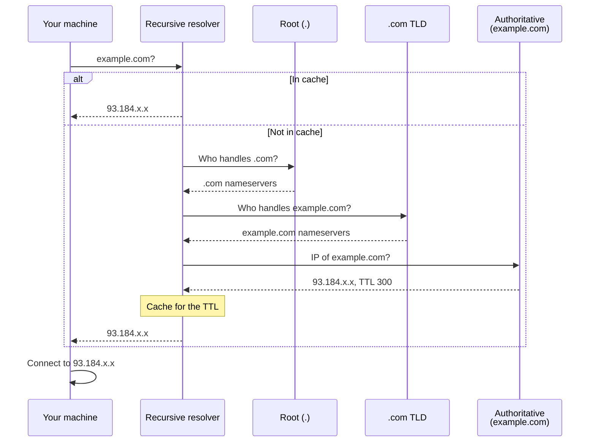
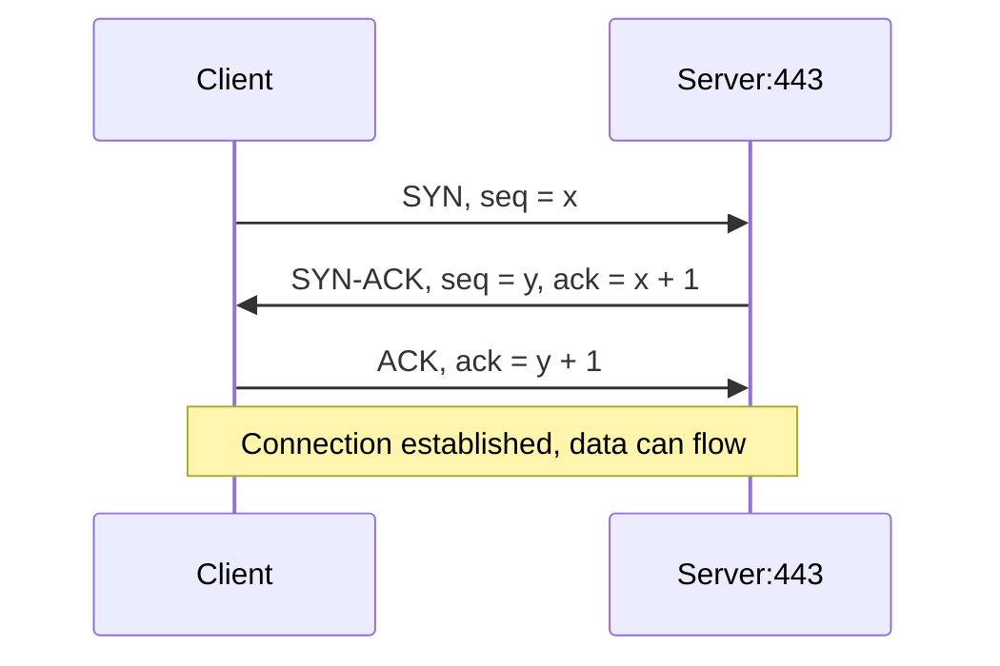
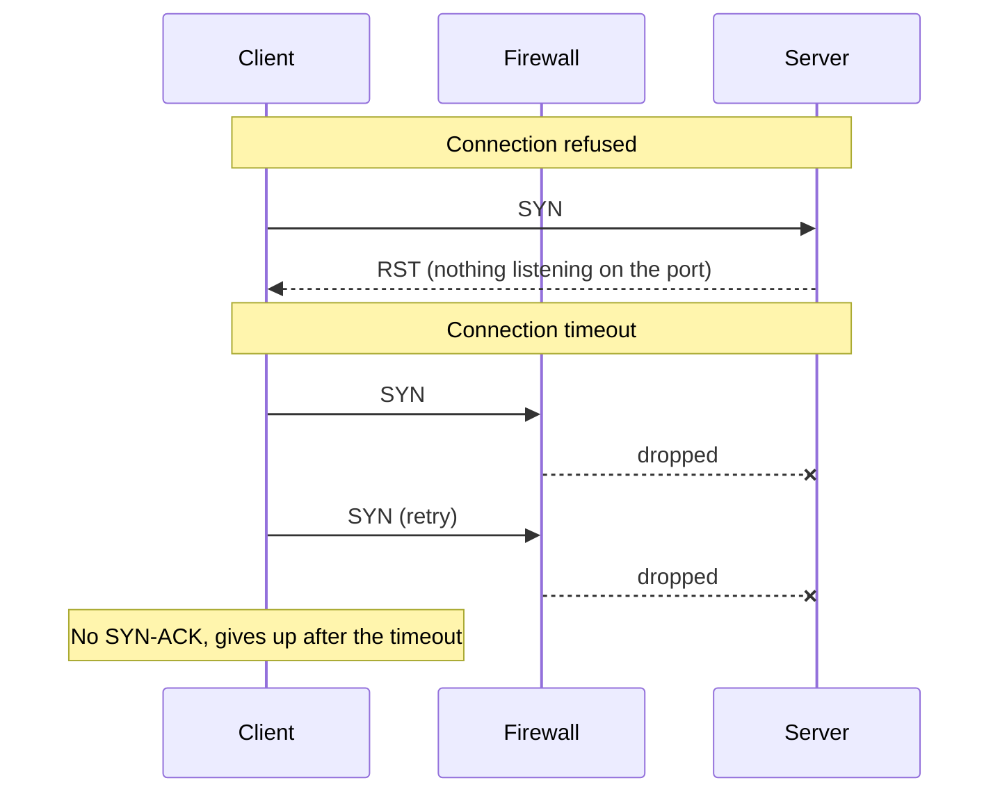
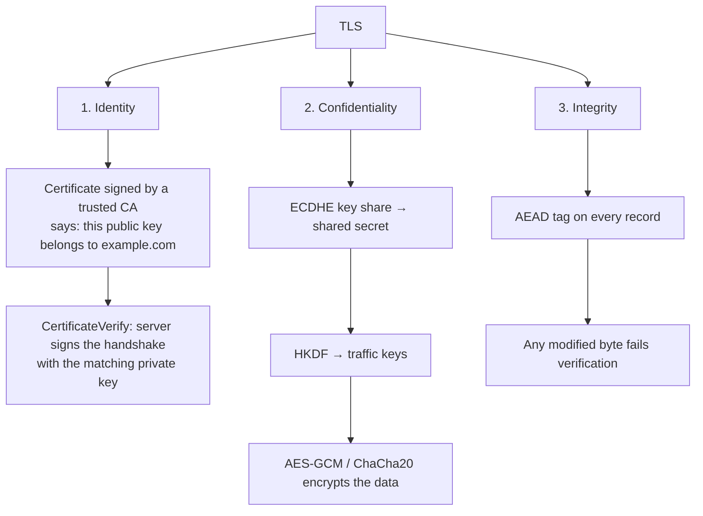
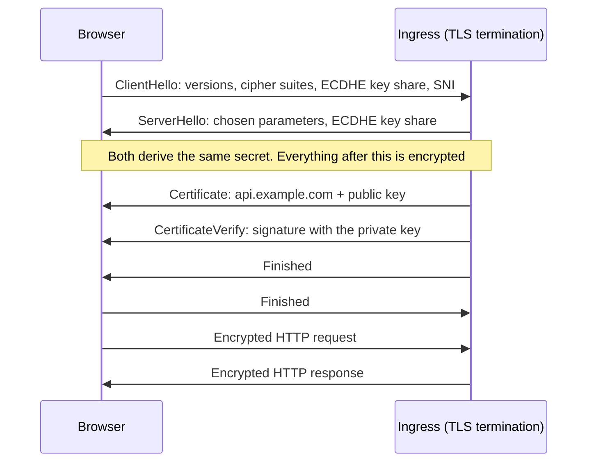

# Networking fundamentals: TCP, DNS, TLS

!!! abstract "Where it's used in this project"
    Every request in the platform crosses DNS, TCP and TLS: browsers to the UI and API, the API to ZITADEL, and database clients to PostgreSQL through the [shared TCP passthrough](../design-decisions/shared-loadbalancer.md).

## Key ideas

### DNS

A name is resolved by asking a chain of servers for more and more specific answers: the **recursive resolver** (usually your ISP's, or CoreDNS inside a cluster) asks a root server, then the TLD server (`.cloud`), then the domain's **authoritative** server, which owns the actual records. Resolvers cache answers for the record's TTL.

| Error | Means |
|---|---|
| `NXDOMAIN` | The name definitely doesn't exist |
| `SERVFAIL` | The resolver couldn't complete the lookup (upstream problem, DNSSEC failure) |
| Timeout | Nobody answered |

Inside Kubernetes the same thing happens through CoreDNS: `dbaas-svc.dbaas-api.svc.cluster.local` resolves to the Service's virtual IP.

### TCP

A connection starts with the three-way handshake: `SYN` → `SYN-ACK` → `ACK`. Sequence and acknowledgement numbers then let both sides detect loss and reorder data.

The two failures look different and mean different things:

| Symptom | What happened | Usual cause |
|---|---|---|
| **Connection refused** (immediate) | The host answered with `RST` | Nothing listening on that port |
| **Connection timeout** (slow) | No answer at all | A firewall or security group drops packets, or the host is down |

### TLS 1.3

TLS gives three separate guarantees, each from a different mechanism:

| Guarantee | Comes from |
|---|---|
| **Identity**: you're talking to the real `api.example.com` | The certificate, signed by a CA the client trusts, plus proof the server holds the private key |
| **Confidentiality**: nobody can read the traffic | ECDHE key agreement → shared secret → traffic keys → symmetric encryption (AES-GCM) |
| **Integrity**: nobody can change the traffic | The AEAD authentication tag on every record |

The TLS 1.3 handshake, as it happens at the Ingress:

The certificate's private key **doesn't encrypt your data**. It proves identity by signing the handshake. The encryption keys come from the ECDHE exchange and are never sent over the wire.

**SNI** (Server Name Indication) is the hostname the client sends in the first handshake message, so one IP can serve certificates for many domains.

### Latency and timeouts

**Latency** is how long something takes; report it as percentiles (p50, p95, p99), not averages, because averages hide the slow tail. A **timeout** is how long you're willing to wait. Every network call needs one, or a slow dependency ties up your resources indefinitely.

## What I learned building it

- **Refused vs timeout tells you where to look.** Refused: the packet reached the host, so check the process and port. Timeout: something in the path dropped it, so check firewalls and security groups.
- **DNS failures can masquerade as other problems.** The two-node cluster's `NXDOMAIN` errors were really a blocked Flannel VXLAN port (see [Kubernetes on VMs](kubernetes-on-vms.md)).
- **PostgreSQL can't be routed by hostname through a TCP proxy.** A PostgreSQL client sends a plaintext `SSLRequest` before starting TLS, so the proxy never sees a TLS ClientHello with SNI to route on. That's why each instance gets its own port.
- **`*.localhost` is special in browsers.** Chrome and Firefox resolve it to loopback without DNS and treat it as a secure context, which is why the local setup can run OIDC with PKCE over plain HTTP. Inside the cluster, a CoreDNS rewrite points the same names at ingress-nginx.

## Review questions

??? question "`curl` returns 'connection refused' immediately vs hangs and times out. What does each tell you?"
    Refused: the host is reachable and actively rejected the connection, usually because nothing is listening on that port. Timeout: packets are being dropped somewhere, by a firewall or security group, or the host is down.

??? question "What does the certificate's private key actually do in TLS 1.3?"
    It signs the handshake (CertificateVerify) to prove the server owns the certificate. It doesn't encrypt application data; those keys come from the ECDHE exchange.

??? question "Why can't this platform route PostgreSQL connections by hostname?"
    Routing by hostname at a TCP proxy needs SNI from a TLS ClientHello. PostgreSQL clients (before version 17's direct TLS negotiation) first send a plaintext `SSLRequest`, so the proxy has nothing to route on.

??? question "Why report p95 latency instead of the average?"
    The average hides the slow tail that real users experience. p95 means 95 % of requests were at or below that value.

??? question "`NXDOMAIN` vs `SERVFAIL`?"
    `NXDOMAIN` is a definitive answer that the name doesn't exist. `SERVFAIL` means the resolver failed to get an answer, a problem in the resolution path rather than with the name.
