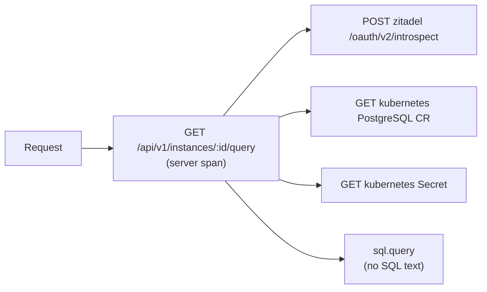

# Observability

!!! abstract "Where it's used in this project"
    Prometheus, Grafana, Loki, Tempo and Alloy in [`gitops/observability`](https://github.com/foyez/dbaas-platform/tree/main/gitops/observability), installed by `make dev` too. The API's metrics, tracing and audit code is in [`platform/internal/observability`](https://github.com/foyez/dbaas-platform/tree/main/platform/internal/observability). See [Observability](../components/observability.md).

## Key ideas

### Signals

| Signal | Answers | Here |
|---|---|---|
| **Metrics** | How much, how fast, how often? Numbers over time | Prometheus |
| **Logs** | What exactly happened? Timestamped records | Loki |
| **Traces** | Where did this request spend its time, and in which call? | Tempo, via OpenTelemetry |
| **Events** | Something happened at a point in time | Kubernetes events, audit events |

### Prometheus

Prometheus **pulls** (scrapes) `/metrics` from targets on an interval and stores time series: a metric name plus labels, with timestamped samples.

| Type | Behaviour | Example |
|---|---|---|
| Counter | Only goes up (resets on restart) | `requests_total` |
| Gauge | Goes up and down | memory in use, queue length |
| Histogram | Counts observations in buckets | request duration; gives percentiles |
| Summary | Client-side quantiles | rarely the right choice |

Counters are read with `rate()` (per second) or `increase()` (over a window), never raw. Percentiles come from histograms: `histogram_quantile(0.95, sum by (le) (rate(..._bucket[5m])))`.

**Cardinality** is the number of unique label combinations. Each one is a separate time series, so a label like `user_id` or a raw URL path can create millions and overload Prometheus. Labels must have small, bounded value sets.

### Loki and Alloy

Loki stores logs indexed **only by labels** (namespace, pod, app); the log content isn't indexed and is filtered at query time with LogQL. That keeps it cheap, but the same cardinality rule applies to labels. Grafana Alloy runs on every node, tails container logs and ships them to Loki with labels attached.

Structured JSON logs make LogQL filtering possible without making every field a label: `{namespace="dbaas-api"} | json | component="audit"`.

### Tracing with OpenTelemetry

A **trace** is the tree of work done for one request. Each node is a **span**: a named, timed operation with attributes and a status, such as "GET /api/v1/instances/:id" or "sql.query". Spans share a **trace ID**, and each child points at its parent's span ID.

- **Context propagation.** Within a process the active span travels in Go's `context.Context`, so every call that receives `ctx` can start a child span. Across processes it travels in the W3C `traceparent` header, so a downstream service continues the same trace.
- **Instrumentation.** Middleware creates the server span for each request (`otelgin`); wrapped HTTP transports create client spans for outgoing calls (`otelhttp`); for anything else you start spans yourself.
- **Export.** The SDK batches finished spans and sends them over **OTLP** to a collector, here Grafana Alloy, which forwards them to Tempo. A collector keeps that plumbing out of the app: retries, batching and changing backends without a redeploy.
- **Sampling** decides which traces to keep. "Parent-based" keeps a trace if the caller's did, so a trace is never half-recorded.

**Correlation** is what makes three signals more than three tools: putting the `trace_id` in every log line lets you jump from a log to its trace and back.

### SLI, SLO, SLA

- **SLI**: what you measure, e.g. the fraction of requests that succeed in under 500 ms.
- **SLO**: the target for it, e.g. 99.5 % over 30 days. The gap to 100 % is the error budget.
- **SLA**: a contract with consequences if the SLO is missed.

## How this project uses it

- **API metrics** are labelled by method, **route template** (`c.FullPath()`, e.g. `/api/v1/instances/:id`) and status, never by raw path or user.
- **Request logs** are structured JSON, one line per request, with `trace_id` and `span_id`. Health checks and scrapes are logged only at debug level.
- **Traces** cover each request, its Kubernetes API calls, ZITADEL introspection, Loki queries and SQL console statements. They go over OTLP to Alloy, then Tempo.
- **Metrics come from three places:** the API (requests, latencies, SQL console outcomes), the operator (reconciles and errors) and every PostgreSQL instance (CNPG's exporter).
- **Audit events** are log lines with `component=audit`, filtered at query time rather than made a Loki label, and read back by the admin audit endpoint. See [design decision 7](../design-decisions/audit-in-loki.md).
- **Instance logs** shown in the UI come from Loki by instance label.
- Retention is 7 days for Prometheus and Loki, and 3 days for Tempo.

## What I learned building it

- **Use the route template as a label, not the URL.** `/instances/instance-3f36…` would create a new series per instance; `/instances/:id` stays bounded.
- **Don't scrape yourself into noise.** The metrics middleware skips `/metrics`, and health checks shouldn't be logged at INFO.
- **Logs-as-audit has limits.** It reused the existing stack, but retention equals log retention and nothing is tamper-evident; a compliance-grade audit trail needs append-only storage.
- **Keep user data out of telemetry.** SQL console spans and logs record the instance, row count and SQLSTATE, never the SQL text or PostgreSQL's message, which can contain values from the user's tables. Off-the-shelf database instrumentation records the statement by default.
- **Correlation needs consistent formats.** The audit and trace-to-log queries parse JSON (`| json`), but the API logged plain text outside production, so locally they silently returned nothing. The log format is now JSON everywhere it runs in a cluster.
- **Libraries log too.** Without `slog.SetDefault`, the auth middleware's warnings bypassed the structured logger and arrived as unparseable text.
- **Flush on shutdown.** Spans are exported in batches; without a graceful shutdown that calls the tracer provider's `Shutdown`, the last batch is lost every time a pod stops.
- **Check what the manifests actually render.** The Prometheus chart's CRDs weren't included (`includeCRDs` defaults to false), so the stack couldn't install on a fresh cluster.
- **Build it in phases.** Metrics and dashboards for the API first, then platform logs, then user-facing instance logs, then audit, each on top of the last.

## Review questions

??? question "Why is `user_id` a bad Prometheus label?"
    Every distinct value creates a new time series. With many users that's an unbounded number of series, which uses memory and slows queries. Put such detail in logs instead.

??? question "How do you get p95 latency from Prometheus?"
    Record a histogram, then `histogram_quantile(0.95, sum by (le) (rate(http_request_duration_seconds_bucket[5m])))`.

??? question "Why can't you read a counter's raw value to know the request rate?"
    It's cumulative since the process started and resets on restart. `rate()` computes the per-second increase over a window and handles resets.

??? question "What does Loki index, and what doesn't it?"
    It indexes only the label set of each log stream. Log lines themselves are stored compressed and scanned at query time, which is why label filters should narrow the search first.

??? question "SLO vs SLA?"
    An SLO is an internal reliability target. An SLA is an external commitment, usually looser than the SLO, with penalties if it's broken.

??? question "How does a span created deep in the SQL code end up in the same trace as the HTTP request?"
    The request's server span is stored in the request's `context.Context`. That context is passed down through the handler and service to the query code, which starts its span from it, so the new span gets the same trace ID and the server span as its parent.

??? question "Why send traces to Alloy instead of straight to Tempo?"
    The collector handles batching, retries and routing in one place. Apps only need to know one OTLP endpoint, and the backend can change without redeploying them.

??? question "What does `trace_id` in log lines give you?"
    A link between signals: from a slow or failing request in the logs you open its trace to see which call took the time, and from a span you find the exact log lines written during it.

??? question "Why doesn't the SQL console span include the SQL statement?"
    Statements and PostgreSQL's error messages can contain values from the user's data. Traces are stored and viewed by operators, so they get the instance, row count and SQLSTATE only.
