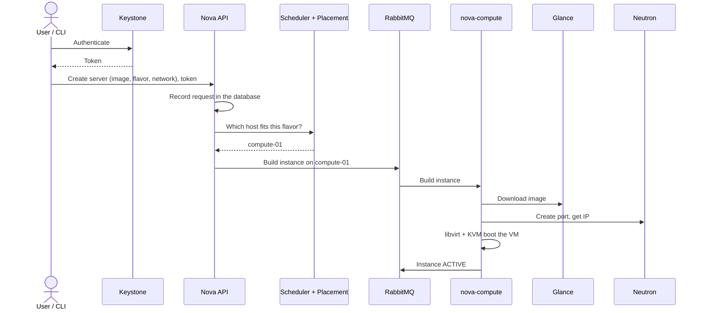

# OpenStack (IaaS)

!!! abstract "Where it's used in this project"
    The first layer of the project: a single-node OpenStack cloud (DevStack) that the early Kubernetes clusters ran on. Code: [`infra/openstack`](https://github.com/foyez/dbaas-platform/tree/main/infra/openstack). See [Infrastructure](../components/infrastructure.md).

## Key ideas

**IaaS** gives you virtual machines, networks and disks through an API, instead of physical hardware. OpenStack is open-source software that turns a set of servers into that kind of cloud, the self-hosted equivalent of EC2/VPC/EBS.

A deployment has three roles, which DevStack puts on one machine:

| Node | Job |
|---|---|
| Controller | APIs, authentication, scheduling, the database and the message queue |
| Compute | Runs the VMs through a hypervisor (KVM) |
| Network | Virtual networks, routing, NAT, floating IPs |

The core services, and their AWS equivalents:

| Service | Does | AWS |
|---|---|---|
| Keystone | Identity: users, projects, tokens, service catalogue | IAM |
| Nova | Compute: VM lifecycle | EC2 |
| Neutron | Networking: networks, subnets, routers, security groups | VPC |
| Glance | VM images | AMI |
| Cinder | Persistent block volumes | EBS |
| Swift | Object storage | S3 |
| Placement | Tracks free CPU, RAM and disk per host | — |
| Horizon | Web dashboard | Console |

**How a VM gets created:** Keystone authenticates the request → Nova API stores it in the database → the scheduler (using Placement) picks a compute node → the command travels over **RabbitMQ** to `nova-compute` → the hypervisor boots the image from Glance, and Neutron plugs it into the network. Services talk to users over REST APIs and to each other over the message queue.

Modern Neutron uses **OVN** (Open Virtual Network) instead of the older per-node agents for L2/L3 networking.

## What I learned building it

- **Networking is built from the outside in, and torn down in reverse.** Network → subnet → router → router interface → external gateway → VM → floating IP. Neutron rejects deleting anything that something else still references, so teardown has to go VM → volume → router interface → router → subnet → network.
- **A router isn't usable until you attach it.** Creating it isn't enough; it needs an interface on the private subnet (to be the gateway) and a gateway on the external network (for SNAT). Without the second, `apt update` inside the VM just hangs.
- **Security groups deny inbound traffic by default.** SSH, ping and HTTP all need explicit rules. A purpose-named group documents intent better than editing `default`.
- **"Reachable" and "working" are different checks.** `ping` only proves the network path. `cloud-init status` and `journalctl` inside the VM prove the guest actually booted properly.
- **Root disks are ephemeral; Cinder volumes aren't.** Database data belongs on a volume, which can be detached from a broken VM and attached to a new one. A new volume still needs `mkfs` and `mount` before you can write to it.
- **Volume snapshots copy data; instance snapshots create a bootable image.** The second is how you turn one hand-configured VM into a template for many.
- **DevStack passwords must be alphanumeric**, and DevStack must run as a non-root user with sudo.

## Review questions

??? question "What does Placement do that Nova's scheduler can't do alone?"
    Placement keeps an inventory of resources (vCPU, RAM, disk) per compute host and what's already allocated. The scheduler asks Placement which hosts can fit the request, then picks one of them.

??? question "Why do OpenStack services use RabbitMQ between themselves instead of only REST?"
    Work like booting a VM is asynchronous and long-running. The API service puts a message on the queue and returns immediately; `nova-compute` on the chosen host picks it up when it can. That decouples services and lets them scale and fail independently.

??? question "A VM has a private IP but you can't SSH to it from your laptop. What do you check, in order?"
    Floating IP assigned → router has a gateway on the external network → router has an interface on the VM's subnet → security group allows TCP 22 → your key pair was injected (cloud images have no password login). Then check inside the VM that cloud-init finished.

??? question "Cinder vs Swift?"
    Cinder is block storage: a disk attached to one VM, formatted with a filesystem, good for databases. Swift is object storage: files stored and fetched over HTTP by key, good for images, backups and static assets.
