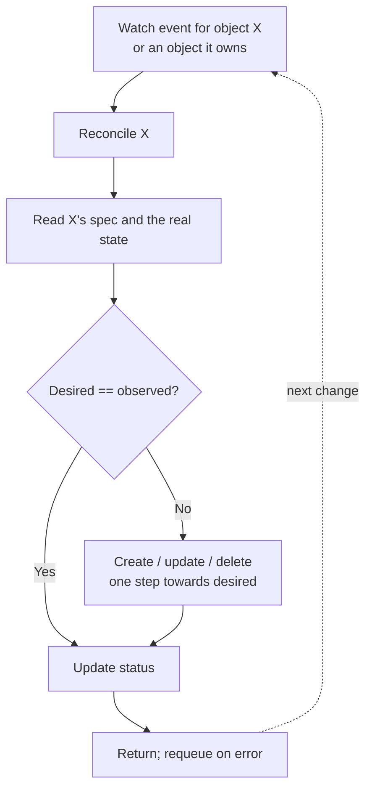
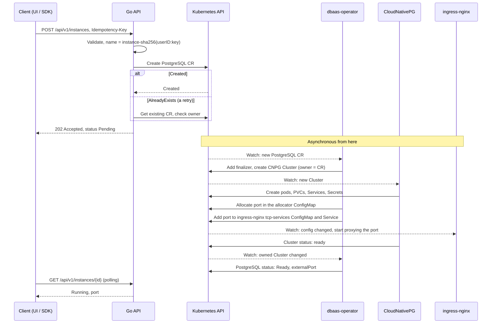

# Custom resources and operators

!!! abstract "Where it's used in this project"
    The platform's core: the `PostgreSQL` CRD and the operator that reconciles it into a CloudNativePG cluster with an external port. Code: [`operator/`](https://github.com/foyez/dbaas-platform/tree/main/operator). See [Operator](../components/operator.md).

## Key ideas

A **CustomResourceDefinition (CRD)** teaches the API server a new kind, with an OpenAPI schema for validation. A **custom resource** is an instance of that kind. On its own it's just stored data; an **operator** is the controller that makes it mean something.

**Operator = CRD + controller + operational knowledge.** It's worth building one when the work continues after install: reacting to failures, upgrades, scaling, cleanup. If everything fits into "what gets installed", a Helm chart is cheaper. Many systems use both: Helm installs the operator, and the operator manages instances.

Every custom resource has:

- `spec`: what the user wants, written by the user
- `status`: what's actually happening, written only by the controller, through the `/status` subresource so the two never overwrite each other
- `metadata`: name, labels, owner references, finalizers

**The reconcile loop** is level-triggered: it gets "something about object X changed", not what changed. It reads the current spec and the real world, makes one pass towards the desired state, writes status, and returns. Every step has to be **idempotent**, because reconcile runs again and again.

**Kubebuilder** scaffolds the project. You write Go types with markers (`+kubebuilder:validation:Minimum=1`, `+kubebuilder:subresource:status`, `+kubebuilder:printcolumn`) and `make manifests` generates the CRD YAML and RBAC from them. `make generate` writes the DeepCopy code.

## How this project's operator is built

What happens when a user creates a database, end to end:

- **A narrow spec over CNPG.** Users set `version`, `instances`, `storage`, `database` and `username`. The operator builds the CNPG `Cluster`, so CNPG's large API never leaks to the API or UI. See [design decision 2](../design-decisions/own-crd-over-cnpg.md).
- **Owner references give cascade delete for free.** The CNPG `Cluster` has the `PostgreSQL` CR as its controller owner, so deleting the CR garbage-collects the cluster, its pods and its PVCs.
- **Watches instead of polling.** `Owns(&cnpgv1.Cluster{})` re-runs reconcile for the parent CR whenever CNPG updates the cluster, such as after a failover. The first version polled with `RequeueAfter: 15s`.
- **A normalised phase.** `Pending → Creating → Ready`, plus `Failed` and `Deleting`, derived from CNPG's status, so clients don't need to understand CNPG.

## What I learned building it

- **Owner references only clean up what's inside the cluster.** The first version needed no finalizer. Once the operator started allocating ports and editing ingress-nginx's ConfigMap and Service, objects it doesn't own, it needed a `tcp-expose` finalizer to release them before the CR disappears.
- **Keep `Reconcile` an orchestrator.** Building CNPG objects lives in `cnpg.go` and port handling in `tcpexpose.go`, so the main loop reads as a list of steps.
- **Shared state needs optimistic locking.** The port allocator is a ConfigMap. Two reconciles can race for the same port, so updates rely on `resourceVersion` conflicts and retry.
- **Version-match your dependencies.** The operator compiles against a CNPG API version, which has to match the CNPG installed in the cluster.
- **A PgBouncer StatefulSet was a good exercise but the wrong product choice.** Managing StatefulSet, PVC and Service directly taught the mechanics. CNPG's own `Pooler` is the better fit, so that code is disabled.
- **A CR is configuration, not a database.** Store desired state in CRs, not application or monitoring data.

## Review questions

??? question "Why must reconcile be idempotent?"
    It's called many times for the same object: on every change, on watches of owned objects, on resyncs and after errors. Each run must converge on the same result instead of, say, creating a second cluster.

??? question "When do you need a finalizer, and when are owner references enough?"
    Owner references let the garbage collector delete dependent objects in the same cluster. A finalizer is needed when cleanup involves something the garbage collector can't reach: external systems, or objects you don't own, like ingress-nginx's ConfigMap entries here.

??? question "Why write status through the `/status` subresource?"
    Users write `spec`, the controller writes `status`. With the subresource, updating one can't overwrite a concurrent change to the other, and RBAC can grant them separately.

??? question "What does `Owns(&cnpgv1.Cluster{})` do?"
    It adds a watch on CNPG Clusters. When one changes, controller-runtime follows its controller owner reference and enqueues the parent `PostgreSQL` for reconcile.

??? question "Operator or Helm chart for a new internal tool?"
    Helm if the work ends at install and upgrade. An operator if something has to react continuously to runtime events, such as failover, backups or external resources that need cleanup.
