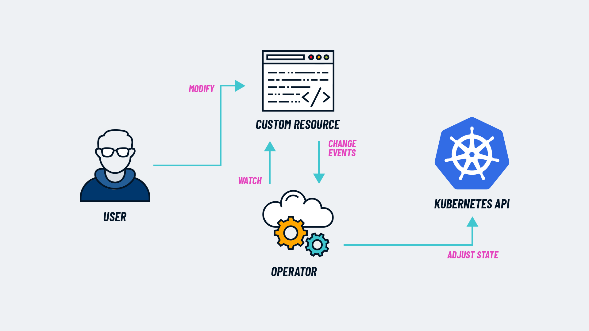
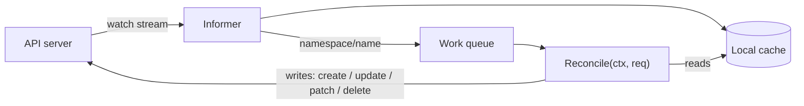
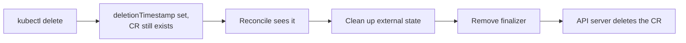
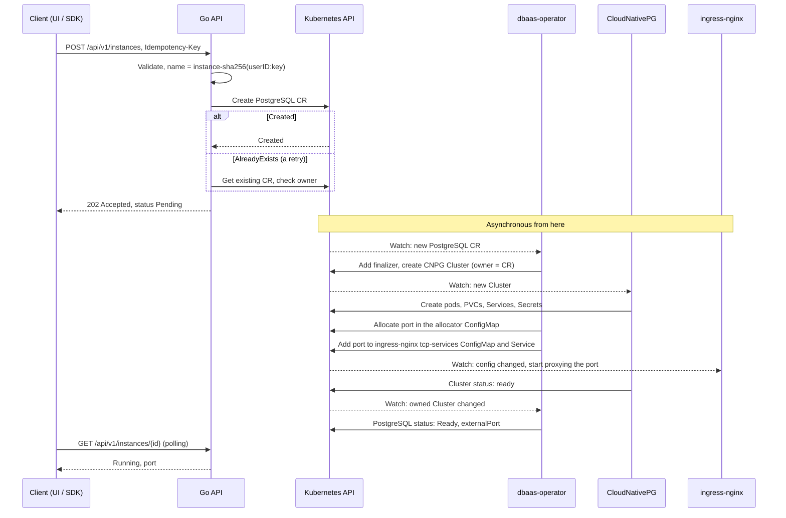

# Custom resources and operators

!!! abstract "Where it's used in this project"
    The platform's core: the `PostgreSQL` CRD and the operator that reconciles it into a CloudNativePG cluster with an external port. Code: [`operator/`](https://github.com/foyez/dbaas-platform/tree/main/operator). See [Operator](../components/operator.md).

## Key ideas

### CRD, CR and operator

Three pieces, each useless without the others:

| Piece | What it is | Analogy |
|---|---|---|
| **CustomResourceDefinition (CRD)** | Teaches the API server a new kind, with an OpenAPI schema for validation. Installed once per cluster. | A table definition |
| **Custom resource (CR)** | One object of that kind, stored in etcd like any other resource. On its own it's just data. | A row in the table |
| **Operator** | The controller that watches CRs and makes the real world match them. | The code that acts on the rows |

Once the CRD is installed, `kubectl get postgresqls` works like `kubectl get pods`, and a CR looks like any other manifest:

```yaml
apiVersion: database.example.com/v1
kind: PostgreSQL
metadata:
  name: customer-db
spec:                  # desired state, written by the user
  version: "16"
  instances: 3
  storage: 1Gi
  database: customer
  username: customer-admin
status:                # observed state, written by the operator
  phase: Ready
  readyInstances: 3
  externalPort: 30001
```

Every custom resource has:

- `spec`: what the user wants, written by the user
- `status`: what's actually happening, written only by the controller, through the `/status` subresource so the two never overwrite each other
- `metadata`: name, labels, owner references, finalizers

**Operator = CRD + controller + operational knowledge.** It's worth building one when the work continues after install: reacting to failures, upgrades, scaling, backups, cleanup. If everything fits into "what gets installed", a Helm chart is cheaper. Many systems use both: Helm installs the operator, and the operator manages instances.

### How they work together



<small>Image: [CNCF](https://www.cncf.io/wp-content/uploads/2022/07/k8s-operator.webp)</small>

1. **Modify:** the user (or the Go API here) creates or edits a CR.
2. **Watch / change events:** the operator has a watch open on that kind, so the API server pushes it the change.
3. **Adjust state:** the operator creates, updates or deletes ordinary resources (here a CNPG `Cluster`, ConfigMaps, a Service) through the Kubernetes API, then writes the result into the CR's `status`.

Note that the operator never talks to etcd, kubelets or other controllers directly. Everything goes through the API server.

### An operator is just a pod

Built-in controllers (Deployment, ReplicaSet, Job) run inside `kube-controller-manager` on the control plane. An operator is **not part of Kubernetes**: it's an ordinary Deployment, usually on a worker node, and it reaches the cluster only through the API server, like `kubectl` does. If it crashes, its Deployment restarts it and it picks up where it left off, because all state lives in the CRs.

| | Built-in controller | Operator |
|---|---|---|
| Ships with | Kubernetes | You, or a vendor |
| Runs in | Control plane | A Pod in the cluster |
| Manages | Built-in kinds (Deployment → ReplicaSet → Pods) | Custom kinds (PostgreSQL → CNPG Cluster → Pods) |
| Knows about | Generic workloads | One application: backups, failover, upgrades |
| Examples | Deployment, StatefulSet, Job controllers | CloudNativePG, cert-manager, Prometheus Operator, this project's `dbaas-operator` |

Being a normal client, it needs an identity and permissions: a **ServiceAccount** (who am I), a **ClusterRole** (what may I do: `get`, `list`, `watch`, `create`, `update`, `patch`, `delete` on which kinds, including `postgresqls/status`) and a **ClusterRoleBinding** joining them. Without the right rule the API server answers `403 Forbidden`. See [Kubernetes security](kubernetes-security.md#serviceaccounts-and-rbac).

When running several replicas for availability, **leader election** (a Lease object) makes sure only one of them reconciles at a time; this project's manager runs with `--leader-elect`.

### The reconcile loop

`Reconcile()` is the one function you write. Each call follows the same steps:

1. Read the CR (desired state). If it's gone, return.
2. Read what actually exists (current state).
3. Compare, and create / update / delete whatever is needed to move one step closer.
4. Write `status`.
5. Return: done, requeue after an error (with backoff), or `RequeueAfter` a set time.

It's **level-triggered**: the request only says "look at object X", not what changed. So reconcile always works from the full current state instead of replaying events, and a missed event costs nothing because the next one sees everything.

It's **event-driven, not a busy loop**. The operator sits idle until something happens: a CR is created, updated or deleted; an owned child changes; an earlier attempt failed and is retried; or an optional periodic resync fires. "Control loop" describes the effect over time; each `Reconcile()` call runs once and exits.

Every step has to be **idempotent**, because reconcile runs again and again for the same object. "Create the cluster" must become "create the cluster if it doesn't exist", or the second run makes a second cluster.

### Inside the operator: controller-runtime

[controller-runtime](https://github.com/kubernetes-sigs/controller-runtime) (which Kubebuilder builds on) provides all the plumbing around `Reconcile()`:



- **Informers and the cache.** One watch per kind keeps a local copy of every watched object. `client.Get` and `client.List` read from this cache, so reconciles are fast and don't load the API server. Only writes go to the API server.
- **Work queue.** Events become `namespace/name` keys, not full events. Ten updates to the same object while it waits collapse into one reconcile (deduplication). The queue also handles retries with exponential backoff, rate limiting, and makes sure the same object is never reconciled by two workers at once.
- **Watches on children.** `For(&PostgreSQL{})` watches the CRs themselves. `Owns(&cnpgv1.Cluster{})` watches the children and maps each change back to the owning CR, so a CNPG failover re-runs reconcile for the parent.

Because the cache is updated asynchronously, a read right after your own write can be stale. Idempotent reconciles and `resourceVersion` conflicts handle this: the stale run fails or does nothing, and the next one sees the new state.

### Cleanup: owner references and finalizers

**Owner references** link a child to its parent. When the operator creates the CNPG `Cluster` with the `PostgreSQL` CR as its controller owner, the garbage collector deletes the cluster (and in turn its pods and PVCs) when the CR is deleted. They also let `Owns()` find the parent to reconcile.

**Finalizers** are for cleanup the garbage collector can't do: external systems, or objects the operator edits but doesn't own. A finalizer is a string in `metadata.finalizers`; while any are present, deleting the CR only sets `deletionTimestamp`, and the object stays:



If the operator is down or buggy, the CR hangs in `Terminating` until the finalizer is removed.

### Kubebuilder

**Kubebuilder** scaffolds the project. You write Go types with markers (`+kubebuilder:validation:Minimum=1`, `+kubebuilder:subresource:status`, `+kubebuilder:printcolumn`) and `make manifests` generates the CRD YAML and RBAC from them (`+kubebuilder:rbac` markers on the controller). `make generate` writes the DeepCopy code. It also generates the Deployment, ServiceAccount and role bindings under `config/`.

## How this project's operator is built

What happens when a user creates a database, end to end:



- **A narrow spec over CNPG.** Users set `version`, `instances`, `storage`, `database` and `username`. The operator builds the CNPG `Cluster`, so CNPG's large API never leaks to the API or UI. See [design decision 2](../design-decisions/own-crd-over-cnpg.md).
- **Owner references give cascade delete for free.** The CNPG `Cluster` has the `PostgreSQL` CR as its controller owner, so deleting the CR garbage-collects the cluster, its pods and its PVCs.
- **Watches instead of polling.** `Owns(&cnpgv1.Cluster{})` re-runs reconcile for the parent CR whenever CNPG updates the cluster, such as after a failover. The first version polled with `RequeueAfter: 15s`.
- **A normalised phase.** `Pending → Creating → Ready`, plus `Failed` and `Deleting`, derived from CNPG's status, so clients don't need to understand CNPG.

## What I learned building it

- **Owner references only clean up what's inside the cluster.** The first version needed no finalizer. Once the operator started allocating ports and editing ingress-nginx's ConfigMap and Service, objects it doesn't own, it needed a `tcp-expose` finalizer to release them before the CR disappears.
- **Keep `Reconcile` an orchestrator.** Building CNPG objects lives in `cnpg.go` and port handling in `tcpexpose.go`, so the main loop reads as a list of steps.
- **Shared state needs optimistic locking.** The port allocator is a ConfigMap. Two reconciles can race for the same port, so updates rely on `resourceVersion` conflicts and retry.
- **Version-match your dependencies.** The operator compiles against a CNPG API version, which has to match the CNPG installed in the cluster.
- **A PgBouncer StatefulSet was a good exercise but the wrong product choice.** Managing StatefulSet, PVC and Service directly taught the mechanics. CNPG's own `Pooler` is the better fit, so that code is disabled.
- **A CR is configuration, not a database.** Store desired state in CRs, not application or monitoring data.

## Review questions

??? question "What's the difference between a CRD, a CR and an operator?"
    The CRD defines a new kind and its schema. A CR is one object of that kind, just data in etcd. The operator is the controller that watches CRs and creates or changes real resources to match them.

??? question "Is an operator part of the Kubernetes control plane?"
    No. It runs as an ordinary Deployment and talks to the cluster only through the API server, with a ServiceAccount and RBAC like any other client. If it's down, existing workloads keep running; only changes stop being acted on.

??? question "Does reconcile run in an infinite loop?"
    No. It's event-driven: watch events, owned-object changes, retries and optional resyncs put the object's key on a work queue, and a worker calls `Reconcile()` once. It runs and exits; the "loop" is the repetition over time.

??? question "Why does reconcile read from a cache instead of the API server?"
    Speed and API server load: informers keep a local copy of watched objects, so reads are free. The trade-off is that the cache can lag behind your own writes, which is one more reason reconcile must be idempotent.

??? question "Why must reconcile be idempotent?"
    It's called many times for the same object: on every change, on watches of owned objects, on resyncs and after errors. Each run must converge on the same result instead of, say, creating a second cluster.

??? question "When do you need a finalizer, and when are owner references enough?"
    Owner references let the garbage collector delete dependent objects in the same cluster. A finalizer is needed when cleanup involves something the garbage collector can't reach: external systems, or objects you don't own, like ingress-nginx's ConfigMap entries here.

??? question "Why write status through the `/status` subresource?"
    Users write `spec`, the controller writes `status`. With the subresource, updating one can't overwrite a concurrent change to the other, and RBAC can grant them separately.

??? question "What does `Owns(&cnpgv1.Cluster{})` do?"
    It adds a watch on CNPG Clusters. When one changes, controller-runtime follows its controller owner reference and enqueues the parent `PostgreSQL` for reconcile.

??? question "Operator or Helm chart for a new internal tool?"
    Helm if the work ends at install and upgrade. An operator if something has to react continuously to runtime events, such as failover, backups or external resources that need cleanup.
